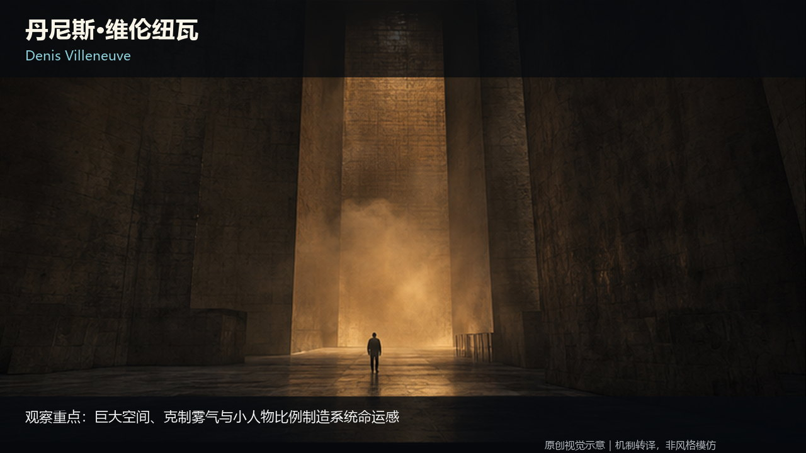
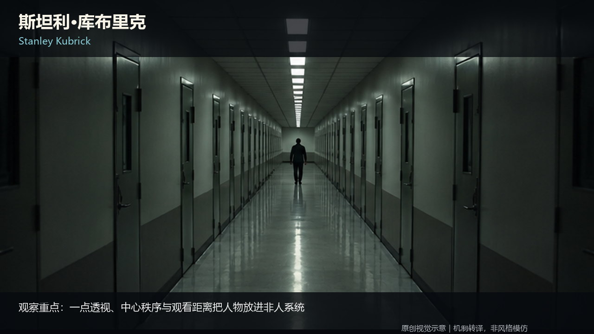
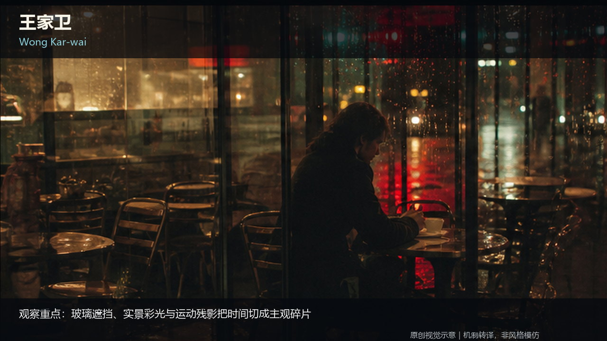
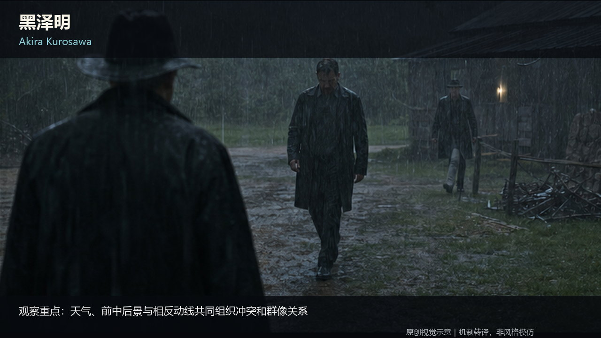
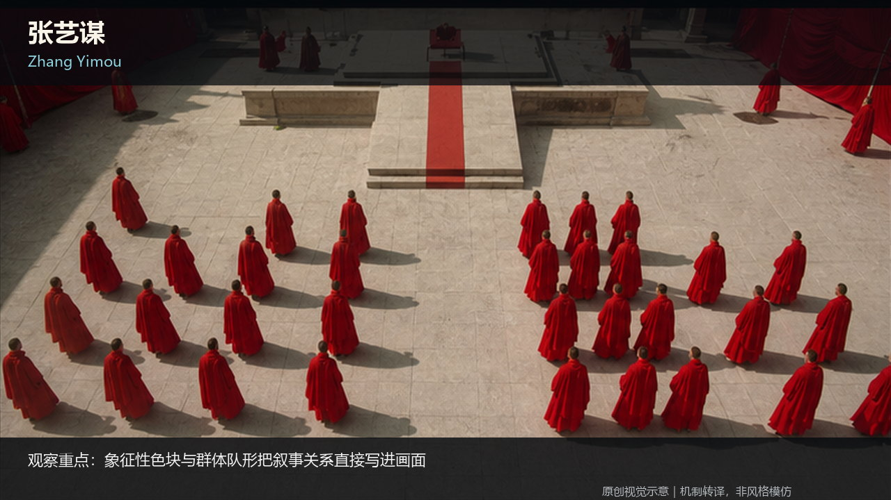
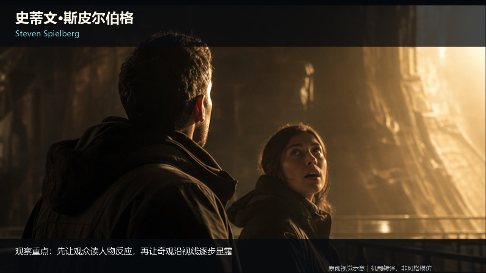
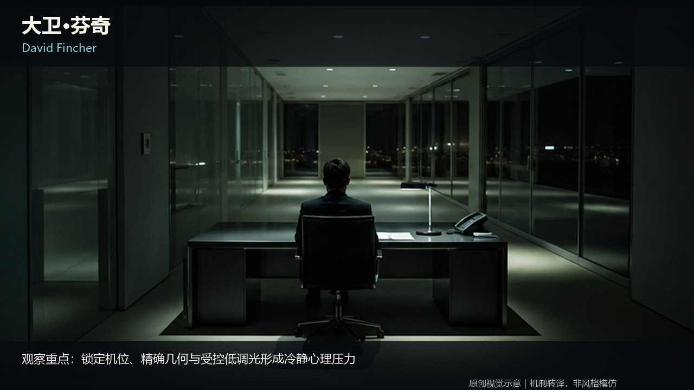
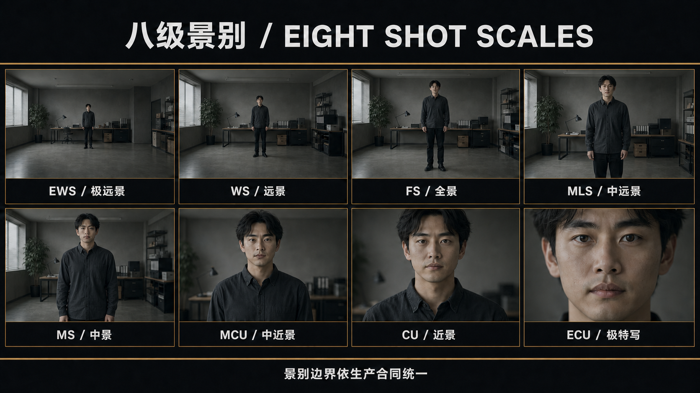
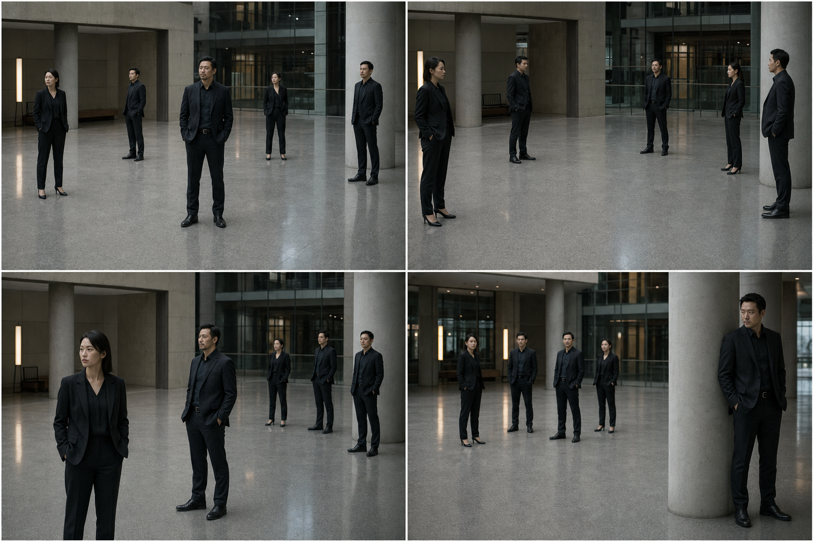
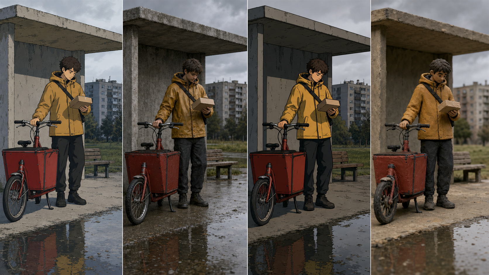

# AI Film Knowledge Base

**A visual knowledge system for directors. See the image. Understand the choice. Make your own.**

[简体中文](docs/i18n/zh-CN/README.md) · [日本語](docs/i18n/ja/README.md) · [한국어](docs/i18n/ko/README.md) · **English**

Cinematography, directing, screenwriting, storyboards, prompts and review—connected through images and practical explanations. Read one note on its own, or follow a creative decision through the whole system.

**105 notes · 696 published source images · 730 in-note image placements · 10 public method diagrams**

[Explore the image gallery](docs/IMAGE_GALLERY.md) · [Browse all notes](CATALOG.md) · [Open the director library](knowledge/A-%E7%90%86%E8%AE%BA%E5%B1%82/A2-%E5%AF%BC%E6%BC%94%E7%BB%84/A2-05%20%E5%AF%BC%E6%BC%94%E4%B8%8E%E6%91%84%E5%BD%B1%E6%8C%87%E5%AF%BC%E9%A3%8E%E6%A0%BC.md)

**Start with this frame.** The figure occupies only a small part of the image; vertical architecture directs attention toward the backlit person. Scale, space and light already carry dramatic pressure. The [director and cinematographer library](knowledge/A-%E7%90%86%E8%AE%BA%E5%B1%82/A2-%E5%AF%BC%E6%BC%94%E7%BB%84/A2-05%20%E5%AF%BC%E6%BC%94%E4%B8%8E%E6%91%84%E5%BD%B1%E6%8C%87%E5%AF%BC%E9%A3%8E%E6%A0%BC.md) connects observations like these to works, collaborators and limits.

## How directors organize an image

These are original illustrations of observable mechanisms, **not frames from the directors’ films**. Names locate a body of work; the usable knowledge is in framing, blocking, light, time and sound.

| **Stanley Kubrick** | **Wong Kar-wai** |
|---|---|
|  |  |
| Geometry becomes pressure: a small figure, repeated lines and a rigid central axis make the space feel more powerful than the person. | Occlusion, reflections and separated positions make an unfinished relationship visible before anyone explains it. |

| **Akira Kurosawa** | **Zhang Yimou** |
|---|---|
|  |  |
| Weather and group direction carry conflict. Read who faces where, which body moves first and how the group responds. | Color, repetition and collective formations turn an individual choice into a visible relationship with a larger order. |

| **Steven Spielberg** | **David Fincher** |
|---|---|
|  |  |
| A reaction and an eyeline prepare the reveal. The spectator discovers an event through a person, rather than receiving everything at once. | Controlled framing and restrained light organize attention, withheld information and the pressure between characters. |

Read the complete note: [21 director/cinematographer profiles and 15 deeper cases](knowledge/A-%E7%90%86%E8%AE%BA%E5%B1%82/A2-%E5%AF%BC%E6%BC%94%E7%BB%84/A2-05%20%E5%AF%BC%E6%BC%94%E4%B8%8E%E6%91%84%E5%BD%B1%E6%8C%87%E5%AF%BC%E9%A3%8E%E6%A0%BC.md).

## Turn an image into a usable decision

### Shot scale: what should the spectator move closer to?

From environment to expression and detail, shot scale changes the information available now. Compare subject size, then read when each scale helps. [Read the illustrated explanation](knowledge/A-%E7%90%86%E8%AE%BA%E5%B1%82/A1-%E6%91%84%E5%BD%B1%E7%BB%84/A1-01%20%E6%99%AF%E5%88%AB%E7%B3%BB%E7%BB%9F.md)。

### Blocking: make a relationship change

Position, orientation and distance form a relationship. Look at who occupies the center, who is separated and how one move changes the group’s balance. [Read the illustrated explanation](knowledge/A-%E7%90%86%E8%AE%BA%E5%B1%82/A2-%E5%AF%BC%E6%BC%94%E7%BB%84/A2-01%20%E8%B0%83%E5%BA%A6%E4%B8%8E%E5%9C%BA%E9%9D%A2%E8%B0%83%E5%BA%A6.md)。

### Visual style: compare the image under shared conditions

Keep the person, pose and basic composition comparable; observe how rendering changes line, volume, surface and light. The atlas turns style labels into visible choices. [Read the illustrated explanation](knowledge/A-%E7%90%86%E8%AE%BA%E5%B1%82/A2-%E5%AF%BC%E6%BC%94%E7%BB%84/A2-07%20%E7%94%B5%E5%BD%B1%E8%A7%86%E8%A7%89%E9%A3%8E%E6%A0%BC%E5%9D%90%E6%A0%87%E7%B3%BB%E4%B8%8E%E6%9C%AF%E8%AF%AD%E6%80%BB%E7%BA%B2.md)。

## Start from your creative question

| Question | Reading route | Notes |
|---|---|---:|
| Why does this image work? | [A · 理论 / Theory](knowledge/A-%E7%90%86%E8%AE%BA%E5%B1%82/) | 51 |
| How do I turn the choice into a shot? | [B · 实战 / Practice](knowledge/B-%E5%AE%9E%E6%88%98%E5%B1%82/) | 43 |
| What should I check in the result? | [C · 审核 / Review](knowledge/C-%E5%AE%A1%E6%A0%B8%E4%B8%8E%E9%AA%8C%E6%94%B6%E5%B1%82/) | 7 |

With 4 overview notes, the corpus contains **105 authored Markdown notes**. No installation is needed: open any note directly on GitHub. Original images are available to view and download; the [image manifest](docs/IMAGE_MANIFEST.json) records files, dimensions, licenses, checksums and reading locations.

## For readers and creative tools

The canonical notes are in Simplified Chinese, with four-language entry pages. Ordinary Markdown works for people and file-reading Agents. Companion [Open Film Skills](https://github.com/62656456/ai-film-skills) provide executable writing, directing and storyboard workflows; individual notes and Skills remain independently usable.

## Publication, license and contribution

All **696 source images** used by the existing public notes are now published, restoring **730 in-note placements**, alongside 10 public method SVGs. This release supersedes the old “622 candidates / 0 uploaded” hold. Teaching illustrations do not prove a film’s actual camera settings or moving-image effects; factual claims retain their source requirements.

Original text and registered original teaching illustrations use [CC BY 4.0](LICENSE). Cited or linked works retain their owners’ rights. See the [publication scope](PUBLICATION_SCOPE.md) and [visual register](docs/VISUAL_ASSETS.md).

[Contributing](CONTRIBUTING.md) · [Issues](https://github.com/62656456/ai-film-knowledge-base/issues) · [Discussions](https://github.com/62656456/ai-film-knowledge-base/discussions) · [haldissita@gmail.com](mailto:haldissita@gmail.com)
