# A1-16 · 1—24

[全部主题](../IMAGE_GALLERY.md) · [首页](../../README.md)

## 类型片×场景色彩系统：逐项原创视觉覆盖（13项）（001-sci-fi-night，原创教学示意）

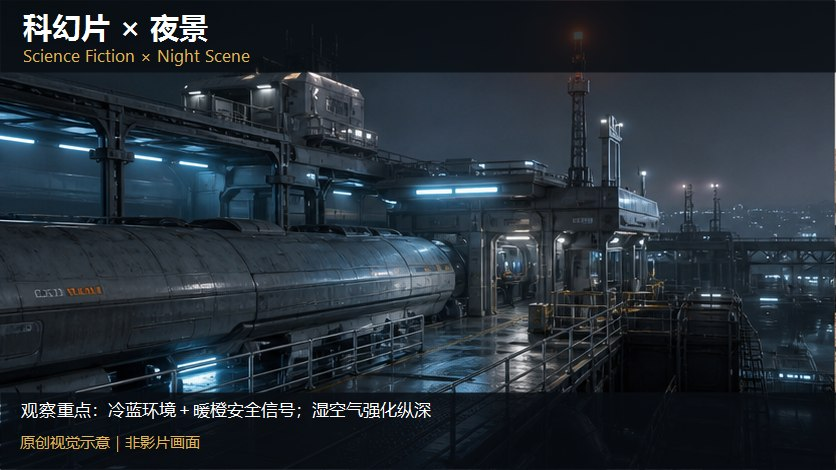

知识讲解：[A1-16 类型片×场景色彩系统](../../knowledge/A-%E7%90%86%E8%AE%BA%E5%B1%82/A1-%E6%91%84%E5%BD%B1%E7%BB%84/A1-16%20%E7%B1%BB%E5%9E%8B%E7%89%87%C3%97%E5%9C%BA%E6%99%AF%E8%89%B2%E5%BD%A9%E7%B3%BB%E7%BB%9F.md)

## 类型片×场景色彩系统：逐项原创视觉覆盖（13项）（002-sci-fi-desert，原创教学示意）

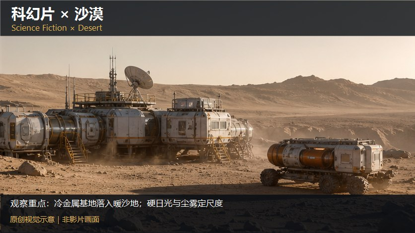

知识讲解：[A1-16 类型片×场景色彩系统](../../knowledge/A-%E7%90%86%E8%AE%BA%E5%B1%82/A1-%E6%91%84%E5%BD%B1%E7%BB%84/A1-16%20%E7%B1%BB%E5%9E%8B%E7%89%87%C3%97%E5%9C%BA%E6%99%AF%E8%89%B2%E5%BD%A9%E7%B3%BB%E7%BB%9F.md)

## 类型片×场景色彩系统：逐项原创视觉覆盖（13项）（003-sci-fi-city，原创教学示意）

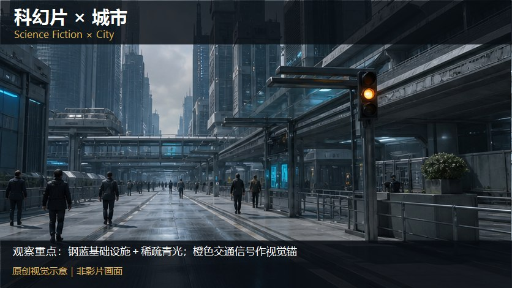

知识讲解：[A1-16 类型片×场景色彩系统](../../knowledge/A-%E7%90%86%E8%AE%BA%E5%B1%82/A1-%E6%91%84%E5%BD%B1%E7%BB%84/A1-16%20%E7%B1%BB%E5%9E%8B%E7%89%87%C3%97%E5%9C%BA%E6%99%AF%E8%89%B2%E5%BD%A9%E7%B3%BB%E7%BB%9F.md)

## 类型片×场景色彩系统：逐项原创视觉覆盖（13项）（004-sci-fi-laboratory，原创教学示意）

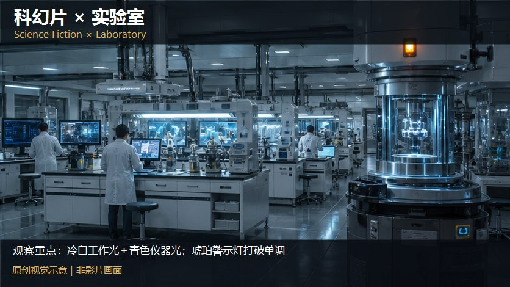

知识讲解：[A1-16 类型片×场景色彩系统](../../knowledge/A-%E7%90%86%E8%AE%BA%E5%B1%82/A1-%E6%91%84%E5%BD%B1%E7%BB%84/A1-16%20%E7%B1%BB%E5%9E%8B%E7%89%87%C3%97%E5%9C%BA%E6%99%AF%E8%89%B2%E5%BD%A9%E7%B3%BB%E7%BB%9F.md)

## 类型片×场景色彩系统：逐项原创视觉覆盖（13项）（005-sci-fi-underground，原创教学示意）

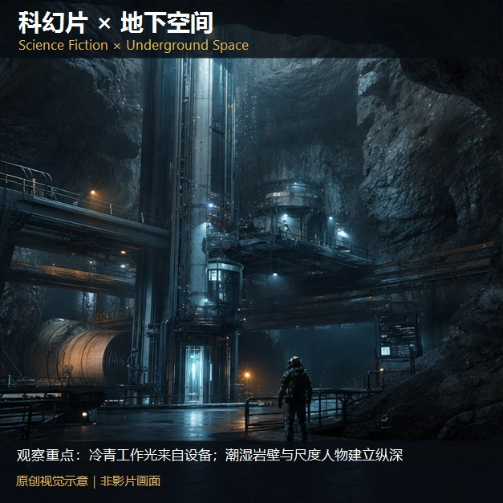

知识讲解：[A1-16 类型片×场景色彩系统](../../knowledge/A-%E7%90%86%E8%AE%BA%E5%B1%82/A1-%E6%91%84%E5%BD%B1%E7%BB%84/A1-16%20%E7%B1%BB%E5%9E%8B%E7%89%87%C3%97%E5%9C%BA%E6%99%AF%E8%89%B2%E5%BD%A9%E7%B3%BB%E7%BB%9F.md)

## 类型片×场景色彩系统：逐项原创视觉覆盖（13项）（006-sci-fi-ruins，原创教学示意）

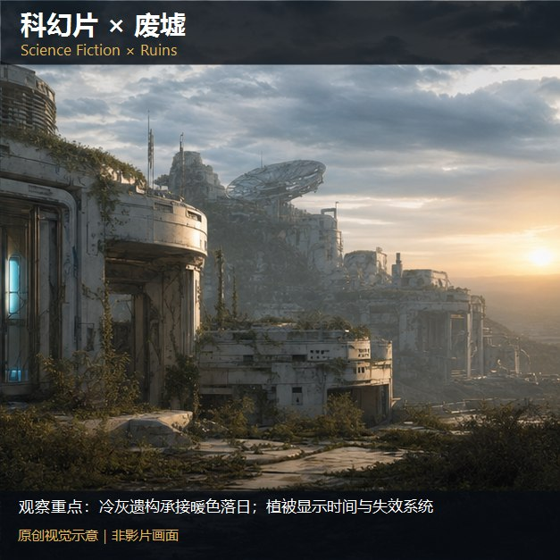

知识讲解：[A1-16 类型片×场景色彩系统](../../knowledge/A-%E7%90%86%E8%AE%BA%E5%B1%82/A1-%E6%91%84%E5%BD%B1%E7%BB%84/A1-16%20%E7%B1%BB%E5%9E%8B%E7%89%87%C3%97%E5%9C%BA%E6%99%AF%E8%89%B2%E5%BD%A9%E7%B3%BB%E7%BB%9F.md)

## 类型片×场景色彩系统：逐项原创视觉覆盖（13项）（007-sci-fi-office，原创教学示意）

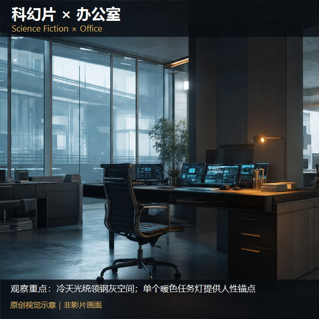

知识讲解：[A1-16 类型片×场景色彩系统](../../knowledge/A-%E7%90%86%E8%AE%BA%E5%B1%82/A1-%E6%91%84%E5%BD%B1%E7%BB%84/A1-16%20%E7%B1%BB%E5%9E%8B%E7%89%87%C3%97%E5%9C%BA%E6%99%AF%E8%89%B2%E5%BD%A9%E7%B3%BB%E7%BB%9F.md)

## 类型片×场景色彩系统：逐项原创视觉覆盖（13项）（008-sci-fi-dream，原创教学示意）

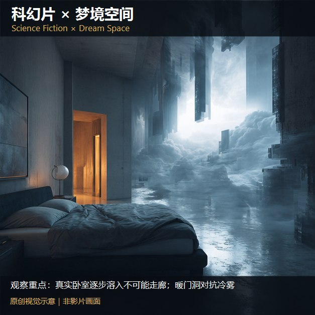

知识讲解：[A1-16 类型片×场景色彩系统](../../knowledge/A-%E7%90%86%E8%AE%BA%E5%B1%82/A1-%E6%91%84%E5%BD%B1%E7%BB%84/A1-16%20%E7%B1%BB%E5%9E%8B%E7%89%87%C3%97%E5%9C%BA%E6%99%AF%E8%89%B2%E5%BD%A9%E7%B3%BB%E7%BB%9F.md)

## 类型片×场景色彩系统：逐项原创视觉覆盖（13项）（009-sci-fi-apocalypse，原创教学示意）

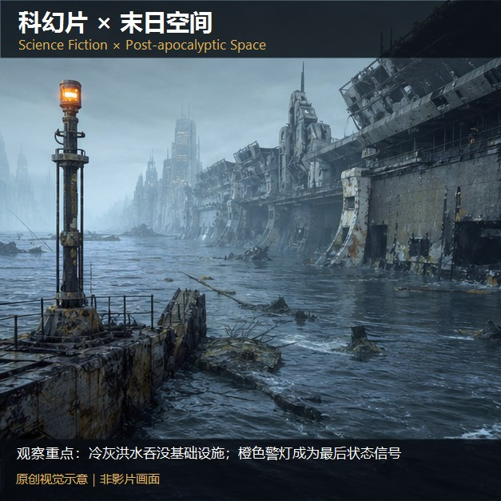

知识讲解：[A1-16 类型片×场景色彩系统](../../knowledge/A-%E7%90%86%E8%AE%BA%E5%B1%82/A1-%E6%91%84%E5%BD%B1%E7%BB%84/A1-16%20%E7%B1%BB%E5%9E%8B%E7%89%87%C3%97%E5%9C%BA%E6%99%AF%E8%89%B2%E5%BD%A9%E7%B3%BB%E7%BB%9F.md)

## 类型片×场景色彩系统：逐项原创视觉覆盖（13项）（010-sci-fi-cyber-city，原创教学示意）

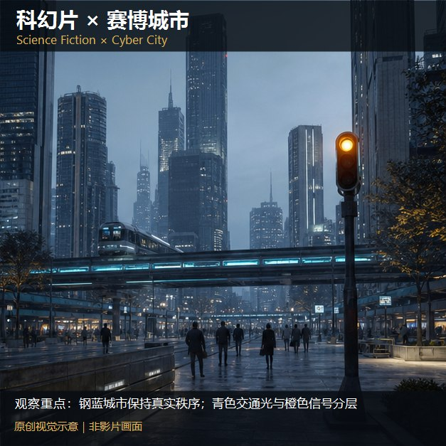

知识讲解：[A1-16 类型片×场景色彩系统](../../knowledge/A-%E7%90%86%E8%AE%BA%E5%B1%82/A1-%E6%91%84%E5%BD%B1%E7%BB%84/A1-16%20%E7%B1%BB%E5%9E%8B%E7%89%87%C3%97%E5%9C%BA%E6%99%AF%E8%89%B2%E5%BD%A9%E7%B3%BB%E7%BB%9F.md)

## 类型片×场景色彩系统：逐项原创视觉覆盖（13项）（011-sci-fi-alien-surface，原创教学示意）

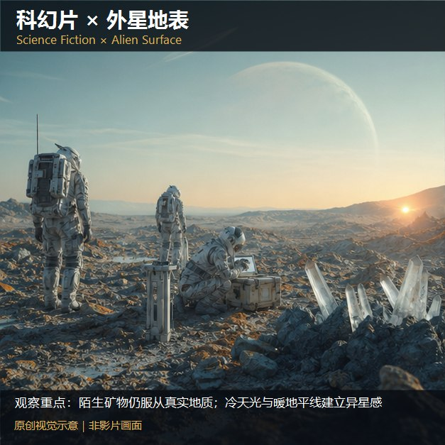

知识讲解：[A1-16 类型片×场景色彩系统](../../knowledge/A-%E7%90%86%E8%AE%BA%E5%B1%82/A1-%E6%91%84%E5%BD%B1%E7%BB%84/A1-16%20%E7%B1%BB%E5%9E%8B%E7%89%87%C3%97%E5%9C%BA%E6%99%AF%E8%89%B2%E5%BD%A9%E7%B3%BB%E7%BB%9F.md)

## 类型片×场景色彩系统：逐项原创视觉覆盖（13项）（078-sci-fi-exterior，原创教学示意）

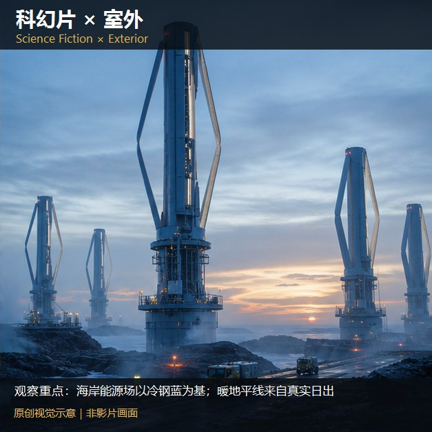

知识讲解：[A1-16 类型片×场景色彩系统](../../knowledge/A-%E7%90%86%E8%AE%BA%E5%B1%82/A1-%E6%91%84%E5%BD%B1%E7%BB%84/A1-16%20%E7%B1%BB%E5%9E%8B%E7%89%87%C3%97%E5%9C%BA%E6%99%AF%E8%89%B2%E5%BD%A9%E7%B3%BB%E7%BB%9F.md)

## 类型片×场景色彩系统：逐项原创视觉覆盖（13项）（079-sci-fi-day，原创教学示意）

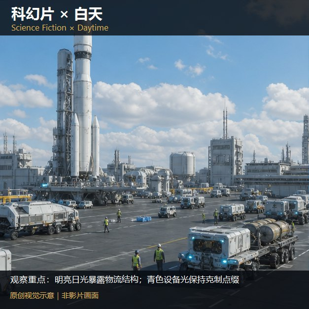

知识讲解：[A1-16 类型片×场景色彩系统](../../knowledge/A-%E7%90%86%E8%AE%BA%E5%B1%82/A1-%E6%91%84%E5%BD%B1%E7%BB%84/A1-16%20%E7%B1%BB%E5%9E%8B%E7%89%87%C3%97%E5%9C%BA%E6%99%AF%E8%89%B2%E5%BD%A9%E7%B3%BB%E7%BB%9F.md)

## 类型片×场景色彩系统：逐项原创视觉覆盖（4项）（012-hard-sci-fi-capsule，原创教学示意）

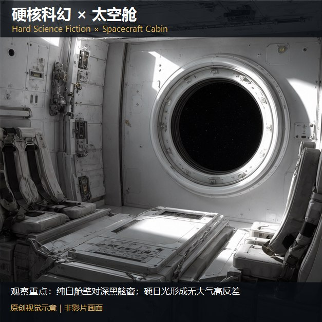

知识讲解：[A1-16 类型片×场景色彩系统](../../knowledge/A-%E7%90%86%E8%AE%BA%E5%B1%82/A1-%E6%91%84%E5%BD%B1%E7%BB%84/A1-16%20%E7%B1%BB%E5%9E%8B%E7%89%87%C3%97%E5%9C%BA%E6%99%AF%E8%89%B2%E5%BD%A9%E7%B3%BB%E7%BB%9F.md)

## 类型片×场景色彩系统：逐项原创视觉覆盖（4项）（013-hard-sci-fi-space，原创教学示意）

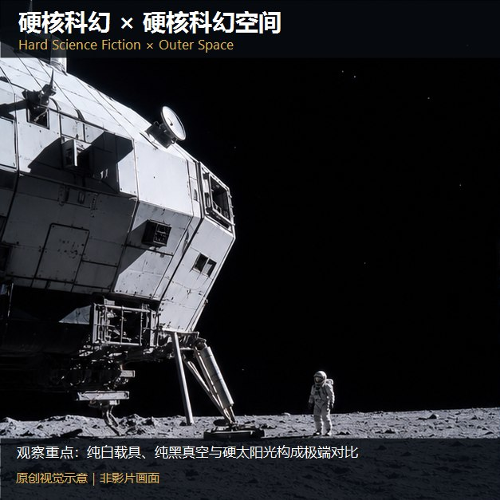

知识讲解：[A1-16 类型片×场景色彩系统](../../knowledge/A-%E7%90%86%E8%AE%BA%E5%B1%82/A1-%E6%91%84%E5%BD%B1%E7%BB%84/A1-16%20%E7%B1%BB%E5%9E%8B%E7%89%87%C3%97%E5%9C%BA%E6%99%AF%E8%89%B2%E5%BD%A9%E7%B3%BB%E7%BB%9F.md)

## 类型片×场景色彩系统：逐项原创视觉覆盖（4项）（080-hard-sf-exterior，原创教学示意）

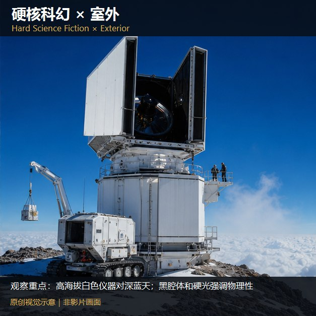

知识讲解：[A1-16 类型片×场景色彩系统](../../knowledge/A-%E7%90%86%E8%AE%BA%E5%B1%82/A1-%E6%91%84%E5%BD%B1%E7%BB%84/A1-16%20%E7%B1%BB%E5%9E%8B%E7%89%87%C3%97%E5%9C%BA%E6%99%AF%E8%89%B2%E5%BD%A9%E7%B3%BB%E7%BB%9F.md)

## 类型片×场景色彩系统：逐项原创视觉覆盖（4项）（081-hard-sf-day，原创教学示意）

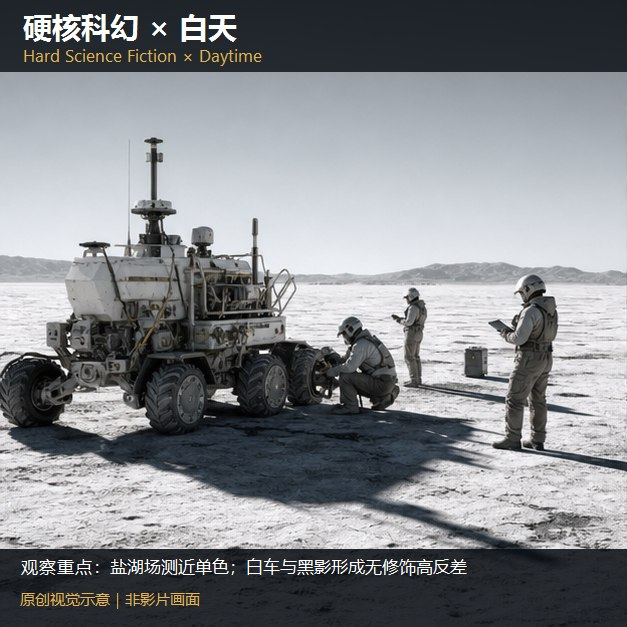

知识讲解：[A1-16 类型片×场景色彩系统](../../knowledge/A-%E7%90%86%E8%AE%BA%E5%B1%82/A1-%E6%91%84%E5%BD%B1%E7%BB%84/A1-16%20%E7%B1%BB%E5%9E%8B%E7%89%87%C3%97%E5%9C%BA%E6%99%AF%E8%89%B2%E5%BD%A9%E7%B3%BB%E7%BB%9F.md)

## 类型片×场景色彩系统：逐项原创视觉覆盖（6项）（014-cyberpunk-cyber-city，原创教学示意）

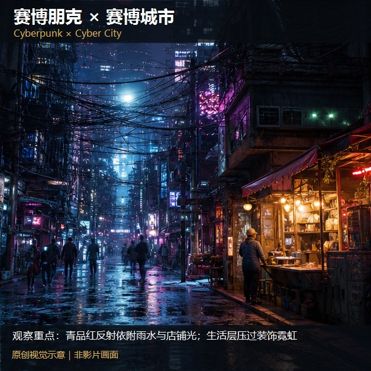

知识讲解：[A1-16 类型片×场景色彩系统](../../knowledge/A-%E7%90%86%E8%AE%BA%E5%B1%82/A1-%E6%91%84%E5%BD%B1%E7%BB%84/A1-16%20%E7%B1%BB%E5%9E%8B%E7%89%87%C3%97%E5%9C%BA%E6%99%AF%E8%89%B2%E5%BD%A9%E7%B3%BB%E7%BB%9F.md)

## 类型片×场景色彩系统：逐项原创视觉覆盖（6项）（015-cyberpunk-night，原创教学示意）

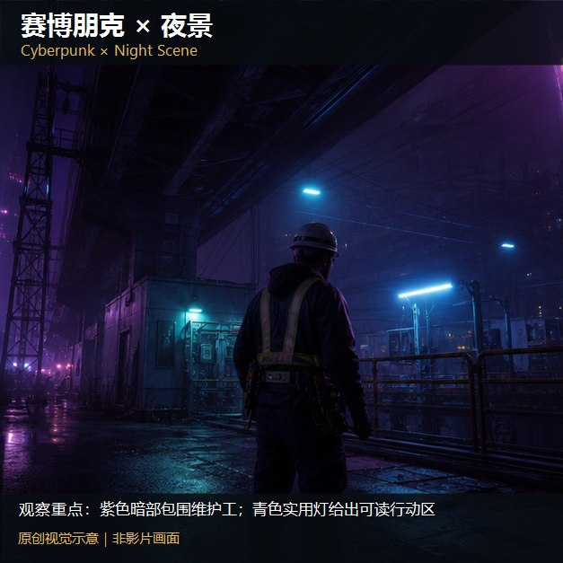

知识讲解：[A1-16 类型片×场景色彩系统](../../knowledge/A-%E7%90%86%E8%AE%BA%E5%B1%82/A1-%E6%91%84%E5%BD%B1%E7%BB%84/A1-16%20%E7%B1%BB%E5%9E%8B%E7%89%87%C3%97%E5%9C%BA%E6%99%AF%E8%89%B2%E5%BD%A9%E7%B3%BB%E7%BB%9F.md)

## 类型片×场景色彩系统：逐项原创视觉覆盖（6项）（016-cyberpunk-rain，原创教学示意）

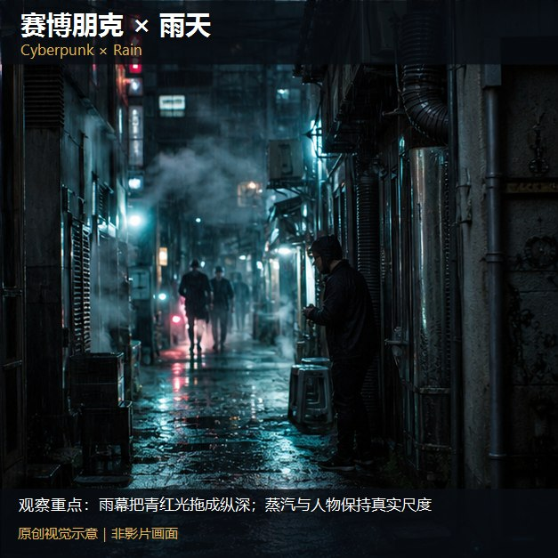

知识讲解：[A1-16 类型片×场景色彩系统](../../knowledge/A-%E7%90%86%E8%AE%BA%E5%B1%82/A1-%E6%91%84%E5%BD%B1%E7%BB%84/A1-16%20%E7%B1%BB%E5%9E%8B%E7%89%87%C3%97%E5%9C%BA%E6%99%AF%E8%89%B2%E5%BD%A9%E7%B3%BB%E7%BB%9F.md)

## 类型片×场景色彩系统：逐项原创视觉覆盖（6项）（017-cyberpunk-city，原创教学示意）

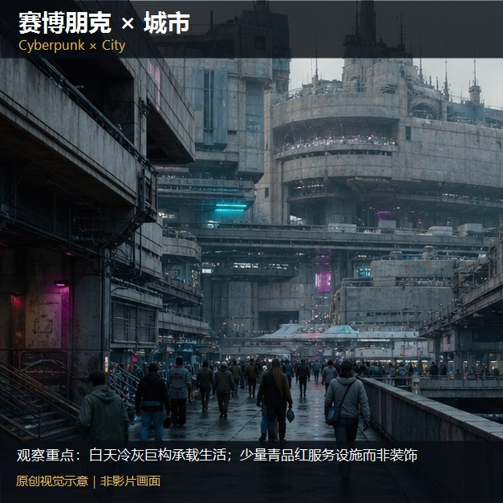

知识讲解：[A1-16 类型片×场景色彩系统](../../knowledge/A-%E7%90%86%E8%AE%BA%E5%B1%82/A1-%E6%91%84%E5%BD%B1%E7%BB%84/A1-16%20%E7%B1%BB%E5%9E%8B%E7%89%87%C3%97%E5%9C%BA%E6%99%AF%E8%89%B2%E5%BD%A9%E7%B3%BB%E7%BB%9F.md)

## 类型片×场景色彩系统：逐项原创视觉覆盖（6项）（082-cyberpunk-exterior，原创教学示意）

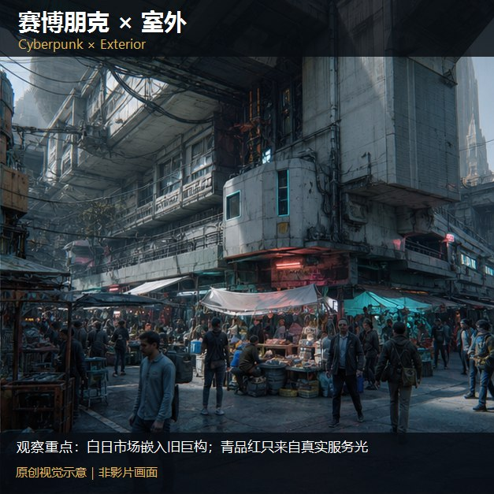

知识讲解：[A1-16 类型片×场景色彩系统](../../knowledge/A-%E7%90%86%E8%AE%BA%E5%B1%82/A1-%E6%91%84%E5%BD%B1%E7%BB%84/A1-16%20%E7%B1%BB%E5%9E%8B%E7%89%87%C3%97%E5%9C%BA%E6%99%AF%E8%89%B2%E5%BD%A9%E7%B3%BB%E7%BB%9F.md)

## 类型片×场景色彩系统：逐项原创视觉覆盖（6项）（083-cyberpunk-day，原创教学示意）

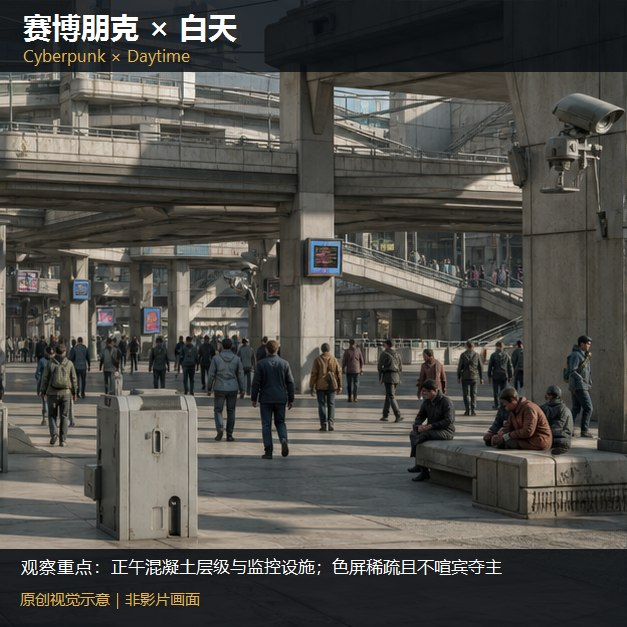

知识讲解：[A1-16 类型片×场景色彩系统](../../knowledge/A-%E7%90%86%E8%AE%BA%E5%B1%82/A1-%E6%91%84%E5%BD%B1%E7%BB%84/A1-16%20%E7%B1%BB%E5%9E%8B%E7%89%87%C3%97%E5%9C%BA%E6%99%AF%E8%89%B2%E5%BD%A9%E7%B3%BB%E7%BB%9F.md)

## 类型片×场景色彩系统：逐项原创视觉覆盖（8项）（018-war-battlefield，原创教学示意）

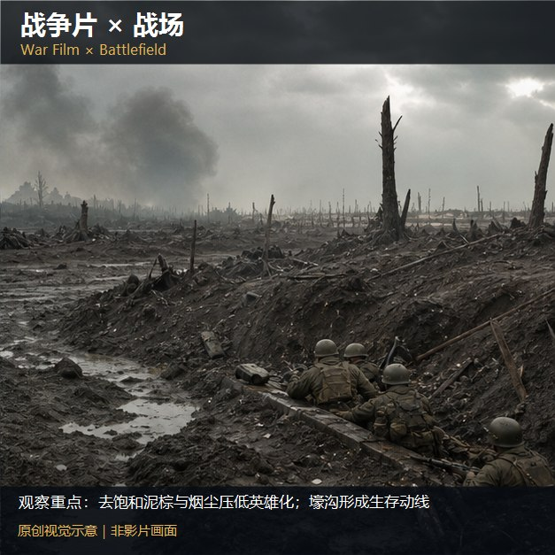

知识讲解：[A1-16 类型片×场景色彩系统](../../knowledge/A-%E7%90%86%E8%AE%BA%E5%B1%82/A1-%E6%91%84%E5%BD%B1%E7%BB%84/A1-16%20%E7%B1%BB%E5%9E%8B%E7%89%87%C3%97%E5%9C%BA%E6%99%AF%E8%89%B2%E5%BD%A9%E7%B3%BB%E7%BB%9F.md)
