# A1-16 · 25—48

[全部主题](../IMAGE_GALLERY.md) · [首页](../../README.md)

## 类型片×场景色彩系统：逐项原创视觉覆盖（8项）（019-war-snow，原创教学示意）

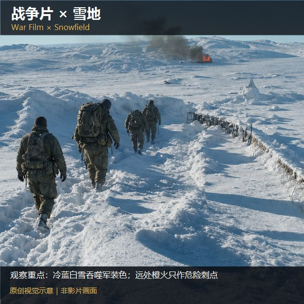

知识讲解：[A1-16 类型片×场景色彩系统](../../knowledge/A-%E7%90%86%E8%AE%BA%E5%B1%82/A1-%E6%91%84%E5%BD%B1%E7%BB%84/A1-16%20%E7%B1%BB%E5%9E%8B%E7%89%87%C3%97%E5%9C%BA%E6%99%AF%E8%89%B2%E5%BD%A9%E7%B3%BB%E7%BB%9F.md)

## 类型片×场景色彩系统：逐项原创视觉覆盖（8项）（020-war-desert，原创教学示意）

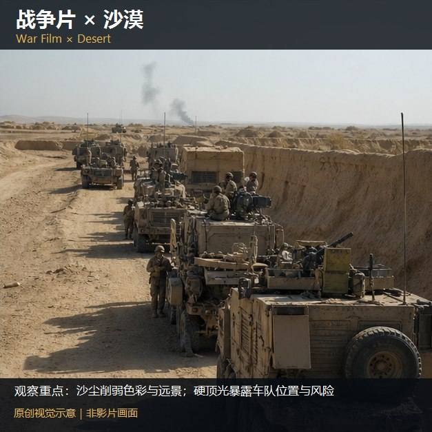

知识讲解：[A1-16 类型片×场景色彩系统](../../knowledge/A-%E7%90%86%E8%AE%BA%E5%B1%82/A1-%E6%91%84%E5%BD%B1%E7%BB%84/A1-16%20%E7%B1%BB%E5%9E%8B%E7%89%87%C3%97%E5%9C%BA%E6%99%AF%E8%89%B2%E5%BD%A9%E7%B3%BB%E7%BB%9F.md)

## 类型片×场景色彩系统：逐项原创视觉覆盖（8项）（021-war-underground，原创教学示意）

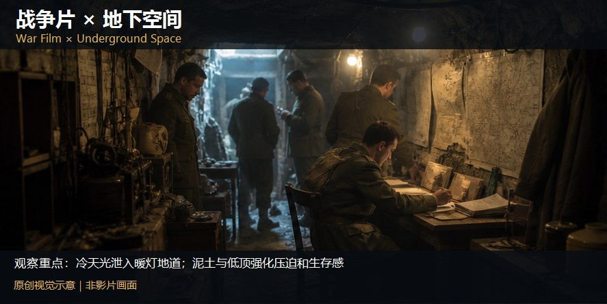

知识讲解：[A1-16 类型片×场景色彩系统](../../knowledge/A-%E7%90%86%E8%AE%BA%E5%B1%82/A1-%E6%91%84%E5%BD%B1%E7%BB%84/A1-16%20%E7%B1%BB%E5%9E%8B%E7%89%87%C3%97%E5%9C%BA%E6%99%AF%E8%89%B2%E5%BD%A9%E7%B3%BB%E7%BB%9F.md)

## 类型片×场景色彩系统：逐项原创视觉覆盖（8项）（022-war-ruins，原创教学示意）

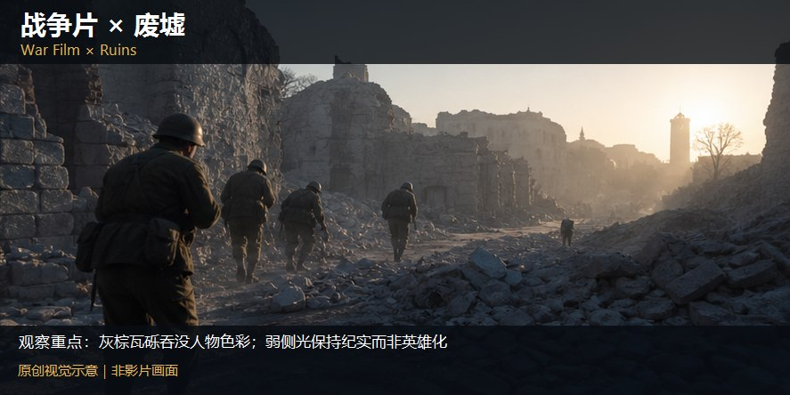

知识讲解：[A1-16 类型片×场景色彩系统](../../knowledge/A-%E7%90%86%E8%AE%BA%E5%B1%82/A1-%E6%91%84%E5%BD%B1%E7%BB%84/A1-16%20%E7%B1%BB%E5%9E%8B%E7%89%87%C3%97%E5%9C%BA%E6%99%AF%E8%89%B2%E5%BD%A9%E7%B3%BB%E7%BB%9F.md)

## 类型片×场景色彩系统：逐项原创视觉覆盖（8项）（023-war-apocalypse，原创教学示意）

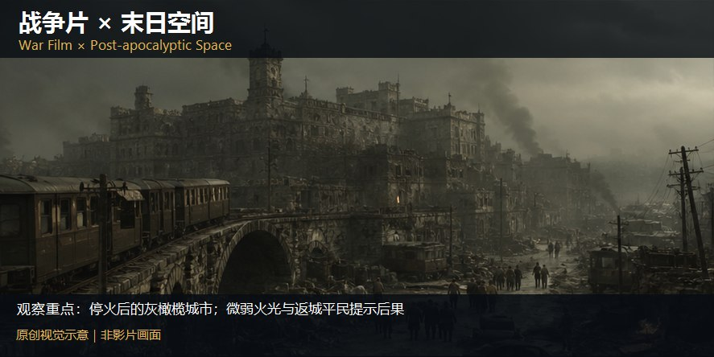

知识讲解：[A1-16 类型片×场景色彩系统](../../knowledge/A-%E7%90%86%E8%AE%BA%E5%B1%82/A1-%E6%91%84%E5%BD%B1%E7%BB%84/A1-16%20%E7%B1%BB%E5%9E%8B%E7%89%87%C3%97%E5%9C%BA%E6%99%AF%E8%89%B2%E5%BD%A9%E7%B3%BB%E7%BB%9F.md)

## 类型片×场景色彩系统：逐项原创视觉覆盖（8项）（084-war-exterior，原创教学示意）

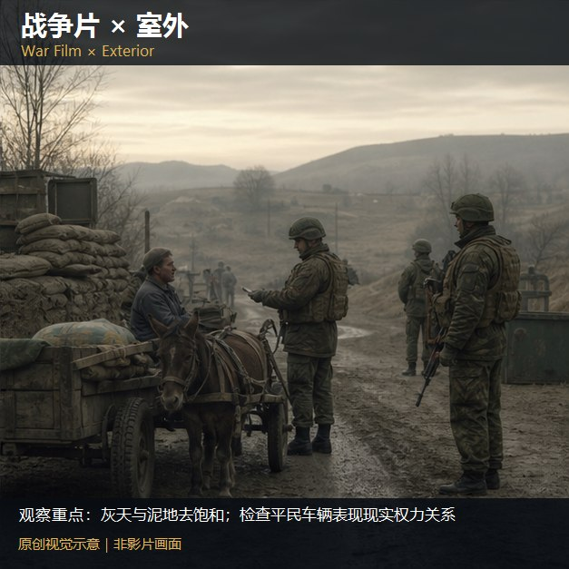

知识讲解：[A1-16 类型片×场景色彩系统](../../knowledge/A-%E7%90%86%E8%AE%BA%E5%B1%82/A1-%E6%91%84%E5%BD%B1%E7%BB%84/A1-16%20%E7%B1%BB%E5%9E%8B%E7%89%87%C3%97%E5%9C%BA%E6%99%AF%E8%89%B2%E5%BD%A9%E7%B3%BB%E7%BB%9F.md)

## 类型片×场景色彩系统：逐项原创视觉覆盖（8项）（085-war-day，原创教学示意）

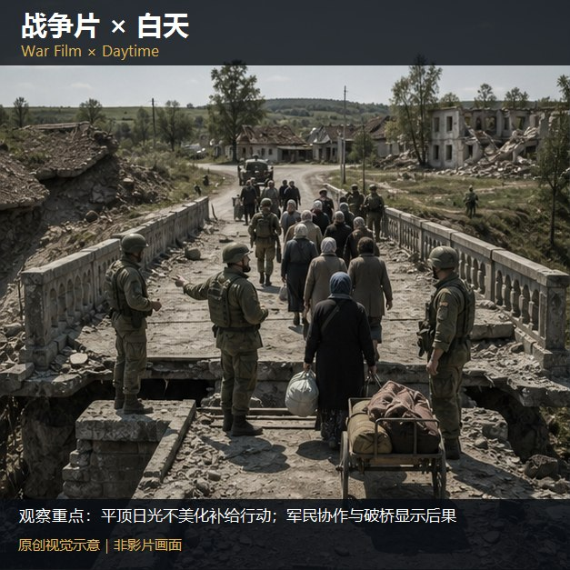

知识讲解：[A1-16 类型片×场景色彩系统](../../knowledge/A-%E7%90%86%E8%AE%BA%E5%B1%82/A1-%E6%91%84%E5%BD%B1%E7%BB%84/A1-16%20%E7%B1%BB%E5%9E%8B%E7%89%87%C3%97%E5%9C%BA%E6%99%AF%E8%89%B2%E5%BD%A9%E7%B3%BB%E7%BB%9F.md)

## 类型片×场景色彩系统：逐项原创视觉覆盖（14项）（024-suspense-interior，原创教学示意）

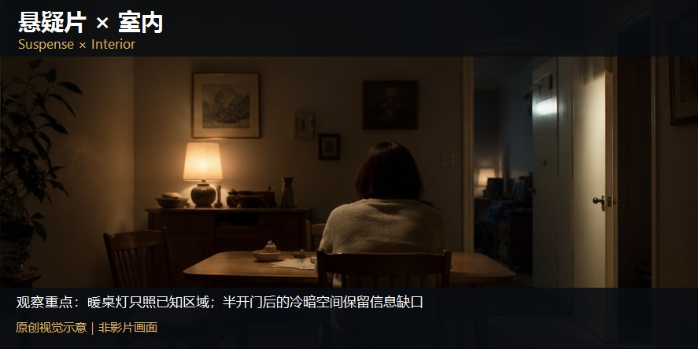

知识讲解：[A1-16 类型片×场景色彩系统](../../knowledge/A-%E7%90%86%E8%AE%BA%E5%B1%82/A1-%E6%91%84%E5%BD%B1%E7%BB%84/A1-16%20%E7%B1%BB%E5%9E%8B%E7%89%87%C3%97%E5%9C%BA%E6%99%AF%E8%89%B2%E5%BD%A9%E7%B3%BB%E7%BB%9F.md)

## 类型片×场景色彩系统：逐项原创视觉覆盖（14项）（025-suspense-night，原创教学示意）

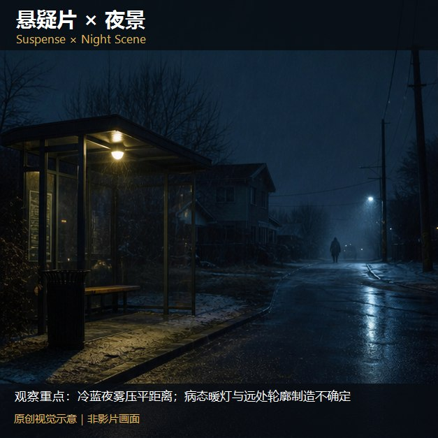

知识讲解：[A1-16 类型片×场景色彩系统](../../knowledge/A-%E7%90%86%E8%AE%BA%E5%B1%82/A1-%E6%91%84%E5%BD%B1%E7%BB%84/A1-16%20%E7%B1%BB%E5%9E%8B%E7%89%87%C3%97%E5%9C%BA%E6%99%AF%E8%89%B2%E5%BD%A9%E7%B3%BB%E7%BB%9F.md)

## 类型片×场景色彩系统：逐项原创视觉覆盖（14项）（026-suspense-rain，原创教学示意）

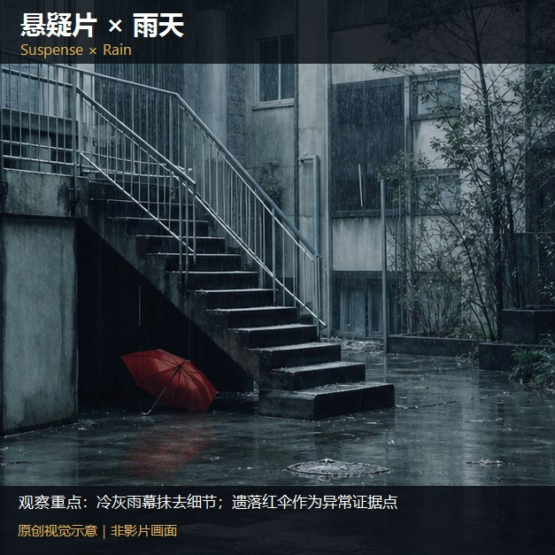

知识讲解：[A1-16 类型片×场景色彩系统](../../knowledge/A-%E7%90%86%E8%AE%BA%E5%B1%82/A1-%E6%91%84%E5%BD%B1%E7%BB%84/A1-16%20%E7%B1%BB%E5%9E%8B%E7%89%87%C3%97%E5%9C%BA%E6%99%AF%E8%89%B2%E5%BD%A9%E7%B3%BB%E7%BB%9F.md)

## 类型片×场景色彩系统：逐项原创视觉覆盖（14项）（027-suspense-snow，原创教学示意）

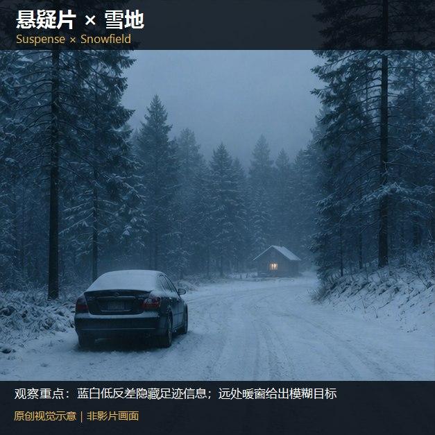

知识讲解：[A1-16 类型片×场景色彩系统](../../knowledge/A-%E7%90%86%E8%AE%BA%E5%B1%82/A1-%E6%91%84%E5%BD%B1%E7%BB%84/A1-16%20%E7%B1%BB%E5%9E%8B%E7%89%87%C3%97%E5%9C%BA%E6%99%AF%E8%89%B2%E5%BD%A9%E7%B3%BB%E7%BB%9F.md)

## 类型片×场景色彩系统：逐项原创视觉覆盖（14项）（028-suspense-city，原创教学示意）

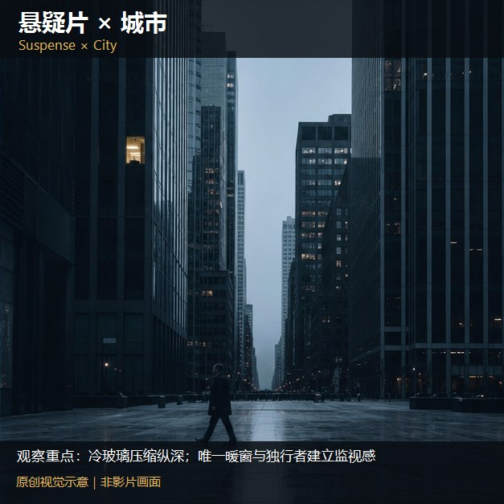

知识讲解：[A1-16 类型片×场景色彩系统](../../knowledge/A-%E7%90%86%E8%AE%BA%E5%B1%82/A1-%E6%91%84%E5%BD%B1%E7%BB%84/A1-16%20%E7%B1%BB%E5%9E%8B%E7%89%87%C3%97%E5%9C%BA%E6%99%AF%E8%89%B2%E5%BD%A9%E7%B3%BB%E7%BB%9F.md)

## 类型片×场景色彩系统：逐项原创视觉覆盖（14项）（029-suspense-lab，原创教学示意）

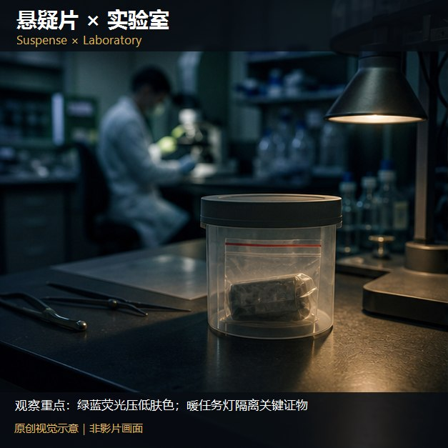

知识讲解：[A1-16 类型片×场景色彩系统](../../knowledge/A-%E7%90%86%E8%AE%BA%E5%B1%82/A1-%E6%91%84%E5%BD%B1%E7%BB%84/A1-16%20%E7%B1%BB%E5%9E%8B%E7%89%87%C3%97%E5%9C%BA%E6%99%AF%E8%89%B2%E5%BD%A9%E7%B3%BB%E7%BB%9F.md)

## 类型片×场景色彩系统：逐项原创视觉覆盖（14项）（030-suspense-hospital，原创教学示意）

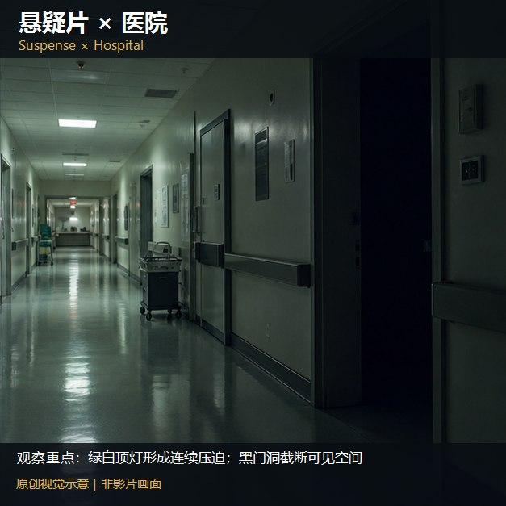

知识讲解：[A1-16 类型片×场景色彩系统](../../knowledge/A-%E7%90%86%E8%AE%BA%E5%B1%82/A1-%E6%91%84%E5%BD%B1%E7%BB%84/A1-16%20%E7%B1%BB%E5%9E%8B%E7%89%87%C3%97%E5%9C%BA%E6%99%AF%E8%89%B2%E5%BD%A9%E7%B3%BB%E7%BB%9F.md)

## 类型片×场景色彩系统：逐项原创视觉覆盖（14项）（031-suspense-school，原创教学示意）

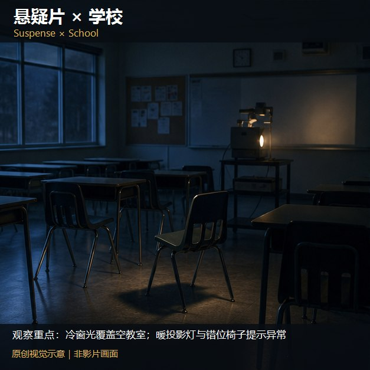

知识讲解：[A1-16 类型片×场景色彩系统](../../knowledge/A-%E7%90%86%E8%AE%BA%E5%B1%82/A1-%E6%91%84%E5%BD%B1%E7%BB%84/A1-16%20%E7%B1%BB%E5%9E%8B%E7%89%87%C3%97%E5%9C%BA%E6%99%AF%E8%89%B2%E5%BD%A9%E7%B3%BB%E7%BB%9F.md)

## 类型片×场景色彩系统：逐项原创视觉覆盖（14项）（032-suspense-office，原创教学示意）

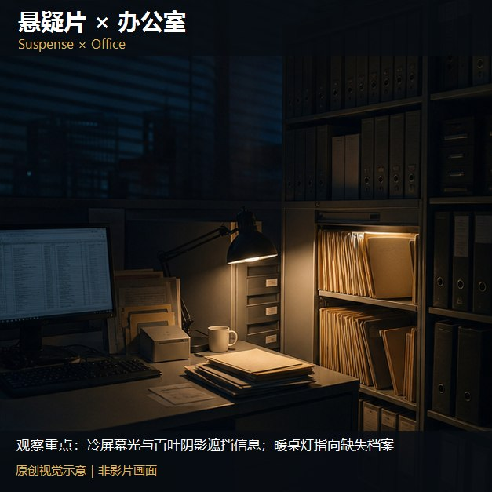

知识讲解：[A1-16 类型片×场景色彩系统](../../knowledge/A-%E7%90%86%E8%AE%BA%E5%B1%82/A1-%E6%91%84%E5%BD%B1%E7%BB%84/A1-16%20%E7%B1%BB%E5%9E%8B%E7%89%87%C3%97%E5%9C%BA%E6%99%AF%E8%89%B2%E5%BD%A9%E7%B3%BB%E7%BB%9F.md)

## 类型片×场景色彩系统：逐项原创视觉覆盖（14项）（033-suspense-dream，原创教学示意）

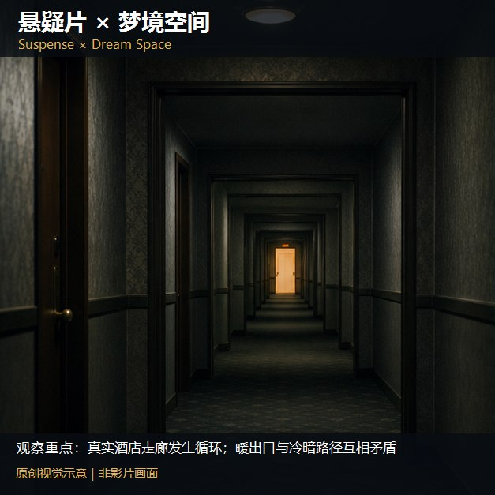

知识讲解：[A1-16 类型片×场景色彩系统](../../knowledge/A-%E7%90%86%E8%AE%BA%E5%B1%82/A1-%E6%91%84%E5%BD%B1%E7%BB%84/A1-16%20%E7%B1%BB%E5%9E%8B%E7%89%87%C3%97%E5%9C%BA%E6%99%AF%E8%89%B2%E5%BD%A9%E7%B3%BB%E7%BB%9F.md)

## 类型片×场景色彩系统：逐项原创视觉覆盖（14项）（034-suspense-memory，原创教学示意）

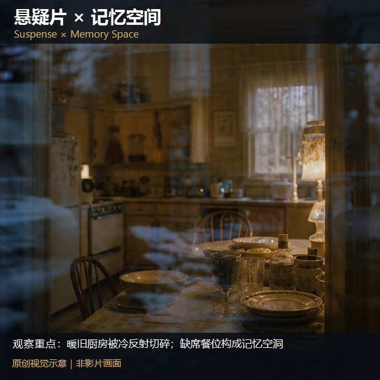

知识讲解：[A1-16 类型片×场景色彩系统](../../knowledge/A-%E7%90%86%E8%AE%BA%E5%B1%82/A1-%E6%91%84%E5%BD%B1%E7%BB%84/A1-16%20%E7%B1%BB%E5%9E%8B%E7%89%87%C3%97%E5%9C%BA%E6%99%AF%E8%89%B2%E5%BD%A9%E7%B3%BB%E7%BB%9F.md)

## 类型片×场景色彩系统：逐项原创视觉覆盖（14项）（035-suspense-cyber-city，原创教学示意）

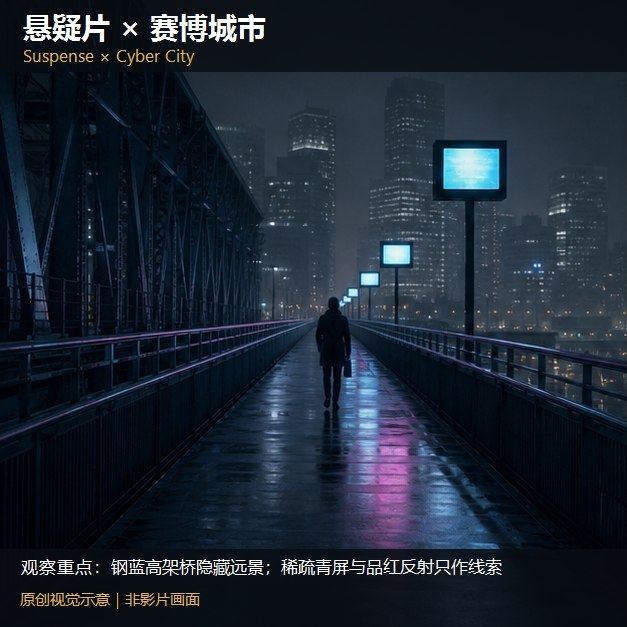

知识讲解：[A1-16 类型片×场景色彩系统](../../knowledge/A-%E7%90%86%E8%AE%BA%E5%B1%82/A1-%E6%91%84%E5%BD%B1%E7%BB%84/A1-16%20%E7%B1%BB%E5%9E%8B%E7%89%87%C3%97%E5%9C%BA%E6%99%AF%E8%89%B2%E5%BD%A9%E7%B3%BB%E7%BB%9F.md)

## 类型片×场景色彩系统：逐项原创视觉覆盖（14项）（086-suspense-exterior，原创教学示意）

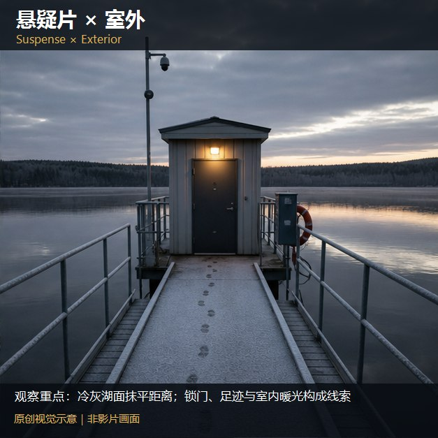

知识讲解：[A1-16 类型片×场景色彩系统](../../knowledge/A-%E7%90%86%E8%AE%BA%E5%B1%82/A1-%E6%91%84%E5%BD%B1%E7%BB%84/A1-16%20%E7%B1%BB%E5%9E%8B%E7%89%87%C3%97%E5%9C%BA%E6%99%AF%E8%89%B2%E5%BD%A9%E7%B3%BB%E7%BB%9F.md)

## 类型片×场景色彩系统：逐项原创视觉覆盖（14项）（087-suspense-day，原创教学示意）

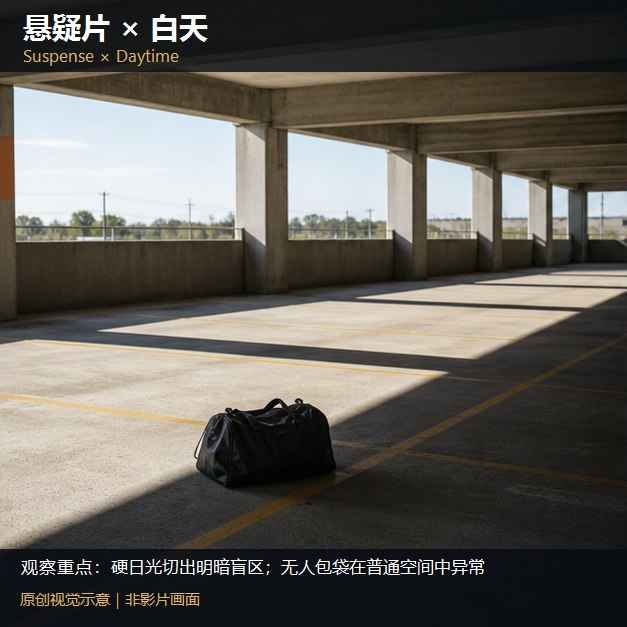

知识讲解：[A1-16 类型片×场景色彩系统](../../knowledge/A-%E7%90%86%E8%AE%BA%E5%B1%82/A1-%E6%91%84%E5%BD%B1%E7%BB%84/A1-16%20%E7%B1%BB%E5%9E%8B%E7%89%87%C3%97%E5%9C%BA%E6%99%AF%E8%89%B2%E5%BD%A9%E7%B3%BB%E7%BB%9F.md)

## 类型片×场景色彩系统：逐项原创视觉覆盖（8项）（036-crime-interior，原创教学示意）

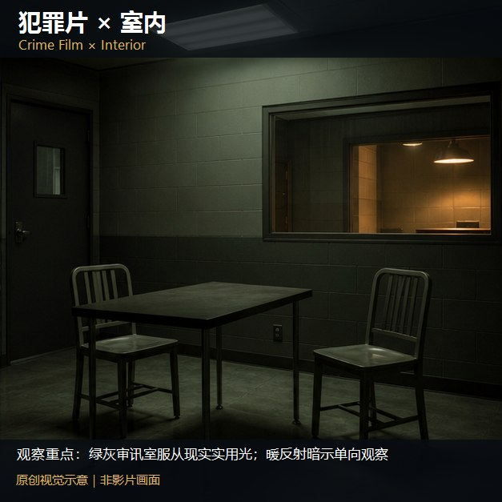

知识讲解：[A1-16 类型片×场景色彩系统](../../knowledge/A-%E7%90%86%E8%AE%BA%E5%B1%82/A1-%E6%91%84%E5%BD%B1%E7%BB%84/A1-16%20%E7%B1%BB%E5%9E%8B%E7%89%87%C3%97%E5%9C%BA%E6%99%AF%E8%89%B2%E5%BD%A9%E7%B3%BB%E7%BB%9F.md)

## 类型片×场景色彩系统：逐项原创视觉覆盖（8项）（037-crime-night，原创教学示意）

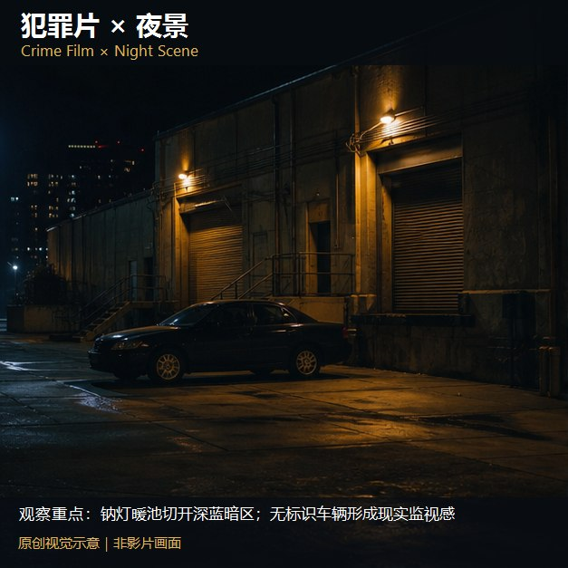

知识讲解：[A1-16 类型片×场景色彩系统](../../knowledge/A-%E7%90%86%E8%AE%BA%E5%B1%82/A1-%E6%91%84%E5%BD%B1%E7%BB%84/A1-16%20%E7%B1%BB%E5%9E%8B%E7%89%87%C3%97%E5%9C%BA%E6%99%AF%E8%89%B2%E5%BD%A9%E7%B3%BB%E7%BB%9F.md)

## 类型片×场景色彩系统：逐项原创视觉覆盖（8项）（038-crime-rain，原创教学示意）

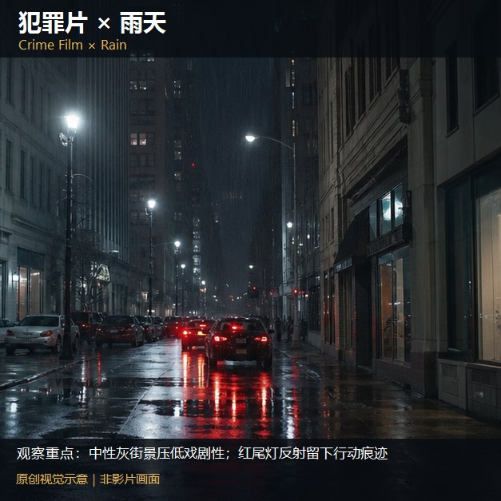

知识讲解：[A1-16 类型片×场景色彩系统](../../knowledge/A-%E7%90%86%E8%AE%BA%E5%B1%82/A1-%E6%91%84%E5%BD%B1%E7%BB%84/A1-16%20%E7%B1%BB%E5%9E%8B%E7%89%87%C3%97%E5%9C%BA%E6%99%AF%E8%89%B2%E5%BD%A9%E7%B3%BB%E7%BB%9F.md)
