# A1-16 · 49—72

[全部主题](../IMAGE_GALLERY.md) · [首页](../../README.md)

## 类型片×场景色彩系统：逐项原创视觉覆盖（8项）（039-crime-city，原创教学示意）

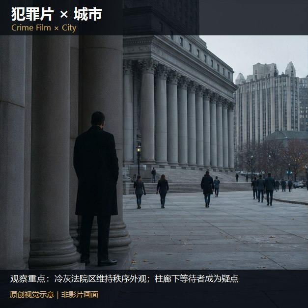

知识讲解：[A1-16 类型片×场景色彩系统](../../knowledge/A-%E7%90%86%E8%AE%BA%E5%B1%82/A1-%E6%91%84%E5%BD%B1%E7%BB%84/A1-16%20%E7%B1%BB%E5%9E%8B%E7%89%87%C3%97%E5%9C%BA%E6%99%AF%E8%89%B2%E5%BD%A9%E7%B3%BB%E7%BB%9F.md)

## 类型片×场景色彩系统：逐项原创视觉覆盖（8项）（040-crime-office，原创教学示意）

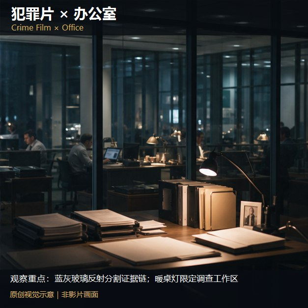

知识讲解：[A1-16 类型片×场景色彩系统](../../knowledge/A-%E7%90%86%E8%AE%BA%E5%B1%82/A1-%E6%91%84%E5%BD%B1%E7%BB%84/A1-16%20%E7%B1%BB%E5%9E%8B%E7%89%87%C3%97%E5%9C%BA%E6%99%AF%E8%89%B2%E5%BD%A9%E7%B3%BB%E7%BB%9F.md)

## 类型片×场景色彩系统：逐项原创视觉覆盖（8项）（041-crime-cyber-city，原创教学示意）

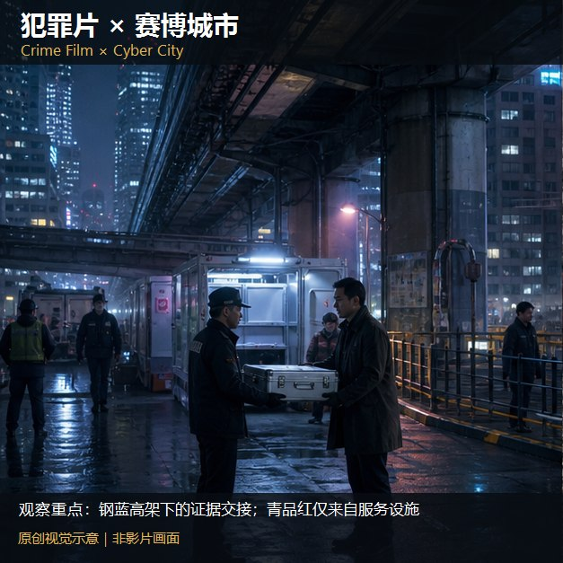

知识讲解：[A1-16 类型片×场景色彩系统](../../knowledge/A-%E7%90%86%E8%AE%BA%E5%B1%82/A1-%E6%91%84%E5%BD%B1%E7%BB%84/A1-16%20%E7%B1%BB%E5%9E%8B%E7%89%87%C3%97%E5%9C%BA%E6%99%AF%E8%89%B2%E5%BD%A9%E7%B3%BB%E7%BB%9F.md)

## 类型片×场景色彩系统：逐项原创视觉覆盖（8项）（088-crime-exterior，原创教学示意）

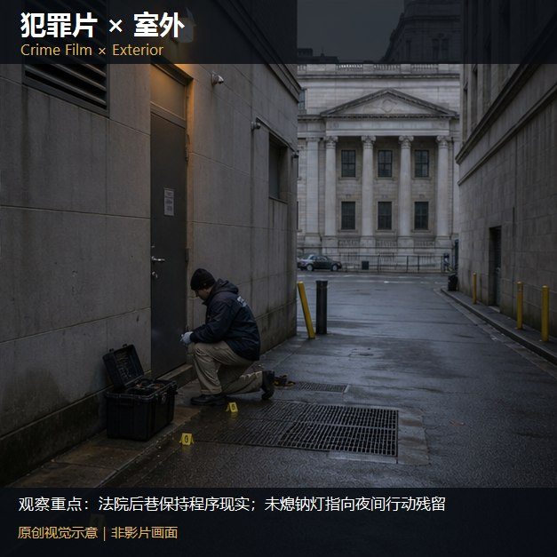

知识讲解：[A1-16 类型片×场景色彩系统](../../knowledge/A-%E7%90%86%E8%AE%BA%E5%B1%82/A1-%E6%91%84%E5%BD%B1%E7%BB%84/A1-16%20%E7%B1%BB%E5%9E%8B%E7%89%87%C3%97%E5%9C%BA%E6%99%AF%E8%89%B2%E5%BD%A9%E7%B3%BB%E7%BB%9F.md)

## 类型片×场景色彩系统：逐项原创视觉覆盖（8项）（089-crime-day，原创教学示意）

知识讲解：[A1-16 类型片×场景色彩系统](../../knowledge/A-%E7%90%86%E8%AE%BA%E5%B1%82/A1-%E6%91%84%E5%BD%B1%E7%BB%84/A1-16%20%E7%B1%BB%E5%9E%8B%E7%89%87%C3%97%E5%9C%BA%E6%99%AF%E8%89%B2%E5%BD%A9%E7%B3%BB%E7%BB%9F.md)

## 类型片×场景色彩系统：逐项原创视觉覆盖（6项）（042-disaster-battlefield，原创教学示意）

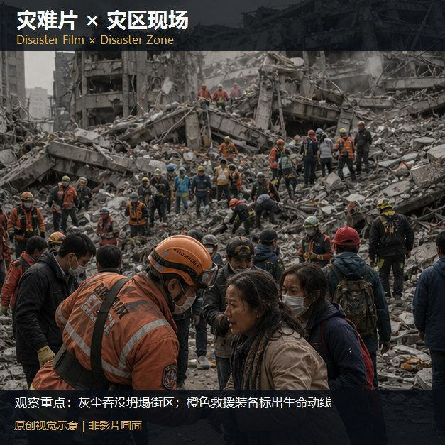

知识讲解：[A1-16 类型片×场景色彩系统](../../knowledge/A-%E7%90%86%E8%AE%BA%E5%B1%82/A1-%E6%91%84%E5%BD%B1%E7%BB%84/A1-16%20%E7%B1%BB%E5%9E%8B%E7%89%87%C3%97%E5%9C%BA%E6%99%AF%E8%89%B2%E5%BD%A9%E7%B3%BB%E7%BB%9F.md)

## 类型片×场景色彩系统：逐项原创视觉覆盖（6项）（043-disaster-lab，原创教学示意）

知识讲解：[A1-16 类型片×场景色彩系统](../../knowledge/A-%E7%90%86%E8%AE%BA%E5%B1%82/A1-%E6%91%84%E5%BD%B1%E7%BB%84/A1-16%20%E7%B1%BB%E5%9E%8B%E7%89%87%C3%97%E5%9C%BA%E6%99%AF%E8%89%B2%E5%BD%A9%E7%B3%BB%E7%BB%9F.md)

## 类型片×场景色彩系统：逐项原创视觉覆盖（6项）（044-disaster-hospital，原创教学示意）

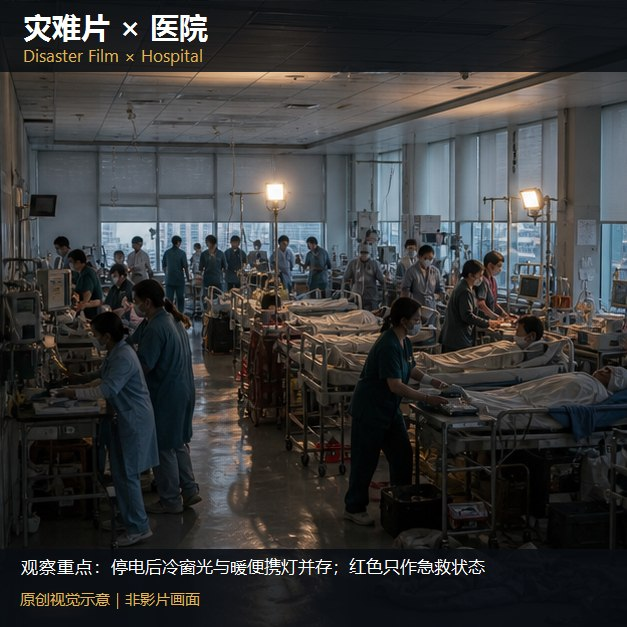

知识讲解：[A1-16 类型片×场景色彩系统](../../knowledge/A-%E7%90%86%E8%AE%BA%E5%B1%82/A1-%E6%91%84%E5%BD%B1%E7%BB%84/A1-16%20%E7%B1%BB%E5%9E%8B%E7%89%87%C3%97%E5%9C%BA%E6%99%AF%E8%89%B2%E5%BD%A9%E7%B3%BB%E7%BB%9F.md)

## 类型片×场景色彩系统：逐项原创视觉覆盖（6项）（045-disaster-hard-space，原创教学示意）

知识讲解：[A1-16 类型片×场景色彩系统](../../knowledge/A-%E7%90%86%E8%AE%BA%E5%B1%82/A1-%E6%91%84%E5%BD%B1%E7%BB%84/A1-16%20%E7%B1%BB%E5%9E%8B%E7%89%87%C3%97%E5%9C%BA%E6%99%AF%E8%89%B2%E5%BD%A9%E7%B3%BB%E7%BB%9F.md)

## 类型片×场景色彩系统：逐项原创视觉覆盖（6项）（090-disaster-exterior，原创教学示意）

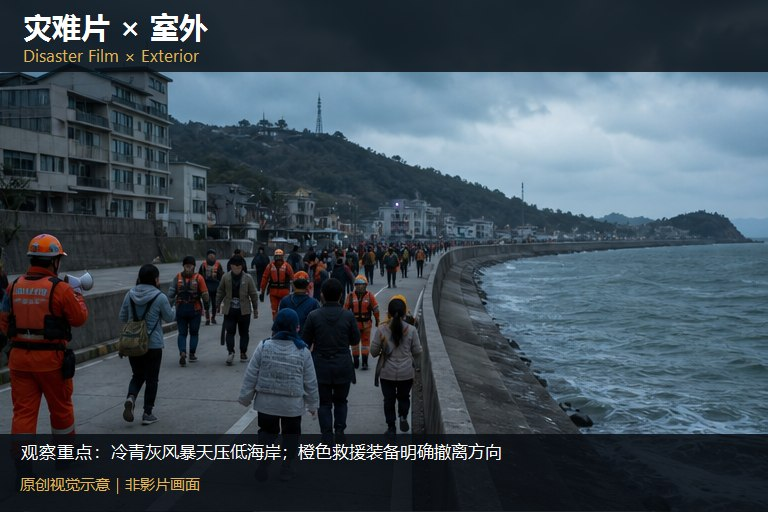

知识讲解：[A1-16 类型片×场景色彩系统](../../knowledge/A-%E7%90%86%E8%AE%BA%E5%B1%82/A1-%E6%91%84%E5%BD%B1%E7%BB%84/A1-16%20%E7%B1%BB%E5%9E%8B%E7%89%87%C3%97%E5%9C%BA%E6%99%AF%E8%89%B2%E5%BD%A9%E7%B3%BB%E7%BB%9F.md)

## 类型片×场景色彩系统：逐项原创视觉覆盖（6项）（091-disaster-day，原创教学示意）

知识讲解：[A1-16 类型片×场景色彩系统](../../knowledge/A-%E7%90%86%E8%AE%BA%E5%B1%82/A1-%E6%91%84%E5%BD%B1%E7%BB%84/A1-16%20%E7%B1%BB%E5%9E%8B%E7%89%87%C3%97%E5%9C%BA%E6%99%AF%E8%89%B2%E5%BD%A9%E7%B3%BB%E7%BB%9F.md)

## 类型片×场景色彩系统：逐项原创视觉覆盖（3项）（046-wuxia-palace，原创教学示意）

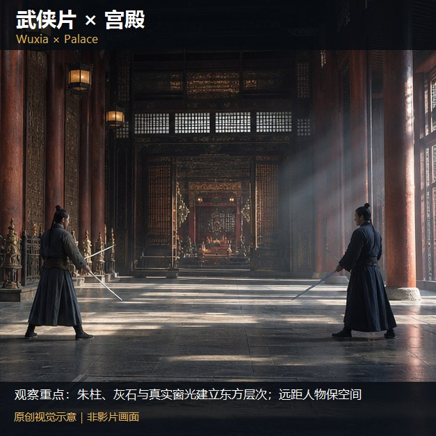

知识讲解：[A1-16 类型片×场景色彩系统](../../knowledge/A-%E7%90%86%E8%AE%BA%E5%B1%82/A1-%E6%91%84%E5%BD%B1%E7%BB%84/A1-16%20%E7%B1%BB%E5%9E%8B%E7%89%87%C3%97%E5%9C%BA%E6%99%AF%E8%89%B2%E5%BD%A9%E7%B3%BB%E7%BB%9F.md)

## 类型片×场景色彩系统：逐项原创视觉覆盖（3项）（047-wuxia-outdoor，原创教学示意）

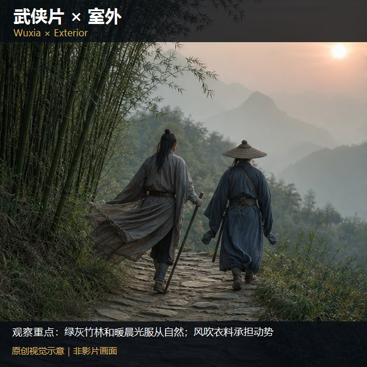

知识讲解：[A1-16 类型片×场景色彩系统](../../knowledge/A-%E7%90%86%E8%AE%BA%E5%B1%82/A1-%E6%91%84%E5%BD%B1%E7%BB%84/A1-16%20%E7%B1%BB%E5%9E%8B%E7%89%87%C3%97%E5%9C%BA%E6%99%AF%E8%89%B2%E5%BD%A9%E7%B3%BB%E7%BB%9F.md)

## 类型片×场景色彩系统：逐项原创视觉覆盖（3项）（092-wuxia-day，原创教学示意）

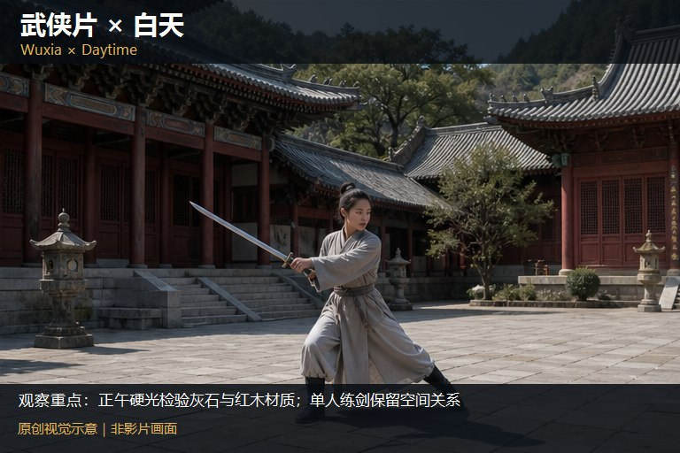

知识讲解：[A1-16 类型片×场景色彩系统](../../knowledge/A-%E7%90%86%E8%AE%BA%E5%B1%82/A1-%E6%91%84%E5%BD%B1%E7%BB%84/A1-16%20%E7%B1%BB%E5%9E%8B%E7%89%87%C3%97%E5%9C%BA%E6%99%AF%E8%89%B2%E5%BD%A9%E7%B3%BB%E7%BB%9F.md)

## 类型片×场景色彩系统：逐项原创视觉覆盖（4项）（048-history-village，原创教学示意）

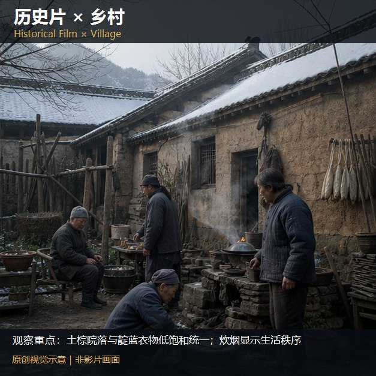

知识讲解：[A1-16 类型片×场景色彩系统](../../knowledge/A-%E7%90%86%E8%AE%BA%E5%B1%82/A1-%E6%91%84%E5%BD%B1%E7%BB%84/A1-16%20%E7%B1%BB%E5%9E%8B%E7%89%87%C3%97%E5%9C%BA%E6%99%AF%E8%89%B2%E5%BD%A9%E7%B3%BB%E7%BB%9F.md)

## 类型片×场景色彩系统：逐项原创视觉覆盖（4项）（049-history-palace，原创教学示意）

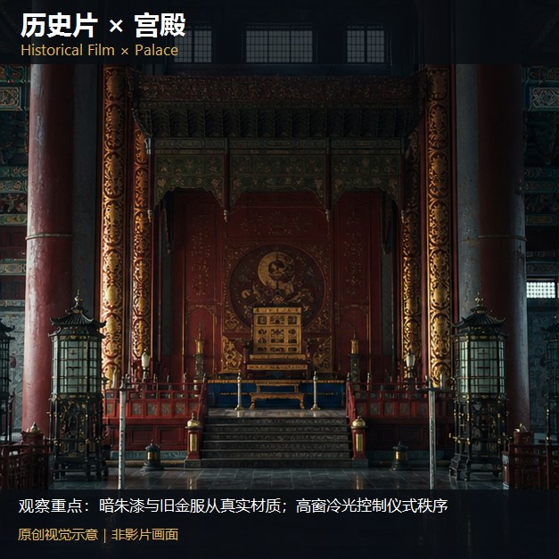

知识讲解：[A1-16 类型片×场景色彩系统](../../knowledge/A-%E7%90%86%E8%AE%BA%E5%B1%82/A1-%E6%91%84%E5%BD%B1%E7%BB%84/A1-16%20%E7%B1%BB%E5%9E%8B%E7%89%87%C3%97%E5%9C%BA%E6%99%AF%E8%89%B2%E5%BD%A9%E7%B3%BB%E7%BB%9F.md)

## 类型片×场景色彩系统：逐项原创视觉覆盖（4项）（093-history-exterior，原创教学示意）

知识讲解：[A1-16 类型片×场景色彩系统](../../knowledge/A-%E7%90%86%E8%AE%BA%E5%B1%82/A1-%E6%91%84%E5%BD%B1%E7%BB%84/A1-16%20%E7%B1%BB%E5%9E%8B%E7%89%87%C3%97%E5%9C%BA%E6%99%AF%E8%89%B2%E5%BD%A9%E7%B3%BB%E7%BB%9F.md)

## 类型片×场景色彩系统：逐项原创视觉覆盖（4项）（094-history-day，原创教学示意）

知识讲解：[A1-16 类型片×场景色彩系统](../../knowledge/A-%E7%90%86%E8%AE%BA%E5%B1%82/A1-%E6%91%84%E5%BD%B1%E7%BB%84/A1-16%20%E7%B1%BB%E5%9E%8B%E7%89%87%C3%97%E5%9C%BA%E6%99%AF%E8%89%B2%E5%BD%A9%E7%B3%BB%E7%BB%9F.md)

## 类型片×场景色彩系统：逐项原创视觉覆盖（9项）（050-romance-interior，原创教学示意）

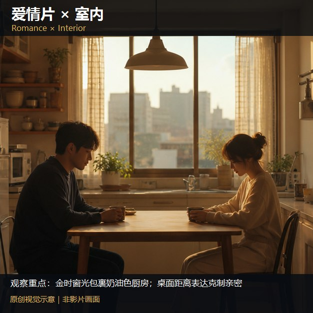

知识讲解：[A1-16 类型片×场景色彩系统](../../knowledge/A-%E7%90%86%E8%AE%BA%E5%B1%82/A1-%E6%91%84%E5%BD%B1%E7%BB%84/A1-16%20%E7%B1%BB%E5%9E%8B%E7%89%87%C3%97%E5%9C%BA%E6%99%AF%E8%89%B2%E5%BD%A9%E7%B3%BB%E7%BB%9F.md)

## 类型片×场景色彩系统：逐项原创视觉覆盖（9项）（051-romance-night，原创教学示意）

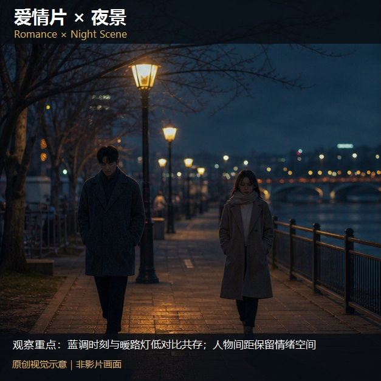

知识讲解：[A1-16 类型片×场景色彩系统](../../knowledge/A-%E7%90%86%E8%AE%BA%E5%B1%82/A1-%E6%91%84%E5%BD%B1%E7%BB%84/A1-16%20%E7%B1%BB%E5%9E%8B%E7%89%87%C3%97%E5%9C%BA%E6%99%AF%E8%89%B2%E5%BD%A9%E7%B3%BB%E7%BB%9F.md)

## 类型片×场景色彩系统：逐项原创视觉覆盖（9项）（052-romance-rain，原创教学示意）

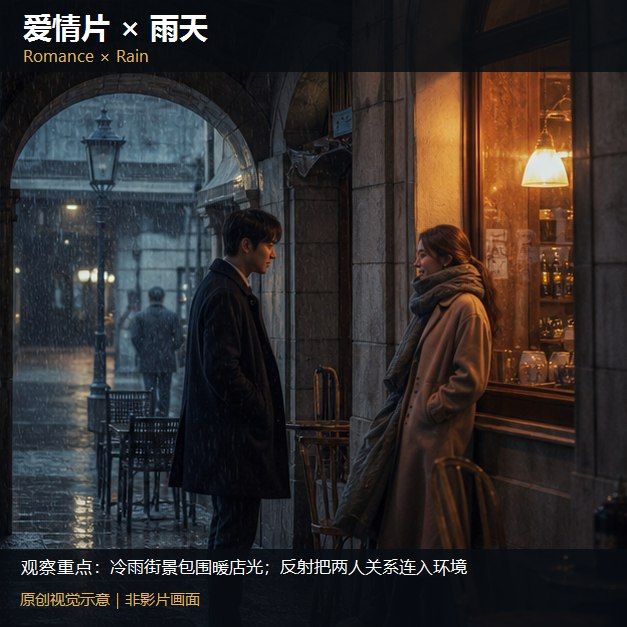

知识讲解：[A1-16 类型片×场景色彩系统](../../knowledge/A-%E7%90%86%E8%AE%BA%E5%B1%82/A1-%E6%91%84%E5%BD%B1%E7%BB%84/A1-16%20%E7%B1%BB%E5%9E%8B%E7%89%87%C3%97%E5%9C%BA%E6%99%AF%E8%89%B2%E5%BD%A9%E7%B3%BB%E7%BB%9F.md)

## 类型片×场景色彩系统：逐项原创视觉覆盖（9项）（053-romance-village，原创教学示意）

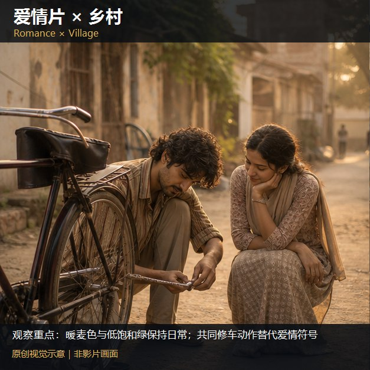

知识讲解：[A1-16 类型片×场景色彩系统](../../knowledge/A-%E7%90%86%E8%AE%BA%E5%B1%82/A1-%E6%91%84%E5%BD%B1%E7%BB%84/A1-16%20%E7%B1%BB%E5%9E%8B%E7%89%87%C3%97%E5%9C%BA%E6%99%AF%E8%89%B2%E5%BD%A9%E7%B3%BB%E7%BB%9F.md)

## 类型片×场景色彩系统：逐项原创视觉覆盖（9项）（054-romance-school，原创教学示意）

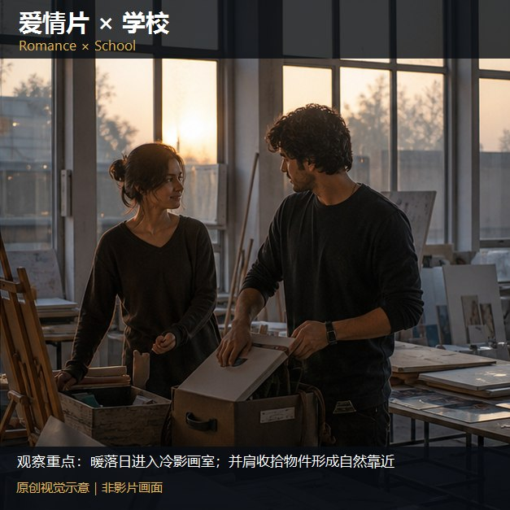

知识讲解：[A1-16 类型片×场景色彩系统](../../knowledge/A-%E7%90%86%E8%AE%BA%E5%B1%82/A1-%E6%91%84%E5%BD%B1%E7%BB%84/A1-16%20%E7%B1%BB%E5%9E%8B%E7%89%87%C3%97%E5%9C%BA%E6%99%AF%E8%89%B2%E5%BD%A9%E7%B3%BB%E7%BB%9F.md)

## 类型片×场景色彩系统：逐项原创视觉覆盖（9项）（055-romance-family，原创教学示意）

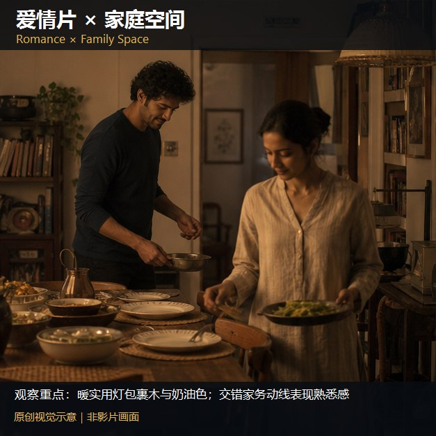

知识讲解：[A1-16 类型片×场景色彩系统](../../knowledge/A-%E7%90%86%E8%AE%BA%E5%B1%82/A1-%E6%91%84%E5%BD%B1%E7%BB%84/A1-16%20%E7%B1%BB%E5%9E%8B%E7%89%87%C3%97%E5%9C%BA%E6%99%AF%E8%89%B2%E5%BD%A9%E7%B3%BB%E7%BB%9F.md)
