# A1-16 · 73—96

[全部主题](../IMAGE_GALLERY.md) · [首页](../../README.md)

## 类型片×场景色彩系统：逐项原创视觉覆盖（9项）（056-romance-memory，原创教学示意）

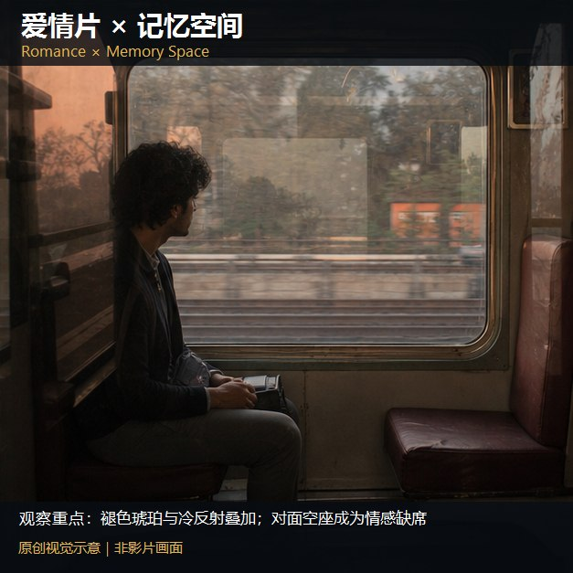

知识讲解：[A1-16 类型片×场景色彩系统](../../knowledge/A-%E7%90%86%E8%AE%BA%E5%B1%82/A1-%E6%91%84%E5%BD%B1%E7%BB%84/A1-16%20%E7%B1%BB%E5%9E%8B%E7%89%87%C3%97%E5%9C%BA%E6%99%AF%E8%89%B2%E5%BD%A9%E7%B3%BB%E7%BB%9F.md)

## 类型片×场景色彩系统：逐项原创视觉覆盖（9项）（095-romance-exterior，原创教学示意）

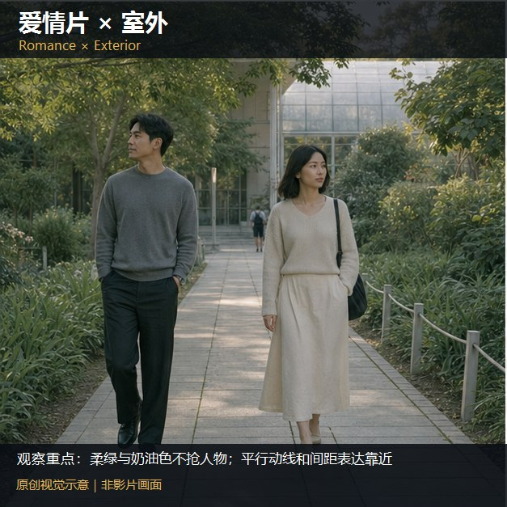

知识讲解：[A1-16 类型片×场景色彩系统](../../knowledge/A-%E7%90%86%E8%AE%BA%E5%B1%82/A1-%E6%91%84%E5%BD%B1%E7%BB%84/A1-16%20%E7%B1%BB%E5%9E%8B%E7%89%87%C3%97%E5%9C%BA%E6%99%AF%E8%89%B2%E5%BD%A9%E7%B3%BB%E7%BB%9F.md)

## 类型片×场景色彩系统：逐项原创视觉覆盖（9项）（096-romance-day，原创教学示意）

知识讲解：[A1-16 类型片×场景色彩系统](../../knowledge/A-%E7%90%86%E8%AE%BA%E5%B1%82/A1-%E6%91%84%E5%BD%B1%E7%BB%84/A1-16%20%E7%B1%BB%E5%9E%8B%E7%89%87%C3%97%E5%9C%BA%E6%99%AF%E8%89%B2%E5%BD%A9%E7%B3%BB%E7%BB%9F.md)

## 类型片×场景色彩系统：逐项原创视觉覆盖（10项）（057-horror-lab，原创教学示意）

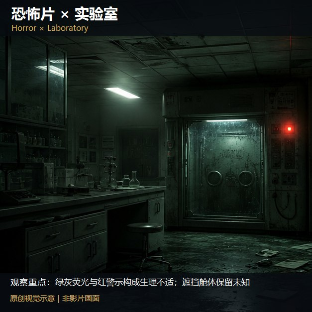

知识讲解：[A1-16 类型片×场景色彩系统](../../knowledge/A-%E7%90%86%E8%AE%BA%E5%B1%82/A1-%E6%91%84%E5%BD%B1%E7%BB%84/A1-16%20%E7%B1%BB%E5%9E%8B%E7%89%87%C3%97%E5%9C%BA%E6%99%AF%E8%89%B2%E5%BD%A9%E7%B3%BB%E7%BB%9F.md)

## 类型片×场景色彩系统：逐项原创视觉覆盖（10项）（058-horror-capsule，原创教学示意）

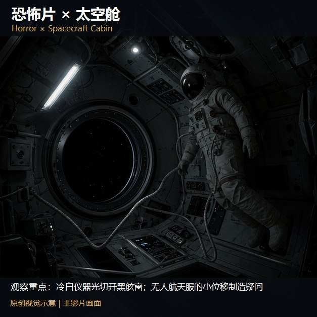

知识讲解：[A1-16 类型片×场景色彩系统](../../knowledge/A-%E7%90%86%E8%AE%BA%E5%B1%82/A1-%E6%91%84%E5%BD%B1%E7%BB%84/A1-16%20%E7%B1%BB%E5%9E%8B%E7%89%87%C3%97%E5%9C%BA%E6%99%AF%E8%89%B2%E5%BD%A9%E7%B3%BB%E7%BB%9F.md)

## 类型片×场景色彩系统：逐项原创视觉覆盖（10项）（059-horror-underground，原创教学示意）

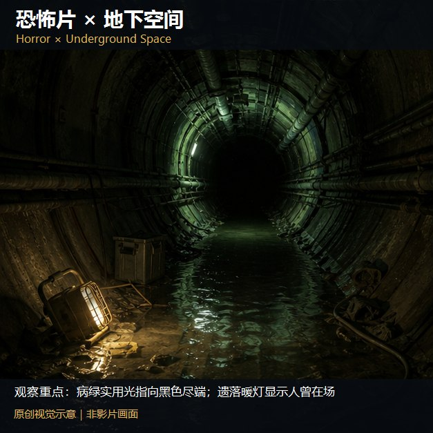

知识讲解：[A1-16 类型片×场景色彩系统](../../knowledge/A-%E7%90%86%E8%AE%BA%E5%B1%82/A1-%E6%91%84%E5%BD%B1%E7%BB%84/A1-16%20%E7%B1%BB%E5%9E%8B%E7%89%87%C3%97%E5%9C%BA%E6%99%AF%E8%89%B2%E5%BD%A9%E7%B3%BB%E7%BB%9F.md)

## 类型片×场景色彩系统：逐项原创视觉覆盖（10项）（060-horror-hospital，原创教学示意）

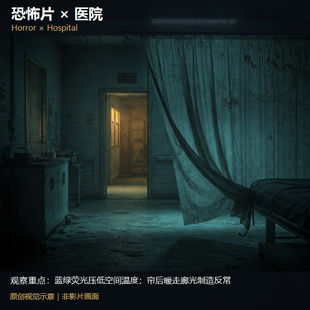

知识讲解：[A1-16 类型片×场景色彩系统](../../knowledge/A-%E7%90%86%E8%AE%BA%E5%B1%82/A1-%E6%91%84%E5%BD%B1%E7%BB%84/A1-16%20%E7%B1%BB%E5%9E%8B%E7%89%87%C3%97%E5%9C%BA%E6%99%AF%E8%89%B2%E5%BD%A9%E7%B3%BB%E7%BB%9F.md)

## 类型片×场景色彩系统：逐项原创视觉覆盖（10项）（061-horror-family，原创教学示意）

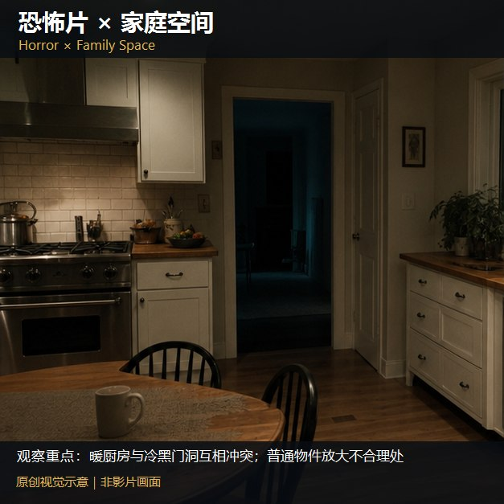

知识讲解：[A1-16 类型片×场景色彩系统](../../knowledge/A-%E7%90%86%E8%AE%BA%E5%B1%82/A1-%E6%91%84%E5%BD%B1%E7%BB%84/A1-16%20%E7%B1%BB%E5%9E%8B%E7%89%87%C3%97%E5%9C%BA%E6%99%AF%E8%89%B2%E5%BD%A9%E7%B3%BB%E7%BB%9F.md)

## 类型片×场景色彩系统：逐项原创视觉覆盖（10项）（062-horror-dream，原创教学示意）

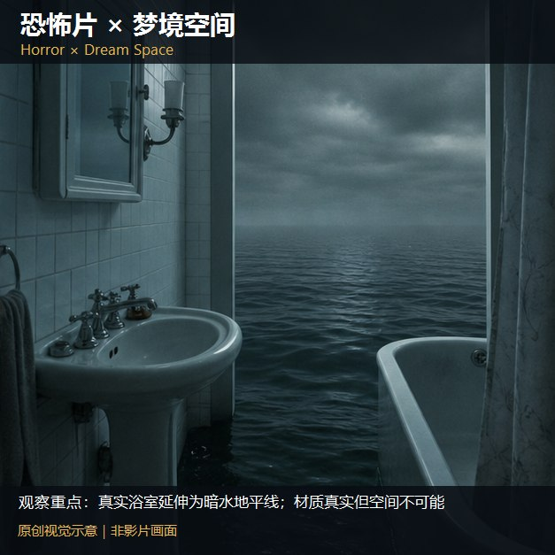

知识讲解：[A1-16 类型片×场景色彩系统](../../knowledge/A-%E7%90%86%E8%AE%BA%E5%B1%82/A1-%E6%91%84%E5%BD%B1%E7%BB%84/A1-16%20%E7%B1%BB%E5%9E%8B%E7%89%87%C3%97%E5%9C%BA%E6%99%AF%E8%89%B2%E5%BD%A9%E7%B3%BB%E7%BB%9F.md)

## 类型片×场景色彩系统：逐项原创视觉覆盖（10项）（063-horror-apocalypse，原创教学示意）

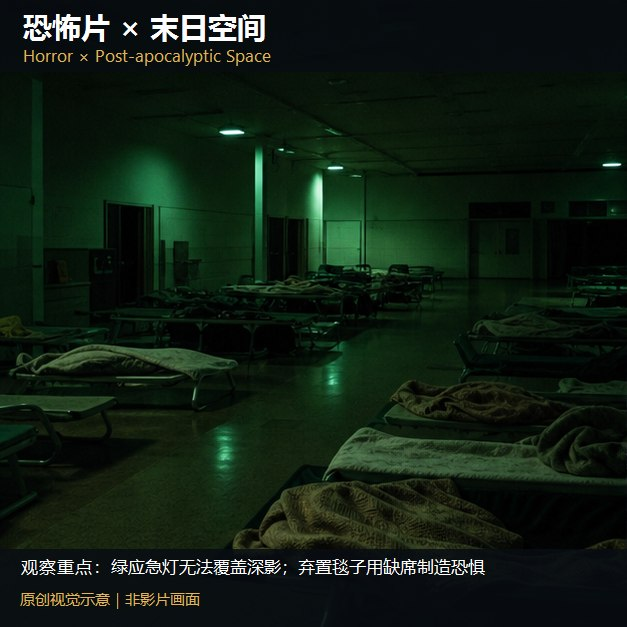

知识讲解：[A1-16 类型片×场景色彩系统](../../knowledge/A-%E7%90%86%E8%AE%BA%E5%B1%82/A1-%E6%91%84%E5%BD%B1%E7%BB%84/A1-16%20%E7%B1%BB%E5%9E%8B%E7%89%87%C3%97%E5%9C%BA%E6%99%AF%E8%89%B2%E5%BD%A9%E7%B3%BB%E7%BB%9F.md)

## 类型片×场景色彩系统：逐项原创视觉覆盖（10项）（064-horror-alien，原创教学示意）

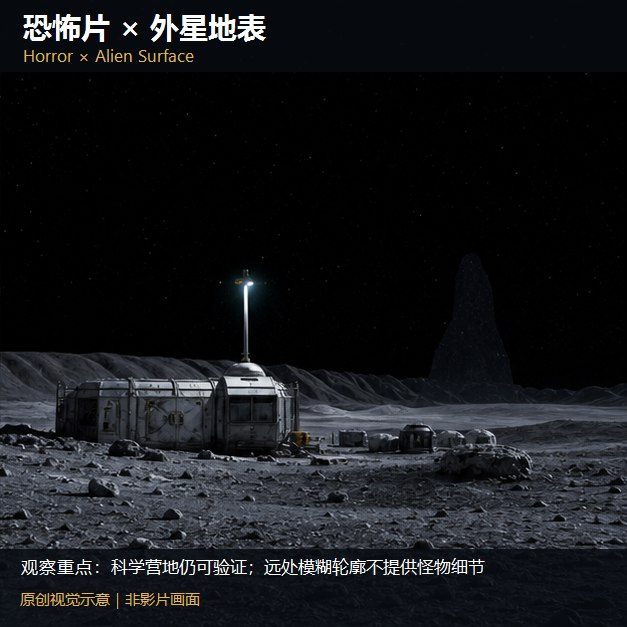

知识讲解：[A1-16 类型片×场景色彩系统](../../knowledge/A-%E7%90%86%E8%AE%BA%E5%B1%82/A1-%E6%91%84%E5%BD%B1%E7%BB%84/A1-16%20%E7%B1%BB%E5%9E%8B%E7%89%87%C3%97%E5%9C%BA%E6%99%AF%E8%89%B2%E5%BD%A9%E7%B3%BB%E7%BB%9F.md)

## 类型片×场景色彩系统：逐项原创视觉覆盖（10项）（097-horror-exterior，原创教学示意）

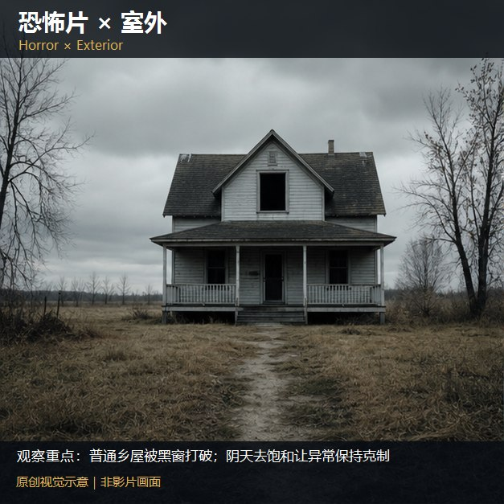

知识讲解：[A1-16 类型片×场景色彩系统](../../knowledge/A-%E7%90%86%E8%AE%BA%E5%B1%82/A1-%E6%91%84%E5%BD%B1%E7%BB%84/A1-16%20%E7%B1%BB%E5%9E%8B%E7%89%87%C3%97%E5%9C%BA%E6%99%AF%E8%89%B2%E5%BD%A9%E7%B3%BB%E7%BB%9F.md)

## 类型片×场景色彩系统：逐项原创视觉覆盖（10项）（098-horror-day，原创教学示意）

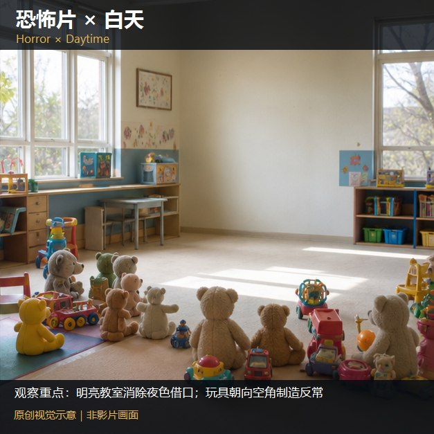

知识讲解：[A1-16 类型片×场景色彩系统](../../knowledge/A-%E7%90%86%E8%AE%BA%E5%B1%82/A1-%E6%91%84%E5%BD%B1%E7%BB%84/A1-16%20%E7%B1%BB%E5%9E%8B%E7%89%87%C3%97%E5%9C%BA%E6%99%AF%E8%89%B2%E5%BD%A9%E7%B3%BB%E7%BB%9F.md)

## 类型片×场景色彩系统：逐项原创视觉覆盖（6项）（065-apocalypse-space，原创教学示意）

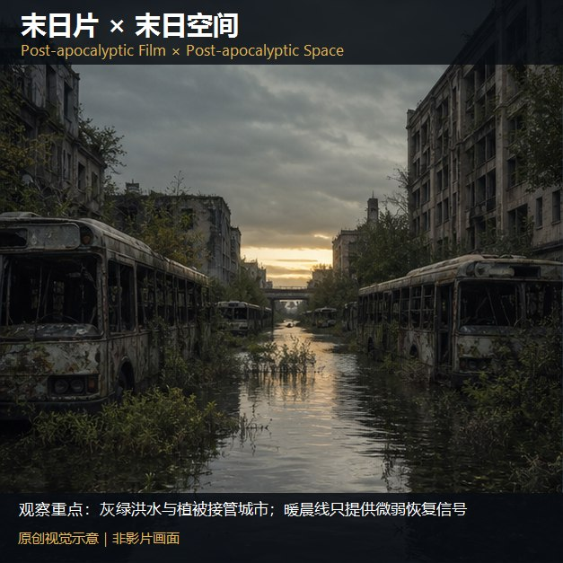

知识讲解：[A1-16 类型片×场景色彩系统](../../knowledge/A-%E7%90%86%E8%AE%BA%E5%B1%82/A1-%E6%91%84%E5%BD%B1%E7%BB%84/A1-16%20%E7%B1%BB%E5%9E%8B%E7%89%87%C3%97%E5%9C%BA%E6%99%AF%E8%89%B2%E5%BD%A9%E7%B3%BB%E7%BB%9F.md)

## 类型片×场景色彩系统：逐项原创视觉覆盖（6项）（066-apocalypse-snow，原创教学示意）

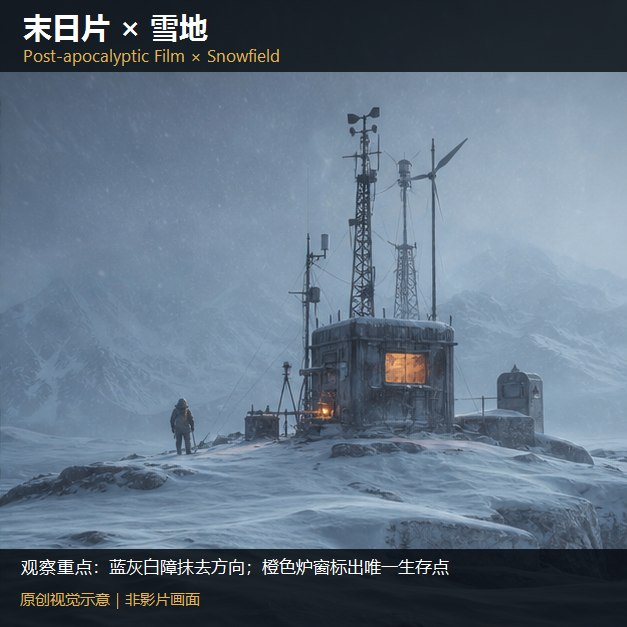

知识讲解：[A1-16 类型片×场景色彩系统](../../knowledge/A-%E7%90%86%E8%AE%BA%E5%B1%82/A1-%E6%91%84%E5%BD%B1%E7%BB%84/A1-16%20%E7%B1%BB%E5%9E%8B%E7%89%87%C3%97%E5%9C%BA%E6%99%AF%E8%89%B2%E5%BD%A9%E7%B3%BB%E7%BB%9F.md)

## 类型片×场景色彩系统：逐项原创视觉覆盖（6项）（067-apocalypse-desert，原创教学示意）

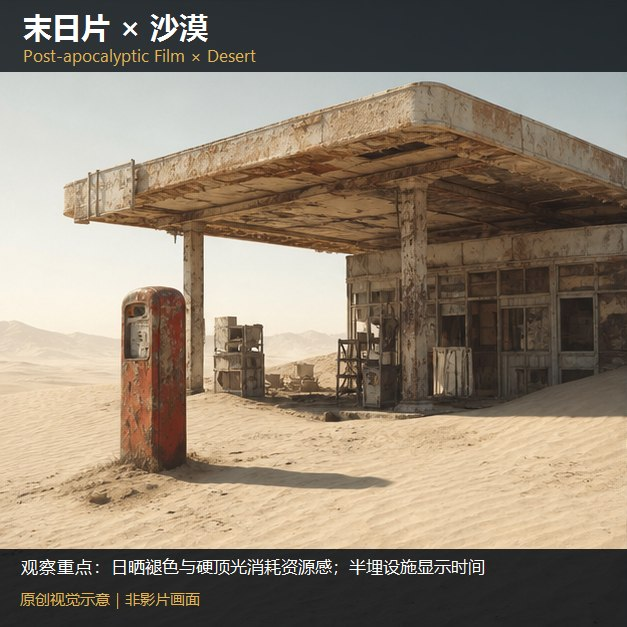

知识讲解：[A1-16 类型片×场景色彩系统](../../knowledge/A-%E7%90%86%E8%AE%BA%E5%B1%82/A1-%E6%91%84%E5%BD%B1%E7%BB%84/A1-16%20%E7%B1%BB%E5%9E%8B%E7%89%87%C3%97%E5%9C%BA%E6%99%AF%E8%89%B2%E5%BD%A9%E7%B3%BB%E7%BB%9F.md)

## 类型片×场景色彩系统：逐项原创视觉覆盖（6项）（068-apocalypse-ruins，原创教学示意）

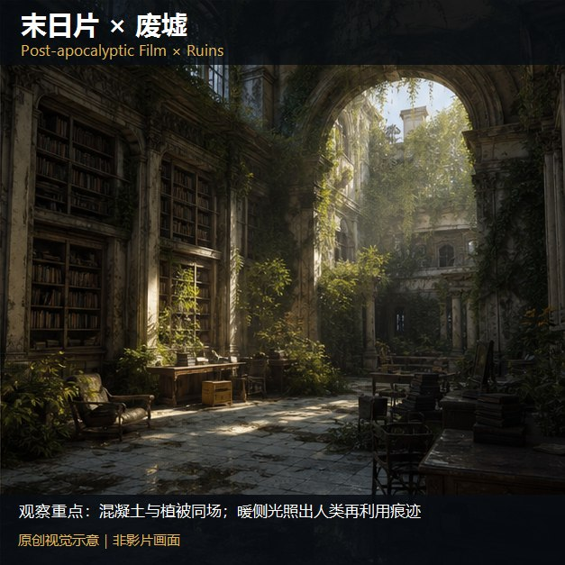

知识讲解：[A1-16 类型片×场景色彩系统](../../knowledge/A-%E7%90%86%E8%AE%BA%E5%B1%82/A1-%E6%91%84%E5%BD%B1%E7%BB%84/A1-16%20%E7%B1%BB%E5%9E%8B%E7%89%87%C3%97%E5%9C%BA%E6%99%AF%E8%89%B2%E5%BD%A9%E7%B3%BB%E7%BB%9F.md)

## 类型片×场景色彩系统：逐项原创视觉覆盖（6项）（099-apocalypse-exterior，原创教学示意）

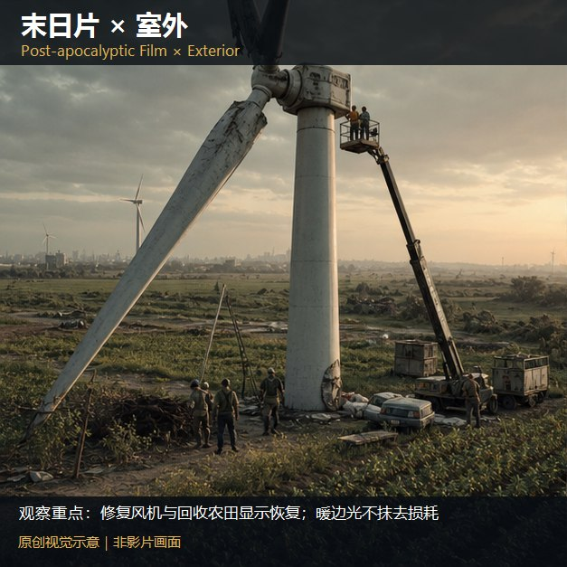

知识讲解：[A1-16 类型片×场景色彩系统](../../knowledge/A-%E7%90%86%E8%AE%BA%E5%B1%82/A1-%E6%91%84%E5%BD%B1%E7%BB%84/A1-16%20%E7%B1%BB%E5%9E%8B%E7%89%87%C3%97%E5%9C%BA%E6%99%AF%E8%89%B2%E5%BD%A9%E7%B3%BB%E7%BB%9F.md)

## 类型片×场景色彩系统：逐项原创视觉覆盖（6项）（100-apocalypse-day，原创教学示意）

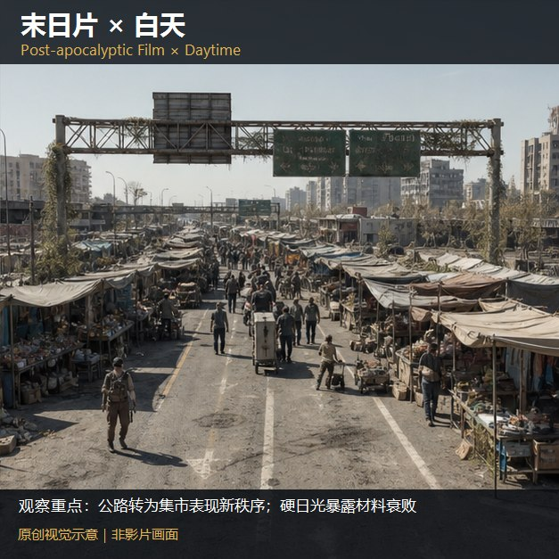

知识讲解：[A1-16 类型片×场景色彩系统](../../knowledge/A-%E7%90%86%E8%AE%BA%E5%B1%82/A1-%E6%91%84%E5%BD%B1%E7%BB%84/A1-16%20%E7%B1%BB%E5%9E%8B%E7%89%87%C3%97%E5%9C%BA%E6%99%AF%E8%89%B2%E5%BD%A9%E7%B3%BB%E7%BB%9F.md)

## 类型片×场景色彩系统：逐项原创视觉覆盖（5项）（069-military-sf-battlefield，原创教学示意）

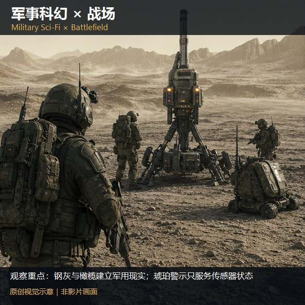

知识讲解：[A1-16 类型片×场景色彩系统](../../knowledge/A-%E7%90%86%E8%AE%BA%E5%B1%82/A1-%E6%91%84%E5%BD%B1%E7%BB%84/A1-16%20%E7%B1%BB%E5%9E%8B%E7%89%87%C3%97%E5%9C%BA%E6%99%AF%E8%89%B2%E5%BD%A9%E7%B3%BB%E7%BB%9F.md)

## 类型片×场景色彩系统：逐项原创视觉覆盖（5项）（070-military-sf-capsule，原创教学示意）

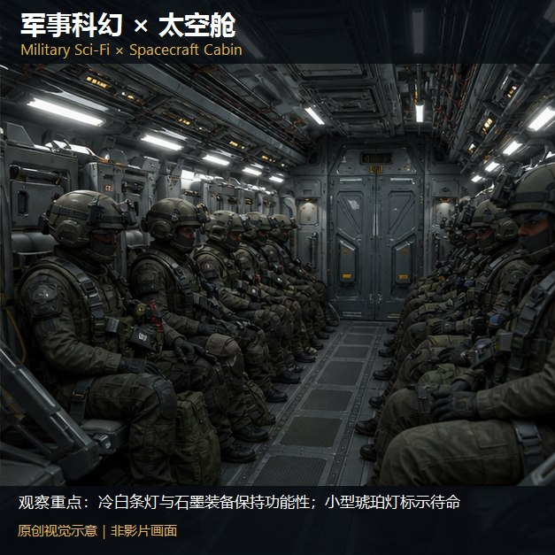

知识讲解：[A1-16 类型片×场景色彩系统](../../knowledge/A-%E7%90%86%E8%AE%BA%E5%B1%82/A1-%E6%91%84%E5%BD%B1%E7%BB%84/A1-16%20%E7%B1%BB%E5%9E%8B%E7%89%87%C3%97%E5%9C%BA%E6%99%AF%E8%89%B2%E5%BD%A9%E7%B3%BB%E7%BB%9F.md)

## 类型片×场景色彩系统：逐项原创视觉覆盖（5项）（071-military-sf-hard-space，原创教学示意）

知识讲解：[A1-16 类型片×场景色彩系统](../../knowledge/A-%E7%90%86%E8%AE%BA%E5%B1%82/A1-%E6%91%84%E5%BD%B1%E7%BB%84/A1-16%20%E7%B1%BB%E5%9E%8B%E7%89%87%C3%97%E5%9C%BA%E6%99%AF%E8%89%B2%E5%BD%A9%E7%B3%BB%E7%BB%9F.md)

## 类型片×场景色彩系统：逐项原创视觉覆盖（5项）（101-military-sf-exterior，原创教学示意）

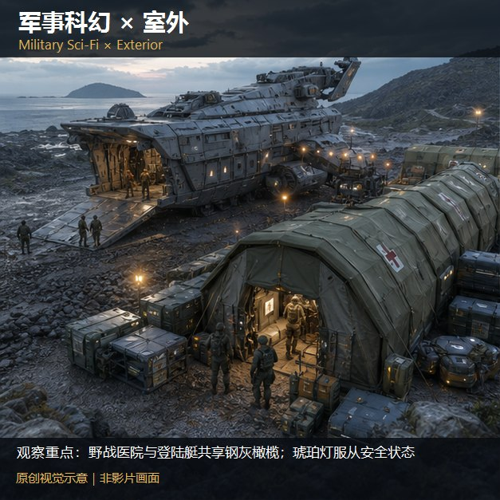

知识讲解：[A1-16 类型片×场景色彩系统](../../knowledge/A-%E7%90%86%E8%AE%BA%E5%B1%82/A1-%E6%91%84%E5%BD%B1%E7%BB%84/A1-16%20%E7%B1%BB%E5%9E%8B%E7%89%87%C3%97%E5%9C%BA%E6%99%AF%E8%89%B2%E5%BD%A9%E7%B3%BB%E7%BB%9F.md)

## 类型片×场景色彩系统：逐项原创视觉覆盖（5项）（102-military-sf-day，原创教学示意）

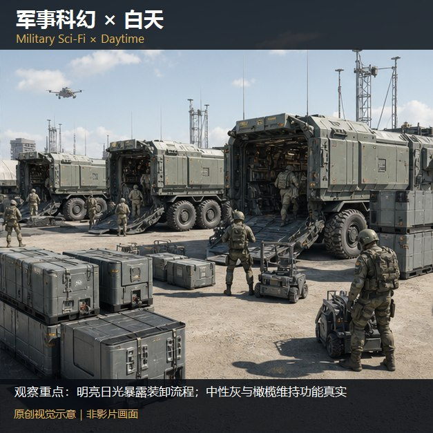

知识讲解：[A1-16 类型片×场景色彩系统](../../knowledge/A-%E7%90%86%E8%AE%BA%E5%B1%82/A1-%E6%91%84%E5%BD%B1%E7%BB%84/A1-16%20%E7%B1%BB%E5%9E%8B%E7%89%87%C3%97%E5%9C%BA%E6%99%AF%E8%89%B2%E5%BD%A9%E7%B3%BB%E7%BB%9F.md)
