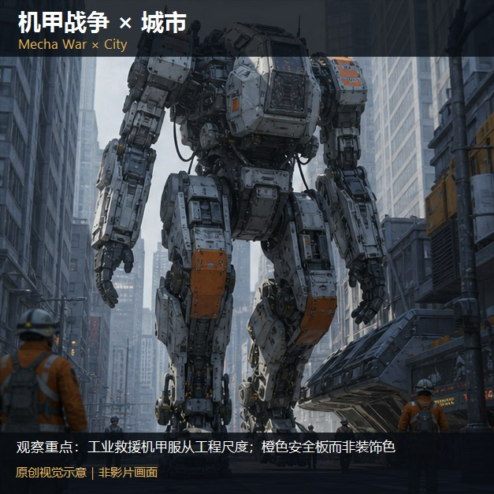
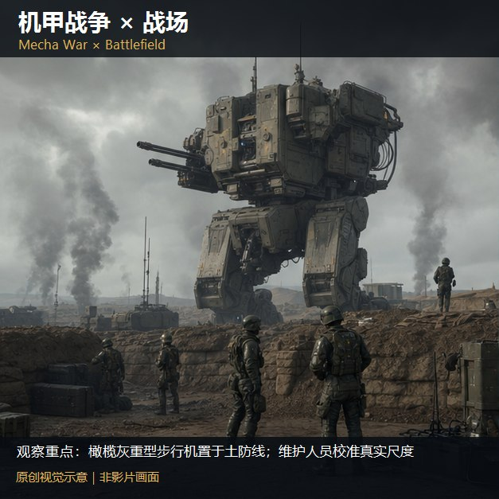
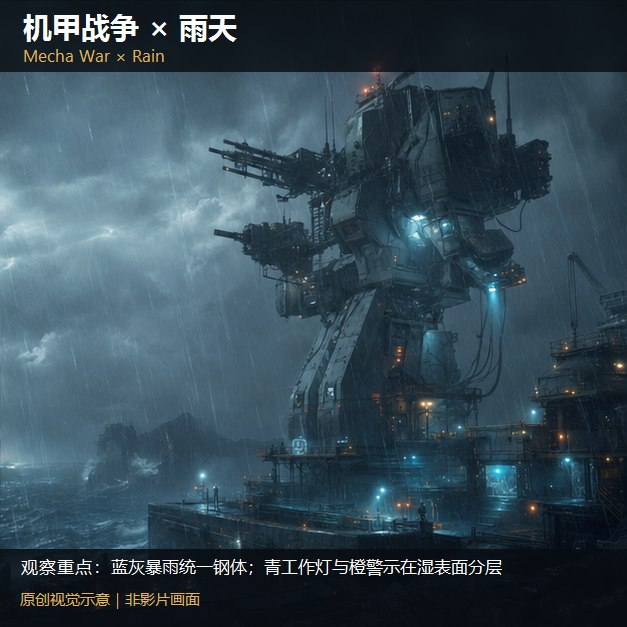
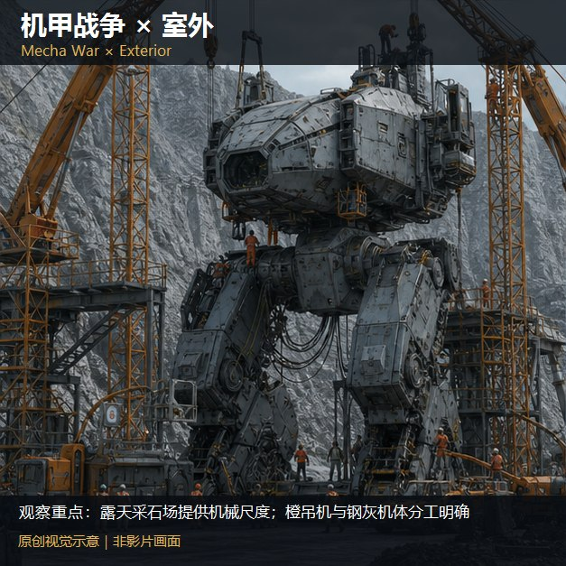
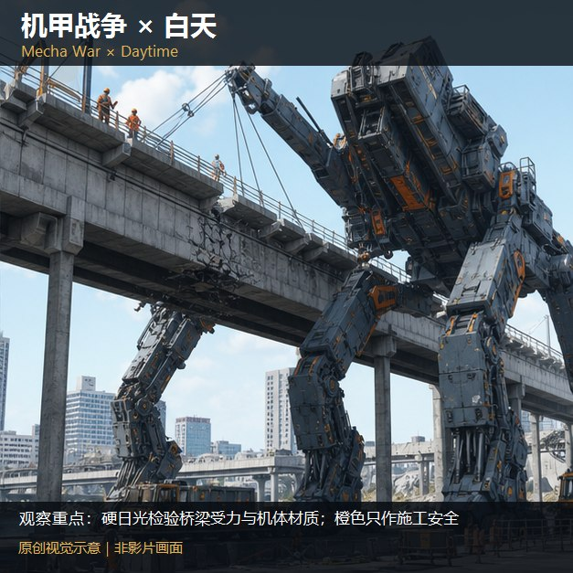
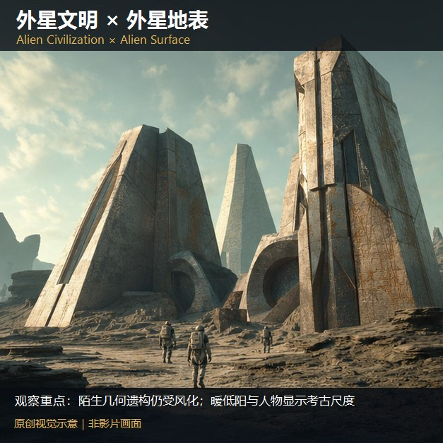
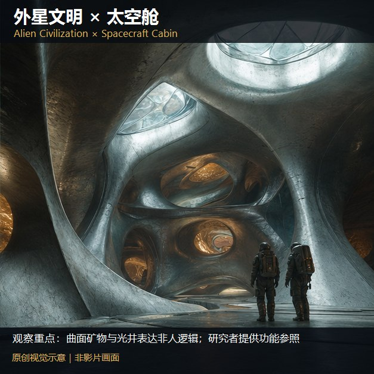
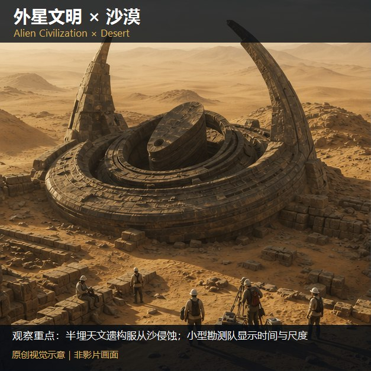
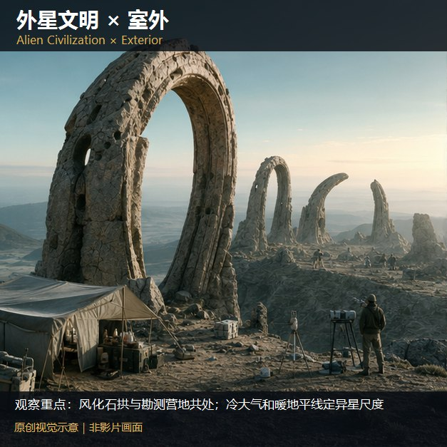
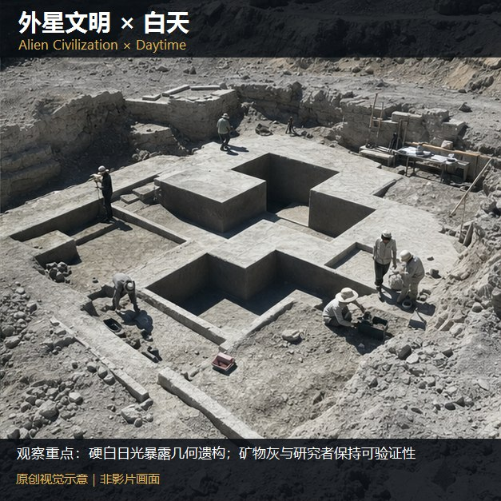

# A1-16 · 97—106

[全部主题](../IMAGE_GALLERY.md) · [首页](../../README.md)

## 类型片×场景色彩系统：逐项原创视觉覆盖（5项）（072-mecha-city，原创教学示意）

知识讲解：[A1-16 类型片×场景色彩系统](../../knowledge/A-%E7%90%86%E8%AE%BA%E5%B1%82/A1-%E6%91%84%E5%BD%B1%E7%BB%84/A1-16%20%E7%B1%BB%E5%9E%8B%E7%89%87%C3%97%E5%9C%BA%E6%99%AF%E8%89%B2%E5%BD%A9%E7%B3%BB%E7%BB%9F.md)

## 类型片×场景色彩系统：逐项原创视觉覆盖（5项）（073-mecha-battlefield，原创教学示意）

知识讲解：[A1-16 类型片×场景色彩系统](../../knowledge/A-%E7%90%86%E8%AE%BA%E5%B1%82/A1-%E6%91%84%E5%BD%B1%E7%BB%84/A1-16%20%E7%B1%BB%E5%9E%8B%E7%89%87%C3%97%E5%9C%BA%E6%99%AF%E8%89%B2%E5%BD%A9%E7%B3%BB%E7%BB%9F.md)

## 类型片×场景色彩系统：逐项原创视觉覆盖（5项）（074-mecha-rain，原创教学示意）

知识讲解：[A1-16 类型片×场景色彩系统](../../knowledge/A-%E7%90%86%E8%AE%BA%E5%B1%82/A1-%E6%91%84%E5%BD%B1%E7%BB%84/A1-16%20%E7%B1%BB%E5%9E%8B%E7%89%87%C3%97%E5%9C%BA%E6%99%AF%E8%89%B2%E5%BD%A9%E7%B3%BB%E7%BB%9F.md)

## 类型片×场景色彩系统：逐项原创视觉覆盖（5项）（103-mecha-exterior，原创教学示意）

知识讲解：[A1-16 类型片×场景色彩系统](../../knowledge/A-%E7%90%86%E8%AE%BA%E5%B1%82/A1-%E6%91%84%E5%BD%B1%E7%BB%84/A1-16%20%E7%B1%BB%E5%9E%8B%E7%89%87%C3%97%E5%9C%BA%E6%99%AF%E8%89%B2%E5%BD%A9%E7%B3%BB%E7%BB%9F.md)

## 类型片×场景色彩系统：逐项原创视觉覆盖（5项）（104-mecha-day，原创教学示意）

知识讲解：[A1-16 类型片×场景色彩系统](../../knowledge/A-%E7%90%86%E8%AE%BA%E5%B1%82/A1-%E6%91%84%E5%BD%B1%E7%BB%84/A1-16%20%E7%B1%BB%E5%9E%8B%E7%89%87%C3%97%E5%9C%BA%E6%99%AF%E8%89%B2%E5%BD%A9%E7%B3%BB%E7%BB%9F.md)

## 类型片×场景色彩系统：逐项原创视觉覆盖（5项）（075-alien-surface，原创教学示意）

知识讲解：[A1-16 类型片×场景色彩系统](../../knowledge/A-%E7%90%86%E8%AE%BA%E5%B1%82/A1-%E6%91%84%E5%BD%B1%E7%BB%84/A1-16%20%E7%B1%BB%E5%9E%8B%E7%89%87%C3%97%E5%9C%BA%E6%99%AF%E8%89%B2%E5%BD%A9%E7%B3%BB%E7%BB%9F.md)

## 类型片×场景色彩系统：逐项原创视觉覆盖（5项）（076-alien-capsule，原创教学示意）

知识讲解：[A1-16 类型片×场景色彩系统](../../knowledge/A-%E7%90%86%E8%AE%BA%E5%B1%82/A1-%E6%91%84%E5%BD%B1%E7%BB%84/A1-16%20%E7%B1%BB%E5%9E%8B%E7%89%87%C3%97%E5%9C%BA%E6%99%AF%E8%89%B2%E5%BD%A9%E7%B3%BB%E7%BB%9F.md)

## 类型片×场景色彩系统：逐项原创视觉覆盖（5项）（077-alien-desert，原创教学示意）

知识讲解：[A1-16 类型片×场景色彩系统](../../knowledge/A-%E7%90%86%E8%AE%BA%E5%B1%82/A1-%E6%91%84%E5%BD%B1%E7%BB%84/A1-16%20%E7%B1%BB%E5%9E%8B%E7%89%87%C3%97%E5%9C%BA%E6%99%AF%E8%89%B2%E5%BD%A9%E7%B3%BB%E7%BB%9F.md)

## 类型片×场景色彩系统：逐项原创视觉覆盖（5项）（105-alien-exterior，原创教学示意）

知识讲解：[A1-16 类型片×场景色彩系统](../../knowledge/A-%E7%90%86%E8%AE%BA%E5%B1%82/A1-%E6%91%84%E5%BD%B1%E7%BB%84/A1-16%20%E7%B1%BB%E5%9E%8B%E7%89%87%C3%97%E5%9C%BA%E6%99%AF%E8%89%B2%E5%BD%A9%E7%B3%BB%E7%BB%9F.md)

## 类型片×场景色彩系统：逐项原创视觉覆盖（5项）（106-alien-day，原创教学示意）

知识讲解：[A1-16 类型片×场景色彩系统](../../knowledge/A-%E7%90%86%E8%AE%BA%E5%B1%82/A1-%E6%91%84%E5%BD%B1%E7%BB%84/A1-16%20%E7%B1%BB%E5%9E%8B%E7%89%87%C3%97%E5%9C%BA%E6%99%AF%E8%89%B2%E5%BD%A9%E7%B3%BB%E7%BB%9F.md)
