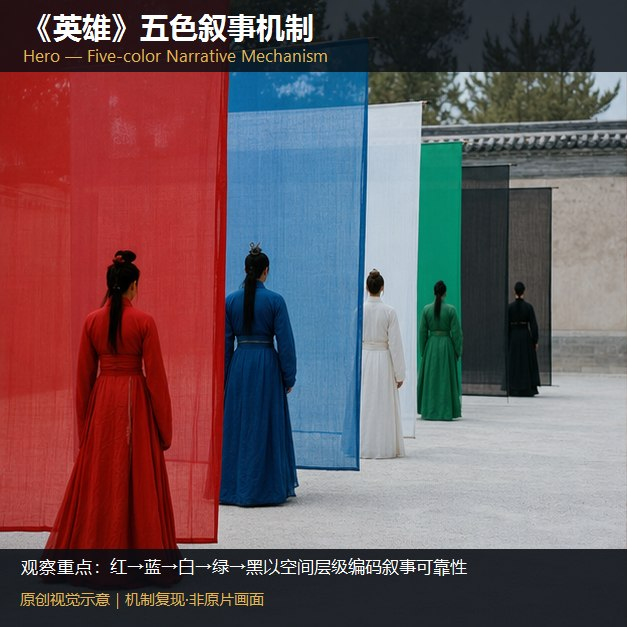
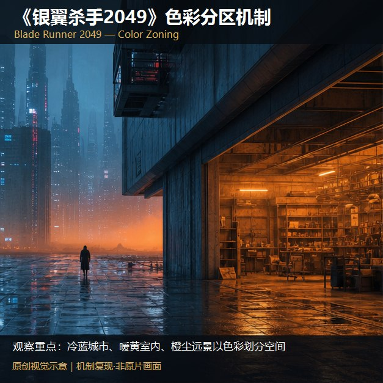
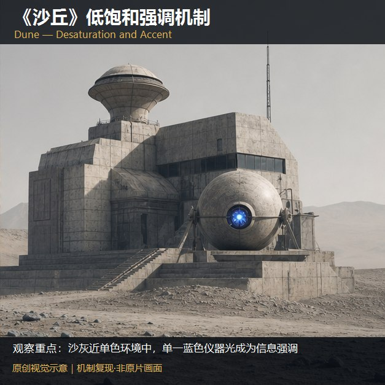
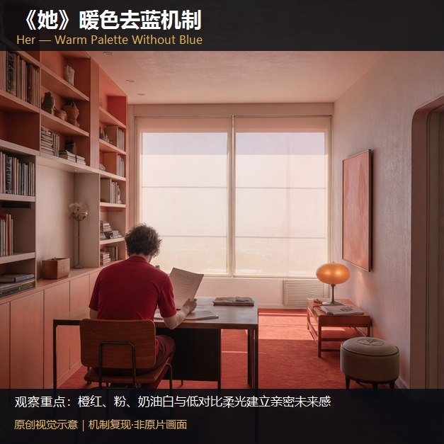
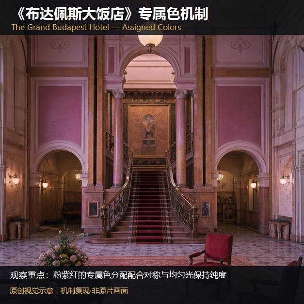
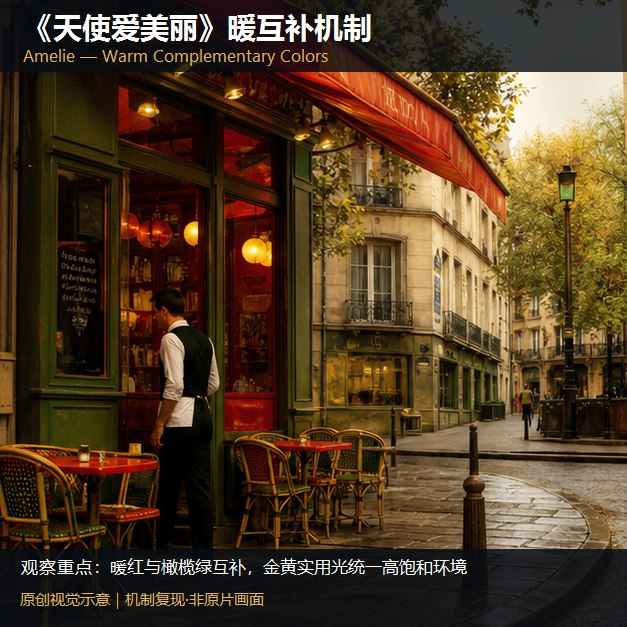
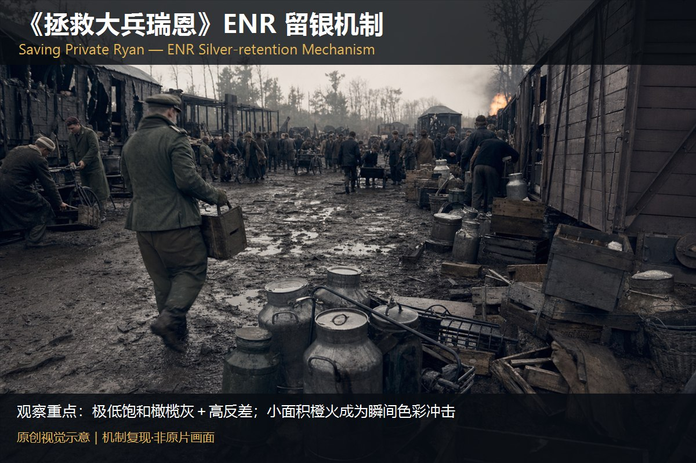
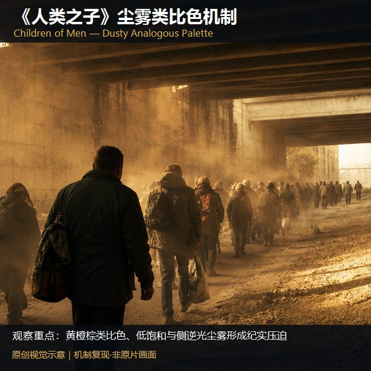
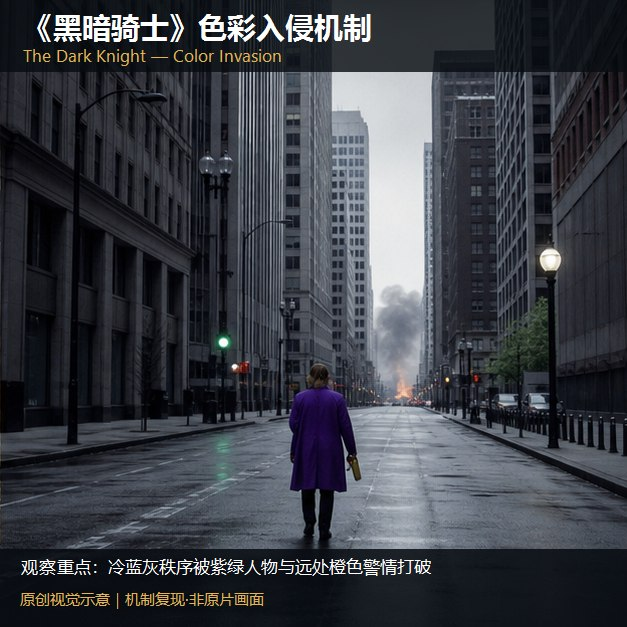

# A1-17 · 1—10

[全部主题](../IMAGE_GALLERY.md) · [首页](../../README.md)

## 经典电影色彩案例：AI可迁移方法（01-hero-five-color，原创教学示意）

知识讲解：[A1-17 经典电影色彩案例](../../knowledge/A-%E7%90%86%E8%AE%BA%E5%B1%82/A1-%E6%91%84%E5%BD%B1%E7%BB%84/A1-17%20%E7%BB%8F%E5%85%B8%E7%94%B5%E5%BD%B1%E8%89%B2%E5%BD%A9%E6%A1%88%E4%BE%8B.md)

## 经典电影色彩案例：AI可迁移方法（02-in-the-mood-warm-corridor，原创教学示意）

知识讲解：[A1-17 经典电影色彩案例](../../knowledge/A-%E7%90%86%E8%AE%BA%E5%B1%82/A1-%E6%91%84%E5%BD%B1%E7%BB%84/A1-17%20%E7%BB%8F%E5%85%B8%E7%94%B5%E5%BD%B1%E8%89%B2%E5%BD%A9%E6%A1%88%E4%BE%8B.md)

## 经典电影色彩案例：AI可迁移方法（03-blade-runner-color-zones，原创教学示意）

知识讲解：[A1-17 经典电影色彩案例](../../knowledge/A-%E7%90%86%E8%AE%BA%E5%B1%82/A1-%E6%91%84%E5%BD%B1%E7%BB%84/A1-17%20%E7%BB%8F%E5%85%B8%E7%94%B5%E5%BD%B1%E8%89%B2%E5%BD%A9%E6%A1%88%E4%BE%8B.md)

## 经典电影色彩案例：AI可迁移方法（04-dune-desaturated-accent，原创教学示意）

知识讲解：[A1-17 经典电影色彩案例](../../knowledge/A-%E7%90%86%E8%AE%BA%E5%B1%82/A1-%E6%91%84%E5%BD%B1%E7%BB%84/A1-17%20%E7%BB%8F%E5%85%B8%E7%94%B5%E5%BD%B1%E8%89%B2%E5%BD%A9%E6%A1%88%E4%BE%8B.md)

## 经典电影色彩案例：AI可迁移方法（05-her-warm-no-blue，原创教学示意）

知识讲解：[A1-17 经典电影色彩案例](../../knowledge/A-%E7%90%86%E8%AE%BA%E5%B1%82/A1-%E6%91%84%E5%BD%B1%E7%BB%84/A1-17%20%E7%BB%8F%E5%85%B8%E7%94%B5%E5%BD%B1%E8%89%B2%E5%BD%A9%E6%A1%88%E4%BE%8B.md)

## 经典电影色彩案例：AI可迁移方法（06-grand-budapest-palette，原创教学示意）

知识讲解：[A1-17 经典电影色彩案例](../../knowledge/A-%E7%90%86%E8%AE%BA%E5%B1%82/A1-%E6%91%84%E5%BD%B1%E7%BB%84/A1-17%20%E7%BB%8F%E5%85%B8%E7%94%B5%E5%BD%B1%E8%89%B2%E5%BD%A9%E6%A1%88%E4%BE%8B.md)

## 经典电影色彩案例：AI可迁移方法（07-amelie-warm-complements，原创教学示意）

知识讲解：[A1-17 经典电影色彩案例](../../knowledge/A-%E7%90%86%E8%AE%BA%E5%B1%82/A1-%E6%91%84%E5%BD%B1%E7%BB%84/A1-17%20%E7%BB%8F%E5%85%B8%E7%94%B5%E5%BD%B1%E8%89%B2%E5%BD%A9%E6%A1%88%E4%BE%8B.md)

## 经典电影色彩案例：AI可迁移方法（08-saving-private-ryan-enr，原创教学示意）

知识讲解：[A1-17 经典电影色彩案例](../../knowledge/A-%E7%90%86%E8%AE%BA%E5%B1%82/A1-%E6%91%84%E5%BD%B1%E7%BB%84/A1-17%20%E7%BB%8F%E5%85%B8%E7%94%B5%E5%BD%B1%E8%89%B2%E5%BD%A9%E6%A1%88%E4%BE%8B.md)

## 经典电影色彩案例：AI可迁移方法（09-children-of-men-dust，原创教学示意）

知识讲解：[A1-17 经典电影色彩案例](../../knowledge/A-%E7%90%86%E8%AE%BA%E5%B1%82/A1-%E6%91%84%E5%BD%B1%E7%BB%84/A1-17%20%E7%BB%8F%E5%85%B8%E7%94%B5%E5%BD%B1%E8%89%B2%E5%BD%A9%E6%A1%88%E4%BE%8B.md)

## 经典电影色彩案例：AI可迁移方法（10-dark-knight-color-invasion，原创教学示意）

知识讲解：[A1-17 经典电影色彩案例](../../knowledge/A-%E7%90%86%E8%AE%BA%E5%B1%82/A1-%E6%91%84%E5%BD%B1%E7%BB%84/A1-17%20%E7%BB%8F%E5%85%B8%E7%94%B5%E5%BD%B1%E8%89%B2%E5%BD%A9%E6%A1%88%E4%BE%8B.md)
