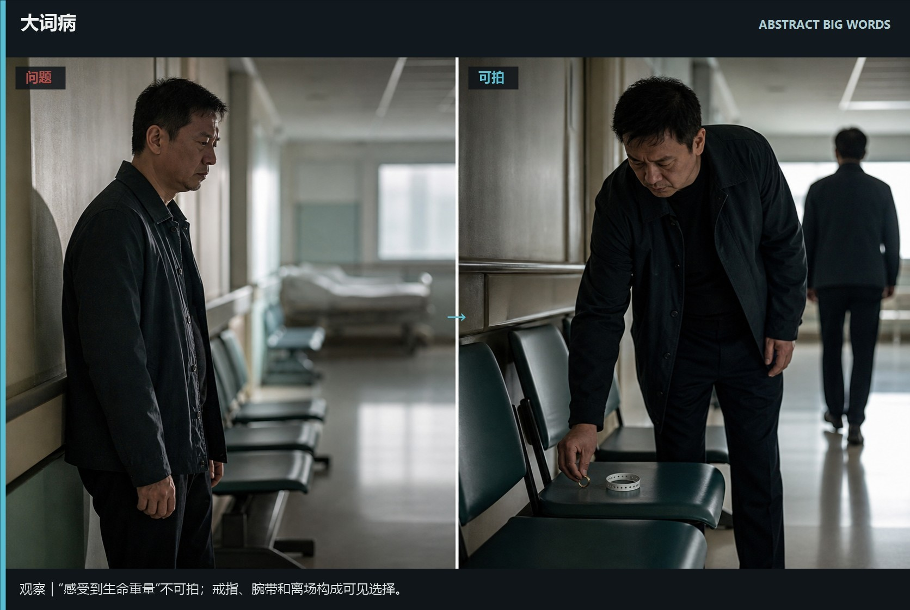
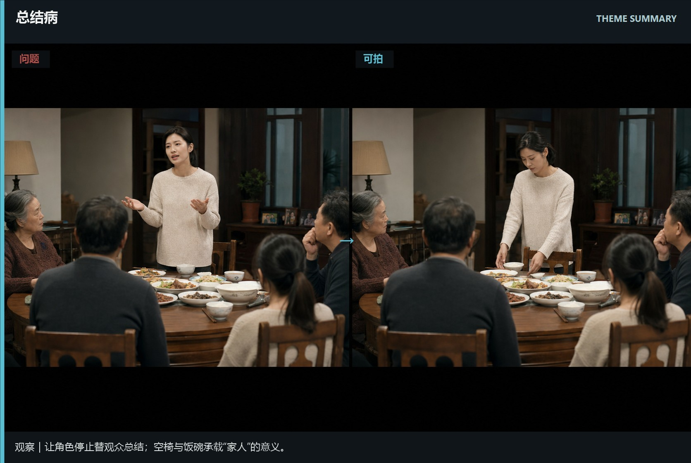
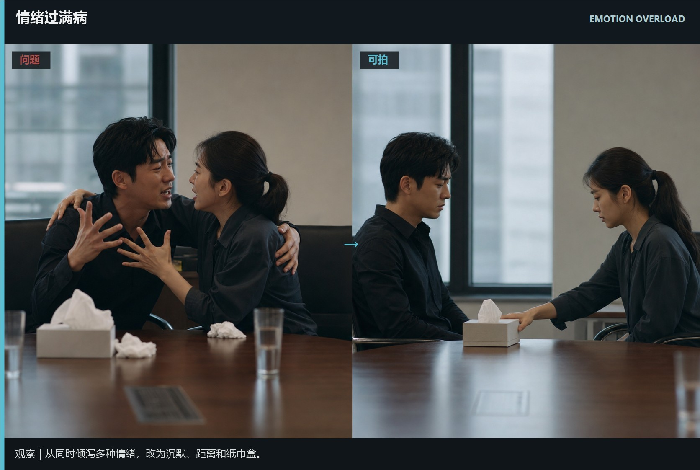
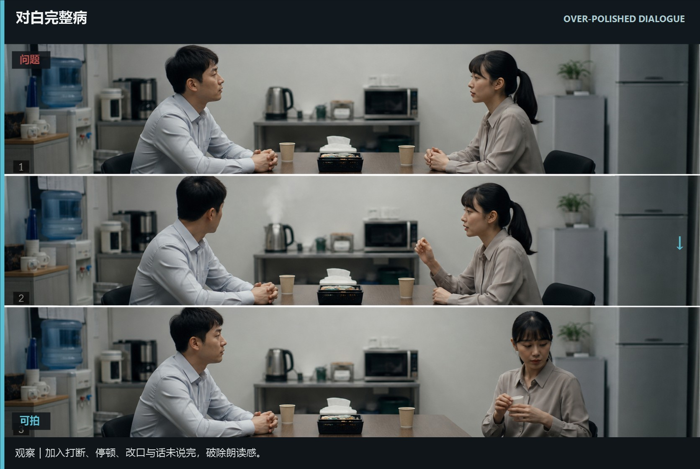
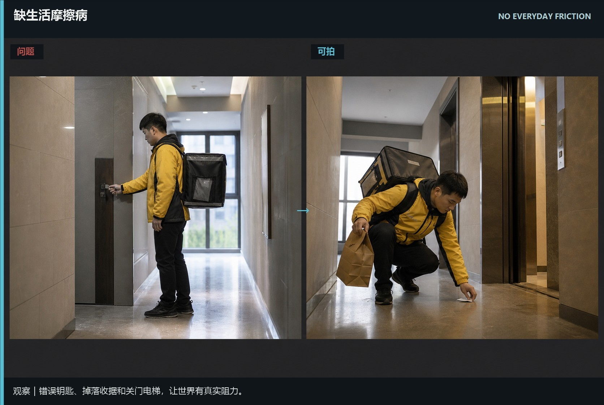

# ai-flavor-six-diseases · 1—6

[全部主题](../IMAGE_GALLERY.md) · [首页](../../README.md)

## AI味六病识别：大词病｜抽象概念没有可拍动作（01-abstract-big-words，原创教学示意）

知识讲解：[A3-18 AI味六病识别](../../knowledge/A-%E7%90%86%E8%AE%BA%E5%B1%82/A3-%E7%BC%96%E5%89%A7%E7%BB%84/A3-18%20AI%E5%91%B3%E5%85%AD%E7%97%85%E8%AF%86%E5%88%AB.md)

## AI味六病识别：总结病｜角色替观众说出主题（02-theme-summary，原创教学示意）

知识讲解：[A3-18 AI味六病识别](../../knowledge/A-%E7%90%86%E8%AE%BA%E5%B1%82/A3-%E7%BC%96%E5%89%A7%E7%BB%84/A3-18%20AI%E5%91%B3%E5%85%AD%E7%97%85%E8%AF%86%E5%88%AB.md)

## AI味六病识别：过度解释病｜动机被全部说出来（03-over-explanation，原创教学示意）

知识讲解：[A3-18 AI味六病识别](../../knowledge/A-%E7%90%86%E8%AE%BA%E5%B1%82/A3-%E7%BC%96%E5%89%A7%E7%BB%84/A3-18%20AI%E5%91%B3%E5%85%AD%E7%97%85%E8%AF%86%E5%88%AB.md)

## AI味六病识别：情绪过满病｜没有呼吸空间（04-emotion-overload，原创教学示意）

知识讲解：[A3-18 AI味六病识别](../../knowledge/A-%E7%90%86%E8%AE%BA%E5%B1%82/A3-%E7%BC%96%E5%89%A7%E7%BB%84/A3-18%20AI%E5%91%B3%E5%85%AD%E7%97%85%E8%AF%86%E5%88%AB.md)

## AI味六病识别：对白完整病｜人人都像在朗读（05-over-polished-dialogue，原创教学示意）

知识讲解：[A3-18 AI味六病识别](../../knowledge/A-%E7%90%86%E8%AE%BA%E5%B1%82/A3-%E7%BC%96%E5%89%A7%E7%BB%84/A3-18%20AI%E5%91%B3%E5%85%AD%E7%97%85%E8%AF%86%E5%88%AB.md)

## AI味六病识别：缺生活摩擦病｜世界没有真实阻力（06-no-everyday-friction，原创教学示意）

知识讲解：[A3-18 AI味六病识别](../../knowledge/A-%E7%90%86%E8%AE%BA%E5%B1%82/A3-%E7%BC%96%E5%89%A7%E7%BB%84/A3-18%20AI%E5%91%B3%E5%85%AD%E7%97%85%E8%AF%86%E5%88%AB.md)
