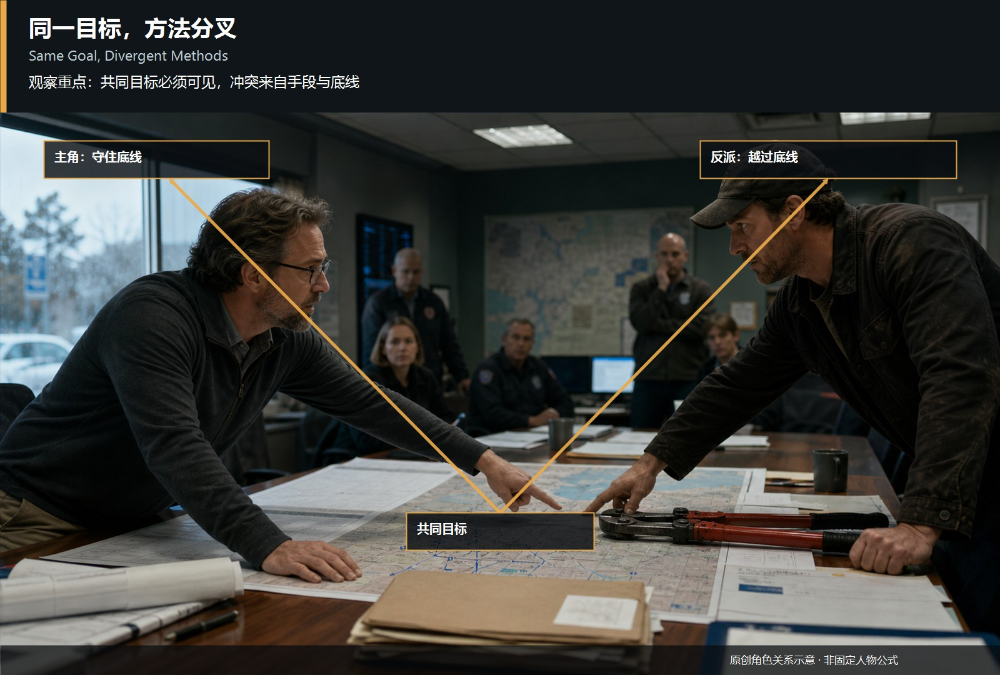
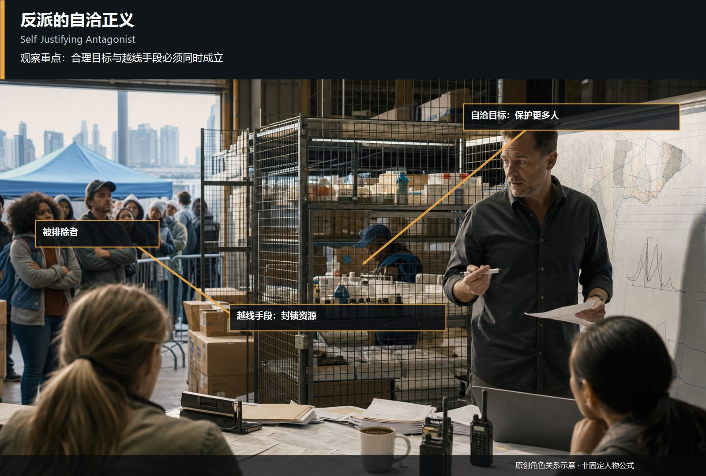
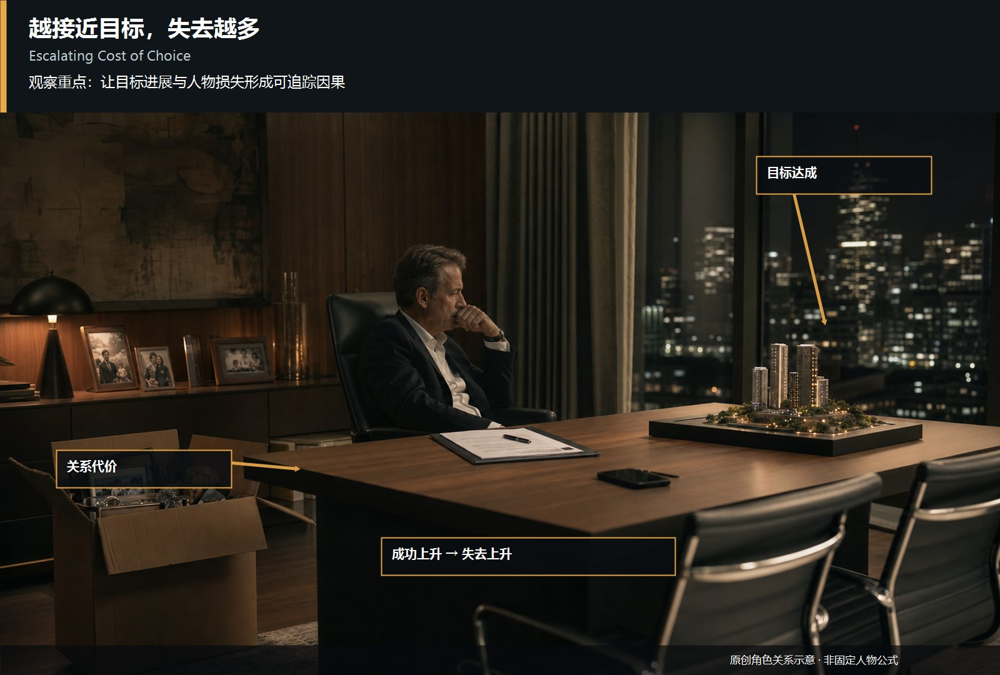
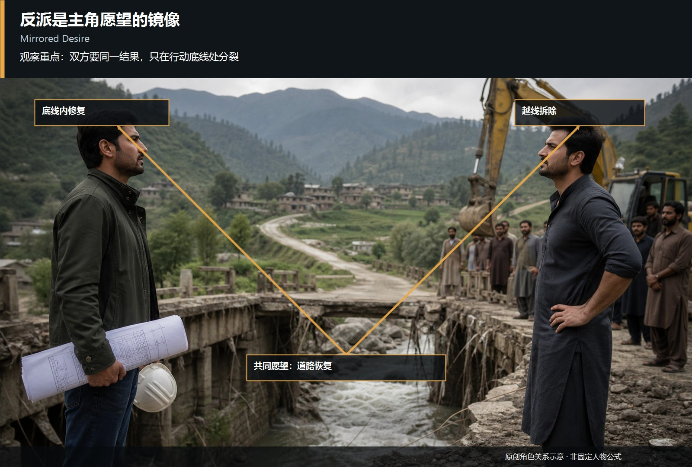
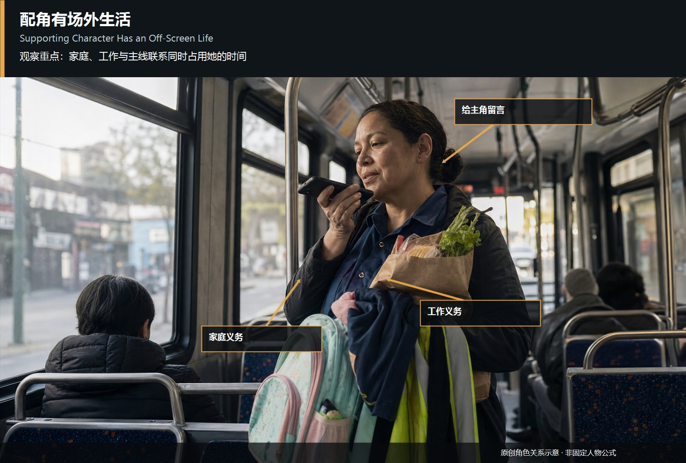
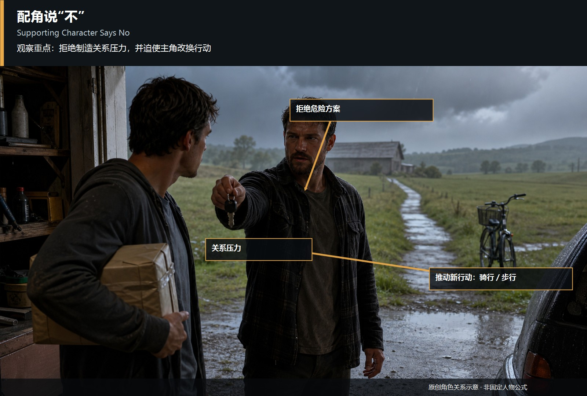

# antagonist-supporting-cast · 1—8

[全部主题](../IMAGE_GALLERY.md) · [首页](../../README.md)

## 反派与配角设计：01 · 他想要什么：同一目标，方法分叉（01-same-goal-divergent-methods，原创教学示意）

知识讲解：[A3-09 反派与配角设计](../../knowledge/A-%E7%90%86%E8%AE%BA%E5%B1%82/A3-%E7%BC%96%E5%89%A7%E7%BB%84/A3-09%20%E5%8F%8D%E6%B4%BE%E4%B8%8E%E9%85%8D%E8%A7%92%E8%AE%BE%E8%AE%A1.md)

## 反派与配角设计：02 · 他为什么觉得自己是对的：自洽正义与越线手段（02-antagonist-self-justification，原创教学示意）

知识讲解：[A3-09 反派与配角设计](../../knowledge/A-%E7%90%86%E8%AE%BA%E5%B1%82/A3-%E7%BC%96%E5%89%A7%E7%BB%84/A3-09%20%E5%8F%8D%E6%B4%BE%E4%B8%8E%E9%85%8D%E8%A7%92%E8%AE%BE%E8%AE%A1.md)

## 反派与配角设计：03 · 他的选择有代价吗：越接近目标，失去越多（03-antagonist-escalating-cost，原创教学示意）

知识讲解：[A3-09 反派与配角设计](../../knowledge/A-%E7%90%86%E8%AE%BA%E5%B1%82/A3-%E7%BC%96%E5%89%A7%E7%BB%84/A3-09%20%E5%8F%8D%E6%B4%BE%E4%B8%8E%E9%85%8D%E8%A7%92%E8%AE%BE%E8%AE%A1.md)

## 反派与配角设计：04 · 愿望镜像（04-antagonist-mirrors-desire，原创教学示意）

知识讲解：[A3-09 反派与配角设计](../../knowledge/A-%E7%90%86%E8%AE%BA%E5%B1%82/A3-%E7%BC%96%E5%89%A7%E7%BB%84/A3-09%20%E5%8F%8D%E6%B4%BE%E4%B8%8E%E9%85%8D%E8%A7%92%E8%AE%BE%E8%AE%A1.md)

## 反派与配角设计：05 · 配角有自己的欲望（05-supporting-character-own-desire，原创教学示意）

知识讲解：[A3-09 反派与配角设计](../../knowledge/A-%E7%90%86%E8%AE%BA%E5%B1%82/A3-%E7%BC%96%E5%89%A7%E7%BB%84/A3-09%20%E5%8F%8D%E6%B4%BE%E4%B8%8E%E9%85%8D%E8%A7%92%E8%AE%BE%E8%AE%A1.md)

## 反派与配角设计：06 · 配角有场外生活（06-supporting-character-offscreen-life，原创教学示意）

知识讲解：[A3-09 反派与配角设计](../../knowledge/A-%E7%90%86%E8%AE%BA%E5%B1%82/A3-%E7%BC%96%E5%89%A7%E7%BB%84/A3-09%20%E5%8F%8D%E6%B4%BE%E4%B8%8E%E9%85%8D%E8%A7%92%E8%AE%BE%E8%AE%A1.md)

## 反派与配角设计：07 · 配角说“不”形成关系压力（07-supporting-character-says-no，原创教学示意）

知识讲解：[A3-09 反派与配角设计](../../knowledge/A-%E7%90%86%E8%AE%BA%E5%B1%82/A3-%E7%BC%96%E5%89%A7%E7%BB%84/A3-09%20%E5%8F%8D%E6%B4%BE%E4%B8%8E%E9%85%8D%E8%A7%92%E8%AE%BE%E8%AE%A1.md)

## 反派与配角设计：08 · 反常偏好制造人物记忆点（08-contradictory-preference，原创教学示意）

知识讲解：[A3-09 反派与配角设计](../../knowledge/A-%E7%90%86%E8%AE%BA%E5%B1%82/A3-%E7%BC%96%E5%89%A7%E7%BB%84/A3-09%20%E5%8F%8D%E6%B4%BE%E4%B8%8E%E9%85%8D%E8%A7%92%E8%AE%BE%E8%AE%A1.md)
