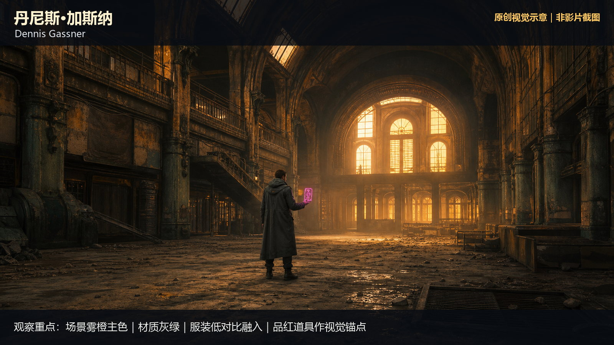
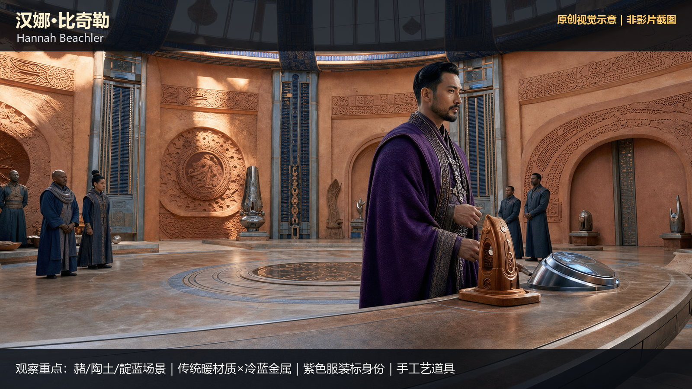
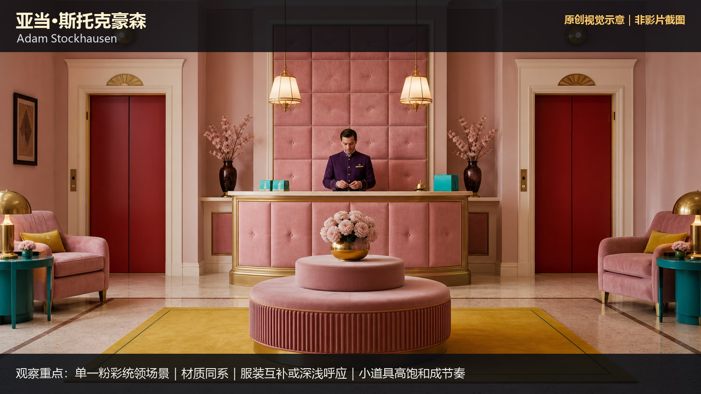
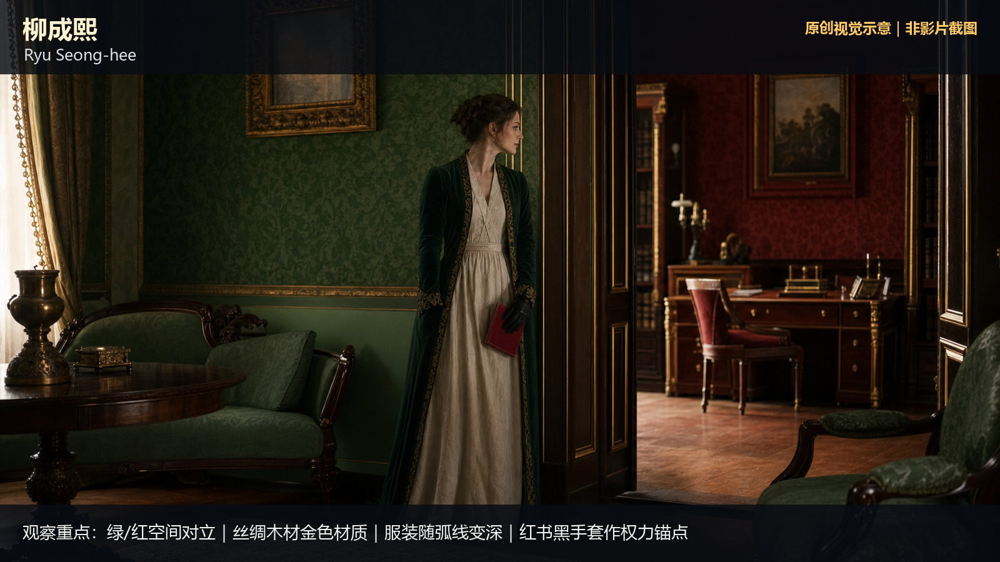
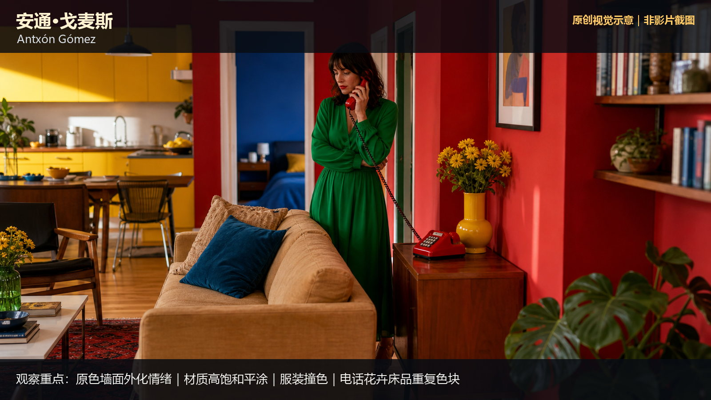
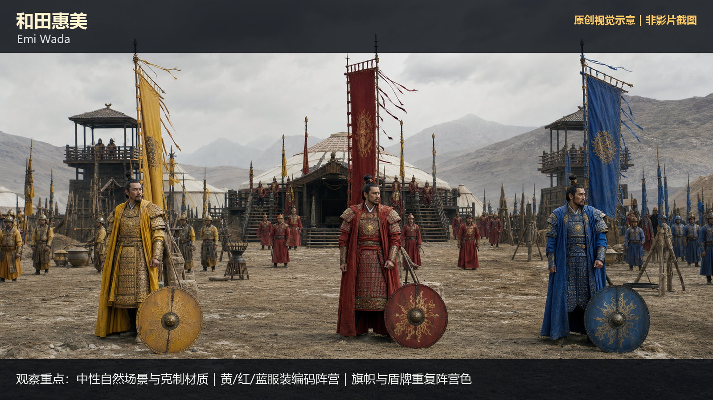
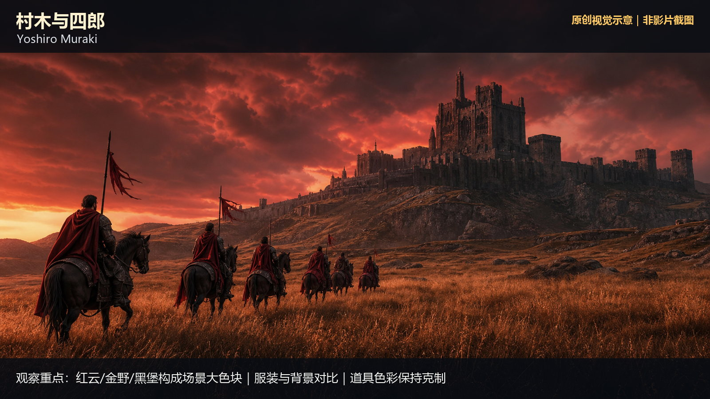
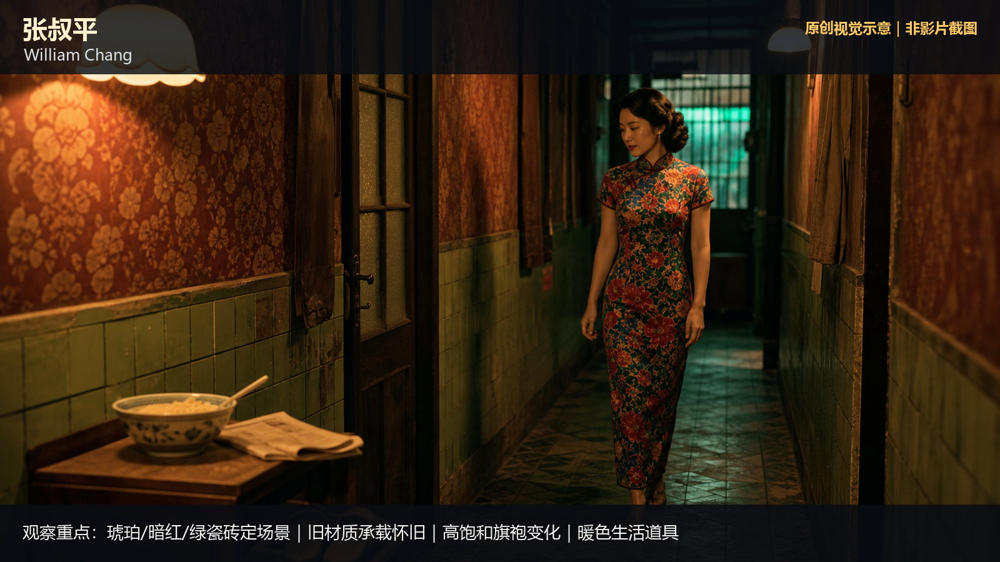

# art-direction-color · 1—8

[全部主题](../IMAGE_GALLERY.md) · [首页](../../README.md)

## 美术指导色彩系统：1. Dennis Gassner（丹尼斯·加斯纳）— 概念世界建构派（01-dennis-gassner，原创教学示意）

知识讲解：[A1-14 美术指导色彩系统](../../knowledge/A-%E7%90%86%E8%AE%BA%E5%B1%82/A1-%E6%91%84%E5%BD%B1%E7%BB%84/A1-14%20%E7%BE%8E%E6%9C%AF%E6%8C%87%E5%AF%BC%E8%89%B2%E5%BD%A9%E7%B3%BB%E7%BB%9F.md)

## 美术指导色彩系统：2. Hannah Beachler（汉娜·比奇勒）— 非洲未来主义色彩派（02-hannah-beachler，原创教学示意）

知识讲解：[A1-14 美术指导色彩系统](../../knowledge/A-%E7%90%86%E8%AE%BA%E5%B1%82/A1-%E6%91%84%E5%BD%B1%E7%BB%84/A1-14%20%E7%BE%8E%E6%9C%AF%E6%8C%87%E5%AF%BC%E8%89%B2%E5%BD%A9%E7%B3%BB%E7%BB%9F.md)

## 美术指导色彩系统：3. Adam Stockhausen（亚当·斯托克豪森）— 糖盒粉彩对称派（03-adam-stockhausen，原创教学示意）

知识讲解：[A1-14 美术指导色彩系统](../../knowledge/A-%E7%90%86%E8%AE%BA%E5%B1%82/A1-%E6%91%84%E5%BD%B1%E7%BB%84/A1-14%20%E7%BE%8E%E6%9C%AF%E6%8C%87%E5%AF%BC%E8%89%B2%E5%BD%A9%E7%B3%BB%E7%BB%9F.md)

## 美术指导色彩系统：4. 柳成熙（Ryu Seong-hee / 류성희）— 闺阁高饱和符号派（04-ryu-seong-hee，原创教学示意）

知识讲解：[A1-14 美术指导色彩系统](../../knowledge/A-%E7%90%86%E8%AE%BA%E5%B1%82/A1-%E6%91%84%E5%BD%B1%E7%BB%84/A1-14%20%E7%BE%8E%E6%9C%AF%E6%8C%87%E5%AF%BC%E8%89%B2%E5%BD%A9%E7%B3%BB%E7%BB%9F.md)

## 美术指导色彩系统：5. Antxón Gómez（安通·戈麦斯）— 阿莫多瓦浓彩情感派（05-antxon-gomez，原创教学示意）

知识讲解：[A1-14 美术指导色彩系统](../../knowledge/A-%E7%90%86%E8%AE%BA%E5%B1%82/A1-%E6%91%84%E5%BD%B1%E7%BB%84/A1-14%20%E7%BE%8E%E6%9C%AF%E6%8C%87%E5%AF%BC%E8%89%B2%E5%BD%A9%E7%B3%BB%E7%BB%9F.md)

## 美术指导色彩系统：6. 和田惠美（Emi Wada）— 东方史诗服饰色派（06-emi-wada，原创教学示意）

知识讲解：[A1-14 美术指导色彩系统](../../knowledge/A-%E7%90%86%E8%AE%BA%E5%B1%82/A1-%E6%91%84%E5%BD%B1%E7%BB%84/A1-14%20%E7%BE%8E%E6%9C%AF%E6%8C%87%E5%AF%BC%E8%89%B2%E5%BD%A9%E7%B3%BB%E7%BB%9F.md)

## 美术指导色彩系统：7. 村木与四郎（Yoshiro Muraki）— 黑泽明御用美术派（07-yoshiro-muraki，原创教学示意）

知识讲解：[A1-14 美术指导色彩系统](../../knowledge/A-%E7%90%86%E8%AE%BA%E5%B1%82/A1-%E6%91%84%E5%BD%B1%E7%BB%84/A1-14%20%E7%BE%8E%E6%9C%AF%E6%8C%87%E5%AF%BC%E8%89%B2%E5%BD%A9%E7%B3%BB%E7%BB%9F.md)

## 美术指导色彩系统：8. 张叔平（William Chang）— 怀旧霓虹旗袍色派（08-william-chang，原创教学示意）

知识讲解：[A1-14 美术指导色彩系统](../../knowledge/A-%E7%90%86%E8%AE%BA%E5%B1%82/A1-%E6%91%84%E5%BD%B1%E7%BB%84/A1-14%20%E7%BE%8E%E6%9C%AF%E6%8C%87%E5%AF%BC%E8%89%B2%E5%BD%A9%E7%B3%BB%E7%BB%9F.md)
