# blocking · 1—24

[全部主题](../IMAGE_GALLERY.md) · [首页](../../README.md)

## 调度与场面调度：人物走位｜Character Blocking（01-character-blocking，原创教学示意）

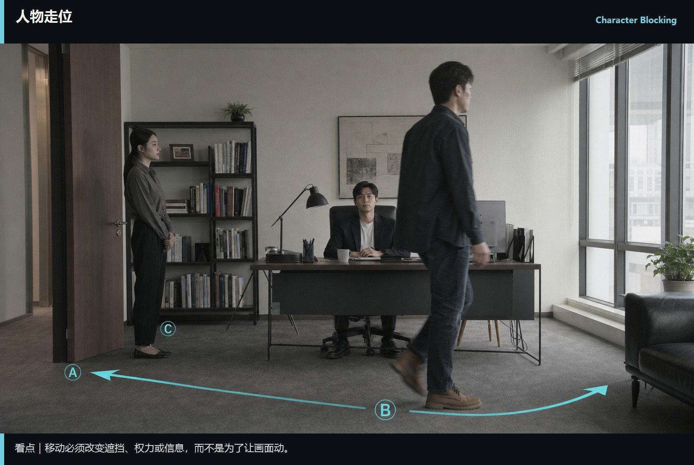

知识讲解：[A2-01 调度与场面调度](../../knowledge/A-%E7%90%86%E8%AE%BA%E5%B1%82/A2-%E5%AF%BC%E6%BC%94%E7%BB%84/A2-01%20%E8%B0%83%E5%BA%A6%E4%B8%8E%E5%9C%BA%E9%9D%A2%E8%B0%83%E5%BA%A6.md)

## 调度与场面调度：人物进出画｜Entrance / Exit（02-entrance-exit，原创教学示意）

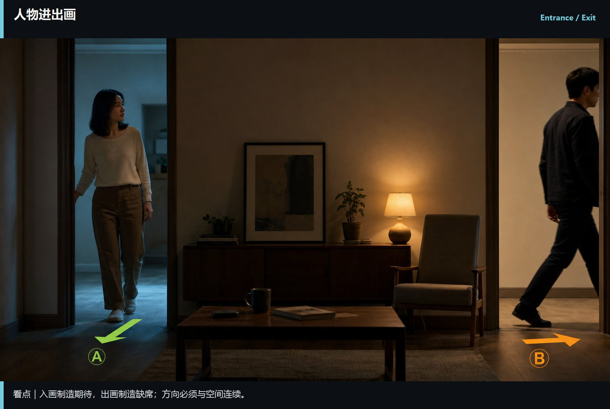

知识讲解：[A2-01 调度与场面调度](../../knowledge/A-%E7%90%86%E8%AE%BA%E5%B1%82/A2-%E5%AF%BC%E6%BC%94%E7%BB%84/A2-01%20%E8%B0%83%E5%BA%A6%E4%B8%8E%E5%9C%BA%E9%9D%A2%E8%B0%83%E5%BA%A6.md)

## 调度与场面调度：前景／中景／背景关系｜Foreground / Midground / Background（03-depth-layers，原创教学示意）

知识讲解：[A2-01 调度与场面调度](../../knowledge/A-%E7%90%86%E8%AE%BA%E5%B1%82/A2-%E5%AF%BC%E6%BC%94%E7%BB%84/A2-01%20%E8%B0%83%E5%BA%A6%E4%B8%8E%E5%9C%BA%E9%9D%A2%E8%B0%83%E5%BA%A6.md)

## 调度与场面调度：前景遮挡调度｜Foreground Occlusion（04-foreground-occlusion，原创教学示意）

知识讲解：[A2-01 调度与场面调度](../../knowledge/A-%E7%90%86%E8%AE%BA%E5%B1%82/A2-%E5%AF%BC%E6%BC%94%E7%BB%84/A2-01%20%E8%B0%83%E5%BA%A6%E4%B8%8E%E5%9C%BA%E9%9D%A2%E8%B0%83%E5%BA%A6.md)

## 调度与场面调度：群像调度｜Ensemble Blocking（05-ensemble-blocking，原创教学示意）

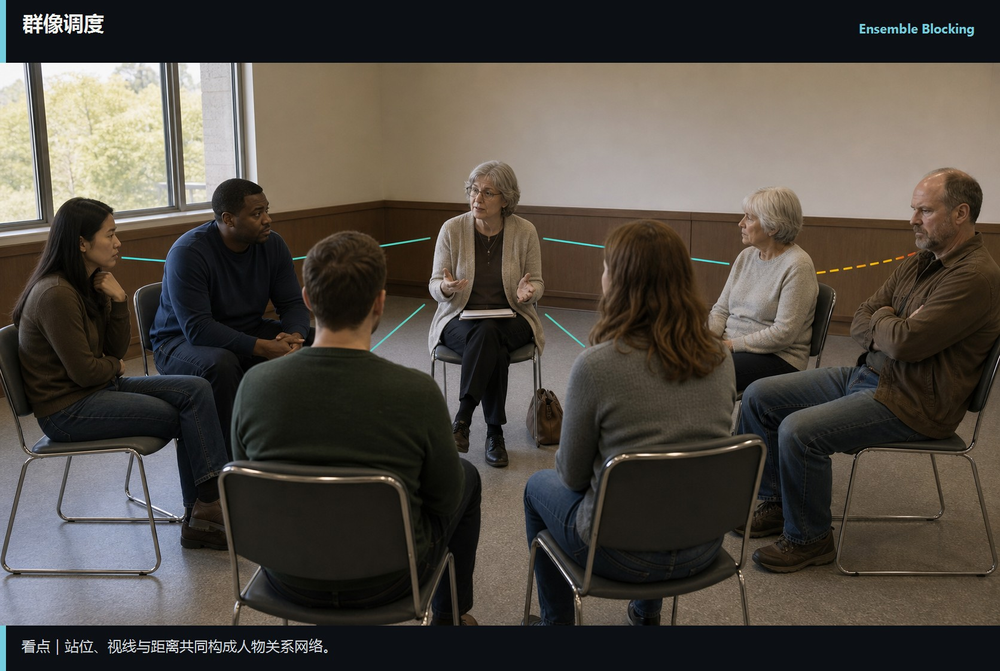

知识讲解：[A2-01 调度与场面调度](../../knowledge/A-%E7%90%86%E8%AE%BA%E5%B1%82/A2-%E5%AF%BC%E6%BC%94%E7%BB%84/A2-01%20%E8%B0%83%E5%BA%A6%E4%B8%8E%E5%9C%BA%E9%9D%A2%E8%B0%83%E5%BA%A6.md)

## 调度与场面调度：战争场面调度｜War-Scene Blocking（06-war-blocking，原创教学示意）

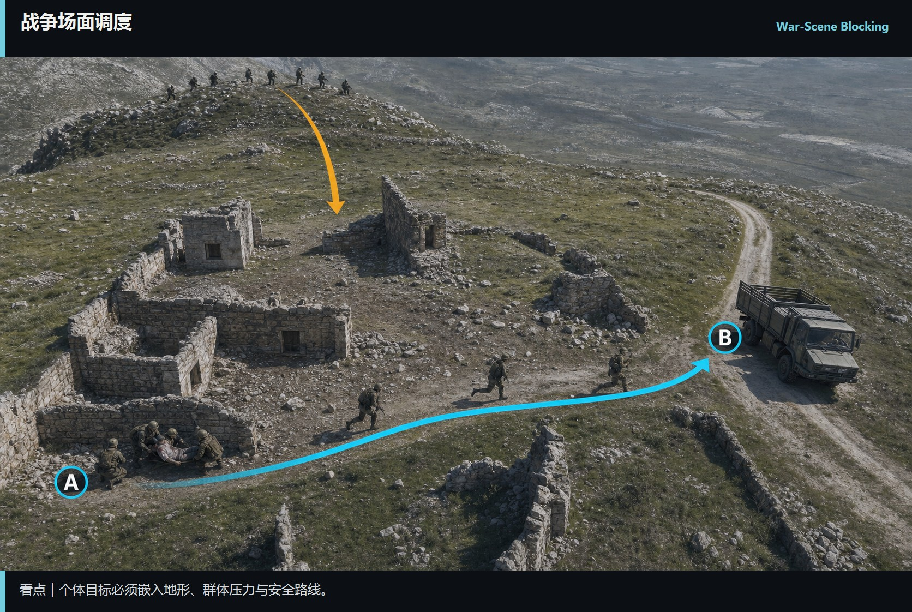

知识讲解：[A2-01 调度与场面调度](../../knowledge/A-%E7%90%86%E8%AE%BA%E5%B1%82/A2-%E5%AF%BC%E6%BC%94%E7%BB%84/A2-01%20%E8%B0%83%E5%BA%A6%E4%B8%8E%E5%9C%BA%E9%9D%A2%E8%B0%83%E5%BA%A6.md)

## 调度与场面调度：动作场面调度｜Action Blocking（07-action-blocking，原创教学示意）

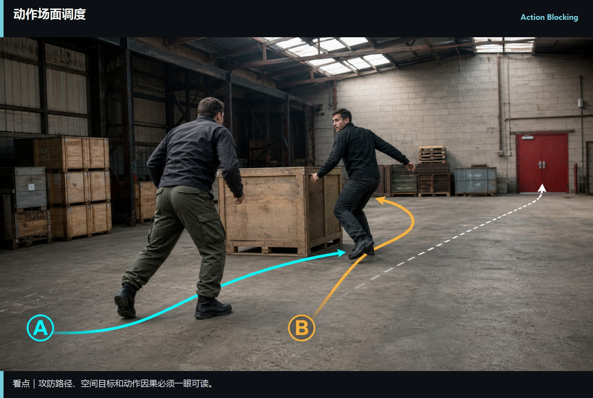

知识讲解：[A2-01 调度与场面调度](../../knowledge/A-%E7%90%86%E8%AE%BA%E5%B1%82/A2-%E5%AF%BC%E6%BC%94%E7%BB%84/A2-01%20%E8%B0%83%E5%BA%A6%E4%B8%8E%E5%9C%BA%E9%9D%A2%E8%B0%83%E5%BA%A6.md)

## 调度与场面调度：长镜头调度｜Long-Take Blocking（08-long-take-blocking，原创教学示意）

知识讲解：[A2-01 调度与场面调度](../../knowledge/A-%E7%90%86%E8%AE%BA%E5%B1%82/A2-%E5%AF%BC%E6%BC%94%E7%BB%84/A2-01%20%E8%B0%83%E5%BA%A6%E4%B8%8E%E5%9C%BA%E9%9D%A2%E8%B0%83%E5%BA%A6.md)

## 调度与场面调度：空间轴线｜Action Axis（09-action-axis，原创教学示意）

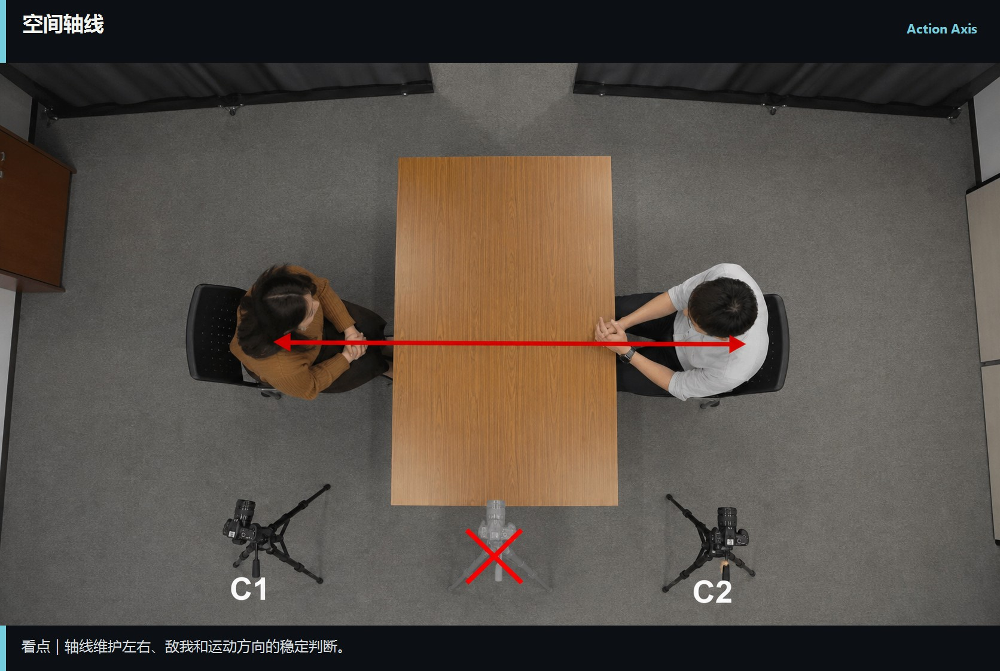

知识讲解：[A2-01 调度与场面调度](../../knowledge/A-%E7%90%86%E8%AE%BA%E5%B1%82/A2-%E5%AF%BC%E6%BC%94%E7%BB%84/A2-01%20%E8%B0%83%E5%BA%A6%E4%B8%8E%E5%9C%BA%E9%9D%A2%E8%B0%83%E5%BA%A6.md)

## 调度与场面调度：180度规则｜180-Degree Rule（10-180-degree-rule，原创教学示意）

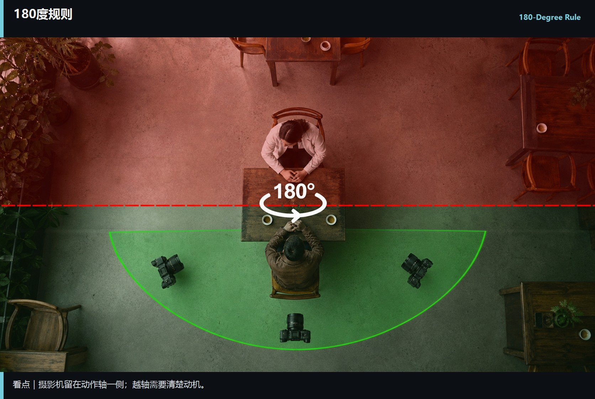

知识讲解：[A2-01 调度与场面调度](../../knowledge/A-%E7%90%86%E8%AE%BA%E5%B1%82/A2-%E5%AF%BC%E6%BC%94%E7%BB%84/A2-01%20%E8%B0%83%E5%BA%A6%E4%B8%8E%E5%9C%BA%E9%9D%A2%E8%B0%83%E5%BA%A6.md)

## 调度与场面调度：视线匹配｜Eyeline Match（11-eyeline-match，原创教学示意）

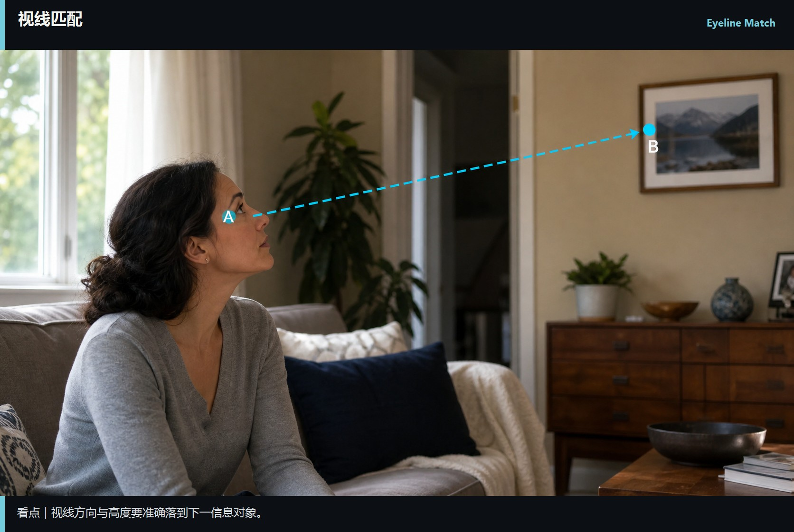

知识讲解：[A2-01 调度与场面调度](../../knowledge/A-%E7%90%86%E8%AE%BA%E5%B1%82/A2-%E5%AF%BC%E6%BC%94%E7%BB%84/A2-01%20%E8%B0%83%E5%BA%A6%E4%B8%8E%E5%9C%BA%E9%9D%A2%E8%B0%83%E5%BA%A6.md)

## 调度与场面调度：动作匹配｜Match on Action（12-match-on-action，原创教学示意）

知识讲解：[A2-01 调度与场面调度](../../knowledge/A-%E7%90%86%E8%AE%BA%E5%B1%82/A2-%E5%AF%BC%E6%BC%94%E7%BB%84/A2-01%20%E8%B0%83%E5%BA%A6%E4%B8%8E%E5%9C%BA%E9%9D%A2%E8%B0%83%E5%BA%A6.md)

## 调度与场面调度：对话场面调度｜Dialogue Blocking（13-dialogue-blocking，原创教学示意）

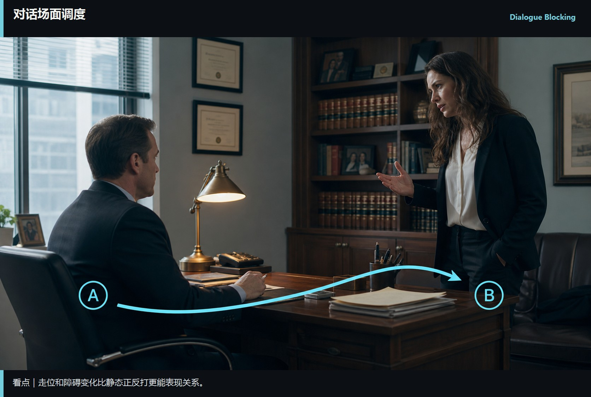

知识讲解：[A2-01 调度与场面调度](../../knowledge/A-%E7%90%86%E8%AE%BA%E5%B1%82/A2-%E5%AF%BC%E6%BC%94%E7%BB%84/A2-01%20%E8%B0%83%E5%BA%A6%E4%B8%8E%E5%9C%BA%E9%9D%A2%E8%B0%83%E5%BA%A6.md)

## 调度与场面调度：双人站位｜Two-Person Staging（14-two-person-staging，原创教学示意）

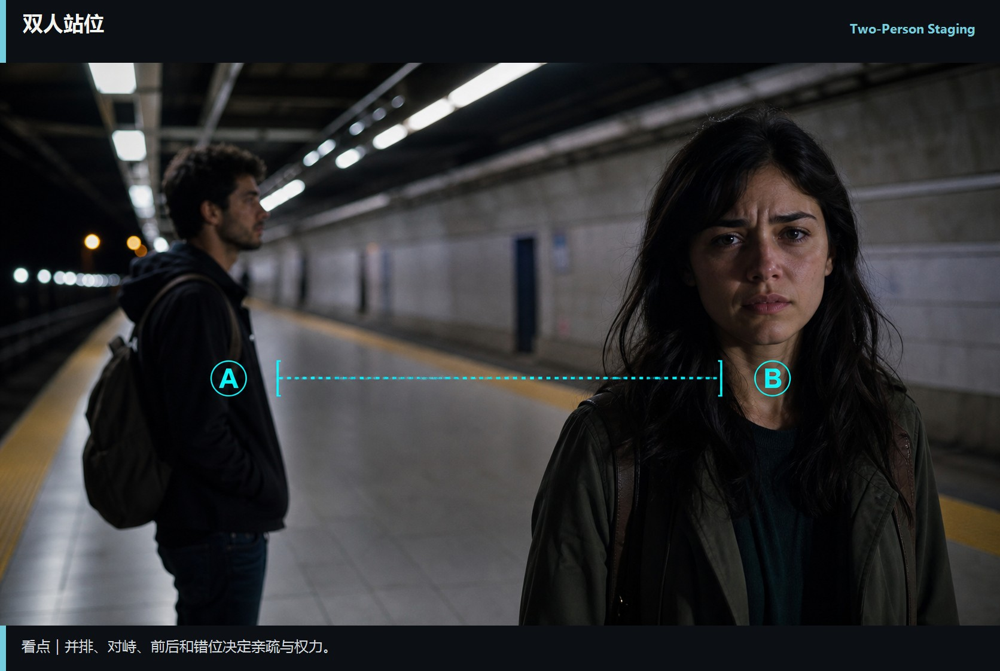

知识讲解：[A2-01 调度与场面调度](../../knowledge/A-%E7%90%86%E8%AE%BA%E5%B1%82/A2-%E5%AF%BC%E6%BC%94%E7%BB%84/A2-01%20%E8%B0%83%E5%BA%A6%E4%B8%8E%E5%9C%BA%E9%9D%A2%E8%B0%83%E5%BA%A6.md)

## 调度与场面调度：三角构图人物关系｜Triangle Staging（15-triangle-staging，原创教学示意）

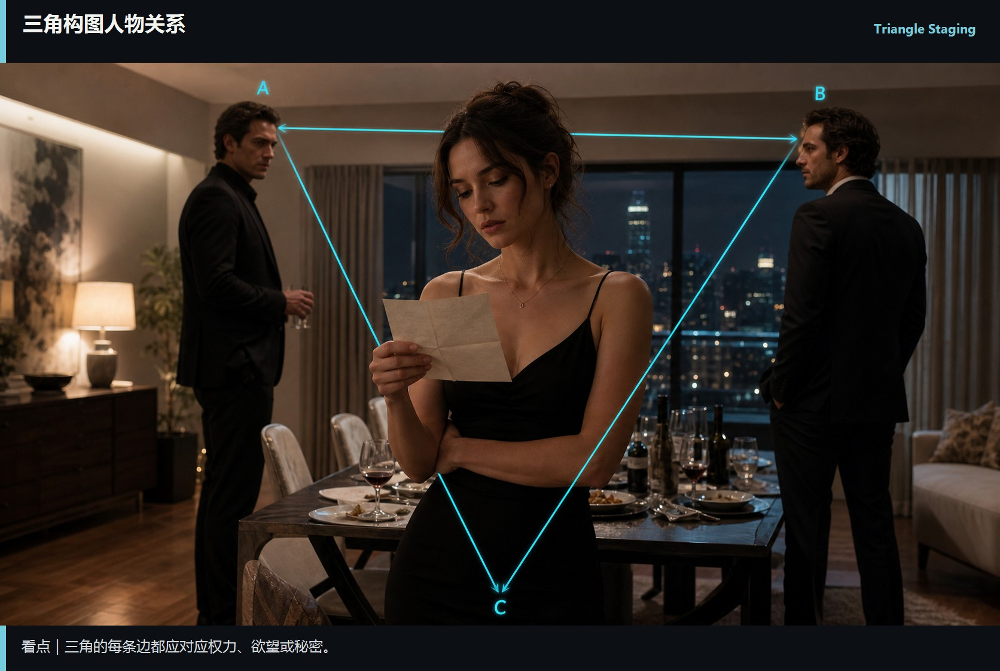

知识讲解：[A2-01 调度与场面调度](../../knowledge/A-%E7%90%86%E8%AE%BA%E5%B1%82/A2-%E5%AF%BC%E6%BC%94%E7%BB%84/A2-01%20%E8%B0%83%E5%BA%A6%E4%B8%8E%E5%9C%BA%E9%9D%A2%E8%B0%83%E5%BA%A6.md)

## 调度与场面调度：权力站位｜Power Positioning（16-power-position，原创教学示意）

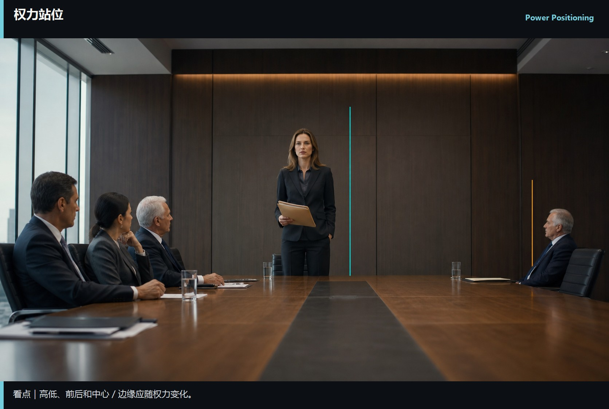

知识讲解：[A2-01 调度与场面调度](../../knowledge/A-%E7%90%86%E8%AE%BA%E5%B1%82/A2-%E5%AF%BC%E6%BC%94%E7%BB%84/A2-01%20%E8%B0%83%E5%BA%A6%E4%B8%8E%E5%9C%BA%E9%9D%A2%E8%B0%83%E5%BA%A6.md)

## 调度与场面调度：门窗墙走廊关系｜Architectural Framing（17-architectural-frames，原创教学示意）

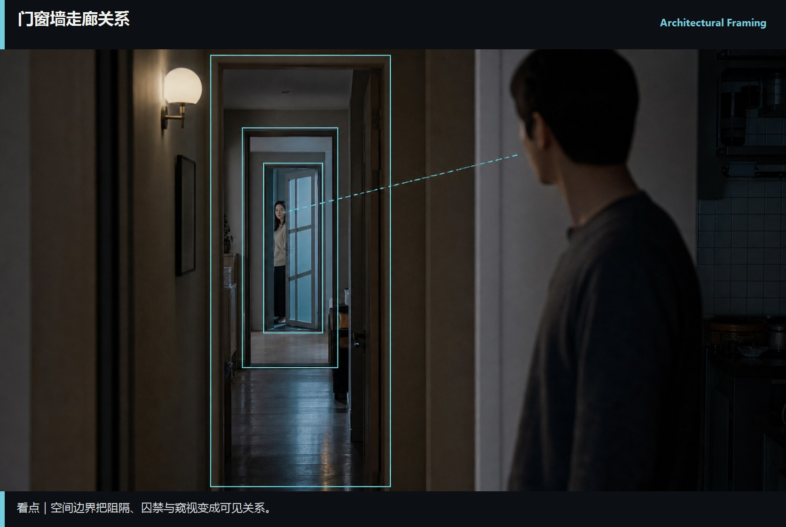

知识讲解：[A2-01 调度与场面调度](../../knowledge/A-%E7%90%86%E8%AE%BA%E5%B1%82/A2-%E5%AF%BC%E6%BC%94%E7%BB%84/A2-01%20%E8%B0%83%E5%BA%A6%E4%B8%8E%E5%9C%BA%E9%9D%A2%E8%B0%83%E5%BA%A6.md)

## 调度与场面调度：巨物与小人物比例｜Scale Contrast（18-scale-contrast，原创教学示意）

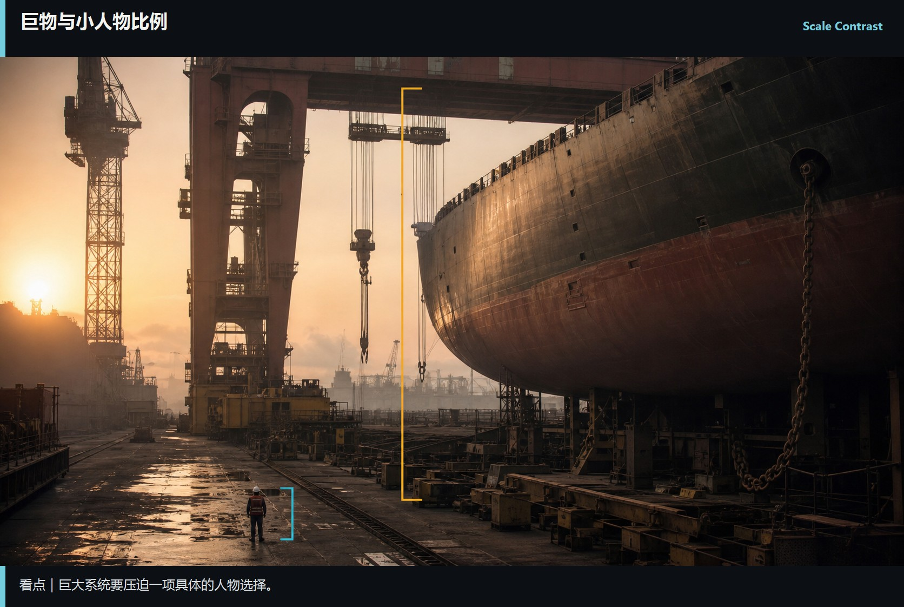

知识讲解：[A2-01 调度与场面调度](../../knowledge/A-%E7%90%86%E8%AE%BA%E5%B1%82/A2-%E5%AF%BC%E6%BC%94%E7%BB%84/A2-01%20%E8%B0%83%E5%BA%A6%E4%B8%8E%E5%9C%BA%E9%9D%A2%E8%B0%83%E5%BA%A6.md)

## 调度与场面调度：纵深调度｜Deep Staging（19-deep-staging，原创教学示意）

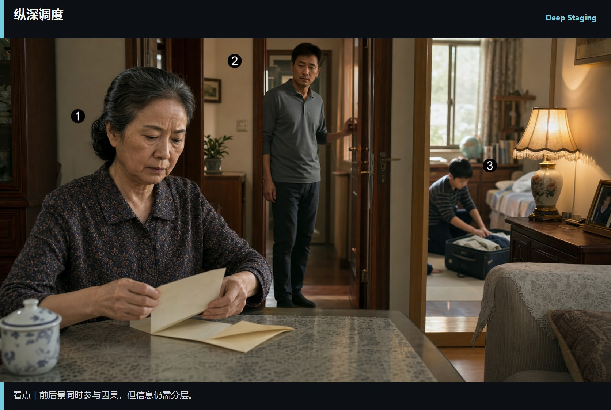

知识讲解：[A2-01 调度与场面调度](../../knowledge/A-%E7%90%86%E8%AE%BA%E5%B1%82/A2-%E5%AF%BC%E6%BC%94%E7%BB%84/A2-01%20%E8%B0%83%E5%BA%A6%E4%B8%8E%E5%9C%BA%E9%9D%A2%E8%B0%83%E5%BA%A6.md)

## 调度与场面调度：遮挡后揭示｜Conceal and Reveal（20-conceal-reveal，原创教学示意）

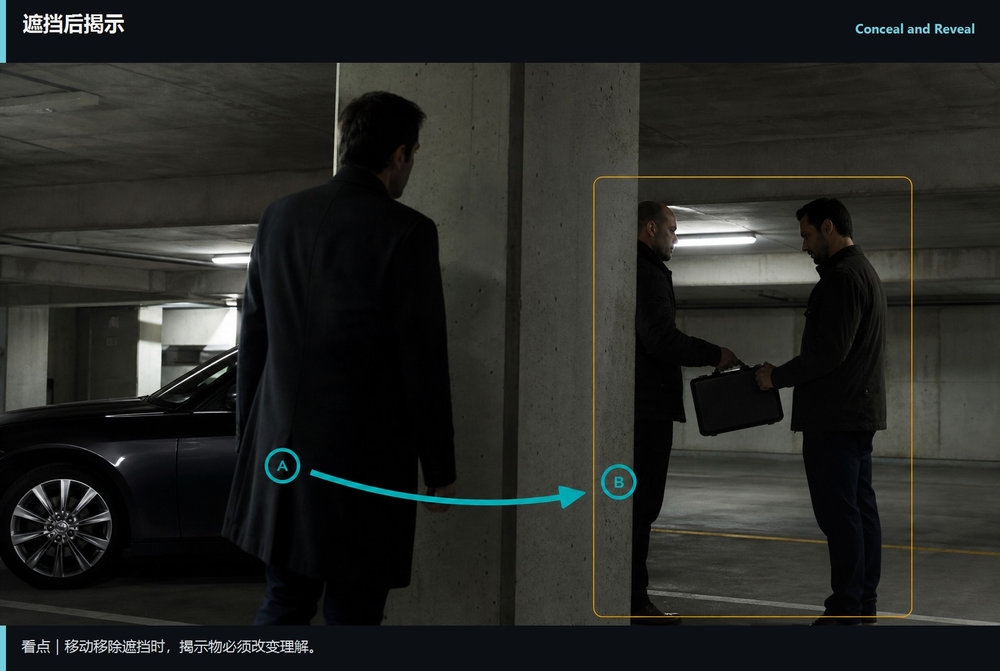

知识讲解：[A2-01 调度与场面调度](../../knowledge/A-%E7%90%86%E8%AE%BA%E5%B1%82/A2-%E5%AF%BC%E6%BC%94%E7%BB%84/A2-01%20%E8%B0%83%E5%BA%A6%E4%B8%8E%E5%9C%BA%E9%9D%A2%E8%B0%83%E5%BA%A6.md)

## 调度与场面调度：镜头内叙事｜In-Shot Narrative（21-in-shot-narrative，原创教学示意）

知识讲解：[A2-01 调度与场面调度](../../knowledge/A-%E7%90%86%E8%AE%BA%E5%B1%82/A2-%E5%AF%BC%E6%BC%94%E7%BB%84/A2-01%20%E8%B0%83%E5%BA%A6%E4%B8%8E%E5%9C%BA%E9%9D%A2%E8%B0%83%E5%BA%A6.md)

## 调度与场面调度：镜头内信息递进｜Progressive Reveal（22-progressive-reveal，原创教学示意）

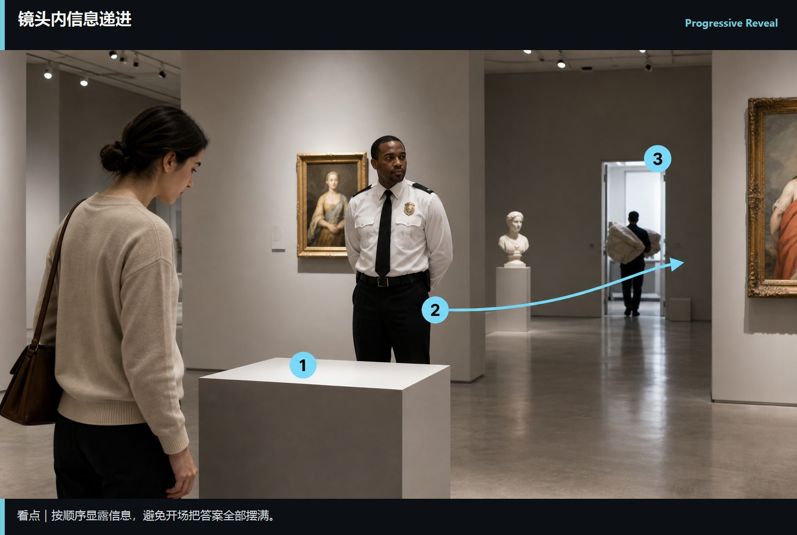

知识讲解：[A2-01 调度与场面调度](../../knowledge/A-%E7%90%86%E8%AE%BA%E5%B1%82/A2-%E5%AF%BC%E6%BC%94%E7%BB%84/A2-01%20%E8%B0%83%E5%BA%A6%E4%B8%8E%E5%9C%BA%E9%9D%A2%E8%B0%83%E5%BA%A6.md)

## 调度与场面调度：1. 杜琪峰：岗位星座 + 静止蓄势 + 共享威胁区（23-team-constellation-mechanism，原创教学示意）

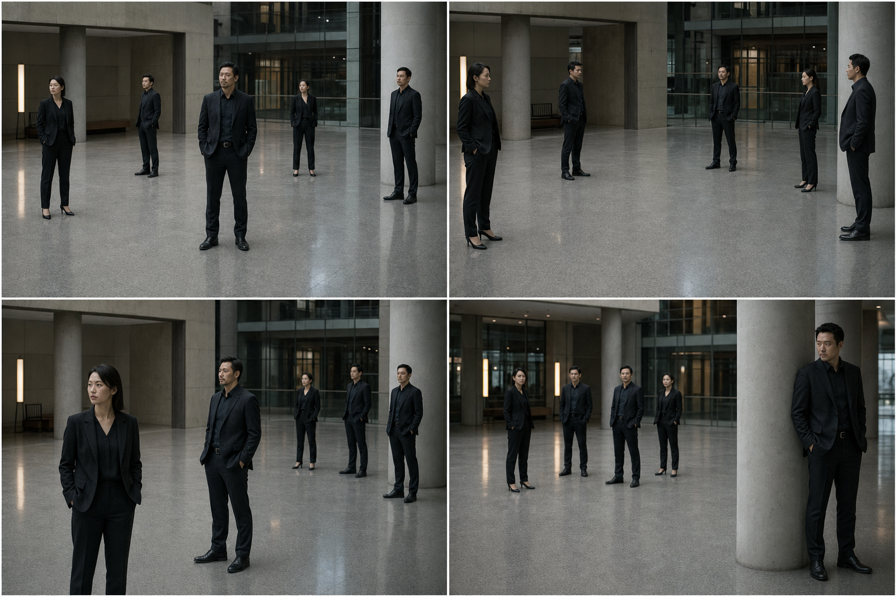

知识讲解：[A2-01 调度与场面调度](../../knowledge/A-%E7%90%86%E8%AE%BA%E5%B1%82/A2-%E5%AF%BC%E6%BC%94%E7%BB%84/A2-01%20%E8%B0%83%E5%BA%A6%E4%B8%8E%E5%9C%BA%E9%9D%A2%E8%B0%83%E5%BA%A6.md) · [A2-05 导演与摄影指导风格](../../knowledge/A-%E7%90%86%E8%AE%BA%E5%B1%82/A2-%E5%AF%BC%E6%BC%94%E7%BB%84/A2-05%20%E5%AF%BC%E6%BC%94%E4%B8%8E%E6%91%84%E5%BD%B1%E6%8C%87%E5%AF%BC%E9%A3%8E%E6%A0%BC.md)

## 调度与场面调度：2. 黑泽明：群体几何 + 方向性运动 + 环境参与（24-group-direction-real-scene-v0.1，原创教学示意）

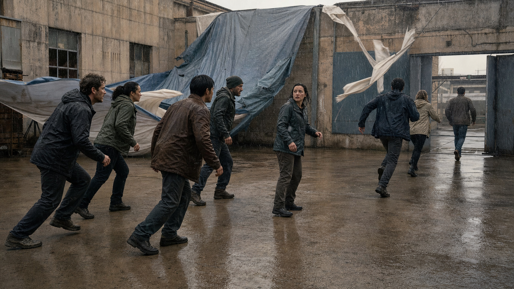

知识讲解：[A2-01 调度与场面调度](../../knowledge/A-%E7%90%86%E8%AE%BA%E5%B1%82/A2-%E5%AF%BC%E6%BC%94%E7%BB%84/A2-01%20%E8%B0%83%E5%BA%A6%E4%B8%8E%E5%9C%BA%E9%9D%A2%E8%B0%83%E5%BA%A6.md)
