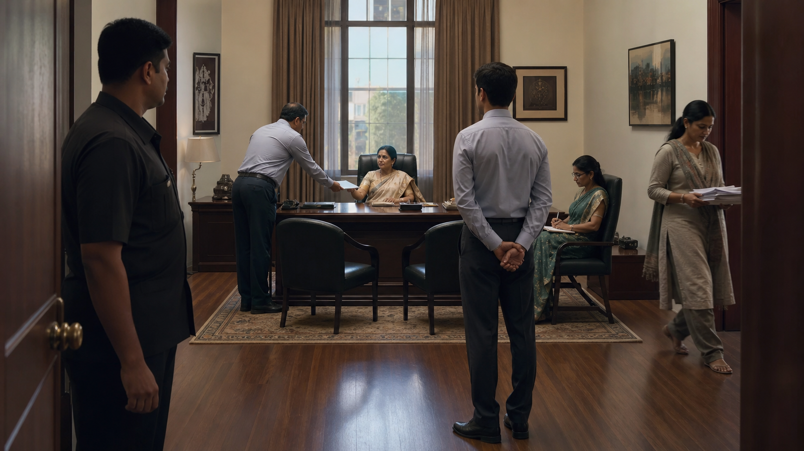
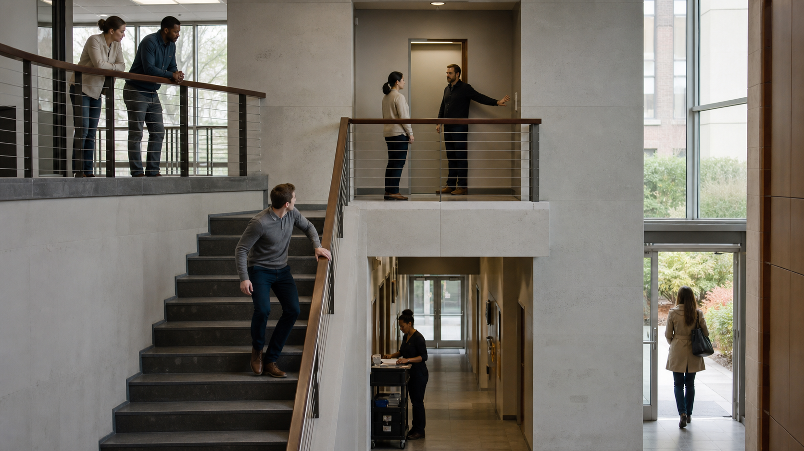
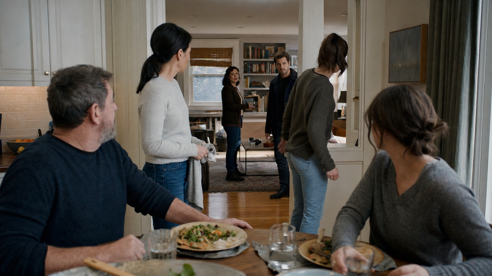

# blocking · 25—27

[全部主题](../IMAGE_GALLERY.md) · [首页](../../README.md)

## 调度与场面调度：3. 科波拉 / 戈登·威利斯：静态权力中心 + 他人轨道（25-static-power-center-real-scene-v0.1，原创教学示意）

知识讲解：[A2-01 调度与场面调度](../../knowledge/A-%E7%90%86%E8%AE%BA%E5%B1%82/A2-%E5%AF%BC%E6%BC%94%E7%BB%84/A2-01%20%E8%B0%83%E5%BA%A6%E4%B8%8E%E5%9C%BA%E9%9D%A2%E8%B0%83%E5%BA%A6.md)

## 调度与场面调度：4. 奉俊昊：建筑高差 + 通道所有权 + 阶级移动（26-architecture-access-real-scene-v0.1，原创教学示意）

知识讲解：[A2-01 调度与场面调度](../../knowledge/A-%E7%90%86%E8%AE%BA%E5%B1%82/A2-%E5%AF%BC%E6%BC%94%E7%BB%84/A2-01%20%E8%B0%83%E5%BA%A6%E4%B8%8E%E5%9C%BA%E9%9D%A2%E8%B0%83%E5%BA%A6.md)

## 调度与场面调度：5. 侯孝贤 / 场面画传统：遮挡—显露 + 微小注意力转移（27-attention-relay-real-scene-v0.1，原创教学示意）

知识讲解：[A2-01 调度与场面调度](../../knowledge/A-%E7%90%86%E8%AE%BA%E5%B1%82/A2-%E5%AF%BC%E6%BC%94%E7%BB%84/A2-01%20%E8%B0%83%E5%BA%A6%E4%B8%8E%E5%9C%BA%E9%9D%A2%E8%B0%83%E5%BA%A6.md)
