# camera-angle · 1—18

[全部主题](../IMAGE_GALLERY.md) · [首页](../../README.md)

## 镜头角度系统：平视镜头（Eye-level Shot）（01-eye-level，原创教学示意）

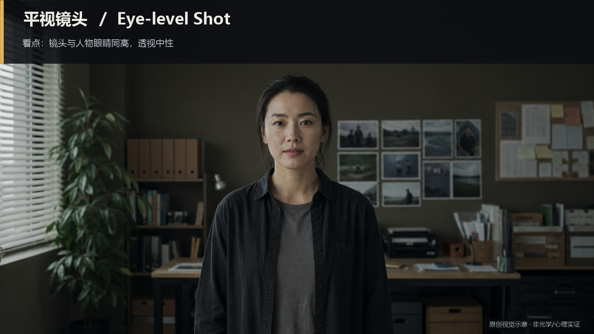

知识讲解：[A1-02 镜头角度系统](../../knowledge/A-%E7%90%86%E8%AE%BA%E5%B1%82/A1-%E6%91%84%E5%BD%B1%E7%BB%84/A1-02%20%E9%95%9C%E5%A4%B4%E8%A7%92%E5%BA%A6%E7%B3%BB%E7%BB%9F.md)

## 镜头角度系统：仰拍（Low Angle）（02-low-angle，原创教学示意）

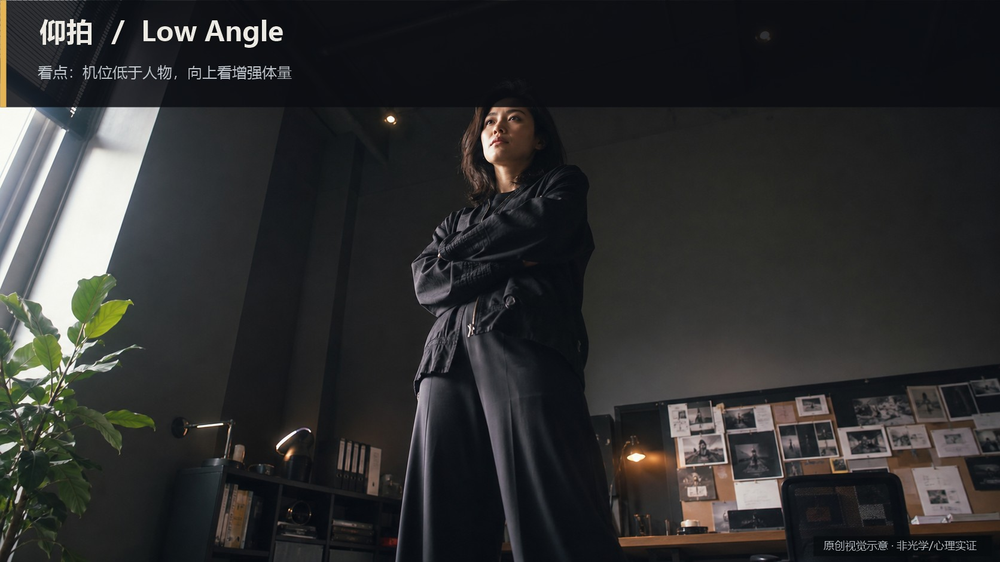

知识讲解：[A1-02 镜头角度系统](../../knowledge/A-%E7%90%86%E8%AE%BA%E5%B1%82/A1-%E6%91%84%E5%BD%B1%E7%BB%84/A1-02%20%E9%95%9C%E5%A4%B4%E8%A7%92%E5%BA%A6%E7%B3%BB%E7%BB%9F.md)

## 镜头角度系统：低角度仰拍（Extreme Low Angle）（03-extreme-low-angle，原创教学示意）

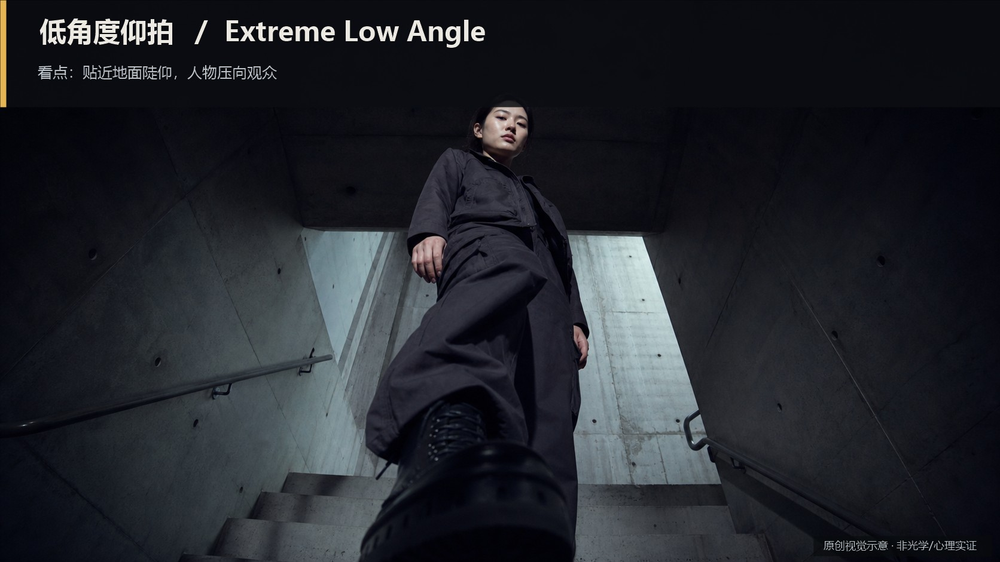

知识讲解：[A1-02 镜头角度系统](../../knowledge/A-%E7%90%86%E8%AE%BA%E5%B1%82/A1-%E6%91%84%E5%BD%B1%E7%BB%84/A1-02%20%E9%95%9C%E5%A4%B4%E8%A7%92%E5%BA%A6%E7%B3%BB%E7%BB%9F.md)

## 镜头角度系统：俯拍（High Angle）（04-high-angle，原创教学示意）

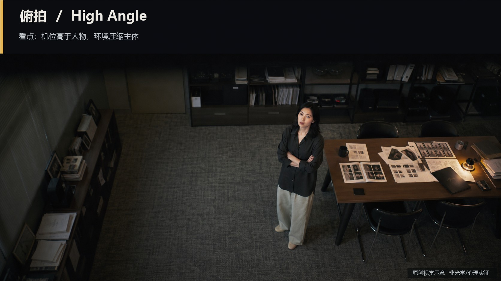

知识讲解：[A1-02 镜头角度系统](../../knowledge/A-%E7%90%86%E8%AE%BA%E5%B1%82/A1-%E6%91%84%E5%BD%B1%E7%BB%84/A1-02%20%E9%95%9C%E5%A4%B4%E8%A7%92%E5%BA%A6%E7%B3%BB%E7%BB%9F.md)

## 镜头角度系统：高角度俯拍（Extreme High Angle）（05-extreme-high-angle，原创教学示意）

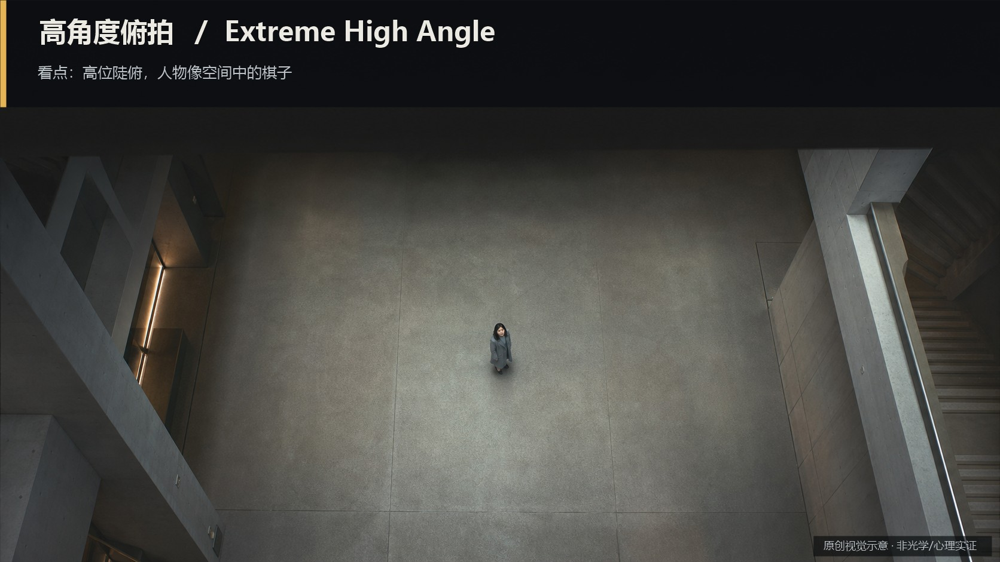

知识讲解：[A1-02 镜头角度系统](../../knowledge/A-%E7%90%86%E8%AE%BA%E5%B1%82/A1-%E6%91%84%E5%BD%B1%E7%BB%84/A1-02%20%E9%95%9C%E5%A4%B4%E8%A7%92%E5%BA%A6%E7%B3%BB%E7%BB%9F.md)

## 镜头角度系统：鸟瞰（Bird's-eye View）（06-birds-eye-view，原创教学示意）

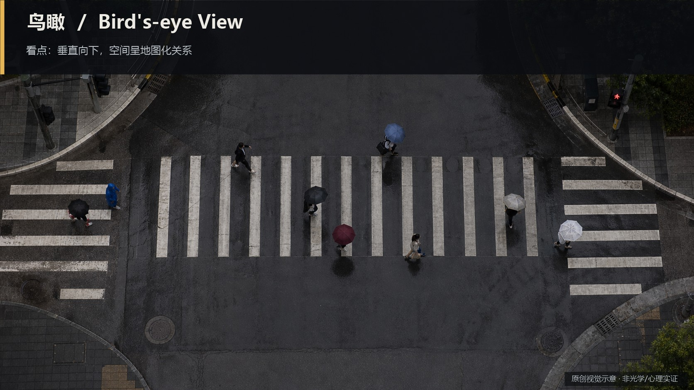

知识讲解：[A1-02 镜头角度系统](../../knowledge/A-%E7%90%86%E8%AE%BA%E5%B1%82/A1-%E6%91%84%E5%BD%B1%E7%BB%84/A1-02%20%E9%95%9C%E5%A4%B4%E8%A7%92%E5%BA%A6%E7%B3%BB%E7%BB%9F.md)

## 镜头角度系统：虫视（Worm's-eye View）（07-worms-eye-view，原创教学示意）

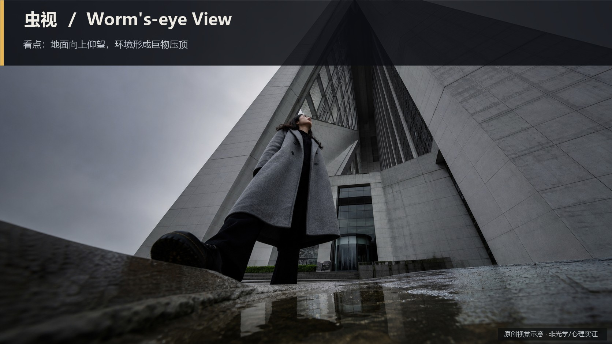

知识讲解：[A1-02 镜头角度系统](../../knowledge/A-%E7%90%86%E8%AE%BA%E5%B1%82/A1-%E6%91%84%E5%BD%B1%E7%BB%84/A1-02%20%E9%95%9C%E5%A4%B4%E8%A7%92%E5%BA%A6%E7%B3%BB%E7%BB%9F.md)

## 镜头角度系统：荷兰角 / 倾斜角（Dutch Angle / Canted Angle）（08-dutch-angle，原创教学示意）

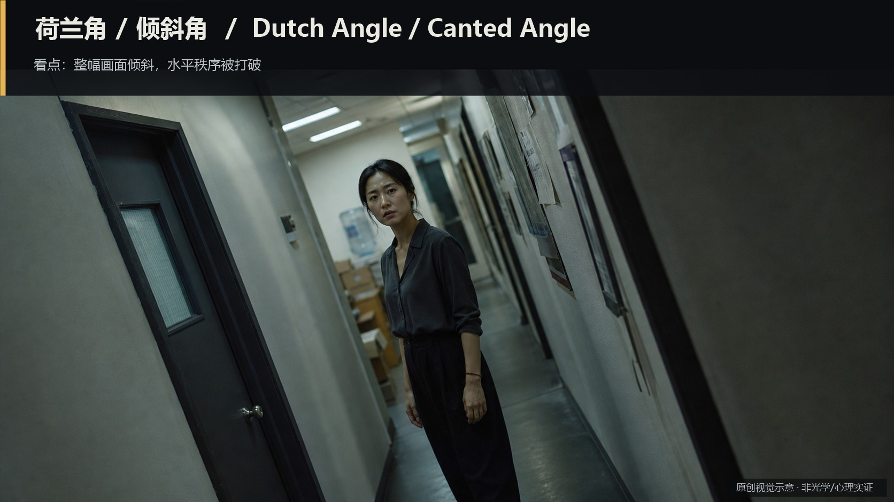

知识讲解：[A1-02 镜头角度系统](../../knowledge/A-%E7%90%86%E8%AE%BA%E5%B1%82/A1-%E6%91%84%E5%BD%B1%E7%BB%84/A1-02%20%E9%95%9C%E5%A4%B4%E8%A7%92%E5%BA%A6%E7%B3%BB%E7%BB%9F.md)

## 镜头角度系统：过肩视角（Over-the-shoulder）（09-over-shoulder，原创教学示意）

知识讲解：[A1-02 镜头角度系统](../../knowledge/A-%E7%90%86%E8%AE%BA%E5%B1%82/A1-%E6%91%84%E5%BD%B1%E7%BB%84/A1-02%20%E9%95%9C%E5%A4%B4%E8%A7%92%E5%BA%A6%E7%B3%BB%E7%BB%9F.md)

## 镜头角度系统：主观视角（Point-of-view）（10-pov，原创教学示意）

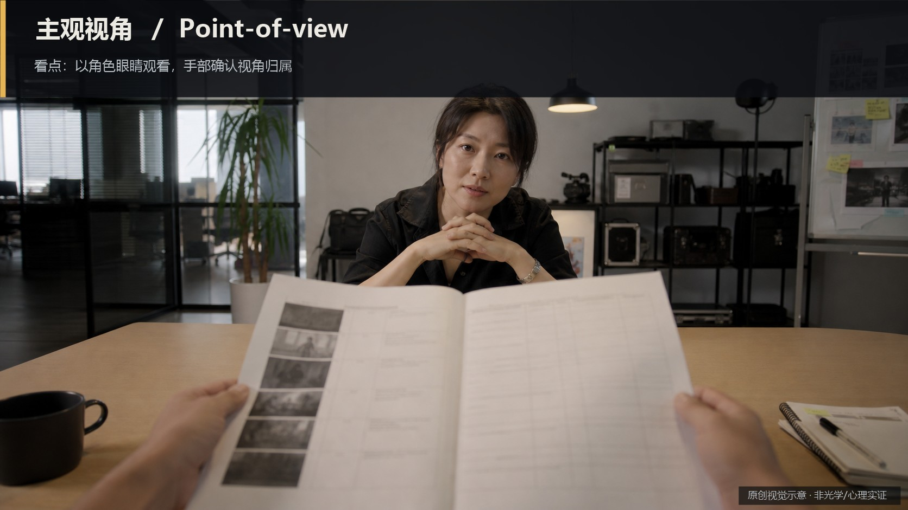

知识讲解：[A1-02 镜头角度系统](../../knowledge/A-%E7%90%86%E8%AE%BA%E5%B1%82/A1-%E6%91%84%E5%BD%B1%E7%BB%84/A1-02%20%E9%95%9C%E5%A4%B4%E8%A7%92%E5%BA%A6%E7%B3%BB%E7%BB%9F.md)

## 镜头角度系统：半主观视角（Semi-subjective）（11-semi-subjective，原创教学示意）

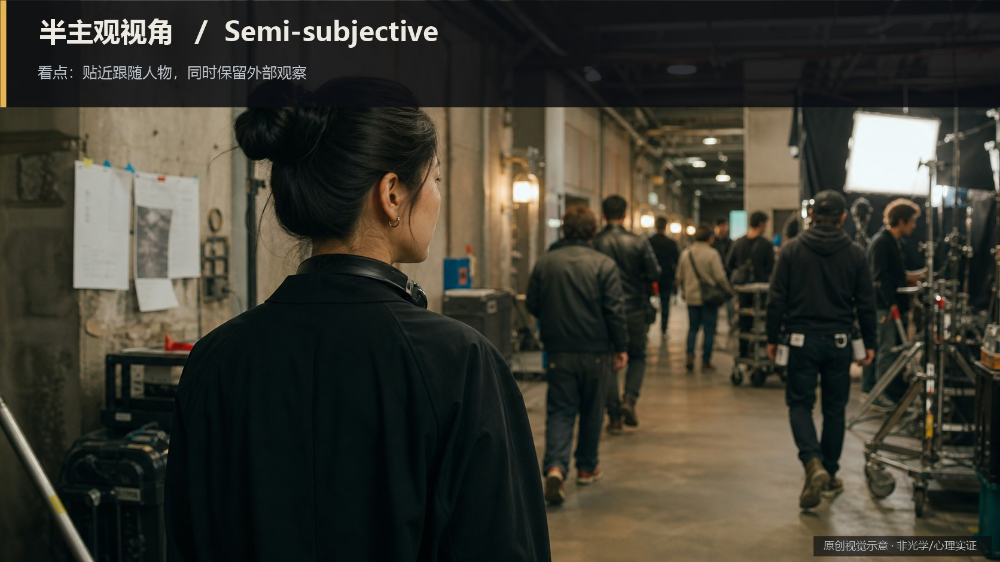

知识讲解：[A1-02 镜头角度系统](../../knowledge/A-%E7%90%86%E8%AE%BA%E5%B1%82/A1-%E6%91%84%E5%BD%B1%E7%BB%84/A1-02%20%E9%95%9C%E5%A4%B4%E8%A7%92%E5%BA%A6%E7%B3%BB%E7%BB%9F.md)

## 镜头角度系统：客观观察视角（Objective Observer）（12-objective-observer，原创教学示意）

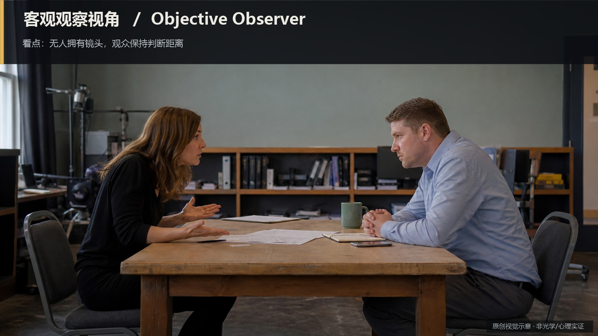

知识讲解：[A1-02 镜头角度系统](../../knowledge/A-%E7%90%86%E8%AE%BA%E5%B1%82/A1-%E6%91%84%E5%BD%B1%E7%BB%84/A1-02%20%E9%95%9C%E5%A4%B4%E8%A7%92%E5%BA%A6%E7%B3%BB%E7%BB%9F.md)

## 镜头角度系统：监控视角（Surveillance View）（13-surveillance，原创教学示意）

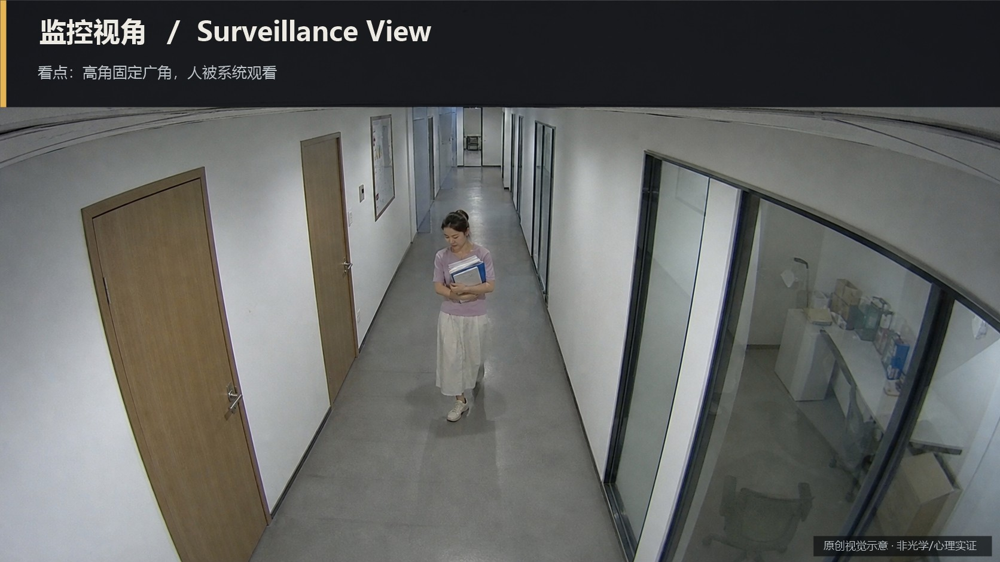

知识讲解：[A1-02 镜头角度系统](../../knowledge/A-%E7%90%86%E8%AE%BA%E5%B1%82/A1-%E6%91%84%E5%BD%B1%E7%BB%84/A1-02%20%E9%95%9C%E5%A4%B4%E8%A7%92%E5%BA%A6%E7%B3%BB%E7%BB%9F.md)

## 镜头角度系统：新闻纪实视角（News / Reportage）（14-news-reportage，原创教学示意）

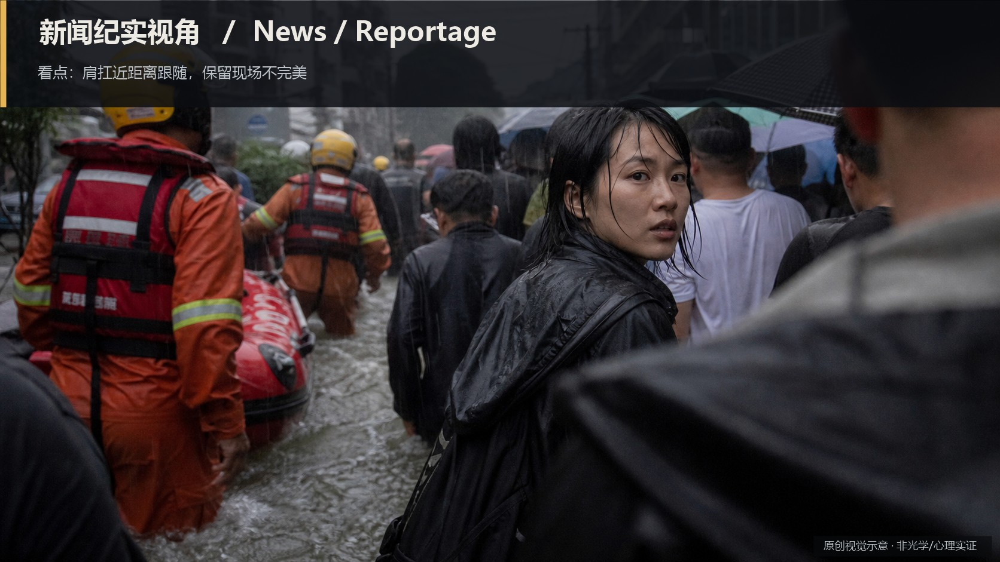

知识讲解：[A1-02 镜头角度系统](../../knowledge/A-%E7%90%86%E8%AE%BA%E5%B1%82/A1-%E6%91%84%E5%BD%B1%E7%BB%84/A1-02%20%E9%95%9C%E5%A4%B4%E8%A7%92%E5%BA%A6%E7%B3%BB%E7%BB%9F.md)

## 镜头角度系统：卫星视角（Satellite View）（15-satellite-view，原创教学示意）

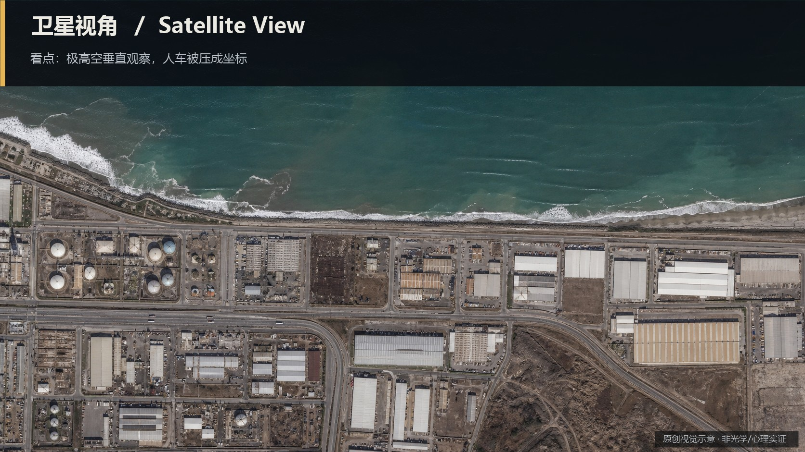

知识讲解：[A1-02 镜头角度系统](../../knowledge/A-%E7%90%86%E8%AE%BA%E5%B1%82/A1-%E6%91%84%E5%BD%B1%E7%BB%84/A1-02%20%E9%95%9C%E5%A4%B4%E8%A7%92%E5%BA%A6%E7%B3%BB%E7%BB%9F.md)

## 镜头角度系统：战术地图视角（Tactical Map View）（16-tactical-map-view，原创教学示意）

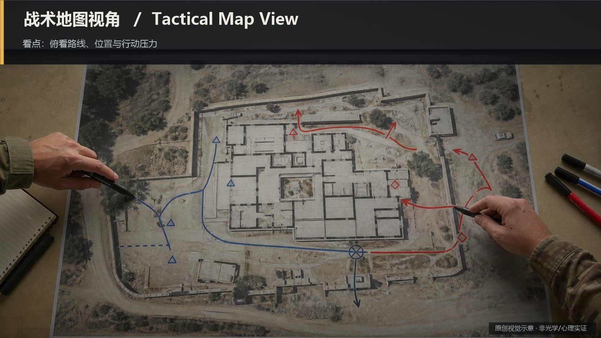

知识讲解：[A1-02 镜头角度系统](../../knowledge/A-%E7%90%86%E8%AE%BA%E5%B1%82/A1-%E6%91%84%E5%BD%B1%E7%BB%84/A1-02%20%E9%95%9C%E5%A4%B4%E8%A7%92%E5%BA%A6%E7%B3%BB%E7%BB%9F.md)

## 镜头角度系统：镜中视角（Mirror View）（17-mirror-view，原创教学示意）

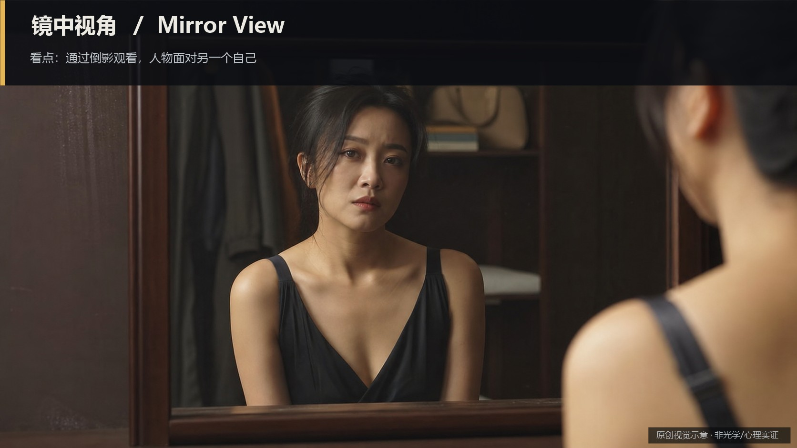

知识讲解：[A1-02 镜头角度系统](../../knowledge/A-%E7%90%86%E8%AE%BA%E5%B1%82/A1-%E6%91%84%E5%BD%B1%E7%BB%84/A1-02%20%E9%95%9C%E5%A4%B4%E8%A7%92%E5%BA%A6%E7%B3%BB%E7%BB%9F.md)

## 镜头角度系统：门框 / 窗框视角（Door / Window Frame）（18-door-window-frame，原创教学示意）

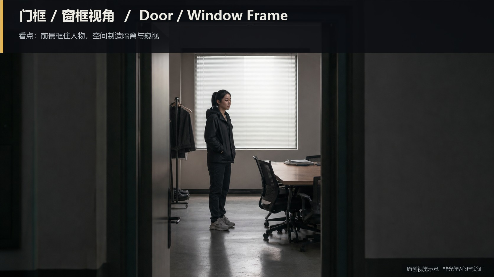

知识讲解：[A1-02 镜头角度系统](../../knowledge/A-%E7%90%86%E8%AE%BA%E5%B1%82/A1-%E6%91%84%E5%BD%B1%E7%BB%84/A1-02%20%E9%95%9C%E5%A4%B4%E8%A7%92%E5%BA%A6%E7%B3%BB%E7%BB%9F.md)
