# camera-language-mechanisms · 1—20

[全部主题](../IMAGE_GALLERY.md) · [首页](../../README.md)

## 景别系统：八级景别合同（统一记录字段）（18-controlled-shot-scale，原创教学示意）

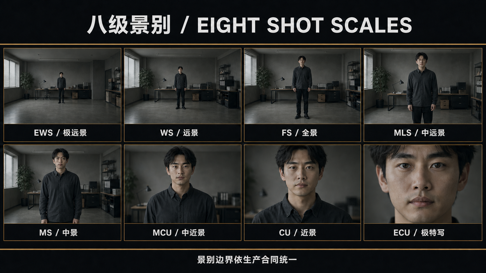

知识讲解：[A1-01 景别系统](../../knowledge/A-%E7%90%86%E8%AE%BA%E5%B1%82/A1-%E6%91%84%E5%BD%B1%E7%BB%84/A1-01%20%E6%99%AF%E5%88%AB%E7%B3%BB%E7%BB%9F.md)

## 镜头角度系统：机位方位罗盘（01-camera-compass，原创教学示意）

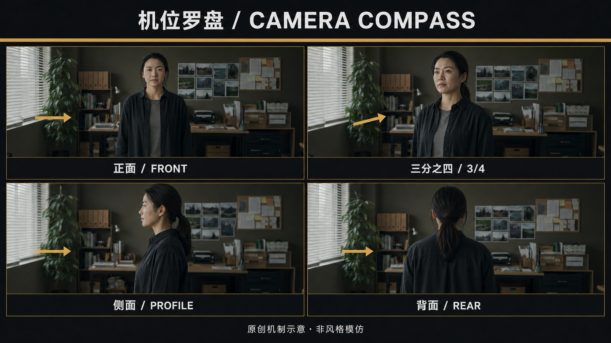

知识讲解：[A1-02 镜头角度系统](../../knowledge/A-%E7%90%86%E8%AE%BA%E5%B1%82/A1-%E6%91%84%E5%BD%B1%E7%BB%84/A1-02%20%E9%95%9C%E5%A4%B4%E8%A7%92%E5%BA%A6%E7%B3%BB%E7%BB%9F.md) · [A2-08 镜头语言机制与摄影机行为](../../knowledge/A-%E7%90%86%E8%AE%BA%E5%B1%82/A2-%E5%AF%BC%E6%BC%94%E7%BB%84/A2-08%20%E9%95%9C%E5%A4%B4%E8%AF%AD%E8%A8%80%E6%9C%BA%E5%88%B6%E4%B8%8E%E6%91%84%E5%BD%B1%E6%9C%BA%E8%A1%8C%E4%B8%BA.md)

## 镜头角度系统：高度与俯仰矩阵（02-height-angle-matrix，原创教学示意）

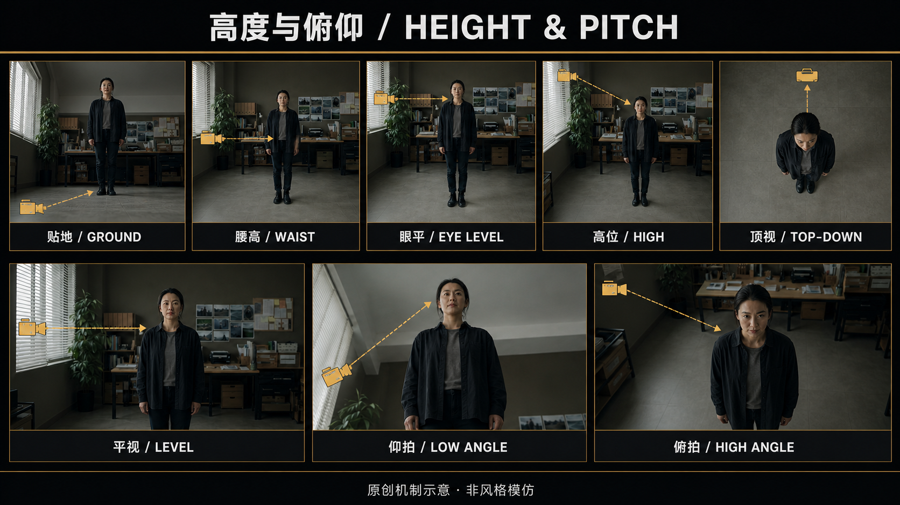

知识讲解：[A1-02 镜头角度系统](../../knowledge/A-%E7%90%86%E8%AE%BA%E5%B1%82/A1-%E6%91%84%E5%BD%B1%E7%BB%84/A1-02%20%E9%95%9C%E5%A4%B4%E8%A7%92%E5%BA%A6%E7%B3%BB%E7%BB%9F.md) · [A2-08 镜头语言机制与摄影机行为](../../knowledge/A-%E7%90%86%E8%AE%BA%E5%B1%82/A2-%E5%AF%BC%E6%BC%94%E7%BB%84/A2-08%20%E9%95%9C%E5%A4%B4%E8%AF%AD%E8%A8%80%E6%9C%BA%E5%88%B6%E4%B8%8E%E6%91%84%E5%BD%B1%E6%9C%BA%E8%A1%8C%E4%B8%BA.md)

## 镜头角度系统：视点归属：是谁在看（03-viewpoint-ladder，原创教学示意）

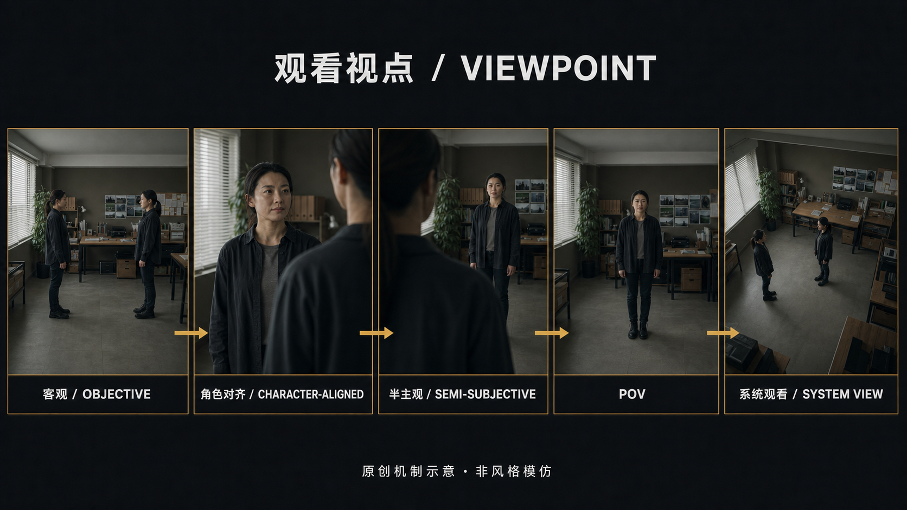

知识讲解：[A1-02 镜头角度系统](../../knowledge/A-%E7%90%86%E8%AE%BA%E5%B1%82/A1-%E6%91%84%E5%BD%B1%E7%BB%84/A1-02%20%E9%95%9C%E5%A4%B4%E8%A7%92%E5%BA%A6%E7%B3%BB%E7%BB%9F.md) · [A2-08 镜头语言机制与摄影机行为](../../knowledge/A-%E7%90%86%E8%AE%BA%E5%B1%82/A2-%E5%AF%BC%E6%BC%94%E7%BB%84/A2-08%20%E9%95%9C%E5%A4%B4%E8%AF%AD%E8%A8%80%E6%9C%BA%E5%88%B6%E4%B8%8E%E6%91%84%E5%BD%B1%E6%9C%BA%E8%A1%8C%E4%B8%BA.md)

## 镜头角度系统：覆盖职责：这一镜为什么要拍（04-axis-coverage，原创教学示意）

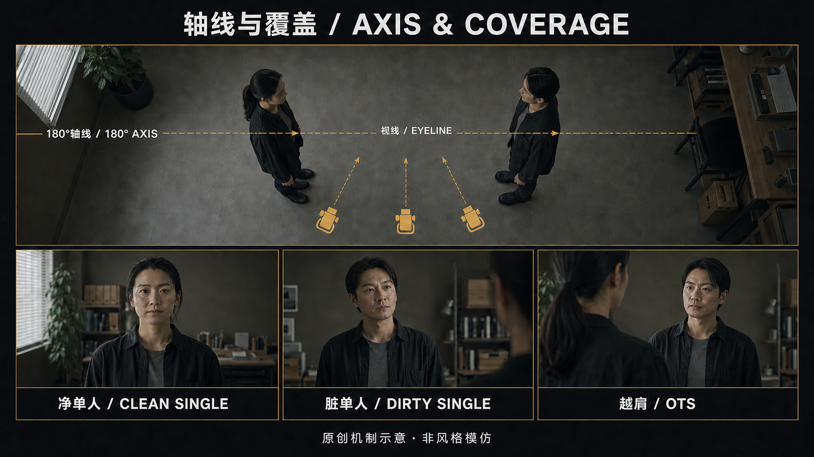

知识讲解：[A1-02 镜头角度系统](../../knowledge/A-%E7%90%86%E8%AE%BA%E5%B1%82/A1-%E6%91%84%E5%BD%B1%E7%BB%84/A1-02%20%E9%95%9C%E5%A4%B4%E8%A7%92%E5%BA%A6%E7%B3%BB%E7%BB%9F.md) · [A2-08 镜头语言机制与摄影机行为](../../knowledge/A-%E7%90%86%E8%AE%BA%E5%B1%82/A2-%E5%AF%BC%E6%BC%94%E7%BB%84/A2-08%20%E9%95%9C%E5%A4%B4%E8%AF%AD%E8%A8%80%E6%9C%BA%E5%88%B6%E4%B8%8E%E6%91%84%E5%BD%B1%E6%9C%BA%E8%A1%8C%E4%B8%BA.md)

## 摄影机运动系统：静止基线与运动六轴（05-translation-rotation-axes，原创教学示意）

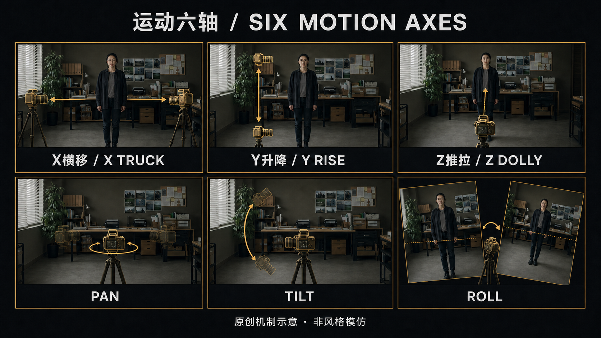

知识讲解：[A1-03 摄影机运动系统](../../knowledge/A-%E7%90%86%E8%AE%BA%E5%B1%82/A1-%E6%91%84%E5%BD%B1%E7%BB%84/A1-03%20%E6%91%84%E5%BD%B1%E6%9C%BA%E8%BF%90%E5%8A%A8%E7%B3%BB%E7%BB%9F.md) · [A2-08 镜头语言机制与摄影机行为](../../knowledge/A-%E7%90%86%E8%AE%BA%E5%B1%82/A2-%E5%AF%BC%E6%BC%94%E7%BB%84/A2-08%20%E9%95%9C%E5%A4%B4%E8%AF%AD%E8%A8%80%E6%9C%BA%E5%88%B6%E4%B8%8E%E6%91%84%E5%BD%B1%E6%9C%BA%E8%A1%8C%E4%B8%BA.md)

## 摄影机运动系统：路径几何（06-path-geometry，原创教学示意）

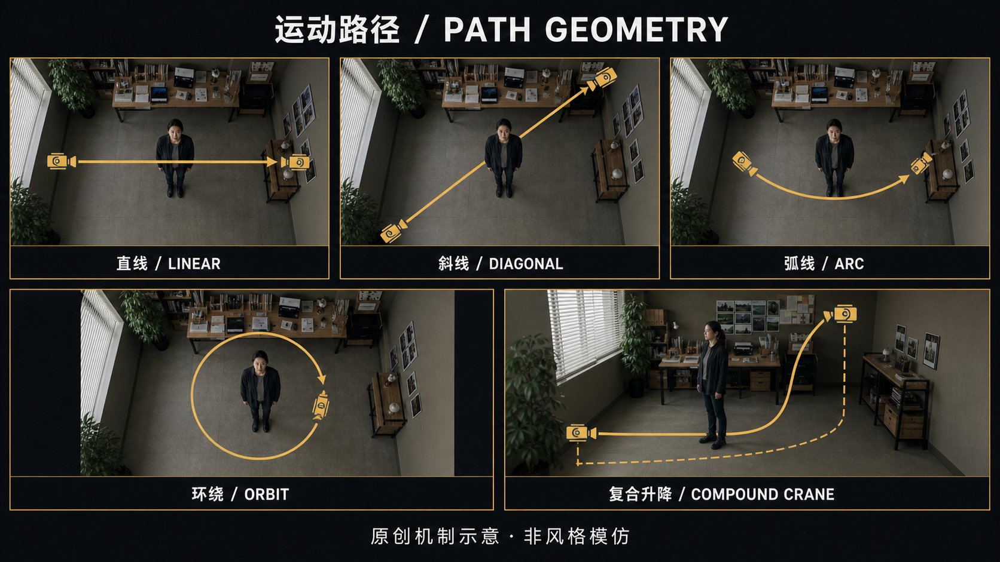

知识讲解：[A1-03 摄影机运动系统](../../knowledge/A-%E7%90%86%E8%AE%BA%E5%B1%82/A1-%E6%91%84%E5%BD%B1%E7%BB%84/A1-03%20%E6%91%84%E5%BD%B1%E6%9C%BA%E8%BF%90%E5%8A%A8%E7%B3%BB%E7%BB%9F.md) · [A2-08 镜头语言机制与摄影机行为](../../knowledge/A-%E7%90%86%E8%AE%BA%E5%B1%82/A2-%E5%AF%BC%E6%BC%94%E7%BB%84/A2-08%20%E9%95%9C%E5%A4%B4%E8%AF%AD%E8%A8%80%E6%9C%BA%E5%88%B6%E4%B8%8E%E6%91%84%E5%BD%B1%E6%9C%BA%E8%A1%8C%E4%B8%BA.md)

## 摄影机运动系统：摄影机与主体关系（07-camera-subject-relations，原创教学示意）

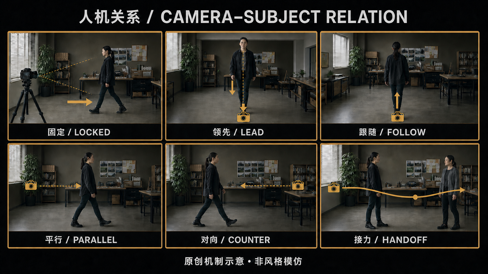

知识讲解：[A1-03 摄影机运动系统](../../knowledge/A-%E7%90%86%E8%AE%BA%E5%B1%82/A1-%E6%91%84%E5%BD%B1%E7%BB%84/A1-03%20%E6%91%84%E5%BD%B1%E6%9C%BA%E8%BF%90%E5%8A%A8%E7%B3%BB%E7%BB%9F.md) · [A2-08 镜头语言机制与摄影机行为](../../knowledge/A-%E7%90%86%E8%AE%BA%E5%B1%82/A2-%E5%AF%BC%E6%BC%94%E7%BB%84/A2-08%20%E9%95%9C%E5%A4%B4%E8%AF%AD%E8%A8%80%E6%9C%BA%E5%88%B6%E4%B8%8E%E6%91%84%E5%BD%B1%E6%9C%BA%E8%A1%8C%E4%B8%BA.md)

## 摄影机运动系统：承载系统决定“身体质感”，不决定路径（08-movement-texture，原创教学示意）

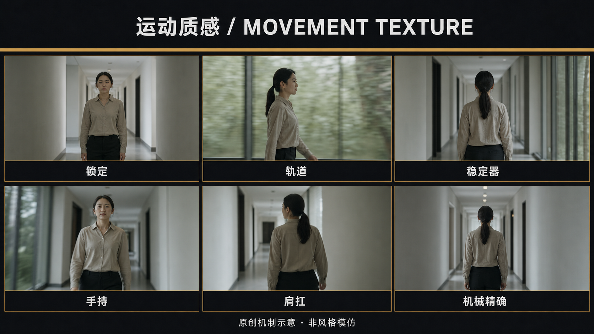

知识讲解：[A1-03 摄影机运动系统](../../knowledge/A-%E7%90%86%E8%AE%BA%E5%B1%82/A1-%E6%91%84%E5%BD%B1%E7%BB%84/A1-03%20%E6%91%84%E5%BD%B1%E6%9C%BA%E8%BF%90%E5%8A%A8%E7%B3%BB%E7%BB%9F.md) · [A2-08 镜头语言机制与摄影机行为](../../knowledge/A-%E7%90%86%E8%AE%BA%E5%B1%82/A2-%E5%AF%BC%E6%BC%94%E7%BB%84/A2-08%20%E9%95%9C%E5%A4%B4%E8%AF%AD%E8%A8%80%E6%9C%BA%E5%88%B6%E4%B8%8E%E6%91%84%E5%BD%B1%E6%9C%BA%E8%A1%8C%E4%B8%BA.md)

## 摄影机运动系统：速度曲线（09-speed-curve，原创教学示意）

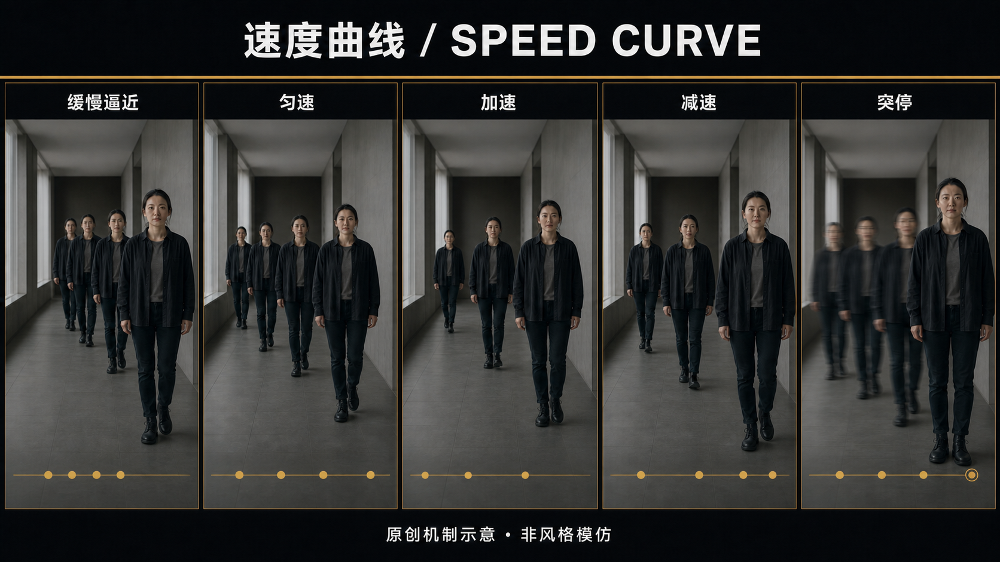

知识讲解：[A1-03 摄影机运动系统](../../knowledge/A-%E7%90%86%E8%AE%BA%E5%B1%82/A1-%E6%91%84%E5%BD%B1%E7%BB%84/A1-03%20%E6%91%84%E5%BD%B1%E6%9C%BA%E8%BF%90%E5%8A%A8%E7%B3%BB%E7%BB%9F.md) · [A2-08 镜头语言机制与摄影机行为](../../knowledge/A-%E7%90%86%E8%AE%BA%E5%B1%82/A2-%E5%AF%BC%E6%BC%94%E7%BB%84/A2-08%20%E9%95%9C%E5%A4%B4%E8%AF%AD%E8%A8%80%E6%9C%BA%E5%88%B6%E4%B8%8E%E6%91%84%E5%BD%B1%E6%9C%BA%E8%A1%8C%E4%B8%BA.md)

## 摄影机运动系统：推镜、变焦、滑动变焦必须分开（10-push-zoom-dollyzoom，原创教学示意）

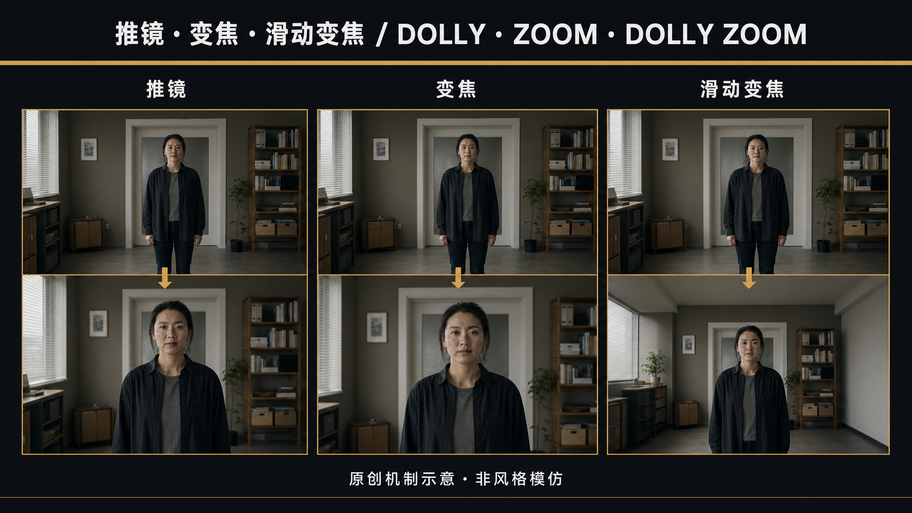

知识讲解：[A1-03 摄影机运动系统](../../knowledge/A-%E7%90%86%E8%AE%BA%E5%B1%82/A1-%E6%91%84%E5%BD%B1%E7%BB%84/A1-03%20%E6%91%84%E5%BD%B1%E6%9C%BA%E8%BF%90%E5%8A%A8%E7%B3%BB%E7%BB%9F.md) · [A2-08 镜头语言机制与摄影机行为](../../knowledge/A-%E7%90%86%E8%AE%BA%E5%B1%82/A2-%E5%AF%BC%E6%BC%94%E7%BB%84/A2-08%20%E9%95%9C%E5%A4%B4%E8%AF%AD%E8%A8%80%E6%9C%BA%E5%88%B6%E4%B8%8E%E6%91%84%E5%BD%B1%E6%9C%BA%E8%A1%8C%E4%B8%BA.md)

## 构图系统：基础画框余量补齐（17-framing-room，原创教学示意）

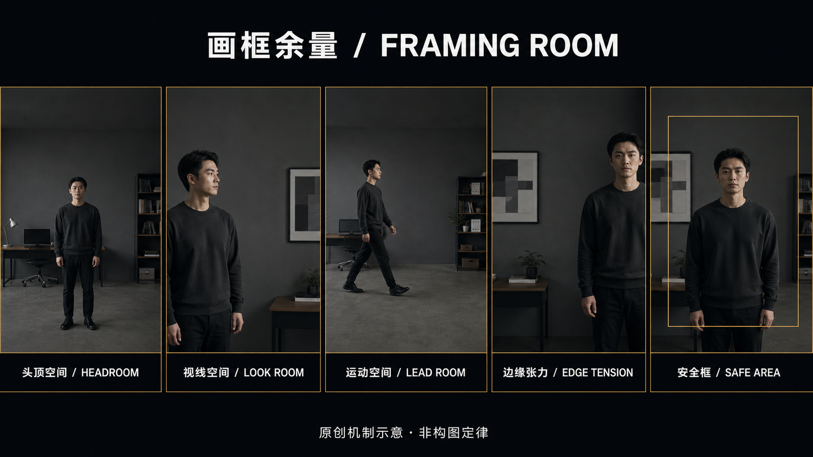

知识讲解：[A1-04 构图系统](../../knowledge/A-%E7%90%86%E8%AE%BA%E5%B1%82/A1-%E6%91%84%E5%BD%B1%E7%BB%84/A1-04%20%E6%9E%84%E5%9B%BE%E7%B3%BB%E7%BB%9F.md)

## 焦段与视觉心理：受控对照：视角与透视不是一件事（19-perspective-control，原创教学示意）

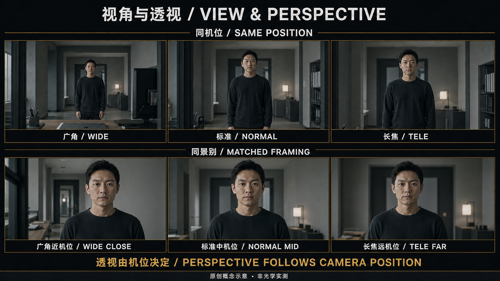

知识讲解：[A1-05 焦段与视觉心理](../../knowledge/A-%E7%90%86%E8%AE%BA%E5%B1%82/A1-%E6%91%84%E5%BD%B1%E7%BB%84/A1-05%20%E7%84%A6%E6%AE%B5%E4%B8%8E%E8%A7%86%E8%A7%89%E5%BF%83%E7%90%86.md)

## 焦段与视觉心理：受控对照：视角与透视不是一件事（11-wide-tele-perspective，原创教学示意）

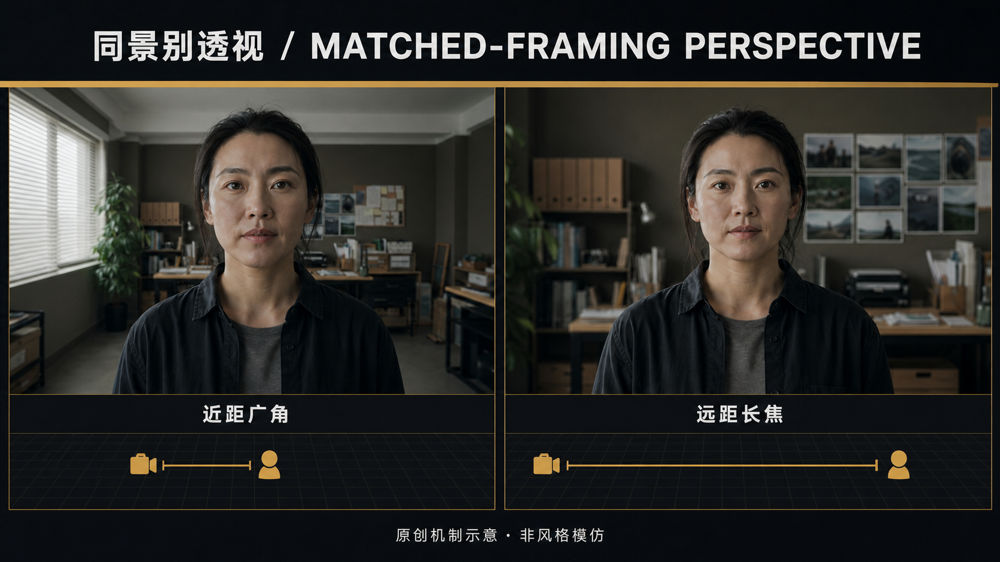

知识讲解：[A1-05 焦段与视觉心理](../../knowledge/A-%E7%90%86%E8%AE%BA%E5%B1%82/A1-%E6%91%84%E5%BD%B1%E7%BB%84/A1-05%20%E7%84%A6%E6%AE%B5%E4%B8%8E%E8%A7%86%E8%A7%89%E5%BF%83%E7%90%86.md) · [A2-08 镜头语言机制与摄影机行为](../../knowledge/A-%E7%90%86%E8%AE%BA%E5%B1%82/A2-%E5%AF%BC%E6%BC%94%E7%BB%84/A2-08%20%E9%95%9C%E5%A4%B4%E8%AF%AD%E8%A8%80%E6%9C%BA%E5%88%B6%E4%B8%8E%E6%91%84%E5%BD%B1%E6%9C%BA%E8%A1%8C%E4%B8%BA.md)

## 焦段与视觉心理：特殊光学补齐（16-special-optics，原创教学示意）

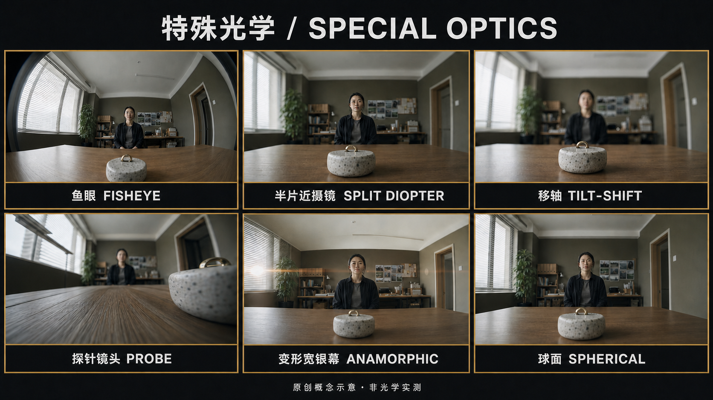

知识讲解：[A1-05 焦段与视觉心理](../../knowledge/A-%E7%90%86%E8%AE%BA%E5%B1%82/A1-%E6%91%84%E5%BD%B1%E7%BB%84/A1-05%20%E7%84%A6%E6%AE%B5%E4%B8%8E%E8%A7%86%E8%A7%89%E5%BF%83%E7%90%86.md)

## 焦段与视觉心理：时间采样与快门（15-time-sampling，原创教学示意）

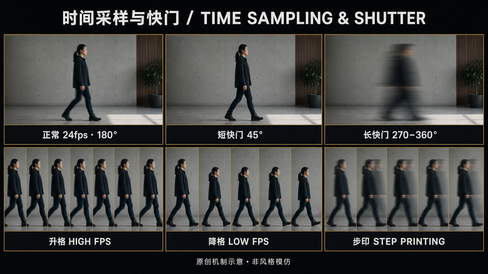

知识讲解：[A1-05 焦段与视觉心理](../../knowledge/A-%E7%90%86%E8%AE%BA%E5%B1%82/A1-%E6%91%84%E5%BD%B1%E7%BB%84/A1-05%20%E7%84%A6%E6%AE%B5%E4%B8%8E%E8%A7%86%E8%A7%89%E5%BF%83%E7%90%86.md)

## 导演与摄影指导风格：5. 王家卫 Wong Kar-wai（导演）（14-fragmented-city-time，原创教学示意）

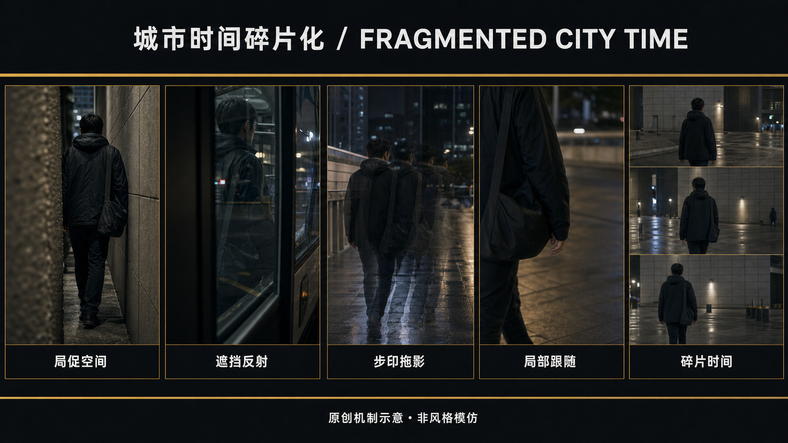

知识讲解：[A2-05 导演与摄影指导风格](../../knowledge/A-%E7%90%86%E8%AE%BA%E5%B1%82/A2-%E5%AF%BC%E6%BC%94%E7%BB%84/A2-05%20%E5%AF%BC%E6%BC%94%E4%B8%8E%E6%91%84%E5%BD%B1%E6%8C%87%E5%AF%BC%E9%A3%8E%E6%A0%BC.md) · [A2-08 镜头语言机制与摄影机行为](../../knowledge/A-%E7%90%86%E8%AE%BA%E5%B1%82/A2-%E5%AF%BC%E6%BC%94%E7%BB%84/A2-08%20%E9%95%9C%E5%A4%B4%E8%AF%AD%E8%A8%80%E6%9C%BA%E5%88%B6%E4%B8%8E%E6%91%84%E5%BD%B1%E6%9C%BA%E8%A1%8C%E4%B8%BA.md)

## 电影视觉风格坐标系与术语总纲：4.2 摄影与画面气质速查（00-six-camera-axes，原创教学示意）

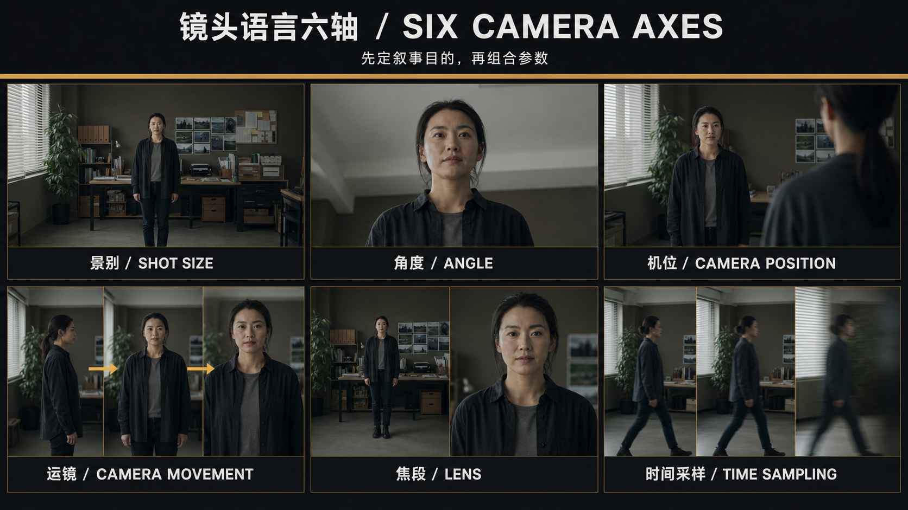

知识讲解：[A2-07 电影视觉风格坐标系与术语总纲](../../knowledge/A-%E7%90%86%E8%AE%BA%E5%B1%82/A2-%E5%AF%BC%E6%BC%94%E7%BB%84/A2-07%20%E7%94%B5%E5%BD%B1%E8%A7%86%E8%A7%89%E9%A3%8E%E6%A0%BC%E5%9D%90%E6%A0%87%E7%B3%BB%E4%B8%8E%E6%9C%AF%E8%AF%AD%E6%80%BB%E7%BA%B2.md) · [A2-08 镜头语言机制与摄影机行为](../../knowledge/A-%E7%90%86%E8%AE%BA%E5%B1%82/A2-%E5%AF%BC%E6%BC%94%E7%BB%84/A2-08%20%E9%95%9C%E5%A4%B4%E8%AF%AD%E8%A8%80%E6%9C%BA%E5%88%B6%E4%B8%8E%E6%91%84%E5%BD%B1%E6%9C%BA%E8%A1%8C%E4%B8%BA.md)

## 镜头语言机制与摄影机行为：2.12 信息顺序：先反应还是先威胁（12-information-order，原创教学示意）

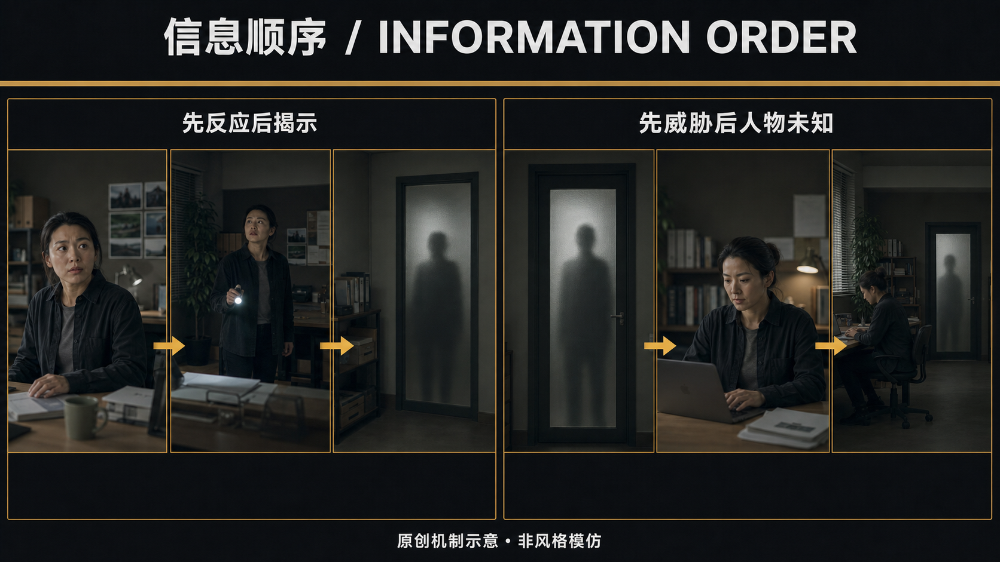

知识讲解：[A2-08 镜头语言机制与摄影机行为](../../knowledge/A-%E7%90%86%E8%AE%BA%E5%B1%82/A2-%E5%AF%BC%E6%BC%94%E7%BB%84/A2-08%20%E9%95%9C%E5%A4%B4%E8%AF%AD%E8%A8%80%E6%9C%BA%E5%88%B6%E4%B8%8E%E6%91%84%E5%BD%B1%E6%9C%BA%E8%A1%8C%E4%B8%BA.md)

## 镜头语言机制与摄影机行为：2.13 覆盖方案：镜头职责而不是景别清单（13-coverage-plan，原创教学示意）

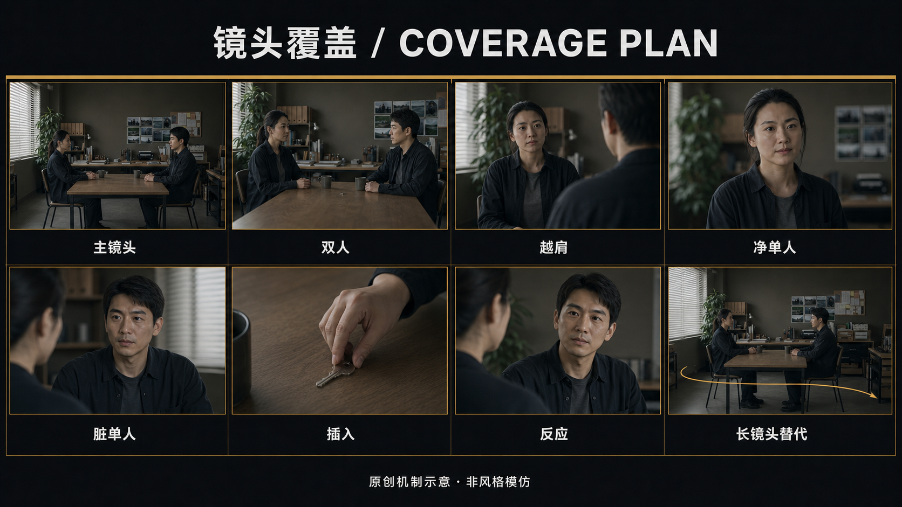

知识讲解：[A2-08 镜头语言机制与摄影机行为](../../knowledge/A-%E7%90%86%E8%AE%BA%E5%B1%82/A2-%E5%AF%BC%E6%BC%94%E7%BB%84/A2-08%20%E9%95%9C%E5%A4%B4%E8%AF%AD%E8%A8%80%E6%9C%BA%E5%88%B6%E4%B8%8E%E6%91%84%E5%BD%B1%E6%9C%BA%E8%A1%8C%E4%B8%BA.md)
