# camera-movement · 1—24

[全部主题](../IMAGE_GALLERY.md) · [首页](../../README.md)

## 摄影机运动系统：推镜（Push in / Dolly in）（01-push-in，原创教学示意）

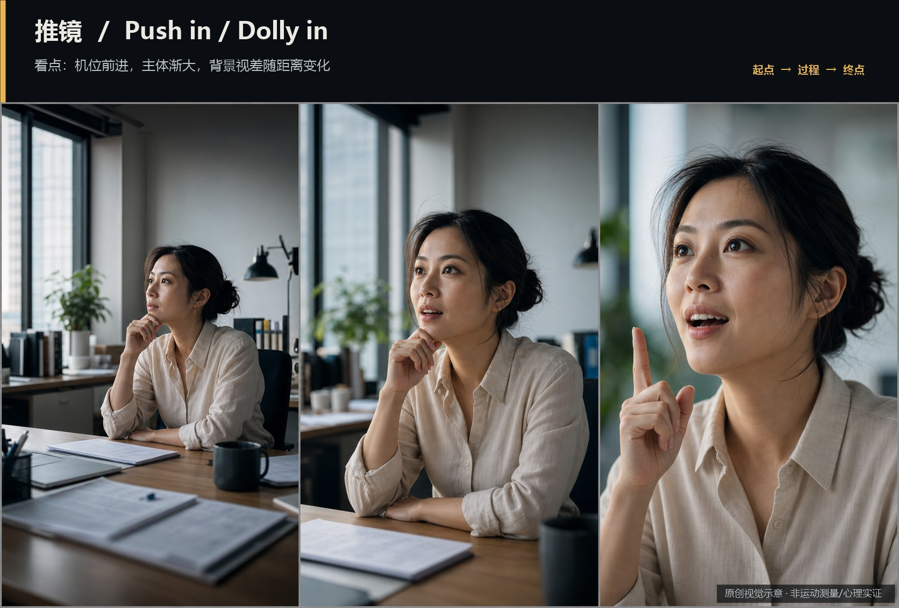

知识讲解：[A1-03 摄影机运动系统](../../knowledge/A-%E7%90%86%E8%AE%BA%E5%B1%82/A1-%E6%91%84%E5%BD%B1%E7%BB%84/A1-03%20%E6%91%84%E5%BD%B1%E6%9C%BA%E8%BF%90%E5%8A%A8%E7%B3%BB%E7%BB%9F.md)

## 摄影机运动系统：拉镜（Pull back / Dolly out）（02-pull-out，原创教学示意）

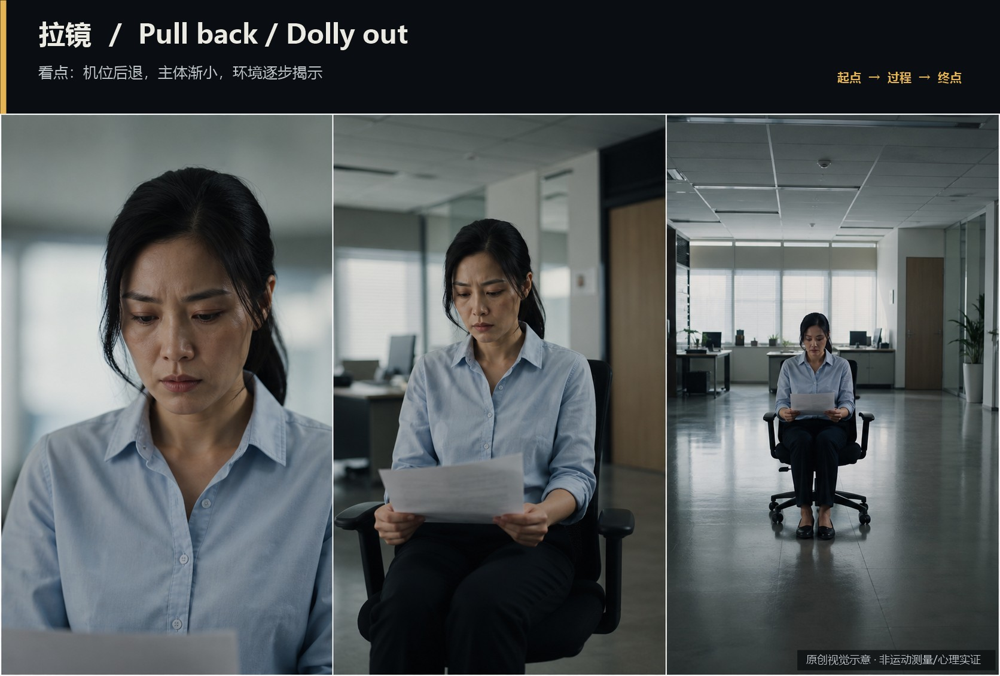

知识讲解：[A1-03 摄影机运动系统](../../knowledge/A-%E7%90%86%E8%AE%BA%E5%B1%82/A1-%E6%91%84%E5%BD%B1%E7%BB%84/A1-03%20%E6%91%84%E5%BD%B1%E6%9C%BA%E8%BF%90%E5%8A%A8%E7%B3%BB%E7%BB%9F.md)

## 摄影机运动系统：摇镜（Pan）（03-pan，原创教学示意）

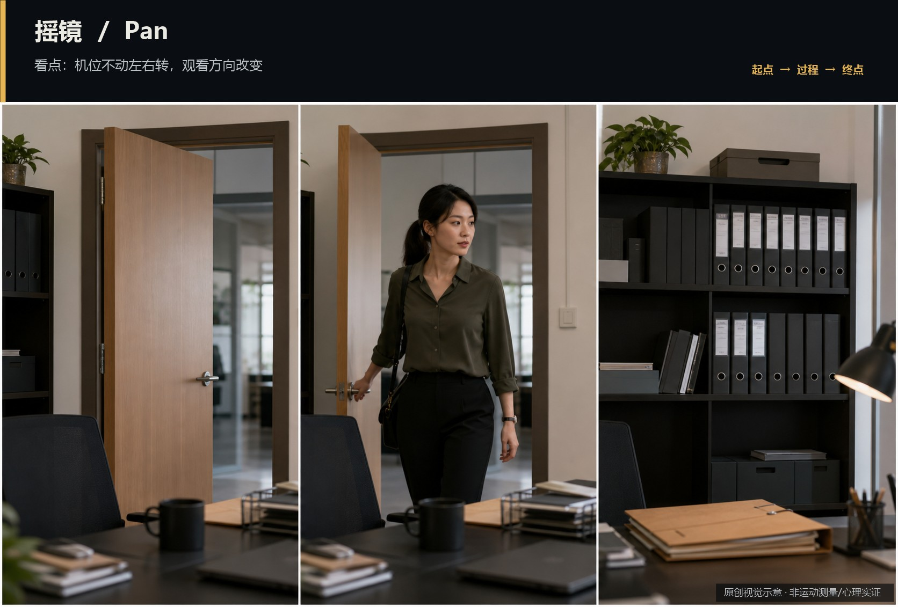

知识讲解：[A1-03 摄影机运动系统](../../knowledge/A-%E7%90%86%E8%AE%BA%E5%B1%82/A1-%E6%91%84%E5%BD%B1%E7%BB%84/A1-03%20%E6%91%84%E5%BD%B1%E6%9C%BA%E8%BF%90%E5%8A%A8%E7%B3%BB%E7%BB%9F.md)

## 摄影机运动系统：俯仰摇（Tilt）（04-tilt，原创教学示意）

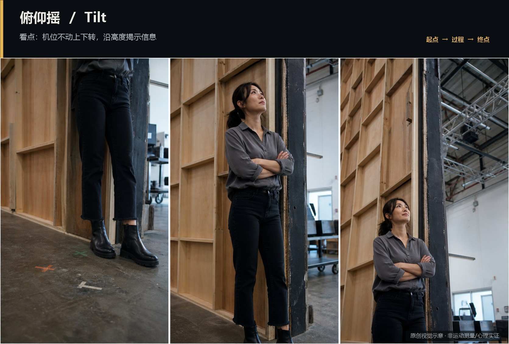

知识讲解：[A1-03 摄影机运动系统](../../knowledge/A-%E7%90%86%E8%AE%BA%E5%B1%82/A1-%E6%91%84%E5%BD%B1%E7%BB%84/A1-03%20%E6%91%84%E5%BD%B1%E6%9C%BA%E8%BF%90%E5%8A%A8%E7%B3%BB%E7%BB%9F.md)

## 摄影机运动系统：横移 / 轨道（Truck / Track）（05-truck-track，原创教学示意）

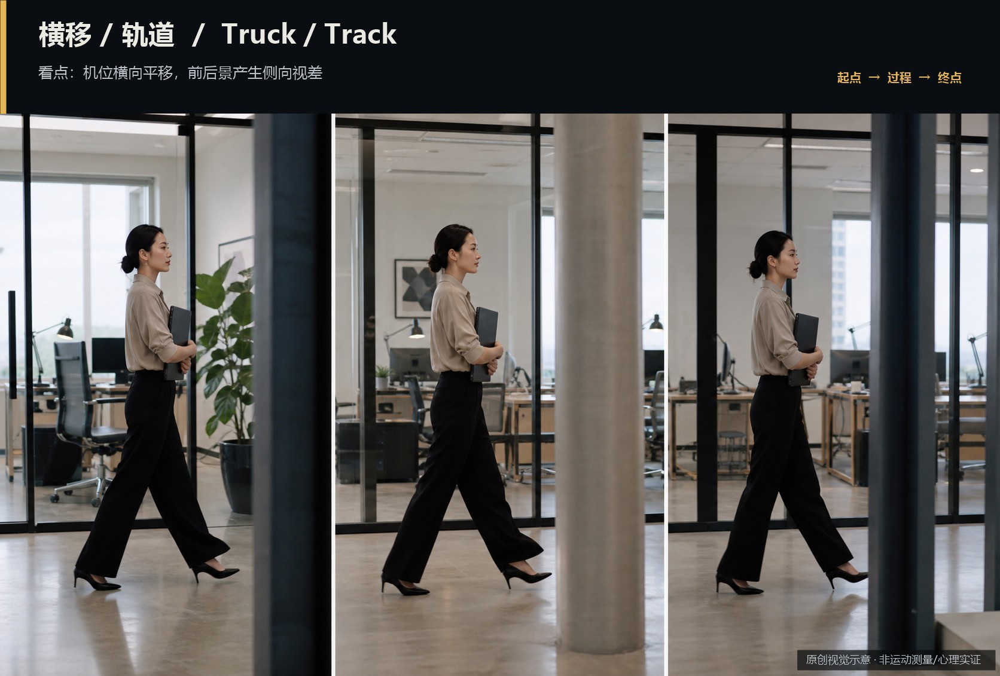

知识讲解：[A1-03 摄影机运动系统](../../knowledge/A-%E7%90%86%E8%AE%BA%E5%B1%82/A1-%E6%91%84%E5%BD%B1%E7%BB%84/A1-03%20%E6%91%84%E5%BD%B1%E6%9C%BA%E8%BF%90%E5%8A%A8%E7%B3%BB%E7%BB%9F.md)

## 摄影机运动系统：跟拍（Follow Shot）（06-follow-shot，原创教学示意）

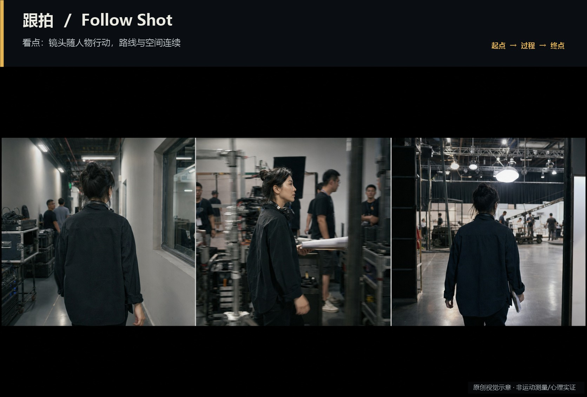

知识讲解：[A1-03 摄影机运动系统](../../knowledge/A-%E7%90%86%E8%AE%BA%E5%B1%82/A1-%E6%91%84%E5%BD%B1%E7%BB%84/A1-03%20%E6%91%84%E5%BD%B1%E6%9C%BA%E8%BF%90%E5%8A%A8%E7%B3%BB%E7%BB%9F.md)

## 摄影机运动系统：升降镜头（Crane / Jib）（07-crane-jib，原创教学示意）

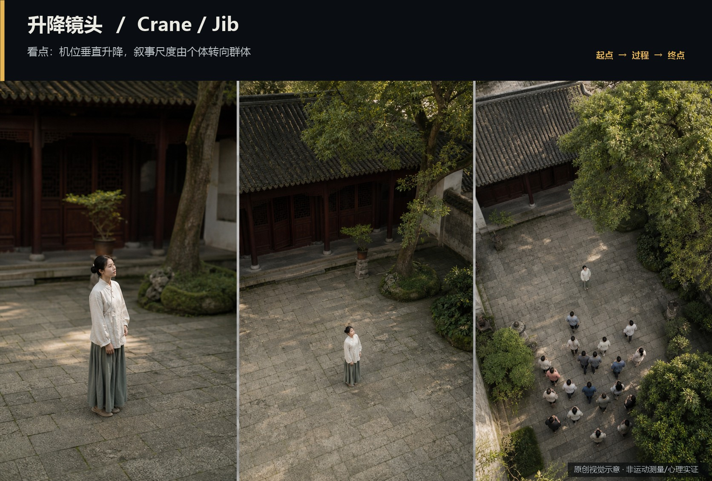

知识讲解：[A1-03 摄影机运动系统](../../knowledge/A-%E7%90%86%E8%AE%BA%E5%B1%82/A1-%E6%91%84%E5%BD%B1%E7%BB%84/A1-03%20%E6%91%84%E5%BD%B1%E6%9C%BA%E8%BF%90%E5%8A%A8%E7%B3%BB%E7%BB%9F.md)

## 摄影机运动系统：航拍（Aerial / Drone）（08-aerial-drone，原创教学示意）

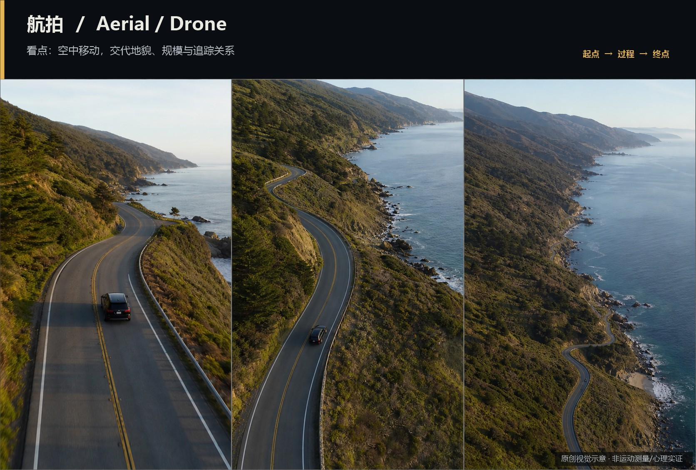

知识讲解：[A1-03 摄影机运动系统](../../knowledge/A-%E7%90%86%E8%AE%BA%E5%B1%82/A1-%E6%91%84%E5%BD%B1%E7%BB%84/A1-03%20%E6%91%84%E5%BD%B1%E6%9C%BA%E8%BF%90%E5%8A%A8%E7%B3%BB%E7%BB%9F.md)

## 摄影机运动系统：稳定器（Steadicam）（09-steadicam，原创教学示意）

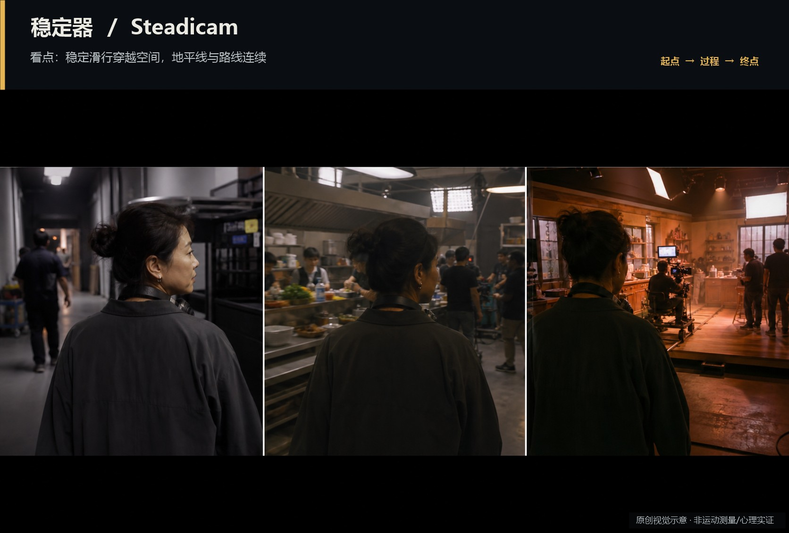

知识讲解：[A1-03 摄影机运动系统](../../knowledge/A-%E7%90%86%E8%AE%BA%E5%B1%82/A1-%E6%91%84%E5%BD%B1%E7%BB%84/A1-03%20%E6%91%84%E5%BD%B1%E6%9C%BA%E8%BF%90%E5%8A%A8%E7%B3%BB%E7%BB%9F.md)

## 摄影机运动系统：手持摄影（Handheld）（10-handheld，原创教学示意）

知识讲解：[A1-03 摄影机运动系统](../../knowledge/A-%E7%90%86%E8%AE%BA%E5%B1%82/A1-%E6%91%84%E5%BD%B1%E7%BB%84/A1-03%20%E6%91%84%E5%BD%B1%E6%9C%BA%E8%BF%90%E5%8A%A8%E7%B3%BB%E7%BB%9F.md)

## 摄影机运动系统：肩扛摄影（Shoulder-mounted）（11-shoulder-mounted，原创教学示意）

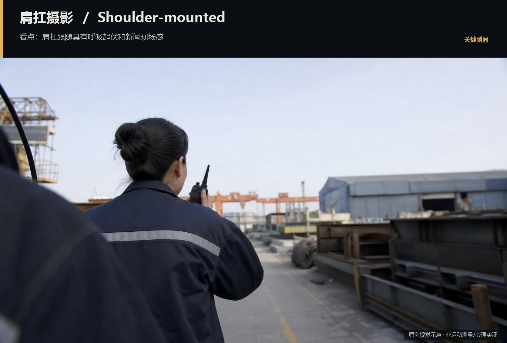

知识讲解：[A1-03 摄影机运动系统](../../knowledge/A-%E7%90%86%E8%AE%BA%E5%B1%82/A1-%E6%91%84%E5%BD%B1%E7%BB%84/A1-03%20%E6%91%84%E5%BD%B1%E6%9C%BA%E8%BF%90%E5%8A%A8%E7%B3%BB%E7%BB%9F.md)

## 摄影机运动系统：环绕镜头（Orbit Shot）（12-orbit，原创教学示意）

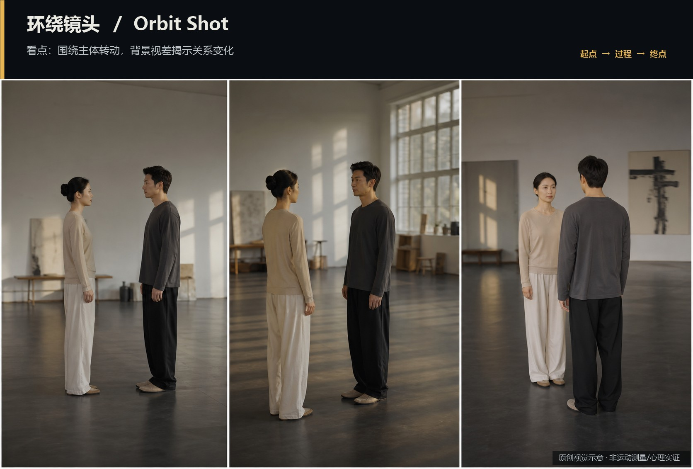

知识讲解：[A1-03 摄影机运动系统](../../knowledge/A-%E7%90%86%E8%AE%BA%E5%B1%82/A1-%E6%91%84%E5%BD%B1%E7%BB%84/A1-03%20%E6%91%84%E5%BD%B1%E6%9C%BA%E8%BF%90%E5%8A%A8%E7%B3%BB%E7%BB%9F.md)

## 摄影机运动系统：英雄环绕（Hero Orbit）（13-hero-orbit，原创教学示意）

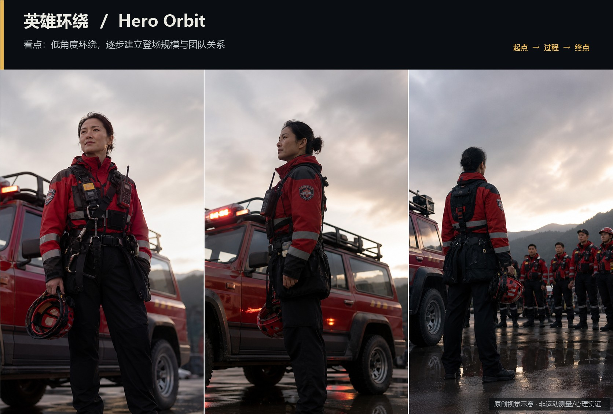

知识讲解：[A1-03 摄影机运动系统](../../knowledge/A-%E7%90%86%E8%AE%BA%E5%B1%82/A1-%E6%91%84%E5%BD%B1%E7%BB%84/A1-03%20%E6%91%84%E5%BD%B1%E6%9C%BA%E8%BF%90%E5%8A%A8%E7%B3%BB%E7%BB%9F.md)

## 摄影机运动系统：快速甩镜（Whip Pan）（14-whip-pan，原创教学示意）

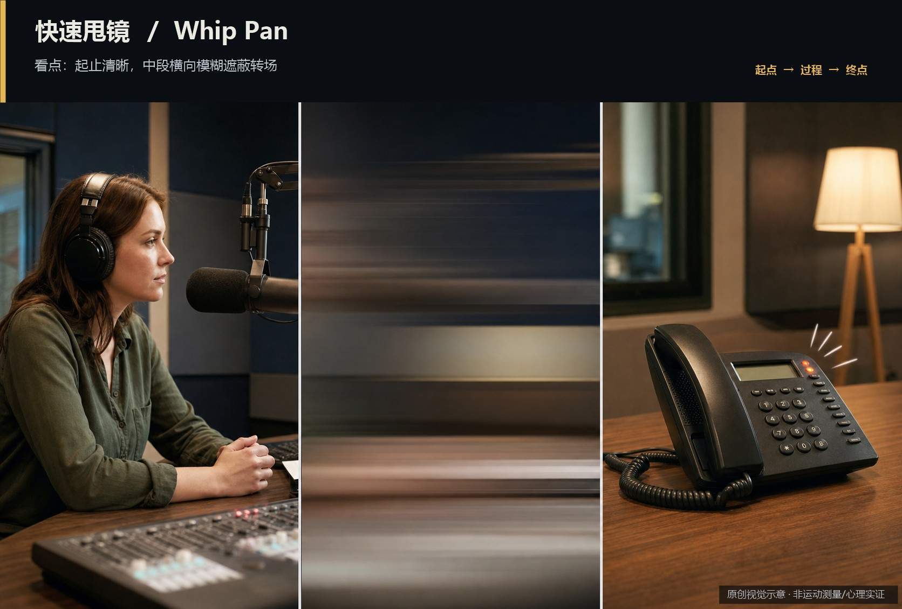

知识讲解：[A1-03 摄影机运动系统](../../knowledge/A-%E7%90%86%E8%AE%BA%E5%B1%82/A1-%E6%91%84%E5%BD%B1%E7%BB%84/A1-03%20%E6%91%84%E5%BD%B1%E6%9C%BA%E8%BF%90%E5%8A%A8%E7%B3%BB%E7%BB%9F.md)

## 摄影机运动系统：变焦（Zoom）（15-zoom，原创教学示意）

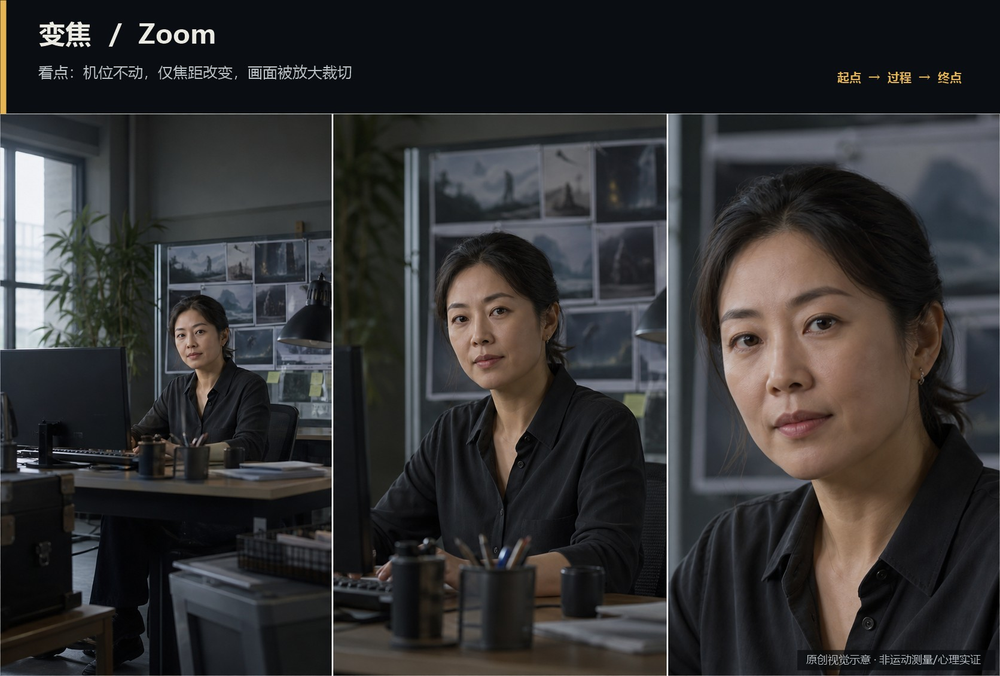

知识讲解：[A1-03 摄影机运动系统](../../knowledge/A-%E7%90%86%E8%AE%BA%E5%B1%82/A1-%E6%91%84%E5%BD%B1%E7%BB%84/A1-03%20%E6%91%84%E5%BD%B1%E6%9C%BA%E8%BF%90%E5%8A%A8%E7%B3%BB%E7%BB%9F.md)

## 摄影机运动系统：希区柯克变焦（Dolly Zoom）（16-dolly-zoom，原创教学示意）

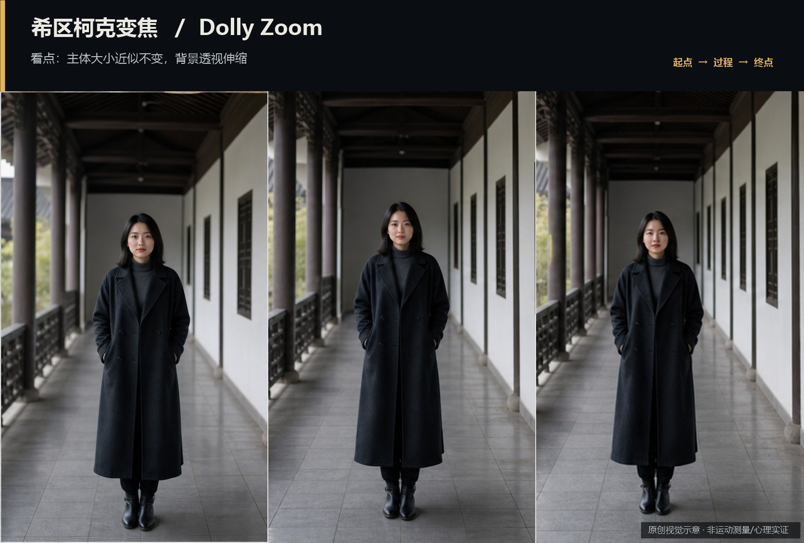

知识讲解：[A1-03 摄影机运动系统](../../knowledge/A-%E7%90%86%E8%AE%BA%E5%B1%82/A1-%E6%91%84%E5%BD%B1%E7%BB%84/A1-03%20%E6%91%84%E5%BD%B1%E6%9C%BA%E8%BF%90%E5%8A%A8%E7%B3%BB%E7%BB%9F.md)

## 摄影机运动系统：长镜头（Long Take）（17-long-take，原创教学示意）

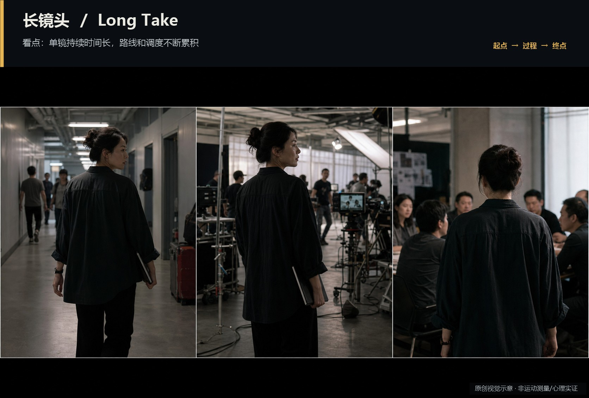

知识讲解：[A1-03 摄影机运动系统](../../knowledge/A-%E7%90%86%E8%AE%BA%E5%B1%82/A1-%E6%91%84%E5%BD%B1%E7%BB%84/A1-03%20%E6%91%84%E5%BD%B1%E6%9C%BA%E8%BF%90%E5%8A%A8%E7%B3%BB%E7%BB%9F.md)

## 摄影机运动系统：一镜到底（Oner）（18-oner，原创教学示意）

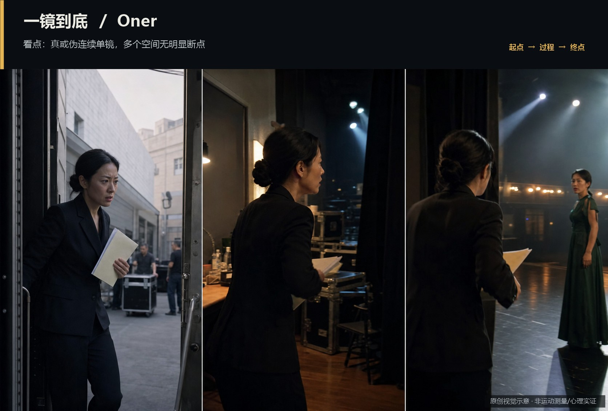

知识讲解：[A1-03 摄影机运动系统](../../knowledge/A-%E7%90%86%E8%AE%BA%E5%B1%82/A1-%E6%91%84%E5%BD%B1%E7%BB%84/A1-03%20%E6%91%84%E5%BD%B1%E6%9C%BA%E8%BF%90%E5%8A%A8%E7%B3%BB%E7%BB%9F.md)

## 摄影机运动系统：旋转镜头（Roll）（19-roll，原创教学示意）

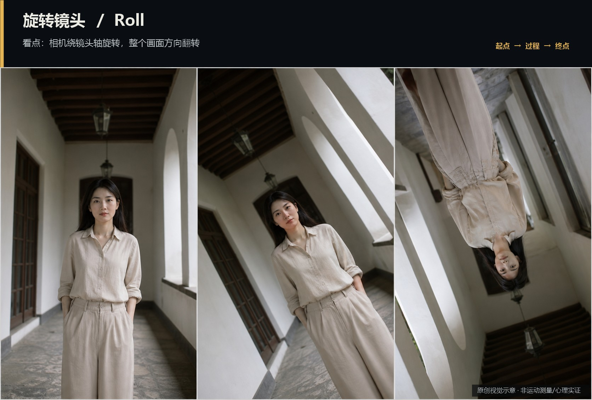

知识讲解：[A1-03 摄影机运动系统](../../knowledge/A-%E7%90%86%E8%AE%BA%E5%B1%82/A1-%E6%91%84%E5%BD%B1%E7%BB%84/A1-03%20%E6%91%84%E5%BD%B1%E6%9C%BA%E8%BF%90%E5%8A%A8%E7%B3%BB%E7%BB%9F.md)

## 摄影机运动系统：慢动作（Slow Motion）（20-slow-motion，原创教学示意）

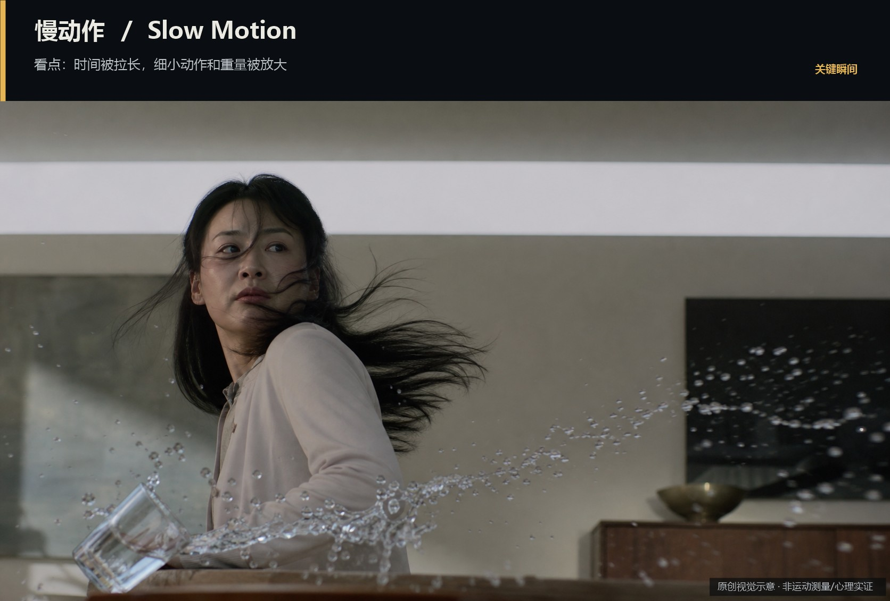

知识讲解：[A1-03 摄影机运动系统](../../knowledge/A-%E7%90%86%E8%AE%BA%E5%B1%82/A1-%E6%91%84%E5%BD%B1%E7%BB%84/A1-03%20%E6%91%84%E5%BD%B1%E6%9C%BA%E8%BF%90%E5%8A%A8%E7%B3%BB%E7%BB%9F.md)

## 摄影机运动系统：快动作 / 延时（Time Lapse）（21-time-lapse，原创教学示意）

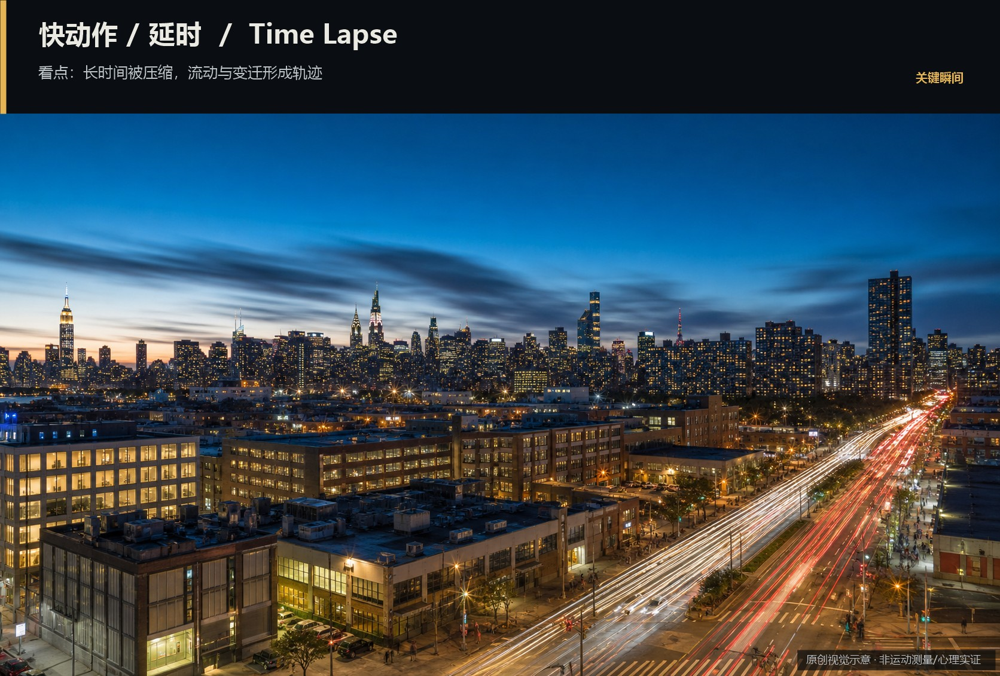

知识讲解：[A1-03 摄影机运动系统](../../knowledge/A-%E7%90%86%E8%AE%BA%E5%B1%82/A1-%E6%91%84%E5%BD%B1%E7%BB%84/A1-03%20%E6%91%84%E5%BD%B1%E6%9C%BA%E8%BF%90%E5%8A%A8%E7%B3%BB%E7%BB%9F.md)

## 摄影机运动系统：子弹时间（Bullet Time）（22-bullet-time，原创教学示意）

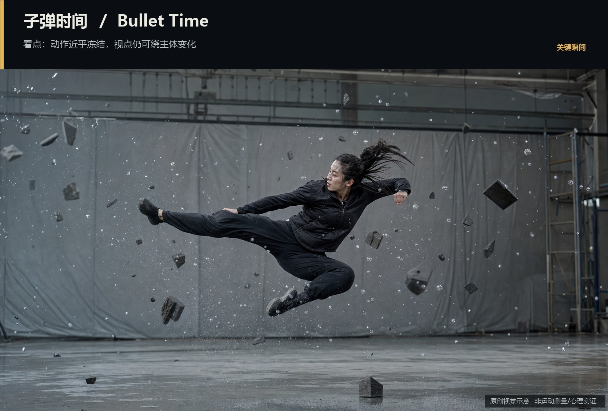

知识讲解：[A1-03 摄影机运动系统](../../knowledge/A-%E7%90%86%E8%AE%BA%E5%B1%82/A1-%E6%91%84%E5%BD%B1%E7%BB%84/A1-03%20%E6%91%84%E5%BD%B1%E6%9C%BA%E8%BF%90%E5%8A%A8%E7%B3%BB%E7%BB%9F.md)

## 摄影机运动系统：焦点转移（Rack Focus）（23-rack-focus，原创教学示意）

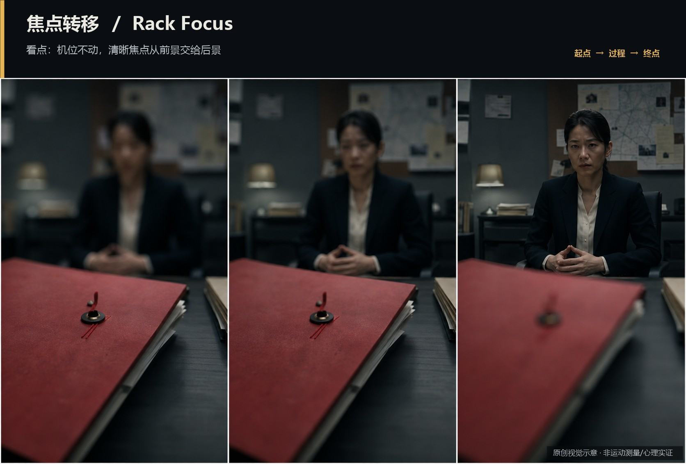

知识讲解：[A1-03 摄影机运动系统](../../knowledge/A-%E7%90%86%E8%AE%BA%E5%B1%82/A1-%E6%91%84%E5%BD%B1%E7%BB%84/A1-03%20%E6%91%84%E5%BD%B1%E6%9C%BA%E8%BF%90%E5%8A%A8%E7%B3%BB%E7%BB%9F.md)

## 摄影机运动系统：呼吸式手持微抖（Breathing Handheld）（24-breathing-handheld，原创教学示意）

知识讲解：[A1-03 摄影机运动系统](../../knowledge/A-%E7%90%86%E8%AE%BA%E5%B1%82/A1-%E6%91%84%E5%BD%B1%E7%BB%84/A1-03%20%E6%91%84%E5%BD%B1%E6%9C%BA%E8%BF%90%E5%8A%A8%E7%B3%BB%E7%BB%9F.md)
