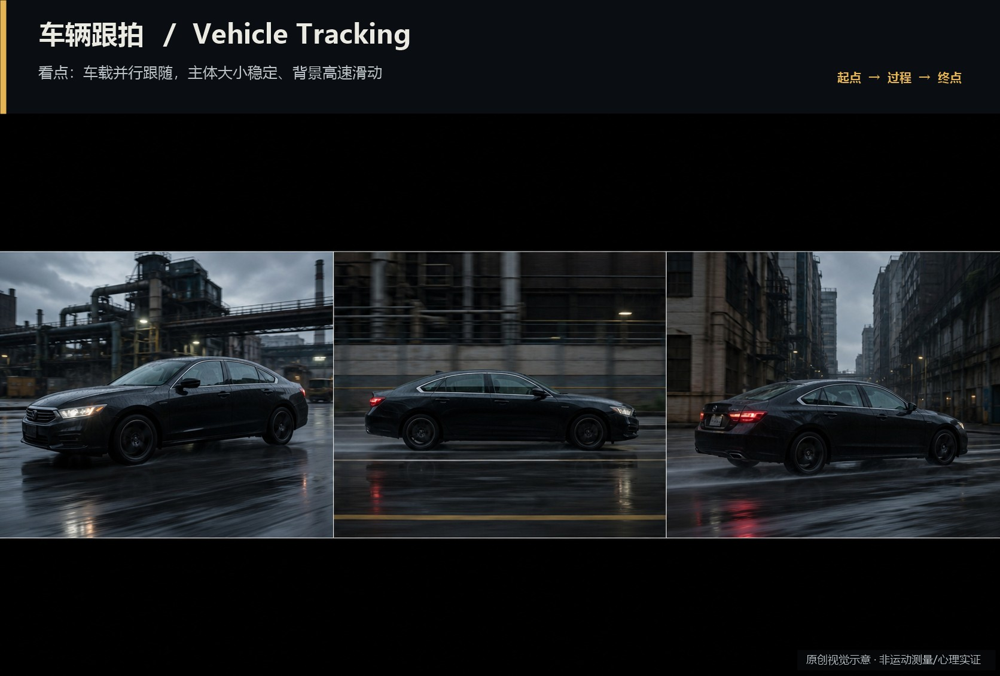
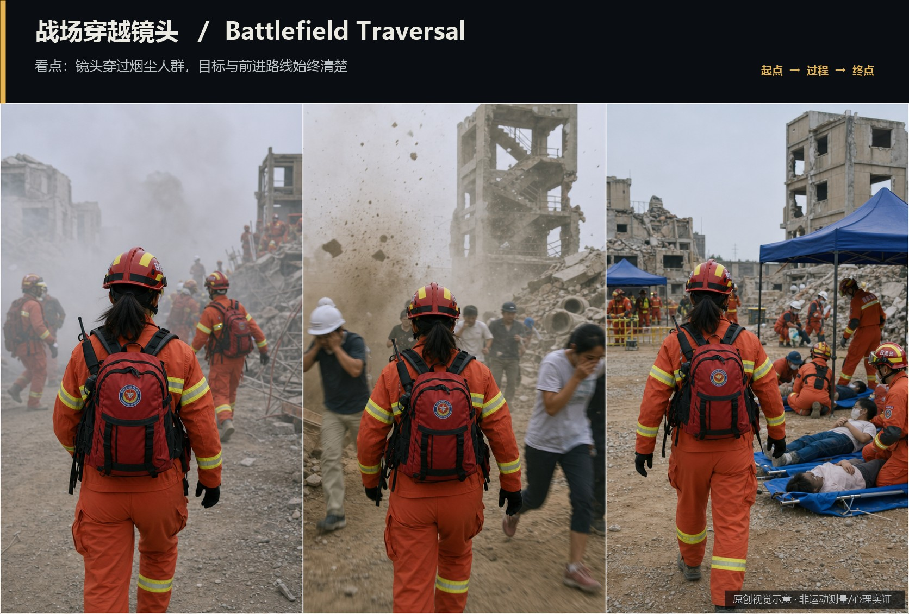
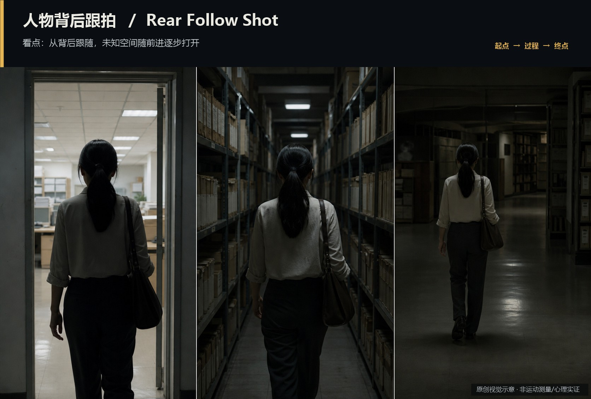
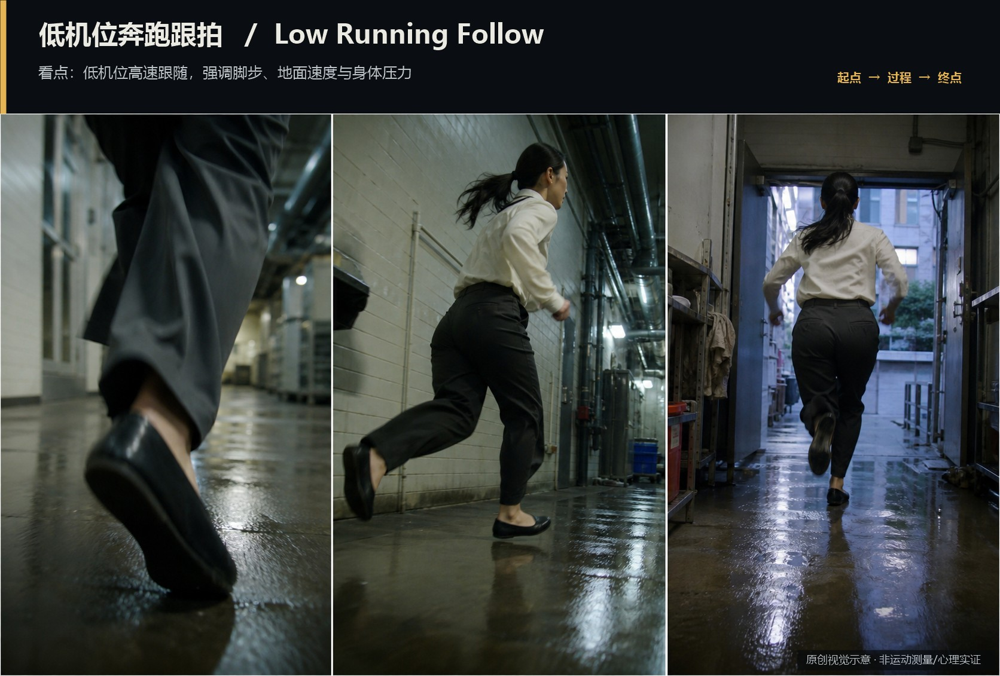

# camera-movement · 25—28

[全部主题](../IMAGE_GALLERY.md) · [首页](../../README.md)

## 摄影机运动系统：车辆跟拍（Vehicle Tracking）（25-vehicle-tracking，原创教学示意）

知识讲解：[A1-03 摄影机运动系统](../../knowledge/A-%E7%90%86%E8%AE%BA%E5%B1%82/A1-%E6%91%84%E5%BD%B1%E7%BB%84/A1-03%20%E6%91%84%E5%BD%B1%E6%9C%BA%E8%BF%90%E5%8A%A8%E7%B3%BB%E7%BB%9F.md)

## 摄影机运动系统：战场穿越镜头（Battlefield Traversal）（26-battlefield-traversal，原创教学示意）

知识讲解：[A1-03 摄影机运动系统](../../knowledge/A-%E7%90%86%E8%AE%BA%E5%B1%82/A1-%E6%91%84%E5%BD%B1%E7%BB%84/A1-03%20%E6%91%84%E5%BD%B1%E6%9C%BA%E8%BF%90%E5%8A%A8%E7%B3%BB%E7%BB%9F.md)

## 摄影机运动系统：人物背后跟拍（Rear Follow Shot）（27-rear-follow，原创教学示意）

知识讲解：[A1-03 摄影机运动系统](../../knowledge/A-%E7%90%86%E8%AE%BA%E5%B1%82/A1-%E6%91%84%E5%BD%B1%E7%BB%84/A1-03%20%E6%91%84%E5%BD%B1%E6%9C%BA%E8%BF%90%E5%8A%A8%E7%B3%BB%E7%BB%9F.md)

## 摄影机运动系统：低机位奔跑跟拍（Low Running Follow）（28-low-running-follow，原创教学示意）

知识讲解：[A1-03 摄影机运动系统](../../knowledge/A-%E7%90%86%E8%AE%BA%E5%B1%82/A1-%E6%91%84%E5%BD%B1%E7%BB%84/A1-03%20%E6%91%84%E5%BD%B1%E6%9C%BA%E8%BF%90%E5%8A%A8%E7%B3%BB%E7%BB%9F.md)
