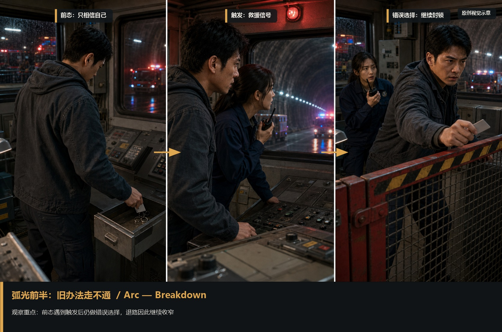
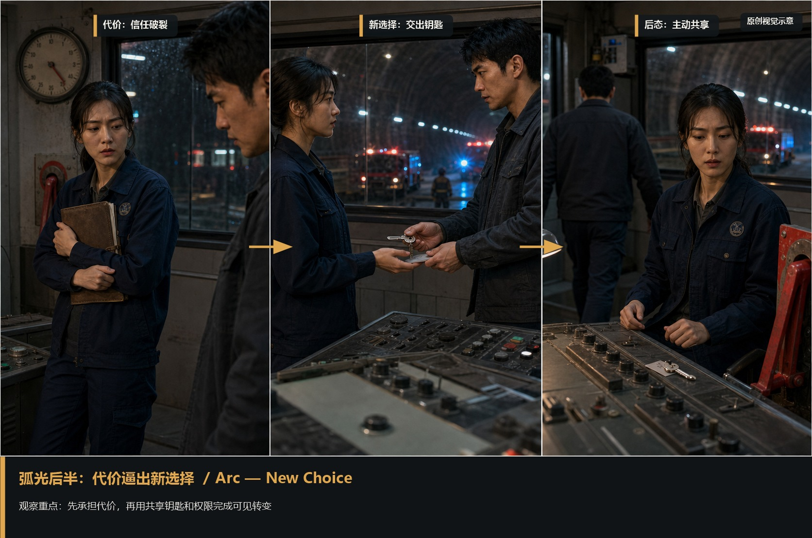
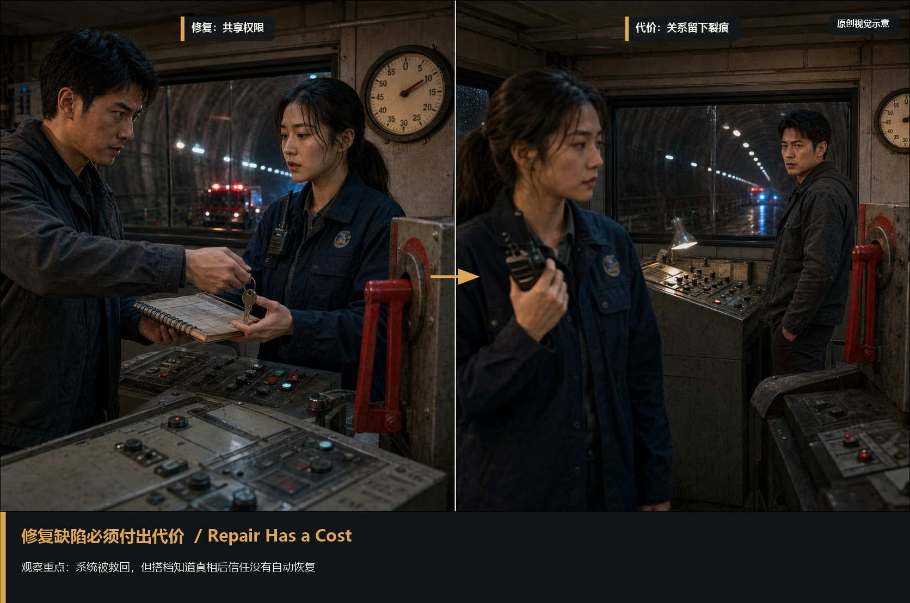

# character-arc · 1—6

[全部主题](../IMAGE_GALLERY.md) · [首页](../../README.md)

## 人物弧光与缺陷：弧光前半｜旧办法连续失效（01-arc-first-half，原创教学示意）

知识讲解：[A3-07 人物弧光与缺陷](../../knowledge/A-%E7%90%86%E8%AE%BA%E5%B1%82/A3-%E7%BC%96%E5%89%A7%E7%BB%84/A3-07%20%E4%BA%BA%E7%89%A9%E5%BC%A7%E5%85%89%E4%B8%8E%E7%BC%BA%E9%99%B7.md)

## 人物弧光与缺陷：弧光后半｜代价逼出新选择（02-arc-second-half，原创教学示意）

知识讲解：[A3-07 人物弧光与缺陷](../../knowledge/A-%E7%90%86%E8%AE%BA%E5%B1%82/A3-%E7%BC%96%E5%89%A7%E7%BB%84/A3-07%20%E4%BA%BA%E7%89%A9%E5%BC%A7%E5%85%89%E4%B8%8E%E7%BC%BA%E9%99%B7.md)

## 人物弧光与缺陷：缺陷是行动障碍（03-action-obstacle，原创教学示意）

知识讲解：[A3-07 人物弧光与缺陷](../../knowledge/A-%E7%90%86%E8%AE%BA%E5%B1%82/A3-%E7%BC%96%E5%89%A7%E7%BB%84/A3-07%20%E4%BA%BA%E7%89%A9%E5%BC%A7%E5%85%89%E4%B8%8E%E7%BC%BA%E9%99%B7.md)

## 人物弧光与缺陷：把缺陷推到极端（04-flaw-extreme，原创教学示意）

知识讲解：[A3-07 人物弧光与缺陷](../../knowledge/A-%E7%90%86%E8%AE%BA%E5%B1%82/A3-%E7%BC%96%E5%89%A7%E7%BB%84/A3-07%20%E4%BA%BA%E7%89%A9%E5%BC%A7%E5%85%89%E4%B8%8E%E7%BC%BA%E9%99%B7.md)

## 人物弧光与缺陷：修复必须付出代价（05-repair-cost，原创教学示意）

知识讲解：[A3-07 人物弧光与缺陷](../../knowledge/A-%E7%90%86%E8%AE%BA%E5%B1%82/A3-%E7%BC%96%E5%89%A7%E7%BB%84/A3-07%20%E4%BA%BA%E7%89%A9%E5%BC%A7%E5%85%89%E4%B8%8E%E7%BC%BA%E9%99%B7.md)

## 人物弧光与缺陷：弧光检验（06-new-action，原创教学示意）

知识讲解：[A3-07 人物弧光与缺陷](../../knowledge/A-%E7%90%86%E8%AE%BA%E5%B1%82/A3-%E7%BC%96%E5%89%A7%E7%BB%84/A3-07%20%E4%BA%BA%E7%89%A9%E5%BC%A7%E5%85%89%E4%B8%8E%E7%BC%BA%E9%99%B7.md)
