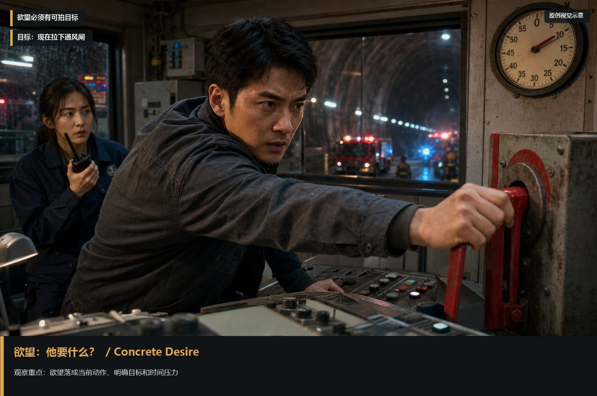
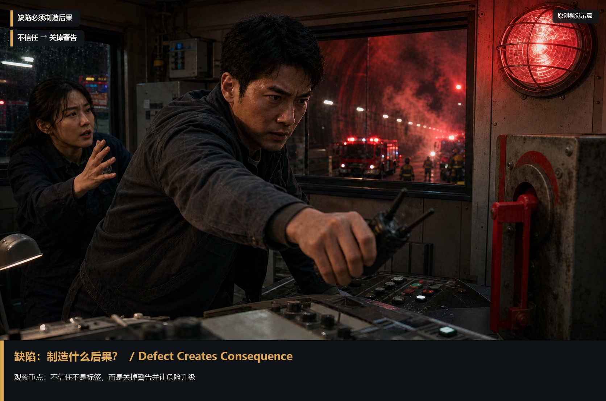
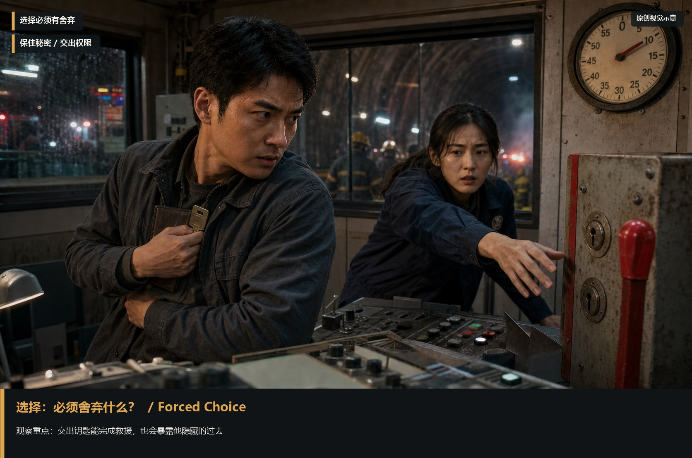
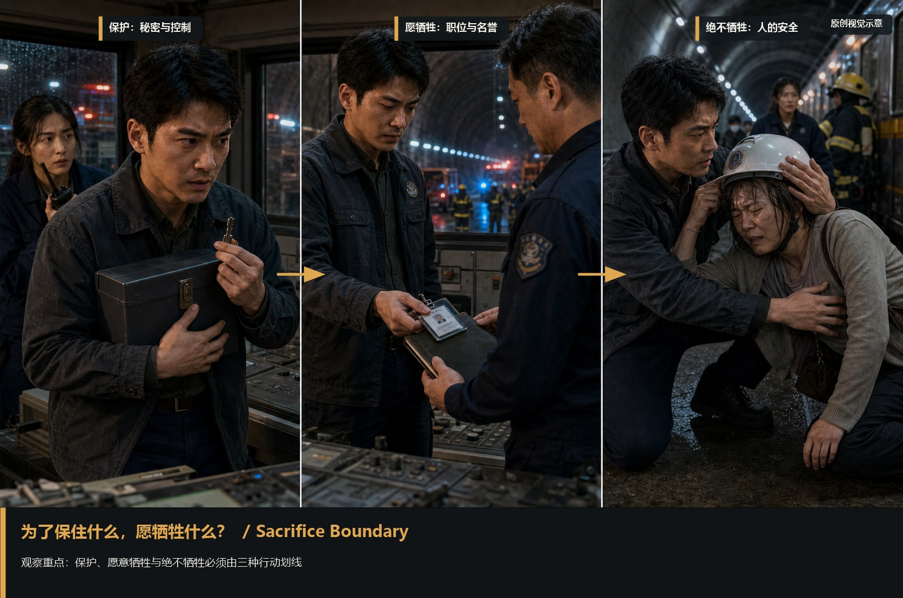
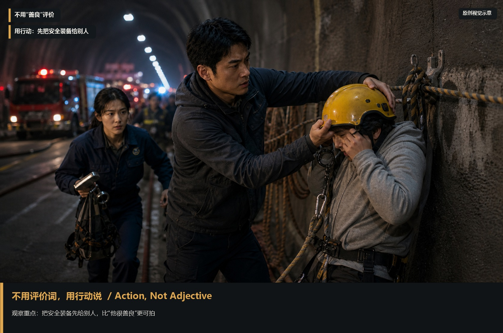

# character-foundation · 1—6

[全部主题](../IMAGE_GALLERY.md) · [首页](../../README.md)

## 人物成立法则：欲望｜他要什么（01-desire，原创教学示意）

知识讲解：[A3-06 人物成立法则](../../knowledge/A-%E7%90%86%E8%AE%BA%E5%B1%82/A3-%E7%BC%96%E5%89%A7%E7%BB%84/A3-06%20%E4%BA%BA%E7%89%A9%E6%88%90%E7%AB%8B%E6%B3%95%E5%88%99.md)

## 人物成立法则：恐惧｜最怕什么发生（02-fear，原创教学示意）

知识讲解：[A3-06 人物成立法则](../../knowledge/A-%E7%90%86%E8%AE%BA%E5%B1%82/A3-%E7%BC%96%E5%89%A7%E7%BB%84/A3-06%20%E4%BA%BA%E7%89%A9%E6%88%90%E7%AB%8B%E6%B3%95%E5%88%99.md)

## 人物成立法则：缺陷｜制造什么后果（03-defect-consequence，原创教学示意）

知识讲解：[A3-06 人物成立法则](../../knowledge/A-%E7%90%86%E8%AE%BA%E5%B1%82/A3-%E7%BC%96%E5%89%A7%E7%BB%84/A3-06%20%E4%BA%BA%E7%89%A9%E6%88%90%E7%AB%8B%E6%B3%95%E5%88%99.md)

## 人物成立法则：选择｜被迫舍弃什么（04-forced-choice，原创教学示意）

知识讲解：[A3-06 人物成立法则](../../knowledge/A-%E7%90%86%E8%AE%BA%E5%B1%82/A3-%E7%BC%96%E5%89%A7%E7%BB%84/A3-06%20%E4%BA%BA%E7%89%A9%E6%88%90%E7%AB%8B%E6%B3%95%E5%88%99.md)

## 人物成立法则：开掘人物的第一个问题（05-sacrifice-boundary，原创教学示意）

知识讲解：[A3-06 人物成立法则](../../knowledge/A-%E7%90%86%E8%AE%BA%E5%B1%82/A3-%E7%BC%96%E5%89%A7%E7%BB%84/A3-06%20%E4%BA%BA%E7%89%A9%E6%88%90%E7%AB%8B%E6%B3%95%E5%88%99.md)

## 人物成立法则：避坑（06-action-not-label，原创教学示意）

知识讲解：[A3-06 人物成立法则](../../knowledge/A-%E7%90%86%E8%AE%BA%E5%B1%82/A3-%E7%BC%96%E5%89%A7%E7%BB%84/A3-06%20%E4%BA%BA%E7%89%A9%E6%88%90%E7%AB%8B%E6%B3%95%E5%88%99.md)
