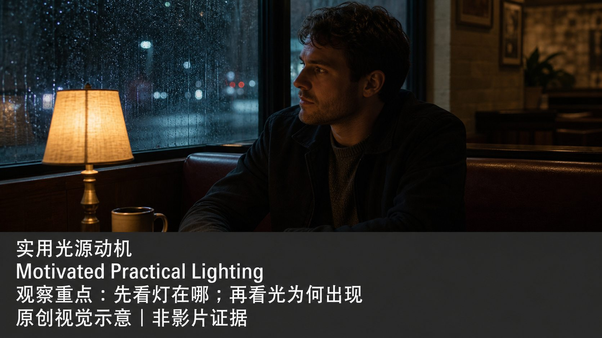
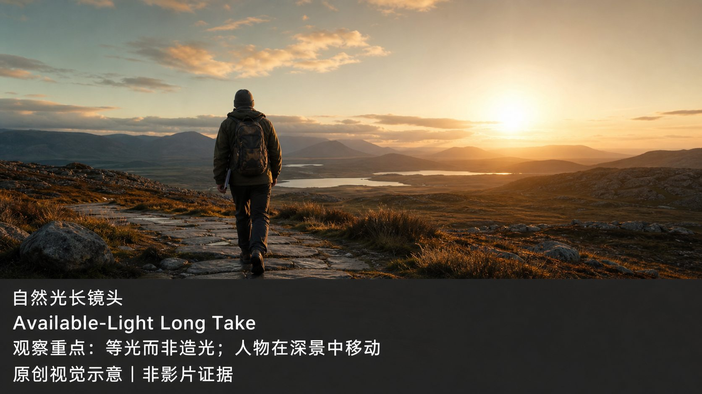
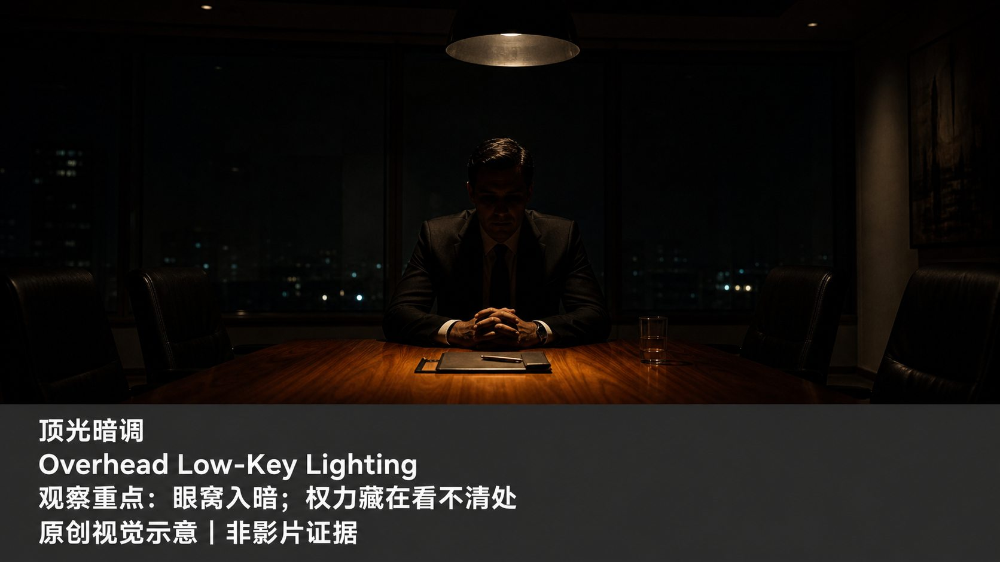
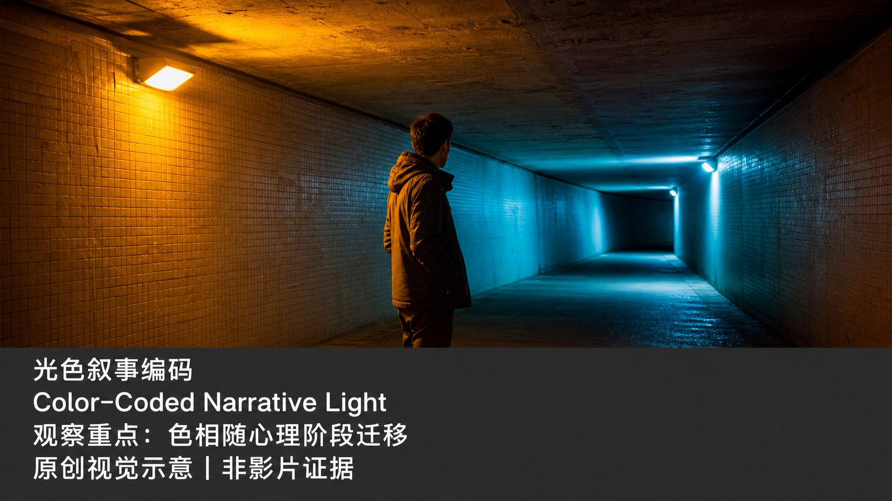
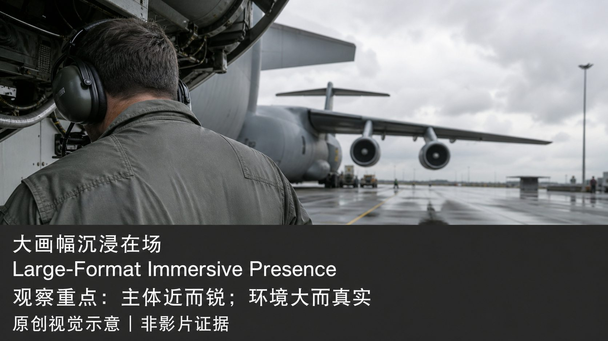
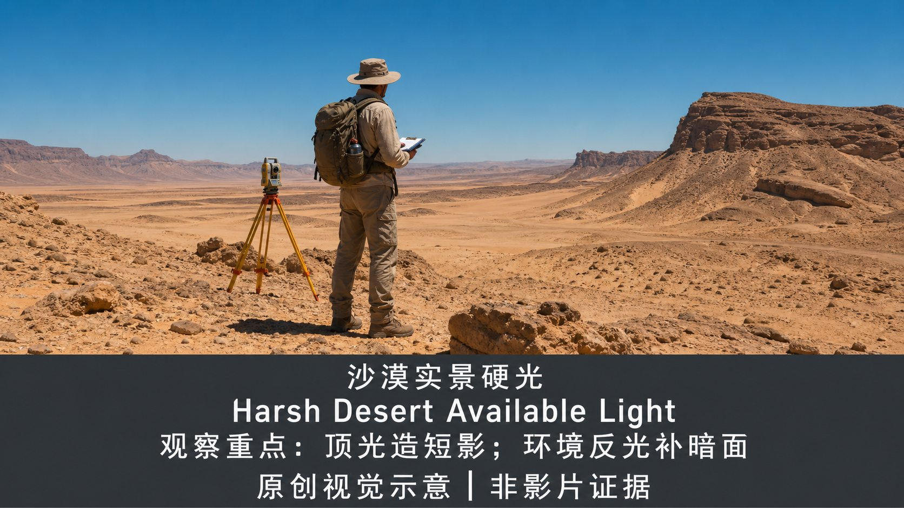
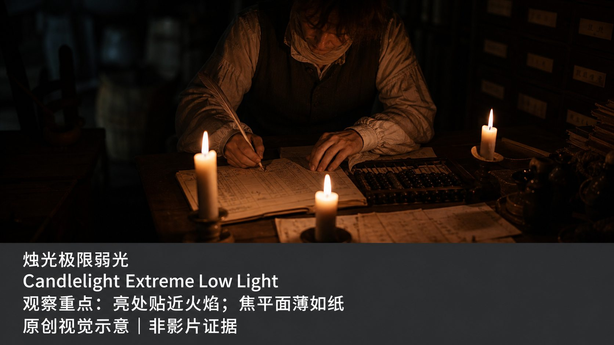
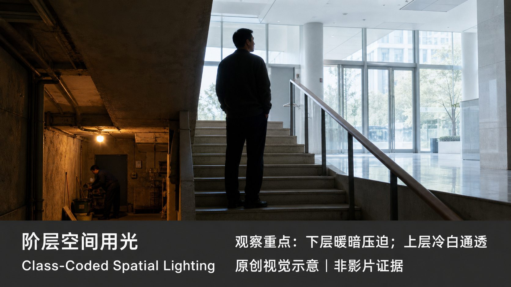
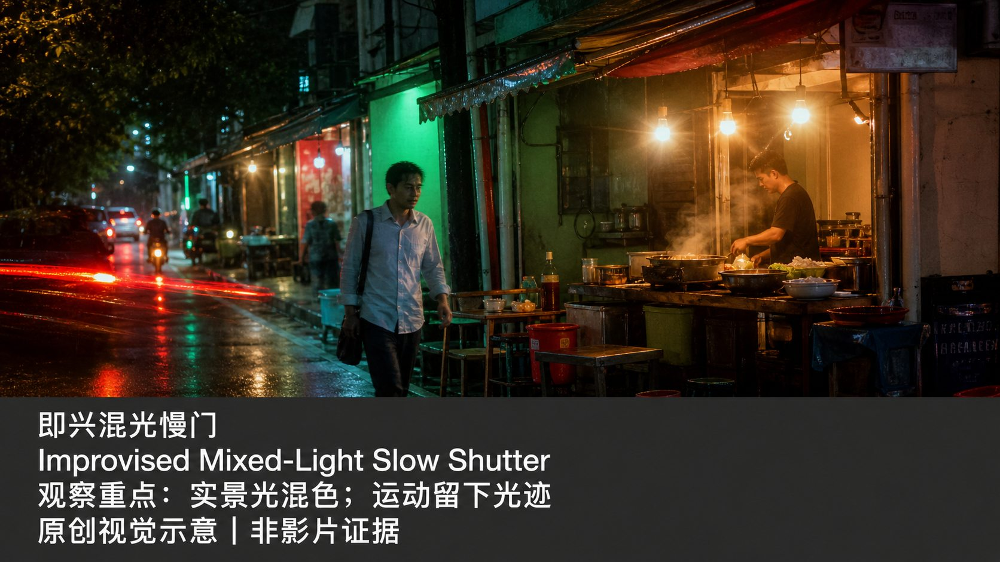
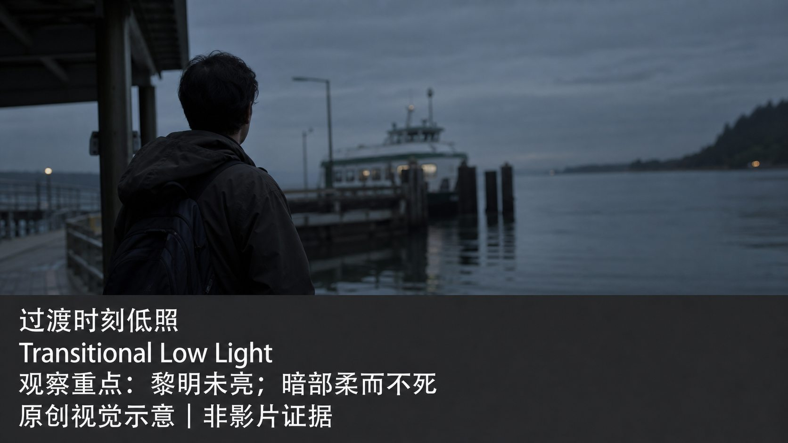

# cinematography-lighting-methods · 1—12

[全部主题](../IMAGE_GALLERY.md) · [首页](../../README.md)

## 摄影指导光影方法：1. Roger Deakins（罗杰·迪金斯）— 实用光源动机派（A1-13-01-motivated-practical，原创教学示意）

知识讲解：[A1-13 摄影指导光影方法](../../knowledge/A-%E7%90%86%E8%AE%BA%E5%B1%82/A1-%E6%91%84%E5%BD%B1%E7%BB%84/A1-13%20%E6%91%84%E5%BD%B1%E6%8C%87%E5%AF%BC%E5%85%89%E5%BD%B1%E6%96%B9%E6%B3%95.md)

## 摄影指导光影方法：2. Emmanuel Lubezki（艾曼努尔·卢贝兹基）— 自然光长镜头派（A1-13-02-available-light-long-take，原创教学示意）

知识讲解：[A1-13 摄影指导光影方法](../../knowledge/A-%E7%90%86%E8%AE%BA%E5%B1%82/A1-%E6%91%84%E5%BD%B1%E7%BB%84/A1-13%20%E6%91%84%E5%BD%B1%E6%8C%87%E5%AF%BC%E5%85%89%E5%BD%B1%E6%96%B9%E6%B3%95.md)

## 摄影指导光影方法：3. Gordon Willis（戈登·威利斯）— 顶光暗调"黑暗王子"（A1-13-03-overhead-low-key，原创教学示意）

知识讲解：[A1-13 摄影指导光影方法](../../knowledge/A-%E7%90%86%E8%AE%BA%E5%B1%82/A1-%E6%91%84%E5%BD%B1%E7%BB%84/A1-13%20%E6%91%84%E5%BD%B1%E6%8C%87%E5%AF%BC%E5%85%89%E5%BD%B1%E6%96%B9%E6%B3%95.md)

## 摄影指导光影方法：4. Vittorio Storaro（维托里奥·斯托拉罗）— 色彩理论叙事派（A1-13-04-color-coded-light，原创教学示意）

知识讲解：[A1-13 摄影指导光影方法](../../knowledge/A-%E7%90%86%E8%AE%BA%E5%B1%82/A1-%E6%91%84%E5%BD%B1%E7%BB%84/A1-13%20%E6%91%84%E5%BD%B1%E6%8C%87%E5%AF%BC%E5%85%89%E5%BD%B1%E6%96%B9%E6%B3%95.md)

## 摄影指导光影方法：5. Hoyte van Hoytema（霍伊特·范·霍伊特玛）— IMAX大画幅手持派（A1-13-05-large-format-presence，原创教学示意）

知识讲解：[A1-13 摄影指导光影方法](../../knowledge/A-%E7%90%86%E8%AE%BA%E5%B1%82/A1-%E6%91%84%E5%BD%B1%E7%BB%84/A1-13%20%E6%91%84%E5%BD%B1%E6%8C%87%E5%AF%BC%E5%85%89%E5%BD%B1%E6%96%B9%E6%B3%95.md)

## 摄影指导光影方法：6. Greig Fraser（格雷格·弗雷泽）— 沙漠实景光派（A1-13-06-harsh-desert-light，原创教学示意）

知识讲解：[A1-13 摄影指导光影方法](../../knowledge/A-%E7%90%86%E8%AE%BA%E5%B1%82/A1-%E6%91%84%E5%BD%B1%E7%BB%84/A1-13%20%E6%91%84%E5%BD%B1%E6%8C%87%E5%AF%BC%E5%85%89%E5%BD%B1%E6%96%B9%E6%B3%95.md)

## 摄影指导光影方法：7. Robert Yeoman（罗伯特·约曼）— 对称粉彩高调派（A1-13-07-high-key-flat-light，原创教学示意）

知识讲解：[A1-13 摄影指导光影方法](../../knowledge/A-%E7%90%86%E8%AE%BA%E5%B1%82/A1-%E6%91%84%E5%BD%B1%E7%BB%84/A1-13%20%E6%91%84%E5%BD%B1%E6%8C%87%E5%AF%BC%E5%85%89%E5%BD%B1%E6%96%B9%E6%B3%95.md)

## 摄影指导光影方法：8. John Alcott（约翰·阿尔科特）— 烛光f/0.7极限弱光派（A1-13-08-candlelight-low-light，原创教学示意）

知识讲解：[A1-13 摄影指导光影方法](../../knowledge/A-%E7%90%86%E8%AE%BA%E5%B1%82/A1-%E6%91%84%E5%BD%B1%E7%BB%84/A1-13%20%E6%91%84%E5%BD%B1%E6%8C%87%E5%AF%BC%E5%85%89%E5%BD%B1%E6%96%B9%E6%B3%95.md)

## 摄影指导光影方法：9. Jeff Cronenweth（杰夫·克罗嫩韦斯）— 数字精确控制派（A1-13-09-digital-deep-shadows，原创教学示意）

知识讲解：[A1-13 摄影指导光影方法](../../knowledge/A-%E7%90%86%E8%AE%BA%E5%B1%82/A1-%E6%91%84%E5%BD%B1%E7%BB%84/A1-13%20%E6%91%84%E5%BD%B1%E6%8C%87%E5%AF%BC%E5%85%89%E5%BD%B1%E6%96%B9%E6%B3%95.md)

## 摄影指导光影方法：10. 洪京表（Hong Kyung-pyo）— 阶级光线派（A1-13-10-class-coded-lighting，原创教学示意）

知识讲解：[A1-13 摄影指导光影方法](../../knowledge/A-%E7%90%86%E8%AE%BA%E5%B1%82/A1-%E6%91%84%E5%BD%B1%E7%BB%84/A1-13%20%E6%91%84%E5%BD%B1%E6%8C%87%E5%AF%BC%E5%85%89%E5%BD%B1%E6%96%B9%E6%B3%95.md)

## 摄影指导光影方法：11. Christopher Doyle（杜可风）— 即兴手持霓虹派（A1-13-11-mixed-light-slow-shutter，原创教学示意）

知识讲解：[A1-13 摄影指导光影方法](../../knowledge/A-%E7%90%86%E8%AE%BA%E5%B1%82/A1-%E6%91%84%E5%BD%B1%E7%BB%84/A1-13%20%E6%91%84%E5%BD%B1%E6%8C%87%E5%AF%BC%E5%85%89%E5%BD%B1%E6%96%B9%E6%B3%95.md)

## 摄影指导光影方法：12. Bradford Young（布拉德福德·杨）— 过渡色低照派（A1-13-12-transitional-low-light，原创教学示意）

知识讲解：[A1-13 摄影指导光影方法](../../knowledge/A-%E7%90%86%E8%AE%BA%E5%B1%82/A1-%E6%91%84%E5%BD%B1%E7%BB%84/A1-13%20%E6%91%84%E5%BD%B1%E6%8C%87%E5%AF%BC%E5%85%89%E5%BD%B1%E6%96%B9%E6%B3%95.md)
