# color-emotion-narrative-worldview · 1—24

[全部主题](../IMAGE_GALLERY.md) · [首页](../../README.md)

## 色彩的情绪·叙事·世界观：1.1 红色（01-red，原创教学示意）

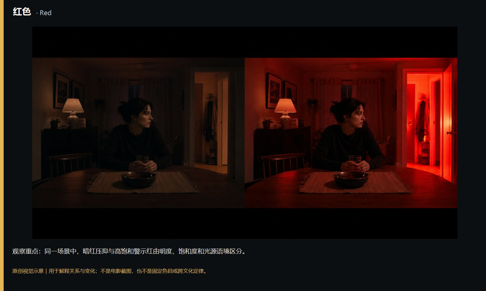

知识讲解：[A1-08 色彩的情绪·叙事·世界观](../../knowledge/A-%E7%90%86%E8%AE%BA%E5%B1%82/A1-%E6%91%84%E5%BD%B1%E7%BB%84/A1-08%20%E8%89%B2%E5%BD%A9%E7%9A%84%E6%83%85%E7%BB%AA%C2%B7%E5%8F%99%E4%BA%8B%C2%B7%E4%B8%96%E7%95%8C%E8%A7%82.md)

## 色彩的情绪·叙事·世界观：1.2 蓝色（02-blue，原创教学示意）

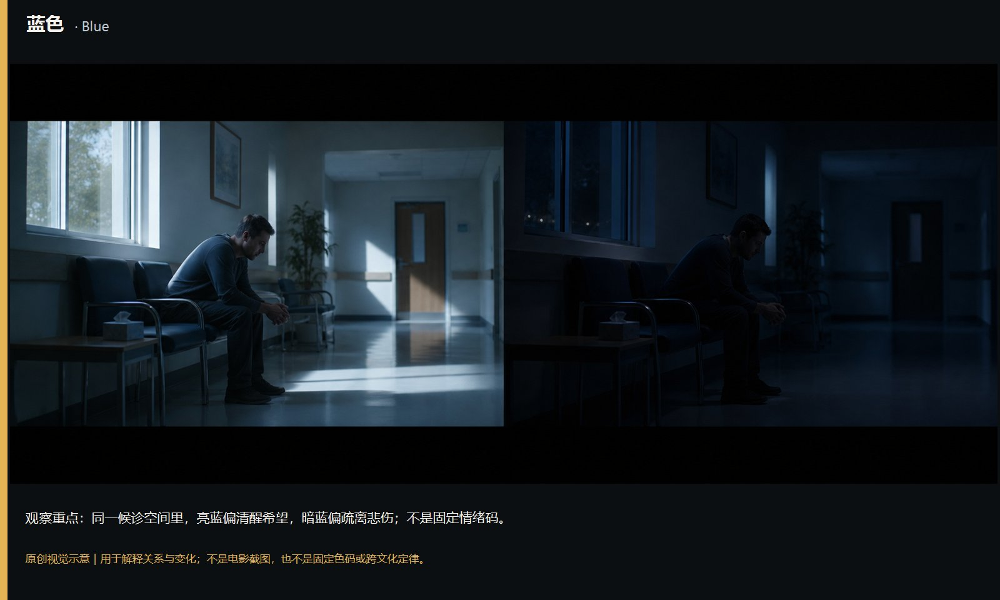

知识讲解：[A1-08 色彩的情绪·叙事·世界观](../../knowledge/A-%E7%90%86%E8%AE%BA%E5%B1%82/A1-%E6%91%84%E5%BD%B1%E7%BB%84/A1-08%20%E8%89%B2%E5%BD%A9%E7%9A%84%E6%83%85%E7%BB%AA%C2%B7%E5%8F%99%E4%BA%8B%C2%B7%E4%B8%96%E7%95%8C%E8%A7%82.md)

## 色彩的情绪·叙事·世界观：1.3 绿色（03-green，原创教学示意）

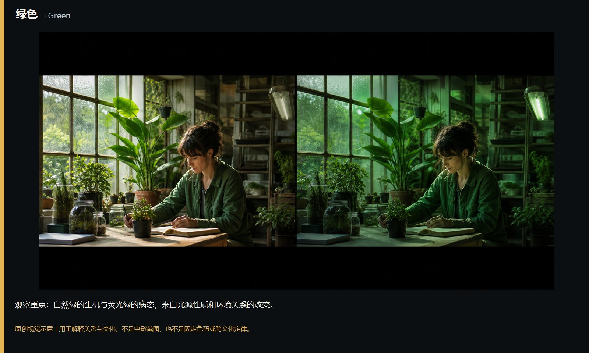

知识讲解：[A1-08 色彩的情绪·叙事·世界观](../../knowledge/A-%E7%90%86%E8%AE%BA%E5%B1%82/A1-%E6%91%84%E5%BD%B1%E7%BB%84/A1-08%20%E8%89%B2%E5%BD%A9%E7%9A%84%E6%83%85%E7%BB%AA%C2%B7%E5%8F%99%E4%BA%8B%C2%B7%E4%B8%96%E7%95%8C%E8%A7%82.md)

## 色彩的情绪·叙事·世界观：1.4 黄色（04-yellow，原创教学示意）

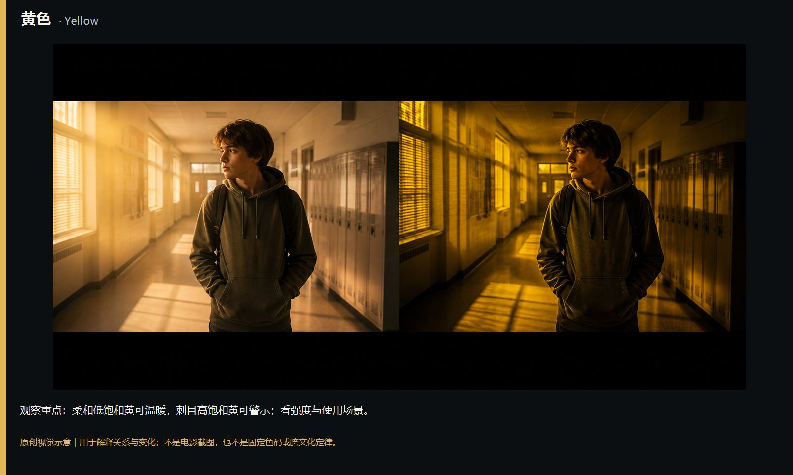

知识讲解：[A1-08 色彩的情绪·叙事·世界观](../../knowledge/A-%E7%90%86%E8%AE%BA%E5%B1%82/A1-%E6%91%84%E5%BD%B1%E7%BB%84/A1-08%20%E8%89%B2%E5%BD%A9%E7%9A%84%E6%83%85%E7%BB%AA%C2%B7%E5%8F%99%E4%BA%8B%C2%B7%E4%B8%96%E7%95%8C%E8%A7%82.md)

## 色彩的情绪·叙事·世界观：1.5 橙色（05-orange，原创教学示意）

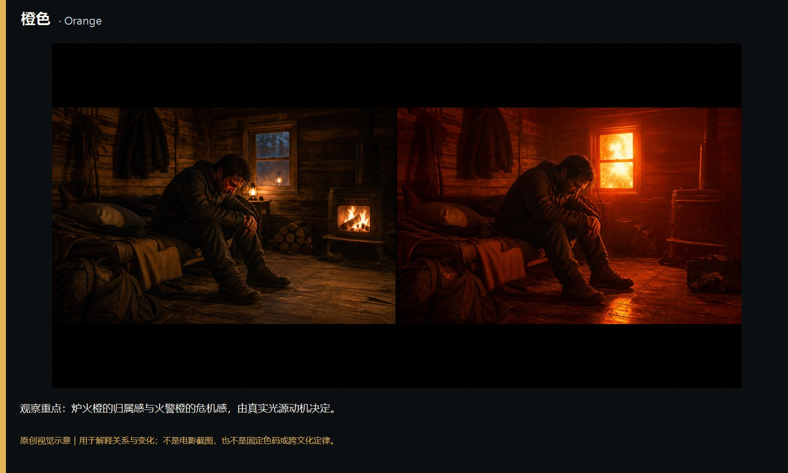

知识讲解：[A1-08 色彩的情绪·叙事·世界观](../../knowledge/A-%E7%90%86%E8%AE%BA%E5%B1%82/A1-%E6%91%84%E5%BD%B1%E7%BB%84/A1-08%20%E8%89%B2%E5%BD%A9%E7%9A%84%E6%83%85%E7%BB%AA%C2%B7%E5%8F%99%E4%BA%8B%C2%B7%E4%B8%96%E7%95%8C%E8%A7%82.md)

## 色彩的情绪·叙事·世界观：1.6 紫色（06-purple，原创教学示意）

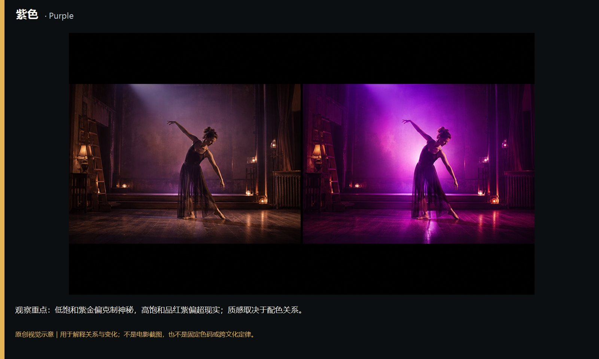

知识讲解：[A1-08 色彩的情绪·叙事·世界观](../../knowledge/A-%E7%90%86%E8%AE%BA%E5%B1%82/A1-%E6%91%84%E5%BD%B1%E7%BB%84/A1-08%20%E8%89%B2%E5%BD%A9%E7%9A%84%E6%83%85%E7%BB%AA%C2%B7%E5%8F%99%E4%BA%8B%C2%B7%E4%B8%96%E7%95%8C%E8%A7%82.md)

## 色彩的情绪·叙事·世界观：1.7 暖色系(总体)（07-warm-palette，原创教学示意）

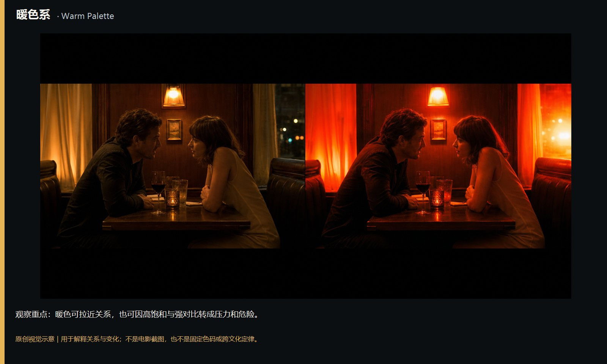

知识讲解：[A1-08 色彩的情绪·叙事·世界观](../../knowledge/A-%E7%90%86%E8%AE%BA%E5%B1%82/A1-%E6%91%84%E5%BD%B1%E7%BB%84/A1-08%20%E8%89%B2%E5%BD%A9%E7%9A%84%E6%83%85%E7%BB%AA%C2%B7%E5%8F%99%E4%BA%8B%C2%B7%E4%B8%96%E7%95%8C%E8%A7%82.md)

## 色彩的情绪·叙事·世界观：1.8 冷色系(总体)（08-cool-palette，原创教学示意）

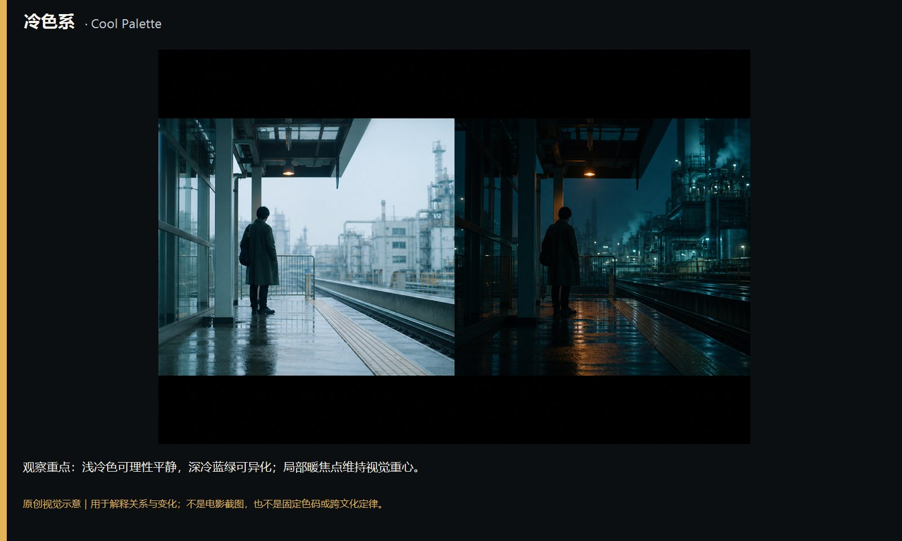

知识讲解：[A1-08 色彩的情绪·叙事·世界观](../../knowledge/A-%E7%90%86%E8%AE%BA%E5%B1%82/A1-%E6%91%84%E5%BD%B1%E7%BB%84/A1-08%20%E8%89%B2%E5%BD%A9%E7%9A%84%E6%83%85%E7%BB%AA%C2%B7%E5%8F%99%E4%BA%8B%C2%B7%E4%B8%96%E7%95%8C%E8%A7%82.md)

## 色彩的情绪·叙事·世界观：1.9 高饱和度（09-high-saturation，原创教学示意）

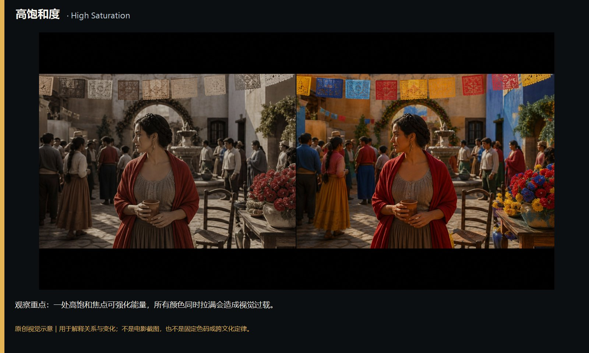

知识讲解：[A1-08 色彩的情绪·叙事·世界观](../../knowledge/A-%E7%90%86%E8%AE%BA%E5%B1%82/A1-%E6%91%84%E5%BD%B1%E7%BB%84/A1-08%20%E8%89%B2%E5%BD%A9%E7%9A%84%E6%83%85%E7%BB%AA%C2%B7%E5%8F%99%E4%BA%8B%C2%B7%E4%B8%96%E7%95%8C%E8%A7%82.md)

## 色彩的情绪·叙事·世界观：1.10 低饱和度（10-low-saturation，原创教学示意）

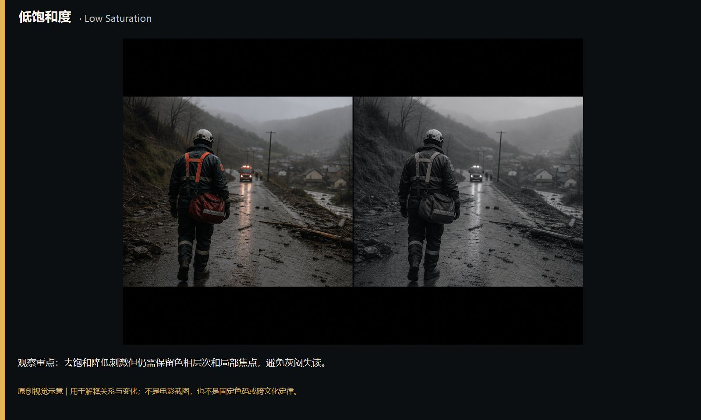

知识讲解：[A1-08 色彩的情绪·叙事·世界观](../../knowledge/A-%E7%90%86%E8%AE%BA%E5%B1%82/A1-%E6%91%84%E5%BD%B1%E7%BB%84/A1-08%20%E8%89%B2%E5%BD%A9%E7%9A%84%E6%83%85%E7%BB%AA%C2%B7%E5%8F%99%E4%BA%8B%C2%B7%E4%B8%96%E7%95%8C%E8%A7%82.md)

## 色彩的情绪·叙事·世界观：1.11 黑色（11-black，原创教学示意）

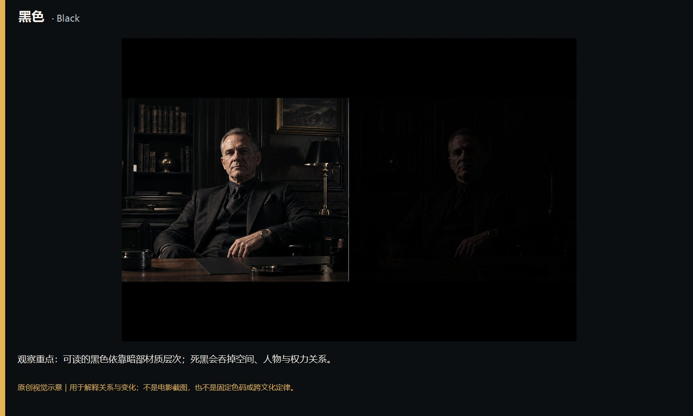

知识讲解：[A1-08 色彩的情绪·叙事·世界观](../../knowledge/A-%E7%90%86%E8%AE%BA%E5%B1%82/A1-%E6%91%84%E5%BD%B1%E7%BB%84/A1-08%20%E8%89%B2%E5%BD%A9%E7%9A%84%E6%83%85%E7%BB%AA%C2%B7%E5%8F%99%E4%BA%8B%C2%B7%E4%B8%96%E7%95%8C%E8%A7%82.md)

## 色彩的情绪·叙事·世界观：1.12 白色（12-white，原创教学示意）

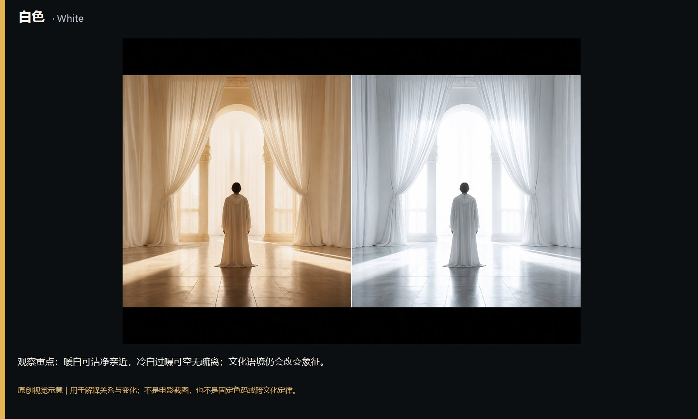

知识讲解：[A1-08 色彩的情绪·叙事·世界观](../../knowledge/A-%E7%90%86%E8%AE%BA%E5%B1%82/A1-%E6%91%84%E5%BD%B1%E7%BB%84/A1-08%20%E8%89%B2%E5%BD%A9%E7%9A%84%E6%83%85%E7%BB%AA%C2%B7%E5%8F%99%E4%BA%8B%C2%B7%E4%B8%96%E7%95%8C%E8%A7%82.md)

## 色彩的情绪·叙事·世界观：2.1 色彩暗示危机（13-crisis-warning，原创教学示意）

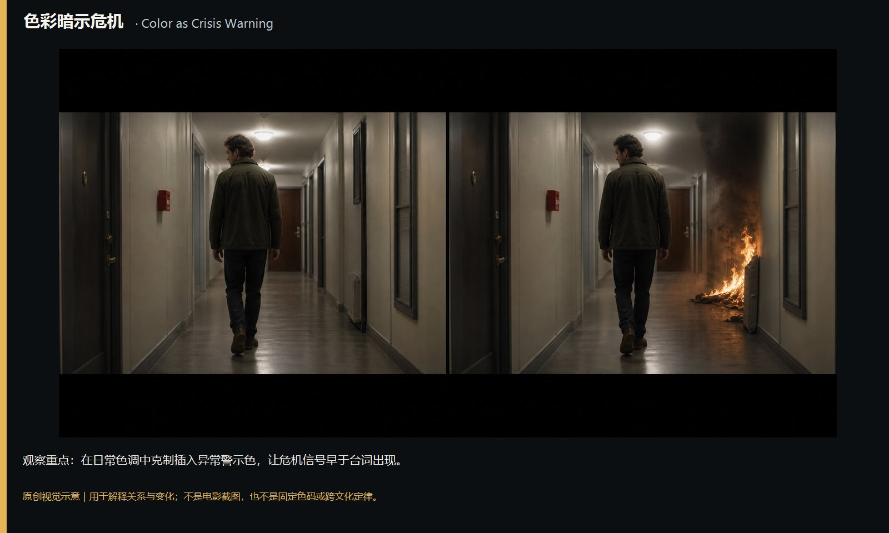

知识讲解：[A1-08 色彩的情绪·叙事·世界观](../../knowledge/A-%E7%90%86%E8%AE%BA%E5%B1%82/A1-%E6%91%84%E5%BD%B1%E7%BB%84/A1-08%20%E8%89%B2%E5%BD%A9%E7%9A%84%E6%83%85%E7%BB%AA%C2%B7%E5%8F%99%E4%BA%8B%C2%B7%E4%B8%96%E7%95%8C%E8%A7%82.md)

## 色彩的情绪·叙事·世界观：2.2 色彩标识记忆/闪回（14-memory-flashback，原创教学示意）

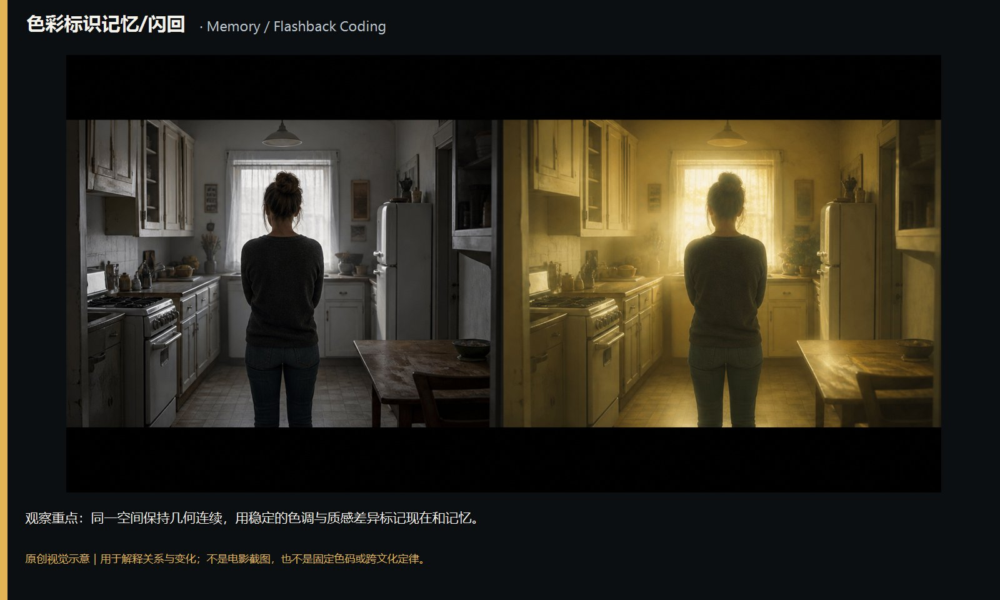

知识讲解：[A1-08 色彩的情绪·叙事·世界观](../../knowledge/A-%E7%90%86%E8%AE%BA%E5%B1%82/A1-%E6%91%84%E5%BD%B1%E7%BB%84/A1-08%20%E8%89%B2%E5%BD%A9%E7%9A%84%E6%83%85%E7%BB%AA%C2%B7%E5%8F%99%E4%BA%8B%C2%B7%E4%B8%96%E7%95%8C%E8%A7%82.md)

## 色彩的情绪·叙事·世界观：2.3 色彩标识梦境/超现实（15-dream-surreal，原创教学示意）

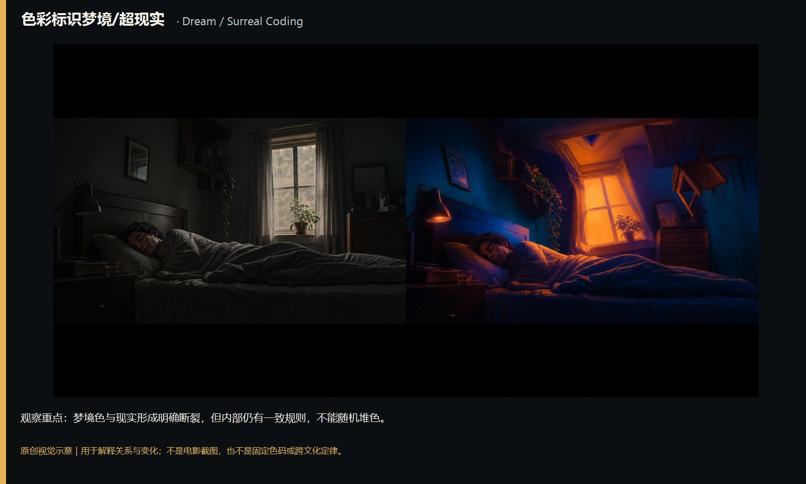

知识讲解：[A1-08 色彩的情绪·叙事·世界观](../../knowledge/A-%E7%90%86%E8%AE%BA%E5%B1%82/A1-%E6%91%84%E5%BD%B1%E7%BB%84/A1-08%20%E8%89%B2%E5%BD%A9%E7%9A%84%E6%83%85%E7%BB%AA%C2%B7%E5%8F%99%E4%BA%8B%C2%B7%E4%B8%96%E7%95%8C%E8%A7%82.md)

## 色彩的情绪·叙事·世界观：2.4 色彩区分阵营/立场 ★《英雄》五色系统归属条（16-faction-position，原创教学示意）

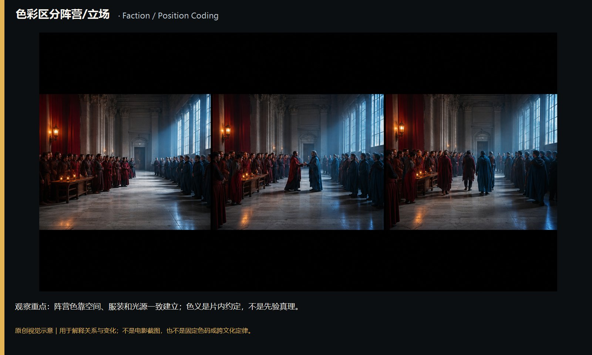

知识讲解：[A1-08 色彩的情绪·叙事·世界观](../../knowledge/A-%E7%90%86%E8%AE%BA%E5%B1%82/A1-%E6%91%84%E5%BD%B1%E7%BB%84/A1-08%20%E8%89%B2%E5%BD%A9%E7%9A%84%E6%83%85%E7%BB%AA%C2%B7%E5%8F%99%E4%BA%8B%C2%B7%E4%B8%96%E7%95%8C%E8%A7%82.md)

## 色彩的情绪·叙事·世界观：2.5 色彩暗示命运走向（17-fate-trajectory，原创教学示意）

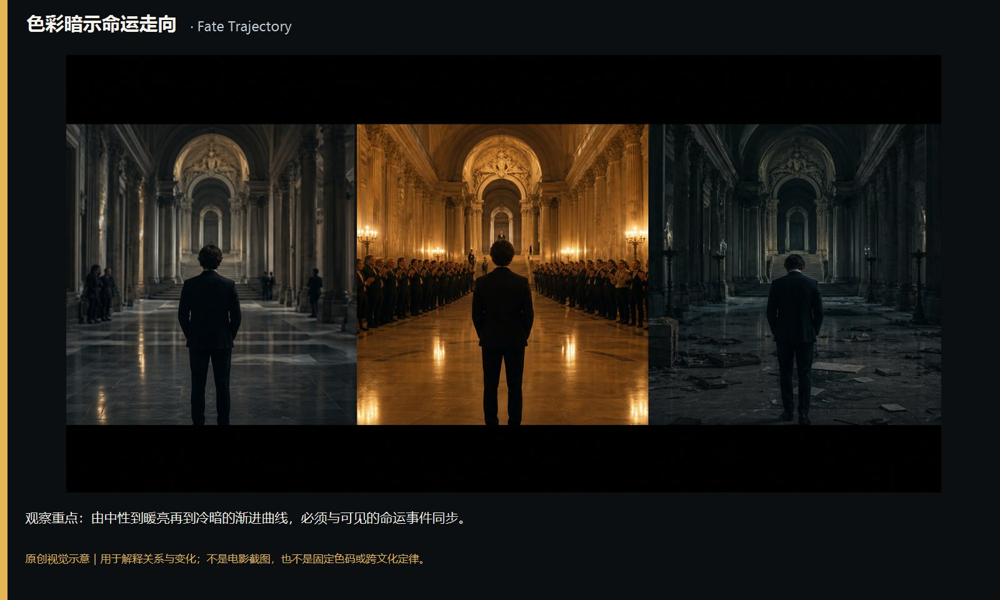

知识讲解：[A1-08 色彩的情绪·叙事·世界观](../../knowledge/A-%E7%90%86%E8%AE%BA%E5%B1%82/A1-%E6%91%84%E5%BD%B1%E7%BB%84/A1-08%20%E8%89%B2%E5%BD%A9%E7%9A%84%E6%83%85%E7%BB%AA%C2%B7%E5%8F%99%E4%BA%8B%C2%B7%E4%B8%96%E7%95%8C%E8%A7%82.md)

## 色彩的情绪·叙事·世界观：2.6 色彩象征权力/等级（18-power-hierarchy，原创教学示意）

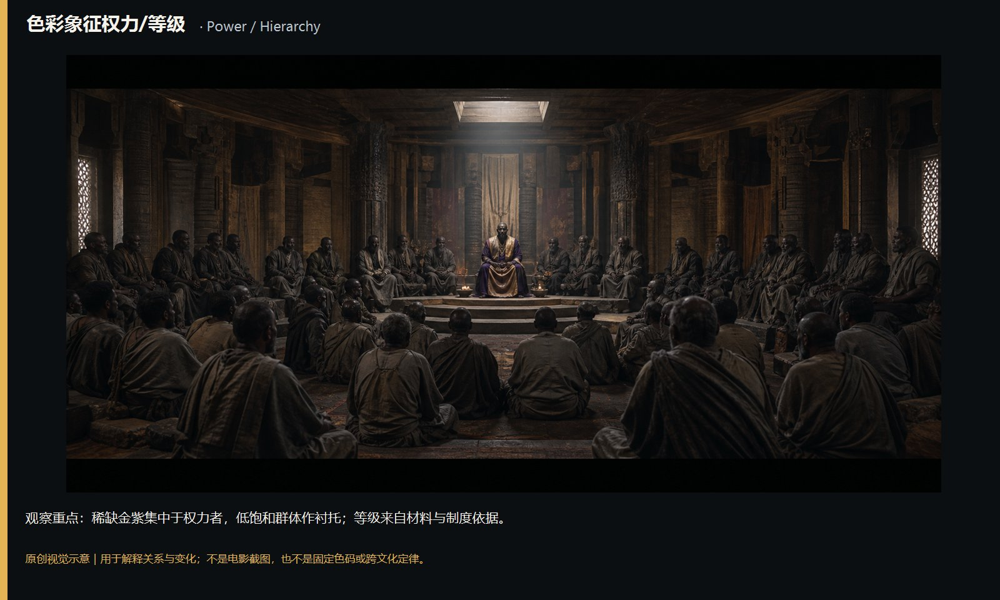

知识讲解：[A1-08 色彩的情绪·叙事·世界观](../../knowledge/A-%E7%90%86%E8%AE%BA%E5%B1%82/A1-%E6%91%84%E5%BD%B1%E7%BB%84/A1-08%20%E8%89%B2%E5%BD%A9%E7%9A%84%E6%83%85%E7%BB%AA%C2%B7%E5%8F%99%E4%BA%8B%C2%B7%E4%B8%96%E7%95%8C%E8%A7%82.md)

## 色彩的情绪·叙事·世界观：2.7 色彩标记叙事转折（19-narrative-turn，原创教学示意）

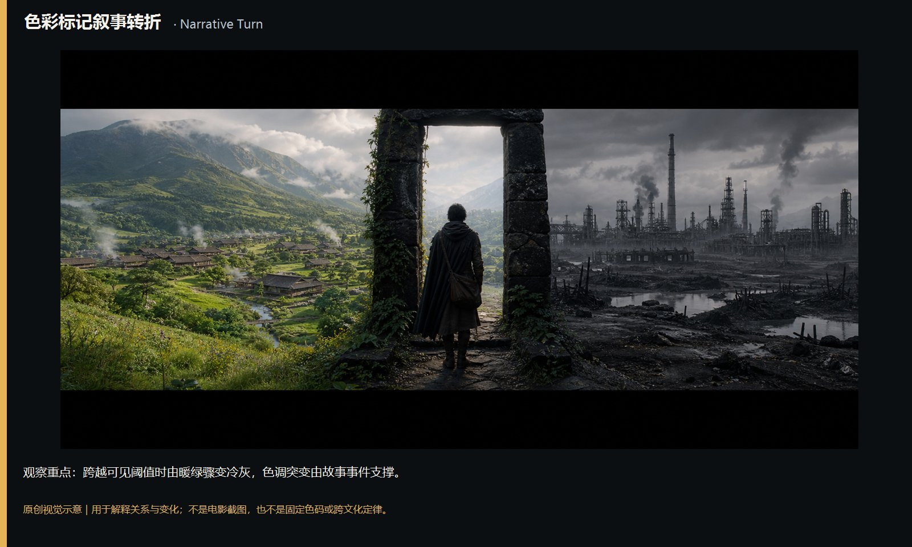

知识讲解：[A1-08 色彩的情绪·叙事·世界观](../../knowledge/A-%E7%90%86%E8%AE%BA%E5%B1%82/A1-%E6%91%84%E5%BD%B1%E7%BB%84/A1-08%20%E8%89%B2%E5%BD%A9%E7%9A%84%E6%83%85%E7%BB%AA%C2%B7%E5%8F%99%E4%BA%8B%C2%B7%E4%B8%96%E7%95%8C%E8%A7%82.md)

## 色彩的情绪·叙事·世界观：2.9 色彩埋伏笔/回收（20-foreshadow-recall，原创教学示意）

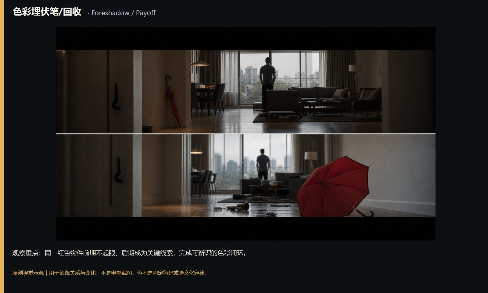

知识讲解：[A1-08 色彩的情绪·叙事·世界观](../../knowledge/A-%E7%90%86%E8%AE%BA%E5%B1%82/A1-%E6%91%84%E5%BD%B1%E7%BB%84/A1-08%20%E8%89%B2%E5%BD%A9%E7%9A%84%E6%83%85%E7%BB%AA%C2%B7%E5%8F%99%E4%BA%8B%C2%B7%E4%B8%96%E7%95%8C%E8%A7%82.md)

## 色彩的情绪·叙事·世界观：2.10 色彩标识身份/转变（21-identity-transformation，原创教学示意）

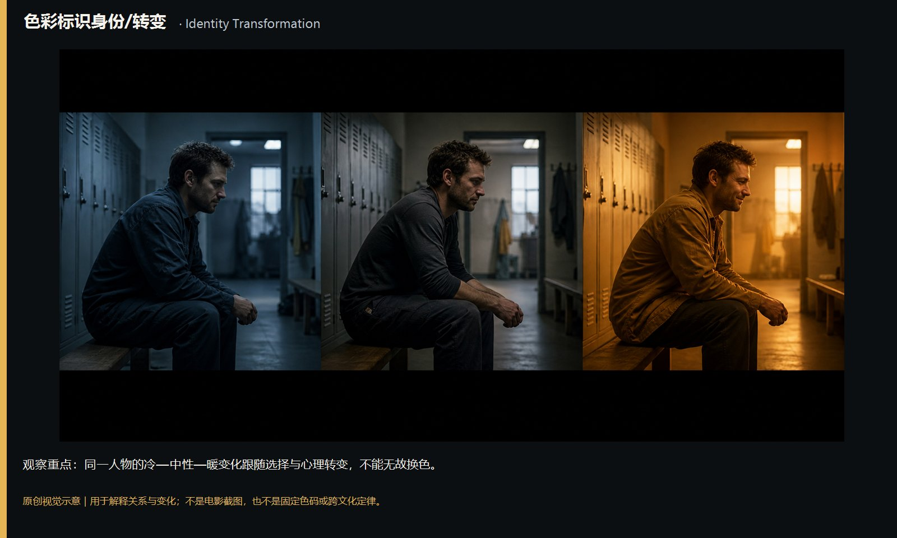

知识讲解：[A1-08 色彩的情绪·叙事·世界观](../../knowledge/A-%E7%90%86%E8%AE%BA%E5%B1%82/A1-%E6%91%84%E5%BD%B1%E7%BB%84/A1-08%20%E8%89%B2%E5%BD%A9%E7%9A%84%E6%83%85%E7%BB%AA%C2%B7%E5%8F%99%E4%BA%8B%C2%B7%E4%B8%96%E7%95%8C%E8%A7%82.md)

## 色彩的情绪·叙事·世界观：第二节使用说明（22-rule-consistency，原创教学示意）

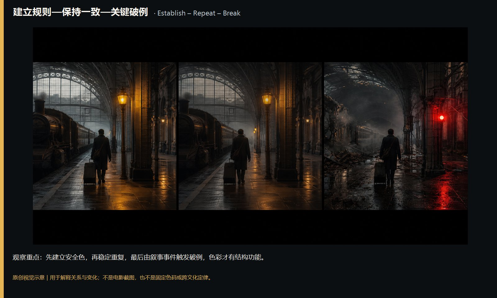

知识讲解：[A1-08 色彩的情绪·叙事·世界观](../../knowledge/A-%E7%90%86%E8%AE%BA%E5%B1%82/A1-%E6%91%84%E5%BD%B1%E7%BB%84/A1-08%20%E8%89%B2%E5%BD%A9%E7%9A%84%E6%83%85%E7%BB%AA%C2%B7%E5%8F%99%E4%BA%8B%C2%B7%E4%B8%96%E7%95%8C%E8%A7%82.md)

## 色彩的情绪·叙事·世界观：3.1 色彩建立世界观规则 ★《黑客帝国》归属条（23-world-rule，原创教学示意）

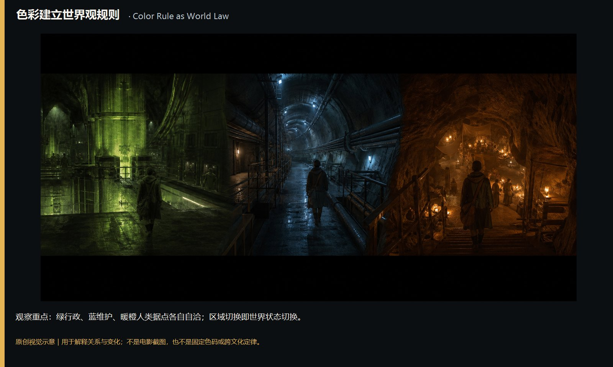

知识讲解：[A1-08 色彩的情绪·叙事·世界观](../../knowledge/A-%E7%90%86%E8%AE%BA%E5%B1%82/A1-%E6%91%84%E5%BD%B1%E7%BB%84/A1-08%20%E8%89%B2%E5%BD%A9%E7%9A%84%E6%83%85%E7%BB%AA%C2%B7%E5%8F%99%E4%BA%8B%C2%B7%E4%B8%96%E7%95%8C%E8%A7%82.md)

## 色彩的情绪·叙事·世界观：3.2 色彩区分时空/平行世界 ★《银翼杀手2049》分区归属条（24-time-parallel-world，原创教学示意）

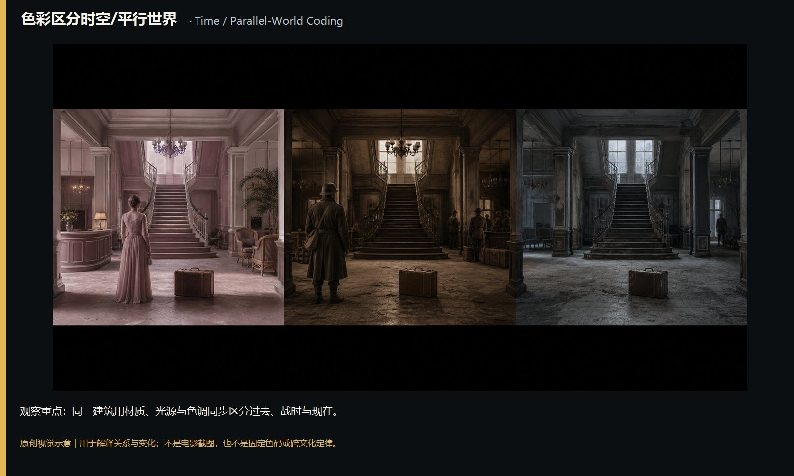

知识讲解：[A1-08 色彩的情绪·叙事·世界观](../../knowledge/A-%E7%90%86%E8%AE%BA%E5%B1%82/A1-%E6%91%84%E5%BD%B1%E7%BB%84/A1-08%20%E8%89%B2%E5%BD%A9%E7%9A%84%E6%83%85%E7%BB%AA%C2%B7%E5%8F%99%E4%BA%8B%C2%B7%E4%B8%96%E7%95%8C%E8%A7%82.md)
