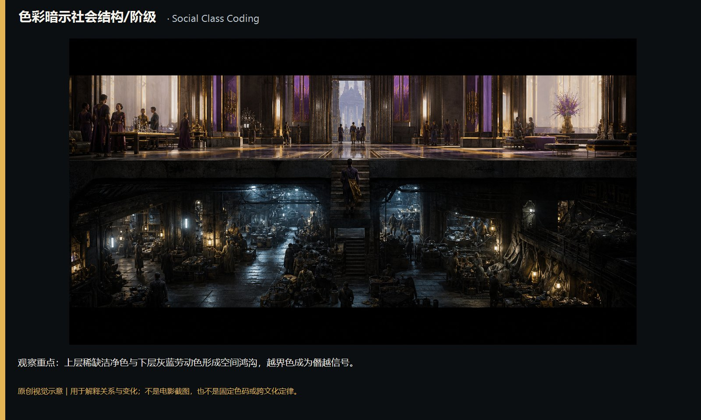
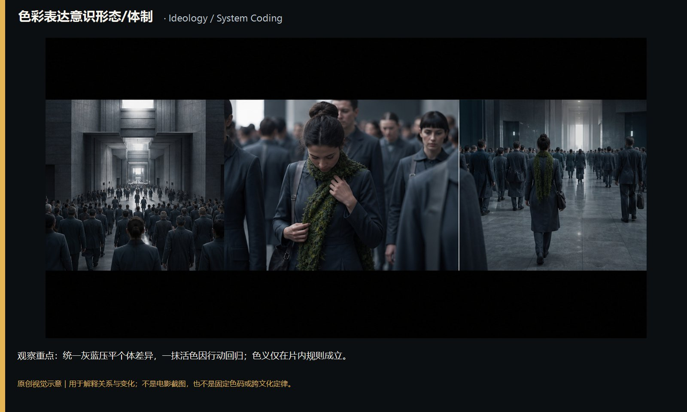
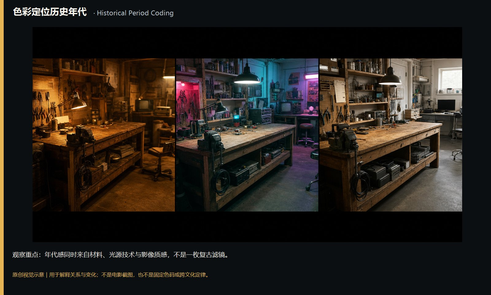
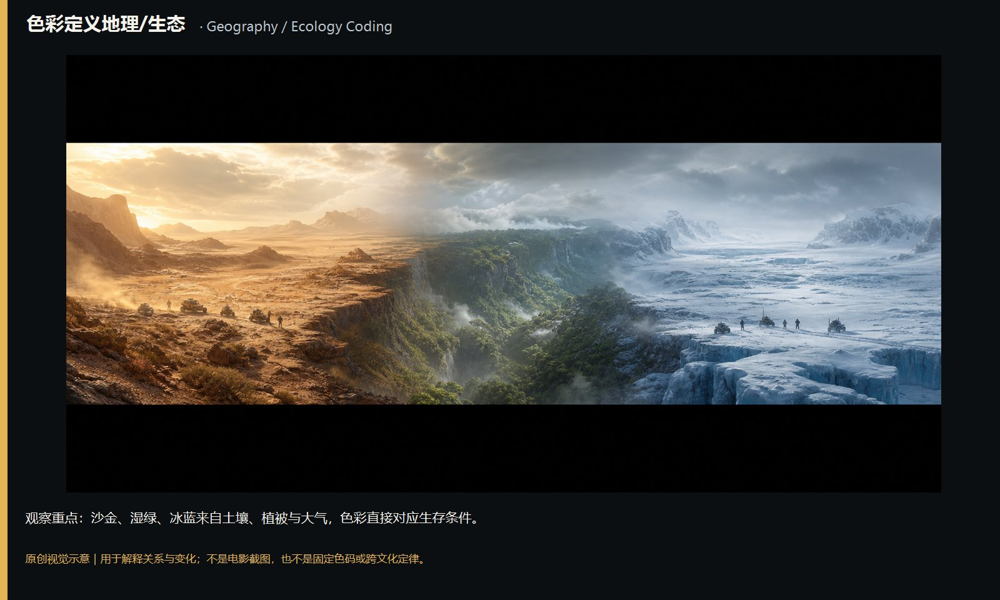
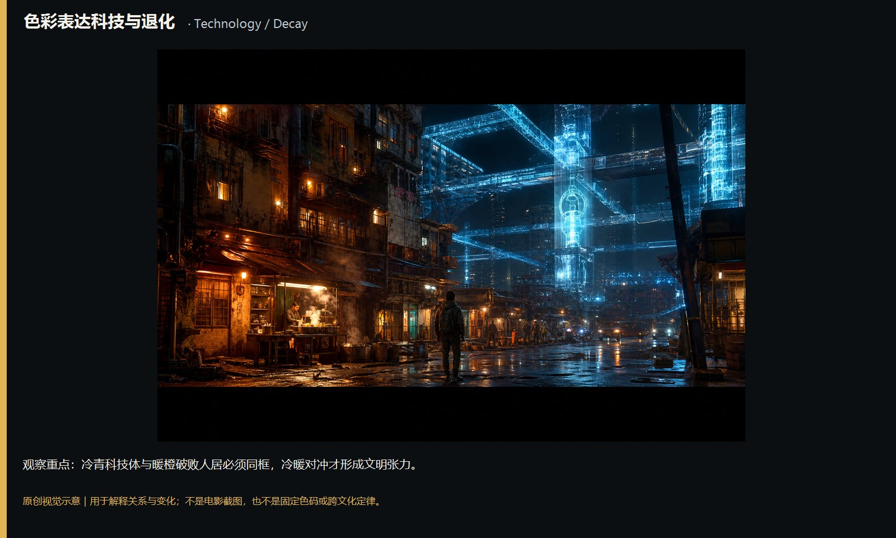
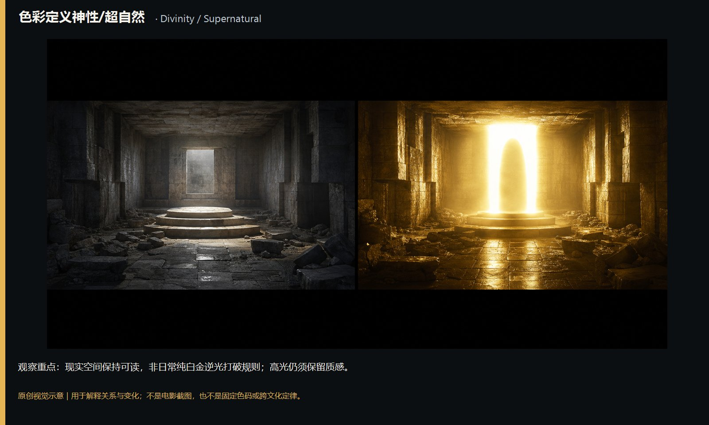
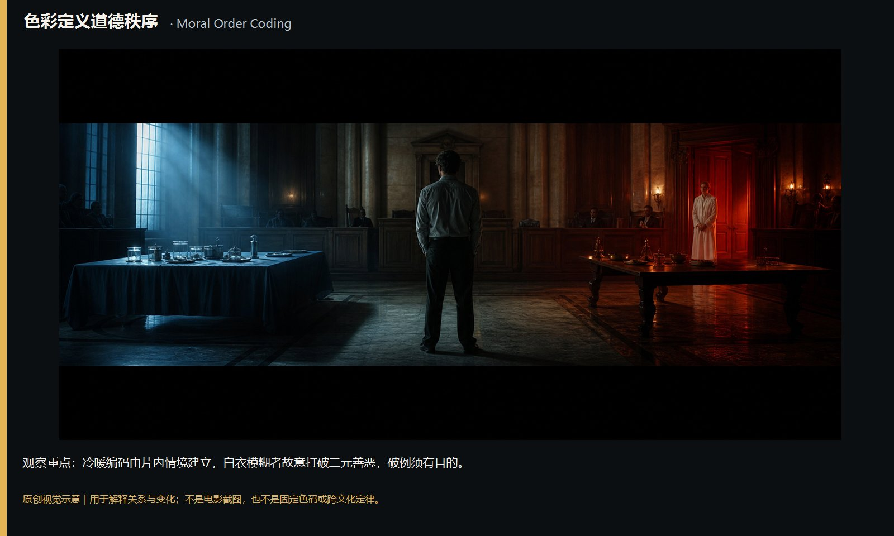
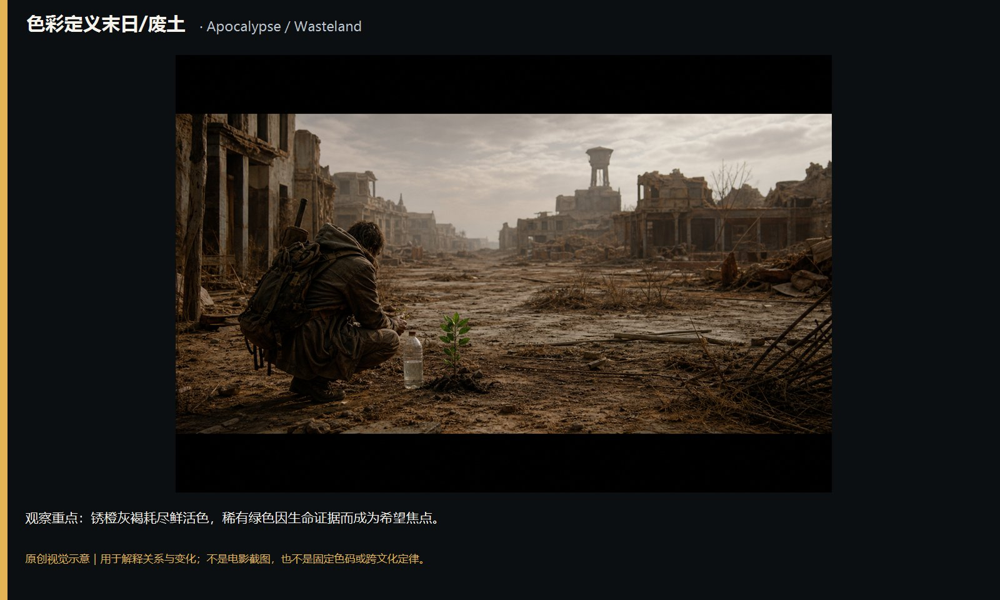

# color-emotion-narrative-worldview · 25—32

[全部主题](../IMAGE_GALLERY.md) · [首页](../../README.md)

## 色彩的情绪·叙事·世界观：3.3 色彩暗示社会结构/阶级（25-class-structure，原创教学示意）

知识讲解：[A1-08 色彩的情绪·叙事·世界观](../../knowledge/A-%E7%90%86%E8%AE%BA%E5%B1%82/A1-%E6%91%84%E5%BD%B1%E7%BB%84/A1-08%20%E8%89%B2%E5%BD%A9%E7%9A%84%E6%83%85%E7%BB%AA%C2%B7%E5%8F%99%E4%BA%8B%C2%B7%E4%B8%96%E7%95%8C%E8%A7%82.md)

## 色彩的情绪·叙事·世界观：3.4 色彩表达意识形态/体制（26-ideology-system，原创教学示意）

知识讲解：[A1-08 色彩的情绪·叙事·世界观](../../knowledge/A-%E7%90%86%E8%AE%BA%E5%B1%82/A1-%E6%91%84%E5%BD%B1%E7%BB%84/A1-08%20%E8%89%B2%E5%BD%A9%E7%9A%84%E6%83%85%E7%BB%AA%C2%B7%E5%8F%99%E4%BA%8B%C2%B7%E4%B8%96%E7%95%8C%E8%A7%82.md)

## 色彩的情绪·叙事·世界观：3.5 色彩定位历史年代（27-historical-period，原创教学示意）

知识讲解：[A1-08 色彩的情绪·叙事·世界观](../../knowledge/A-%E7%90%86%E8%AE%BA%E5%B1%82/A1-%E6%91%84%E5%BD%B1%E7%BB%84/A1-08%20%E8%89%B2%E5%BD%A9%E7%9A%84%E6%83%85%E7%BB%AA%C2%B7%E5%8F%99%E4%BA%8B%C2%B7%E4%B8%96%E7%95%8C%E8%A7%82.md)

## 色彩的情绪·叙事·世界观：3.6 色彩定义地理/生态（28-geography-ecology，原创教学示意）

知识讲解：[A1-08 色彩的情绪·叙事·世界观](../../knowledge/A-%E7%90%86%E8%AE%BA%E5%B1%82/A1-%E6%91%84%E5%BD%B1%E7%BB%84/A1-08%20%E8%89%B2%E5%BD%A9%E7%9A%84%E6%83%85%E7%BB%AA%C2%B7%E5%8F%99%E4%BA%8B%C2%B7%E4%B8%96%E7%95%8C%E8%A7%82.md)

## 色彩的情绪·叙事·世界观：3.7 色彩表达科技与退化 ★《银翼杀手》(1982)归属条（29-technology-decay，原创教学示意）

知识讲解：[A1-08 色彩的情绪·叙事·世界观](../../knowledge/A-%E7%90%86%E8%AE%BA%E5%B1%82/A1-%E6%91%84%E5%BD%B1%E7%BB%84/A1-08%20%E8%89%B2%E5%BD%A9%E7%9A%84%E6%83%85%E7%BB%AA%C2%B7%E5%8F%99%E4%BA%8B%C2%B7%E4%B8%96%E7%95%8C%E8%A7%82.md)

## 色彩的情绪·叙事·世界观：3.8 色彩定义神性/超自然（30-divinity-supernatural，原创教学示意）

知识讲解：[A1-08 色彩的情绪·叙事·世界观](../../knowledge/A-%E7%90%86%E8%AE%BA%E5%B1%82/A1-%E6%91%84%E5%BD%B1%E7%BB%84/A1-08%20%E8%89%B2%E5%BD%A9%E7%9A%84%E6%83%85%E7%BB%AA%C2%B7%E5%8F%99%E4%BA%8B%C2%B7%E4%B8%96%E7%95%8C%E8%A7%82.md)

## 色彩的情绪·叙事·世界观：3.9 色彩定义道德秩序（31-moral-order，原创教学示意）

知识讲解：[A1-08 色彩的情绪·叙事·世界观](../../knowledge/A-%E7%90%86%E8%AE%BA%E5%B1%82/A1-%E6%91%84%E5%BD%B1%E7%BB%84/A1-08%20%E8%89%B2%E5%BD%A9%E7%9A%84%E6%83%85%E7%BB%AA%C2%B7%E5%8F%99%E4%BA%8B%C2%B7%E4%B8%96%E7%95%8C%E8%A7%82.md)

## 色彩的情绪·叙事·世界观：3.10 色彩定义末日/废土（32-apocalypse-wasteland，原创教学示意）

知识讲解：[A1-08 色彩的情绪·叙事·世界观](../../knowledge/A-%E7%90%86%E8%AE%BA%E5%B1%82/A1-%E6%91%84%E5%BD%B1%E7%BB%84/A1-08%20%E8%89%B2%E5%BD%A9%E7%9A%84%E6%83%85%E7%BB%AA%C2%B7%E5%8F%99%E4%BA%8B%C2%B7%E4%B8%96%E7%95%8C%E8%A7%82.md)
