# color-grading · 1—13

[全部主题](../IMAGE_GALLERY.md) · [首页](../../README.md)

## 后期调色逻辑：1. 数字中间片(DI)流程（01-digital-intermediate，原创教学示意）

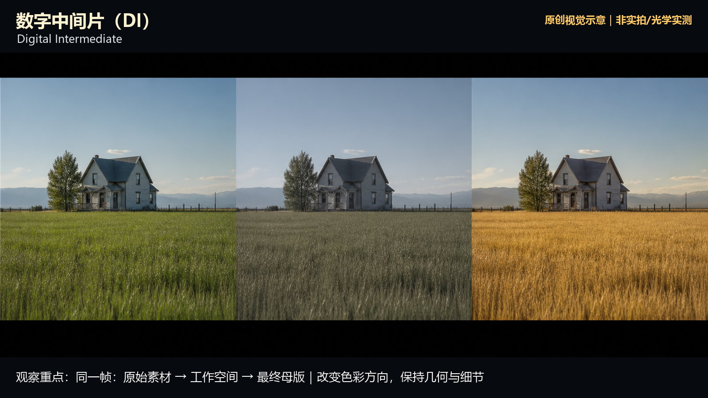

知识讲解：[A1-15 后期调色逻辑](../../knowledge/A-%E7%90%86%E8%AE%BA%E5%B1%82/A1-%E6%91%84%E5%BD%B1%E7%BB%84/A1-15%20%E5%90%8E%E6%9C%9F%E8%B0%83%E8%89%B2%E9%80%BB%E8%BE%91.md)

## 后期调色逻辑：2. 漂白法(Bleach Bypass / Skip Bleach / Silver Retention)（02-bleach-bypass，原创教学示意）

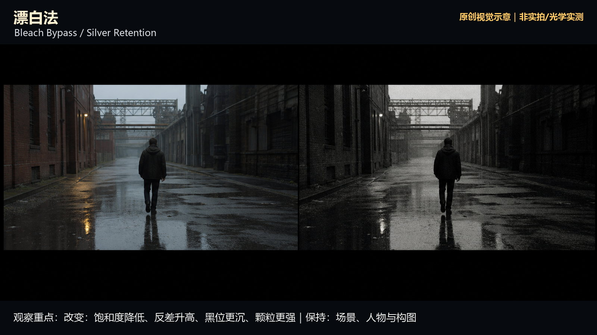

知识讲解：[A1-15 后期调色逻辑](../../knowledge/A-%E7%90%86%E8%AE%BA%E5%B1%82/A1-%E6%91%84%E5%BD%B1%E7%BB%84/A1-15%20%E5%90%8E%E6%9C%9F%E8%B0%83%E8%89%B2%E9%80%BB%E8%BE%91.md)

## 后期调色逻辑：3. ENR工艺（03-enr-process，原创教学示意）

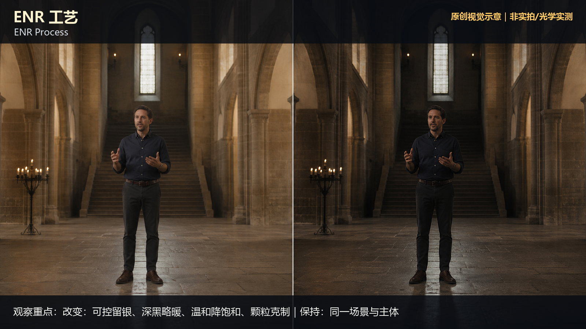

知识讲解：[A1-15 后期调色逻辑](../../knowledge/A-%E7%90%86%E8%AE%BA%E5%B1%82/A1-%E6%91%84%E5%BD%B1%E7%BB%84/A1-15%20%E5%90%8E%E6%9C%9F%E8%B0%83%E8%89%B2%E9%80%BB%E8%BE%91.md)

## 后期调色逻辑：4. ACES色彩编码系统（04-aces，原创教学示意）

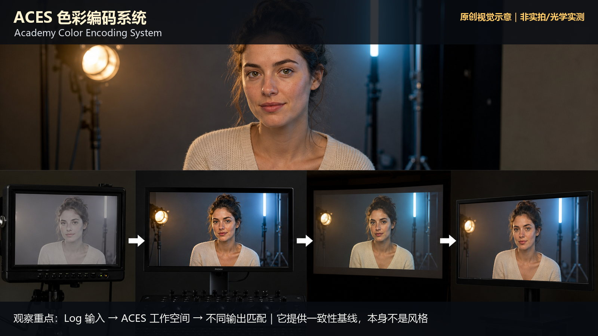

知识讲解：[A1-15 后期调色逻辑](../../knowledge/A-%E7%90%86%E8%AE%BA%E5%B1%82/A1-%E6%91%84%E5%BD%B1%E7%BB%84/A1-15%20%E5%90%8E%E6%9C%9F%E8%B0%83%E8%89%B2%E9%80%BB%E8%BE%91.md)

## 后期调色逻辑：5. DaVinci Resolve调色工作流（05-davinci-workflow，原创教学示意）

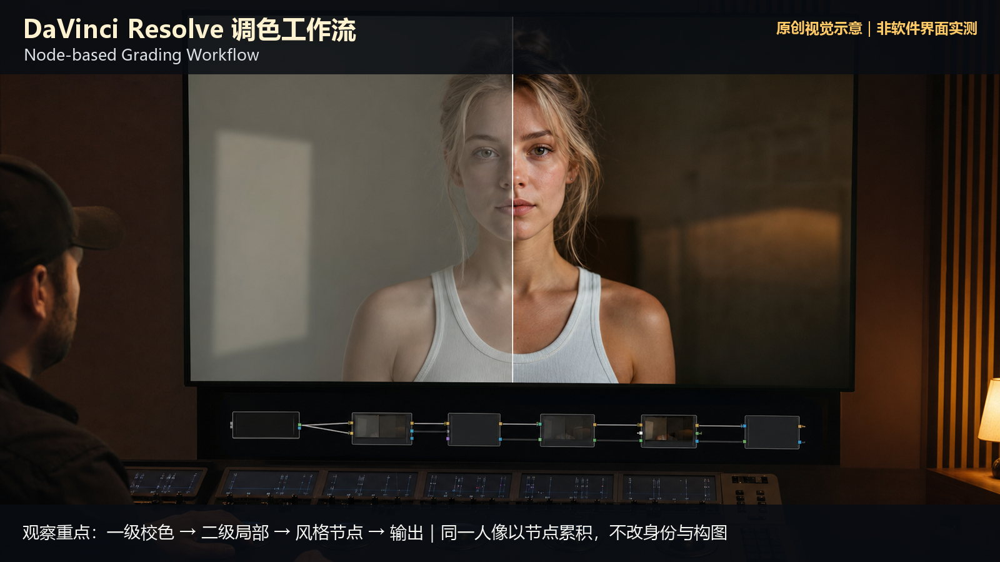

知识讲解：[A1-15 后期调色逻辑](../../knowledge/A-%E7%90%86%E8%AE%BA%E5%B1%82/A1-%E6%91%84%E5%BD%B1%E7%BB%84/A1-15%20%E5%90%8E%E6%9C%9F%E8%B0%83%E8%89%B2%E9%80%BB%E8%BE%91.md)

## 后期调色逻辑：6. 3D LUT预览模拟（06-3d-lut-preview，原创教学示意）

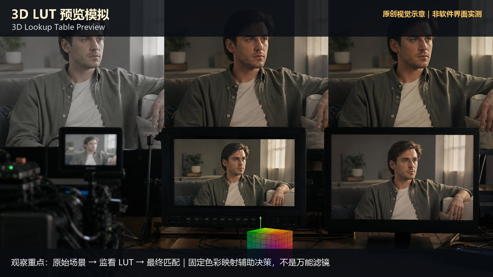

知识讲解：[A1-15 后期调色逻辑](../../knowledge/A-%E7%90%86%E8%AE%BA%E5%B1%82/A1-%E6%91%84%E5%BD%B1%E7%BB%84/A1-15%20%E5%90%8E%E6%9C%9F%E8%B0%83%E8%89%B2%E9%80%BB%E8%BE%91.md)

## 后期调色逻辑：7. 肤色保护策略（07-skin-tone-protection，原创教学示意）

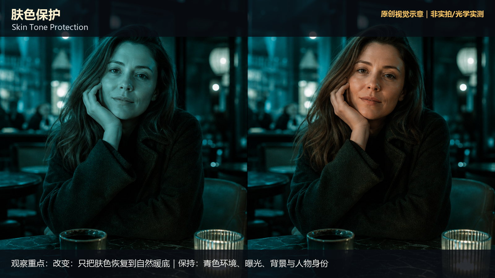

知识讲解：[A1-15 后期调色逻辑](../../knowledge/A-%E7%90%86%E8%AE%BA%E5%B1%82/A1-%E6%91%84%E5%BD%B1%E7%BB%84/A1-15%20%E5%90%8E%E6%9C%9F%E8%B0%83%E8%89%B2%E9%80%BB%E8%BE%91.md)

## 后期调色逻辑：8. 暗部偏色控制（08-shadow-tint，原创教学示意）

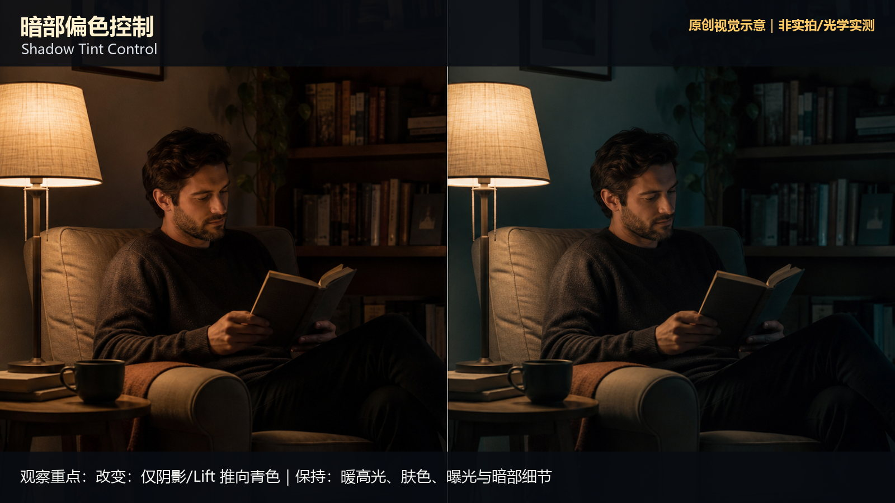

知识讲解：[A1-15 后期调色逻辑](../../knowledge/A-%E7%90%86%E8%AE%BA%E5%B1%82/A1-%E6%91%84%E5%BD%B1%E7%BB%84/A1-15%20%E5%90%8E%E6%9C%9F%E8%B0%83%E8%89%B2%E9%80%BB%E8%BE%91.md)

## 后期调色逻辑：9. 高光偏色控制（09-highlight-tint，原创教学示意）

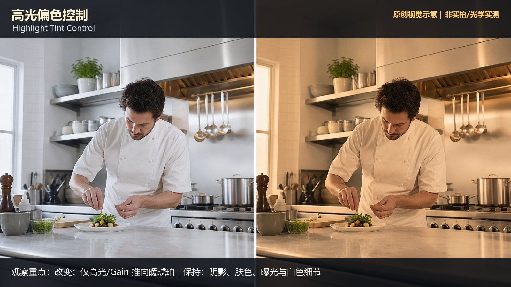

知识讲解：[A1-15 后期调色逻辑](../../knowledge/A-%E7%90%86%E8%AE%BA%E5%B1%82/A1-%E6%91%84%E5%BD%B1%E7%BB%84/A1-15%20%E5%90%8E%E6%9C%9F%E8%B0%83%E8%89%B2%E9%80%BB%E8%BE%91.md)

## 后期调色逻辑：10. 冷暖偏移调色(Split Tone / 冷暖分离)（10-split-tone，原创教学示意）

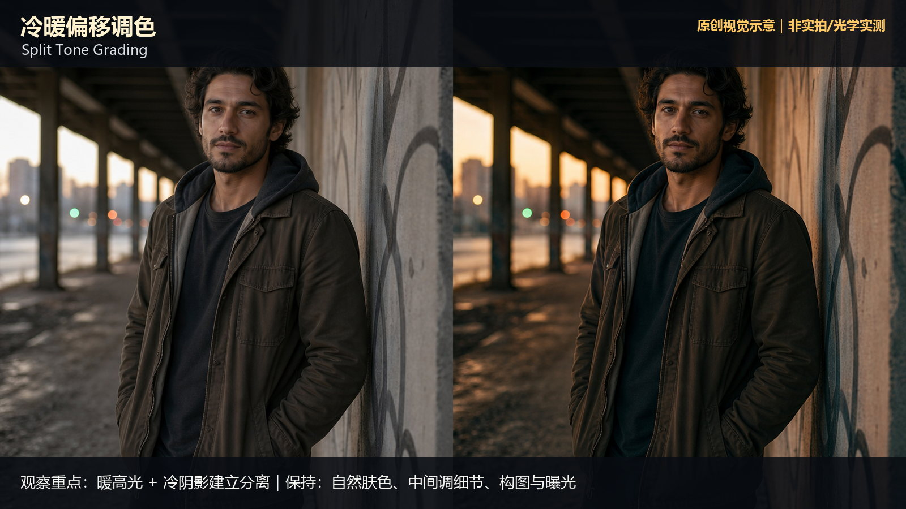

知识讲解：[A1-15 后期调色逻辑](../../knowledge/A-%E7%90%86%E8%AE%BA%E5%B1%82/A1-%E6%91%84%E5%BD%B1%E7%BB%84/A1-15%20%E5%90%8E%E6%9C%9F%E8%B0%83%E8%89%B2%E9%80%BB%E8%BE%91.md)

## 后期调色逻辑：11. 胶片质感模拟(Kodak vs Fuji)（11-kodak-vs-fuji，原创教学示意）

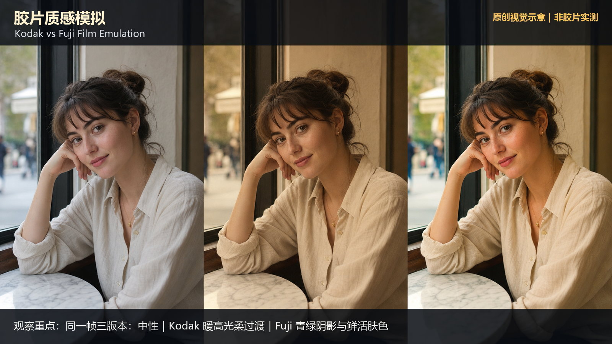

知识讲解：[A1-15 后期调色逻辑](../../knowledge/A-%E7%90%86%E8%AE%BA%E5%B1%82/A1-%E6%91%84%E5%BD%B1%E7%BB%84/A1-15%20%E5%90%8E%E6%9C%9F%E8%B0%83%E8%89%B2%E9%80%BB%E8%BE%91.md)

## 后期调色逻辑：12. 蓝橙调色趋势(Orange & Teal Hollywood Trend)（12-orange-teal，原创教学示意）

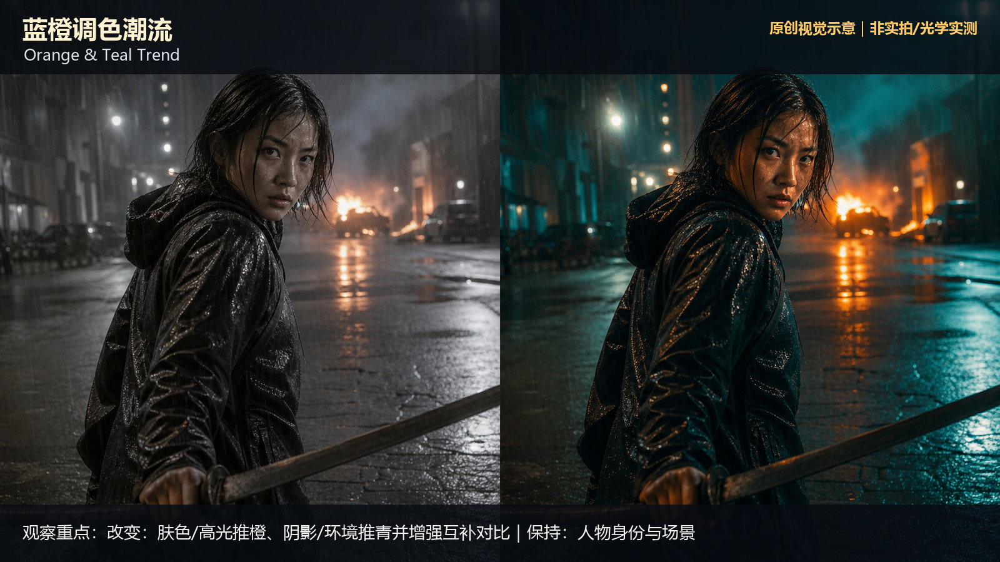

知识讲解：[A1-15 后期调色逻辑](../../knowledge/A-%E7%90%86%E8%AE%BA%E5%B1%82/A1-%E6%91%84%E5%BD%B1%E7%BB%84/A1-15%20%E5%90%8E%E6%9C%9F%E8%B0%83%E8%89%B2%E9%80%BB%E8%BE%91.md)

## 后期调色逻辑：13. 三段式胶片色彩模拟（13-three-chapter-emulation，原创教学示意）

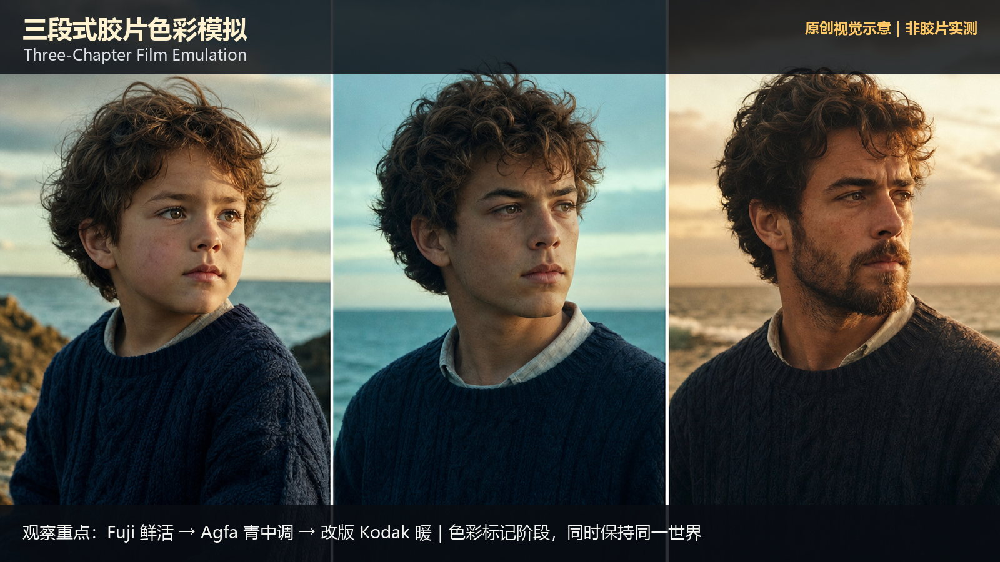

知识讲解：[A1-15 后期调色逻辑](../../knowledge/A-%E7%90%86%E8%AE%BA%E5%B1%82/A1-%E6%91%84%E5%BD%B1%E7%BB%84/A1-15%20%E5%90%8E%E6%9C%9F%E8%B0%83%E8%89%B2%E9%80%BB%E8%BE%91.md)
