# color-logic-construction · 1—15

[全部主题](../IMAGE_GALLERY.md) · [首页](../../README.md)

## 色彩逻辑构造：知识点1：互补色对比（蓝橙方案）（01-complementary-orange-teal，原创教学示意）

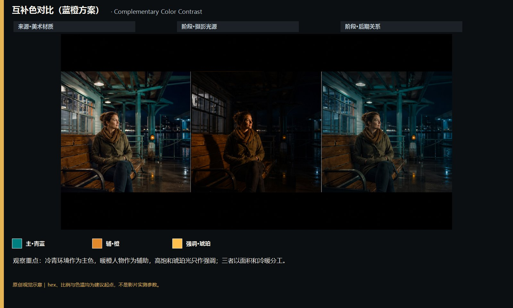

知识讲解：[A1-09 色彩逻辑构造](../../knowledge/A-%E7%90%86%E8%AE%BA%E5%B1%82/A1-%E6%91%84%E5%BD%B1%E7%BB%84/A1-09%20%E8%89%B2%E5%BD%A9%E9%80%BB%E8%BE%91%E6%9E%84%E9%80%A0.md)

## 色彩逻辑构造：知识点2：单色方案（绿色调）（02-monochromatic-green，原创教学示意）

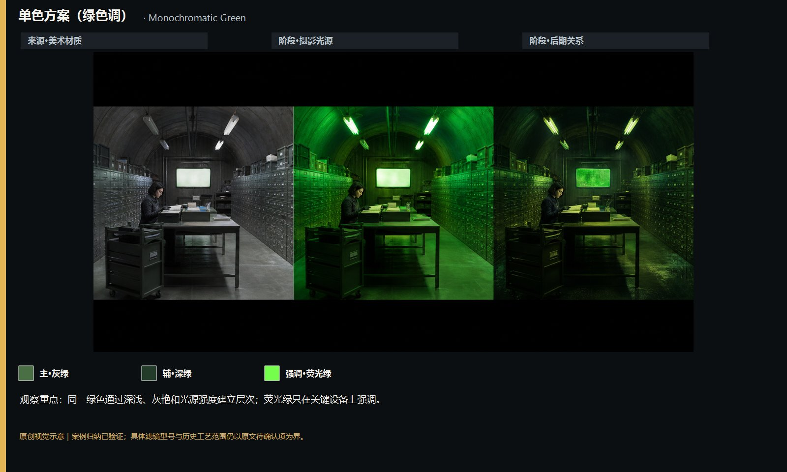

知识讲解：[A1-09 色彩逻辑构造](../../knowledge/A-%E7%90%86%E8%AE%BA%E5%B1%82/A1-%E6%91%84%E5%BD%B1%E7%BB%84/A1-09%20%E8%89%B2%E5%BD%A9%E9%80%BB%E8%BE%91%E6%9E%84%E9%80%A0.md)

## 色彩逻辑构造：知识点3：类比色方案（03-analogous-colors，原创教学示意）

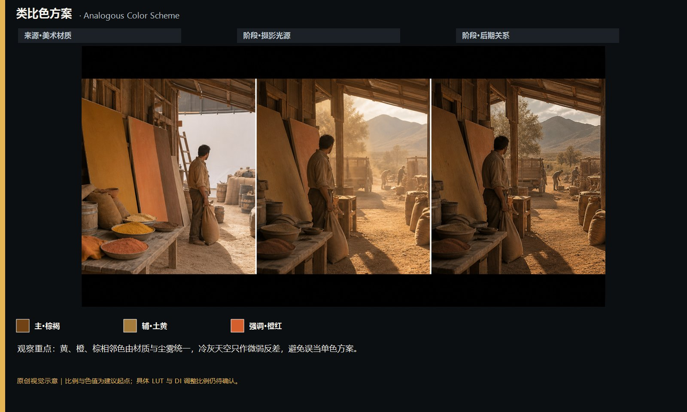

知识讲解：[A1-09 色彩逻辑构造](../../knowledge/A-%E7%90%86%E8%AE%BA%E5%B1%82/A1-%E6%91%84%E5%BD%B1%E7%BB%84/A1-09%20%E8%89%B2%E5%BD%A9%E9%80%BB%E8%BE%91%E6%9E%84%E9%80%A0.md)

## 色彩逻辑构造：知识点4：三元色方案（04-triadic-colors，原创教学示意）

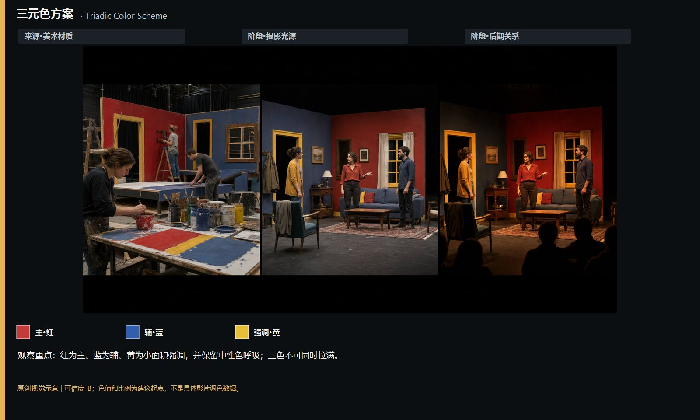

知识讲解：[A1-09 色彩逻辑构造](../../knowledge/A-%E7%90%86%E8%AE%BA%E5%B1%82/A1-%E6%91%84%E5%BD%B1%E7%BB%84/A1-09%20%E8%89%B2%E5%BD%A9%E9%80%BB%E8%BE%91%E6%9E%84%E9%80%A0.md)

## 色彩逻辑构造：知识点5：不协和色（05-discordant-color，原创教学示意）

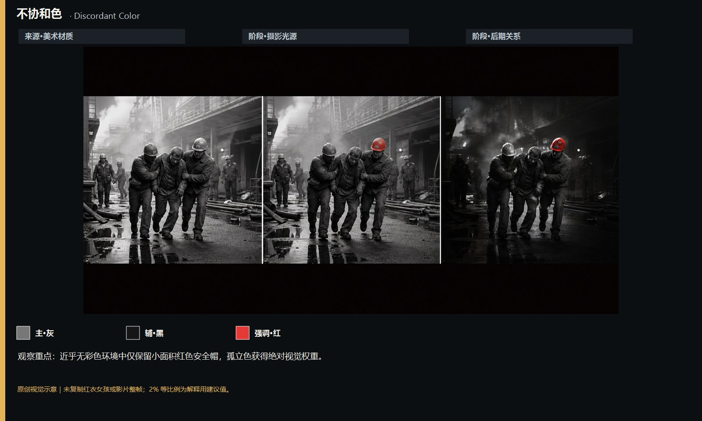

知识讲解：[A1-09 色彩逻辑构造](../../knowledge/A-%E7%90%86%E8%AE%BA%E5%B1%82/A1-%E6%91%84%E5%BD%B1%E7%BB%84/A1-09%20%E8%89%B2%E5%BD%A9%E9%80%BB%E8%BE%91%E6%9E%84%E9%80%A0.md)

## 色彩逻辑构造：知识点6：联想色（06-associative-color，原创教学示意）

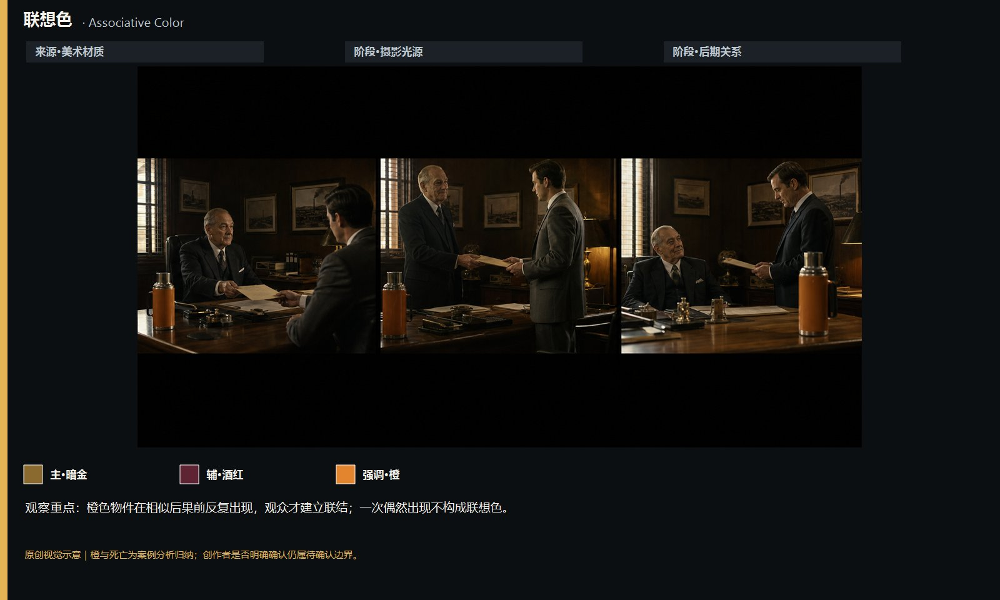

知识讲解：[A1-09 色彩逻辑构造](../../knowledge/A-%E7%90%86%E8%AE%BA%E5%B1%82/A1-%E6%91%84%E5%BD%B1%E7%BB%84/A1-09%20%E8%89%B2%E5%BD%A9%E9%80%BB%E8%BE%91%E6%9E%84%E9%80%A0.md)

## 色彩逻辑构造：知识点7：低饱和去饱和（07-desaturation，原创教学示意）

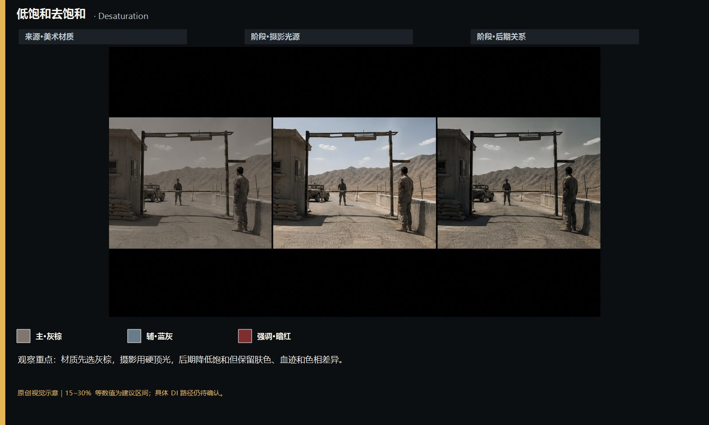

知识讲解：[A1-09 色彩逻辑构造](../../knowledge/A-%E7%90%86%E8%AE%BA%E5%B1%82/A1-%E6%91%84%E5%BD%B1%E7%BB%84/A1-09%20%E8%89%B2%E5%BD%A9%E9%80%BB%E8%BE%91%E6%9E%84%E9%80%A0.md)

## 色彩逻辑构造：知识点8：高饱和象征色（08-high-saturation-symbolic，原创教学示意）

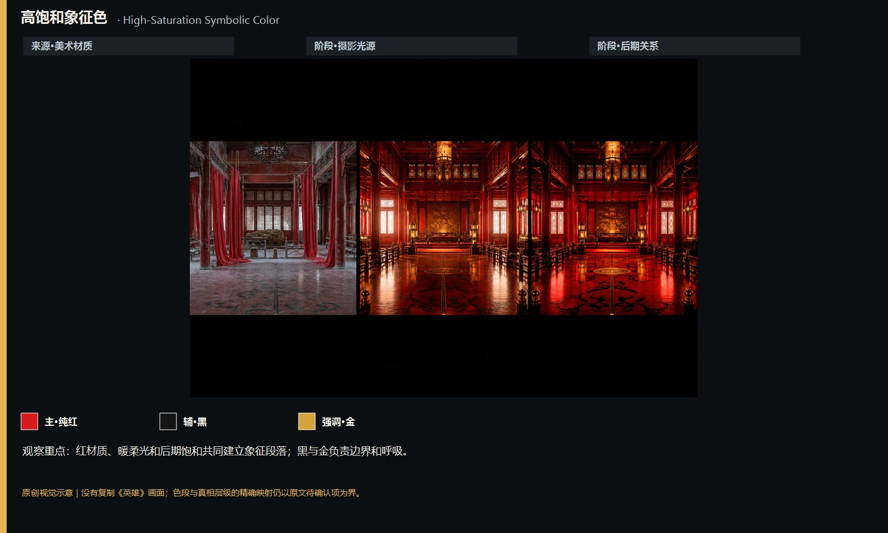

知识讲解：[A1-09 色彩逻辑构造](../../knowledge/A-%E7%90%86%E8%AE%BA%E5%B1%82/A1-%E6%91%84%E5%BD%B1%E7%BB%84/A1-09%20%E8%89%B2%E5%BD%A9%E9%80%BB%E8%BE%91%E6%9E%84%E9%80%A0.md)

## 色彩逻辑构造：知识点9：色彩分区区分世界观（09-color-zoned-world，原创教学示意）

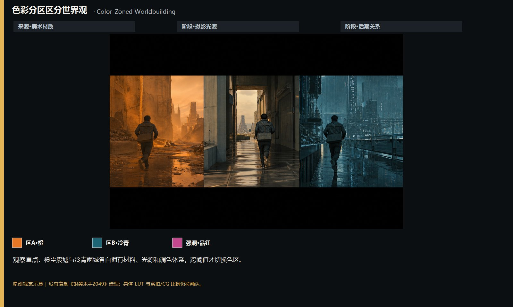

知识讲解：[A1-09 色彩逻辑构造](../../knowledge/A-%E7%90%86%E8%AE%BA%E5%B1%82/A1-%E6%91%84%E5%BD%B1%E7%BB%84/A1-09%20%E8%89%B2%E5%BD%A9%E9%80%BB%E8%BE%91%E6%9E%84%E9%80%A0.md)

## 色彩逻辑构造：知识点10：色彩编码人生阶段（10-life-stage-coding，原创教学示意）

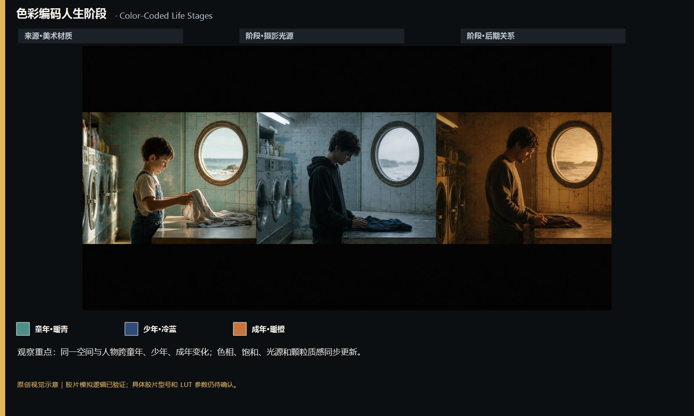

知识讲解：[A1-09 色彩逻辑构造](../../knowledge/A-%E7%90%86%E8%AE%BA%E5%B1%82/A1-%E6%91%84%E5%BD%B1%E7%BB%84/A1-09%20%E8%89%B2%E5%BD%A9%E9%80%BB%E8%BE%91%E6%9E%84%E9%80%A0.md)

## 色彩逻辑构造：知识点11：暖色消除蓝色（11-warm-removes-blue，原创教学示意）

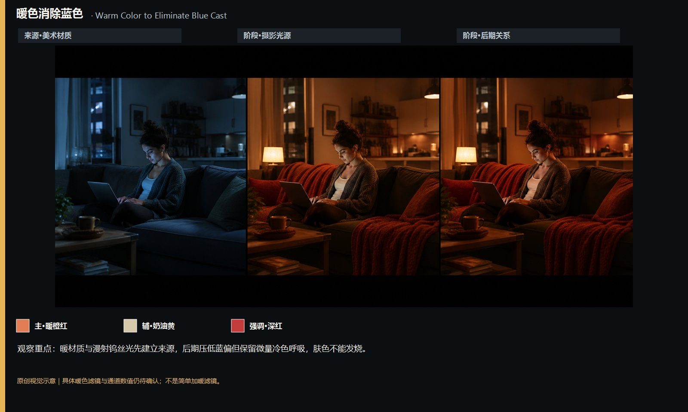

知识讲解：[A1-09 色彩逻辑构造](../../knowledge/A-%E7%90%86%E8%AE%BA%E5%B1%82/A1-%E6%91%84%E5%BD%B1%E7%BB%84/A1-09%20%E8%89%B2%E5%BD%A9%E9%80%BB%E8%BE%91%E6%9E%84%E9%80%A0.md)

## 色彩逻辑构造：知识点12：歌德色彩叙事（12-goethean-narrative，原创教学示意）

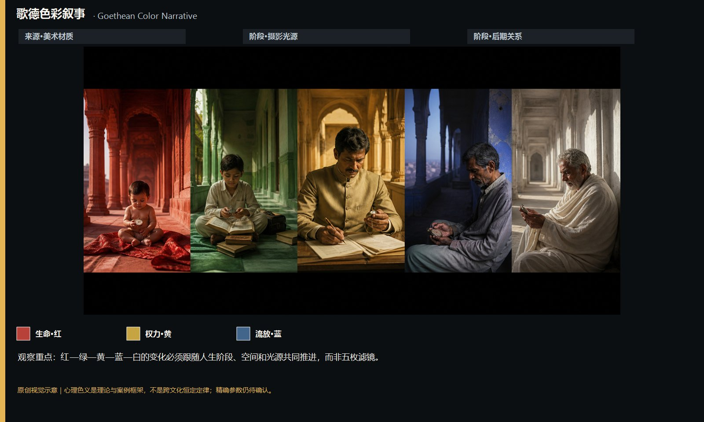

知识讲解：[A1-09 色彩逻辑构造](../../knowledge/A-%E7%90%86%E8%AE%BA%E5%B1%82/A1-%E6%91%84%E5%BD%B1%E7%BB%84/A1-09%20%E8%89%B2%E5%BD%A9%E9%80%BB%E8%BE%91%E6%9E%84%E9%80%A0.md)

## 色彩逻辑构造：知识点13：漂白法高对比低饱和（13-bleach-bypass，原创教学示意）

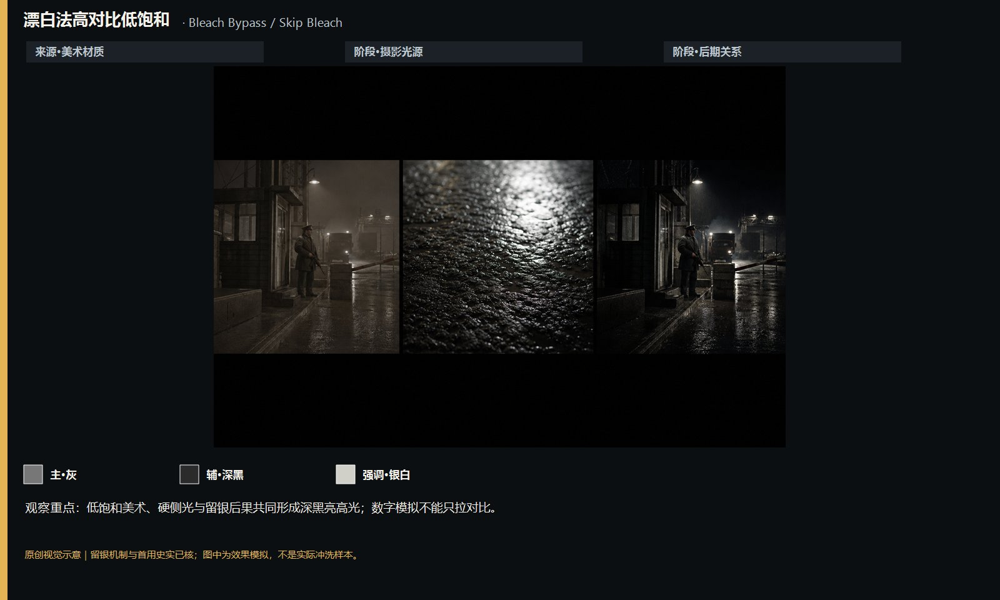

知识讲解：[A1-09 色彩逻辑构造](../../knowledge/A-%E7%90%86%E8%AE%BA%E5%B1%82/A1-%E6%91%84%E5%BD%B1%E7%BB%84/A1-09%20%E8%89%B2%E5%BD%A9%E9%80%BB%E8%BE%91%E6%9E%84%E9%80%A0.md)

## 色彩逻辑构造：知识点14：数字调色DI开创（14-digital-intermediate，原创教学示意）

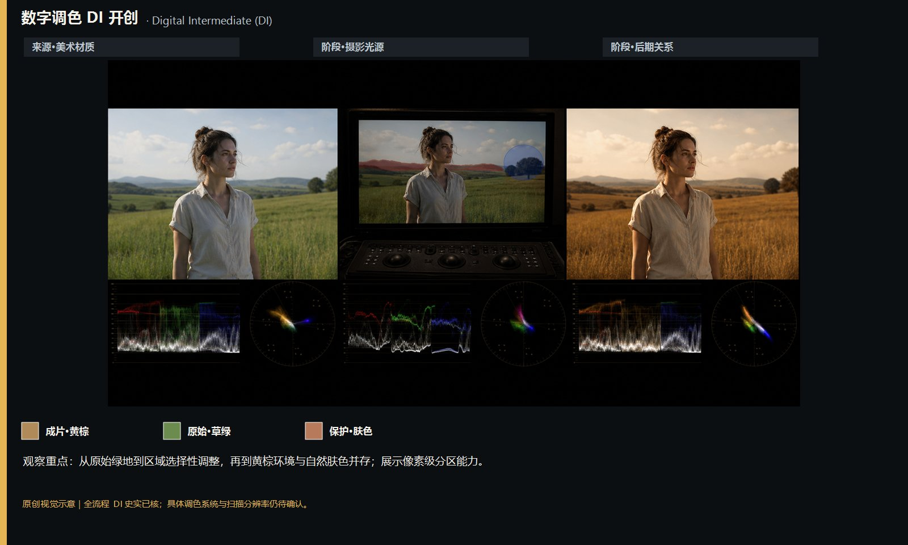

知识讲解：[A1-09 色彩逻辑构造](../../knowledge/A-%E7%90%86%E8%AE%BA%E5%B1%82/A1-%E6%91%84%E5%BD%B1%E7%BB%84/A1-09%20%E8%89%B2%E5%BD%A9%E9%80%BB%E8%BE%91%E6%9E%84%E9%80%A0.md)

## 色彩逻辑构造：知识点15：五色叙事结构（15-five-color-narrative，原创教学示意）

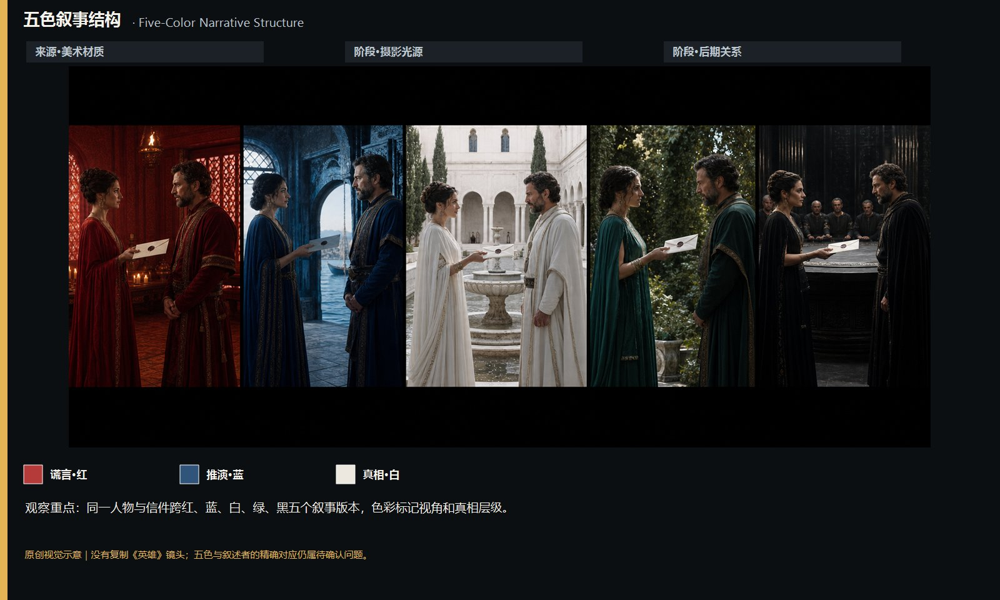

知识讲解：[A1-09 色彩逻辑构造](../../knowledge/A-%E7%90%86%E8%AE%BA%E5%B1%82/A1-%E6%91%84%E5%BD%B1%E7%BB%84/A1-09%20%E8%89%B2%E5%BD%A9%E9%80%BB%E8%BE%91%E6%9E%84%E9%80%A0.md)
