# color-tone · 1—24

[全部主题](../IMAGE_GALLERY.md) · [首页](../../README.md)

## 色彩与影调：01 · 低饱和（01-low-saturation，原创教学示意）

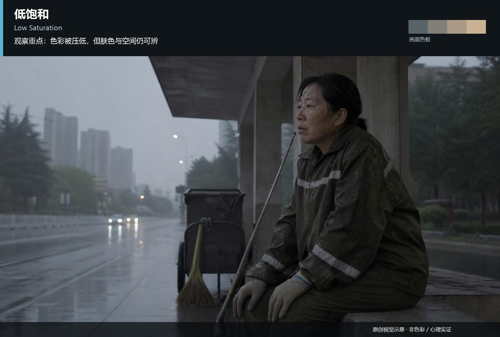

知识讲解：[A1-07 色彩与影调](../../knowledge/A-%E7%90%86%E8%AE%BA%E5%B1%82/A1-%E6%91%84%E5%BD%B1%E7%BB%84/A1-07%20%E8%89%B2%E5%BD%A9%E4%B8%8E%E5%BD%B1%E8%B0%83.md)

## 色彩与影调：02 · 高饱和（02-high-saturation，原创教学示意）

知识讲解：[A1-07 色彩与影调](../../knowledge/A-%E7%90%86%E8%AE%BA%E5%B1%82/A1-%E6%91%84%E5%BD%B1%E7%BB%84/A1-07%20%E8%89%B2%E5%BD%A9%E4%B8%8E%E5%BD%B1%E8%B0%83.md)

## 色彩与影调：03 · 冷色调（03-cold-tone，原创教学示意）

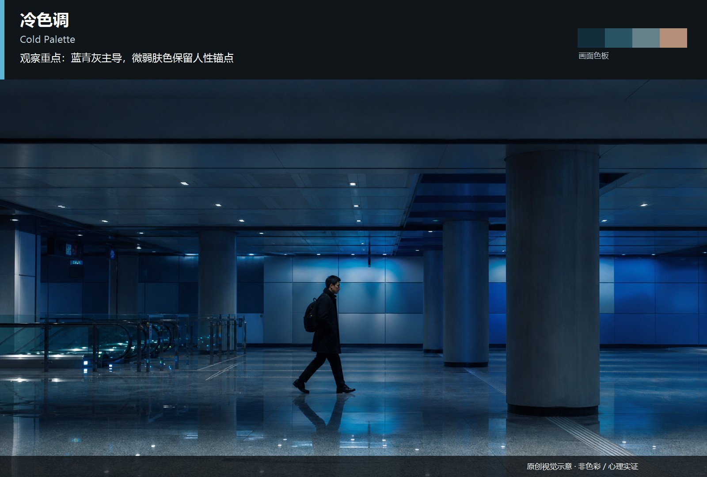

知识讲解：[A1-07 色彩与影调](../../knowledge/A-%E7%90%86%E8%AE%BA%E5%B1%82/A1-%E6%91%84%E5%BD%B1%E7%BB%84/A1-07%20%E8%89%B2%E5%BD%A9%E4%B8%8E%E5%BD%B1%E8%B0%83.md)

## 色彩与影调：04 · 暖色调（04-warm-tone，原创教学示意）

知识讲解：[A1-07 色彩与影调](../../knowledge/A-%E7%90%86%E8%AE%BA%E5%B1%82/A1-%E6%91%84%E5%BD%B1%E7%BB%84/A1-07%20%E8%89%B2%E5%BD%A9%E4%B8%8E%E5%BD%B1%E8%B0%83.md)

## 色彩与影调：05 · 橙蓝对比（05-orange-teal，原创教学示意）

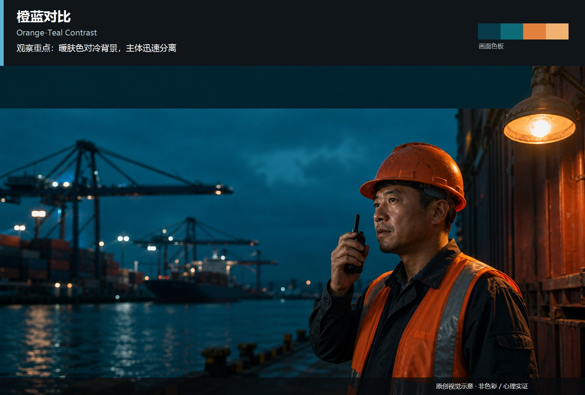

知识讲解：[A1-07 色彩与影调](../../knowledge/A-%E7%90%86%E8%AE%BA%E5%B1%82/A1-%E6%91%84%E5%BD%B1%E7%BB%84/A1-07%20%E8%89%B2%E5%BD%A9%E4%B8%8E%E5%BD%B1%E8%B0%83.md)

## 色彩与影调：06 · 灰蓝工业风（06-gray-blue-industrial，原创教学示意）

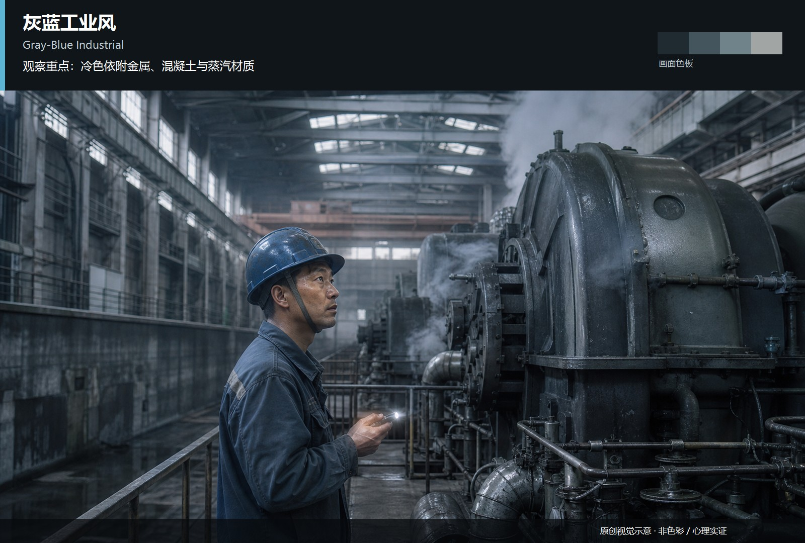

知识讲解：[A1-07 色彩与影调](../../knowledge/A-%E7%90%86%E8%AE%BA%E5%B1%82/A1-%E6%91%84%E5%BD%B1%E7%BB%84/A1-07%20%E8%89%B2%E5%BD%A9%E4%B8%8E%E5%BD%B1%E8%B0%83.md)

## 色彩与影调：07 · 绿色系统感（07-green-system，原创教学示意）

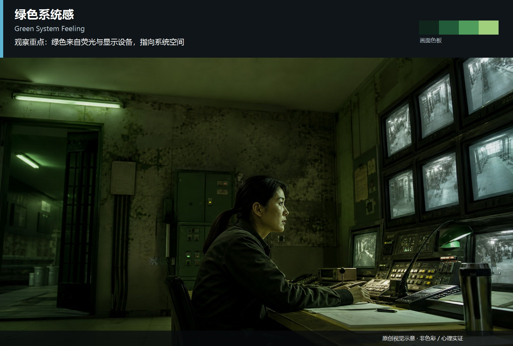

知识讲解：[A1-07 色彩与影调](../../knowledge/A-%E7%90%86%E8%AE%BA%E5%B1%82/A1-%E6%91%84%E5%BD%B1%E7%BB%84/A1-07%20%E8%89%B2%E5%BD%A9%E4%B8%8E%E5%BD%B1%E8%B0%83.md)

## 色彩与影调：08 · 红色警报感（08-red-alert，原创教学示意）

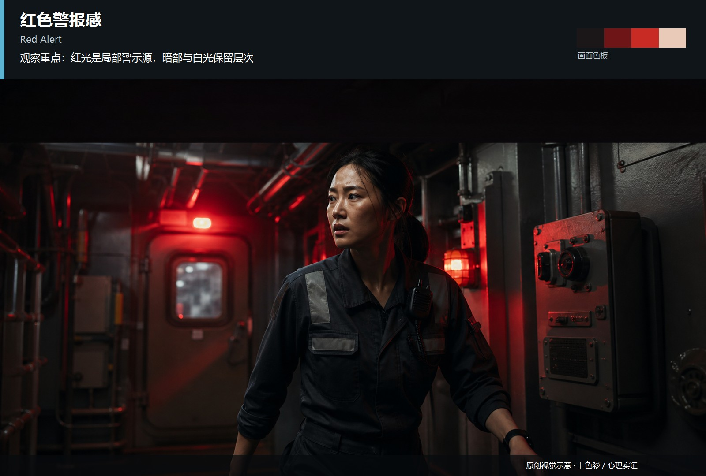

知识讲解：[A1-07 色彩与影调](../../knowledge/A-%E7%90%86%E8%AE%BA%E5%B1%82/A1-%E6%91%84%E5%BD%B1%E7%BB%84/A1-07%20%E8%89%B2%E5%BD%A9%E4%B8%8E%E5%BD%B1%E8%B0%83.md)

## 色彩与影调：09 · 金色神圣感（09-sacred-gold，原创教学示意）

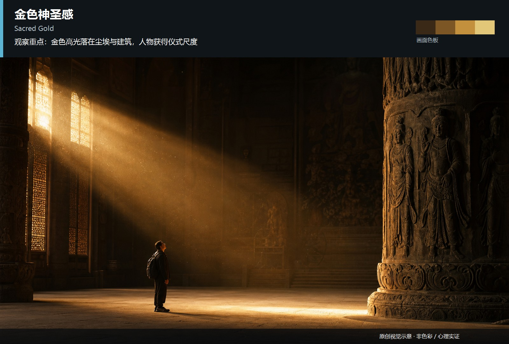

知识讲解：[A1-07 色彩与影调](../../knowledge/A-%E7%90%86%E8%AE%BA%E5%B1%82/A1-%E6%91%84%E5%BD%B1%E7%BB%84/A1-07%20%E8%89%B2%E5%BD%A9%E4%B8%8E%E5%BD%B1%E8%B0%83.md)

## 色彩与影调：10 · 黑白影像（10-black-white，原创教学示意）

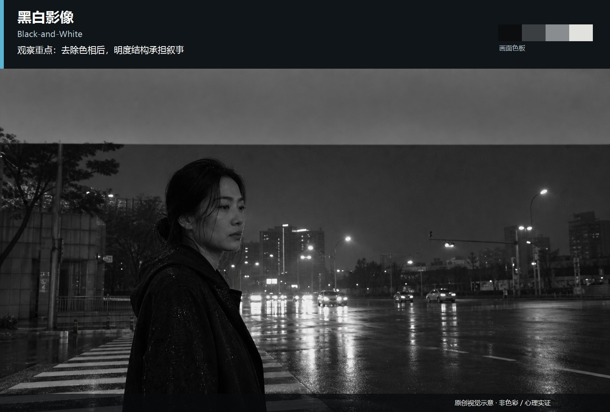

知识讲解：[A1-07 色彩与影调](../../knowledge/A-%E7%90%86%E8%AE%BA%E5%B1%82/A1-%E6%91%84%E5%BD%B1%E7%BB%84/A1-07%20%E8%89%B2%E5%BD%A9%E4%B8%8E%E5%BD%B1%E8%B0%83.md)

## 色彩与影调：11 · 胶片颗粒（11-film-grain，原创教学示意）

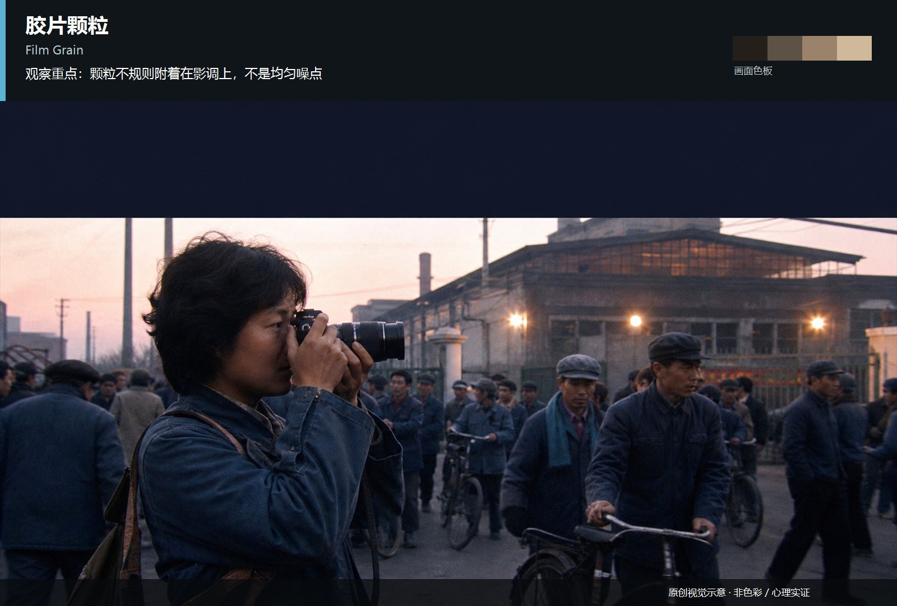

知识讲解：[A1-07 色彩与影调](../../knowledge/A-%E7%90%86%E8%AE%BA%E5%B1%82/A1-%E6%91%84%E5%BD%B1%E7%BB%84/A1-07%20%E8%89%B2%E5%BD%A9%E4%B8%8E%E5%BD%B1%E8%B0%83.md)

## 色彩与影调：12 · 数字冷感（12-digital-cold，原创教学示意）

知识讲解：[A1-07 色彩与影调](../../knowledge/A-%E7%90%86%E8%AE%BA%E5%B1%82/A1-%E6%91%84%E5%BD%B1%E7%BB%84/A1-07%20%E8%89%B2%E5%BD%A9%E4%B8%8E%E5%BD%B1%E8%B0%83.md)

## 色彩与影调：13 · 战争去饱和（13-war-desaturation，原创教学示意）

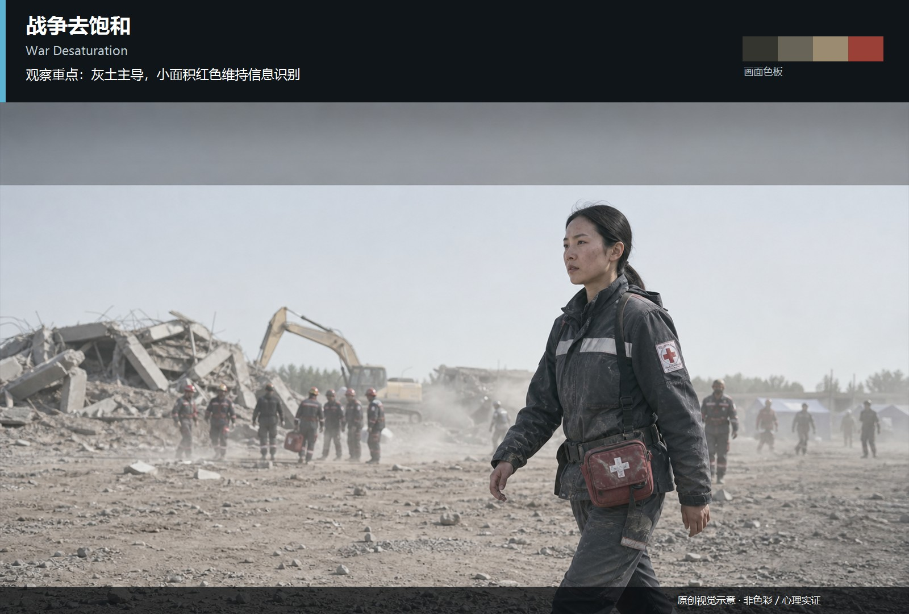

知识讲解：[A1-07 色彩与影调](../../knowledge/A-%E7%90%86%E8%AE%BA%E5%B1%82/A1-%E6%91%84%E5%BD%B1%E7%BB%84/A1-07%20%E8%89%B2%E5%BD%A9%E4%B8%8E%E5%BD%B1%E8%B0%83.md)

## 色彩与影调：14 · 科幻冷色秩序（14-sci-fi-cold-order，原创教学示意）

知识讲解：[A1-07 色彩与影调](../../knowledge/A-%E7%90%86%E8%AE%BA%E5%B1%82/A1-%E6%91%84%E5%BD%B1%E7%BB%84/A1-07%20%E8%89%B2%E5%BD%A9%E4%B8%8E%E5%BD%B1%E8%B0%83.md)

## 色彩与影调：15 · 史诗金色命运（15-epic-golden-destiny，原创教学示意）

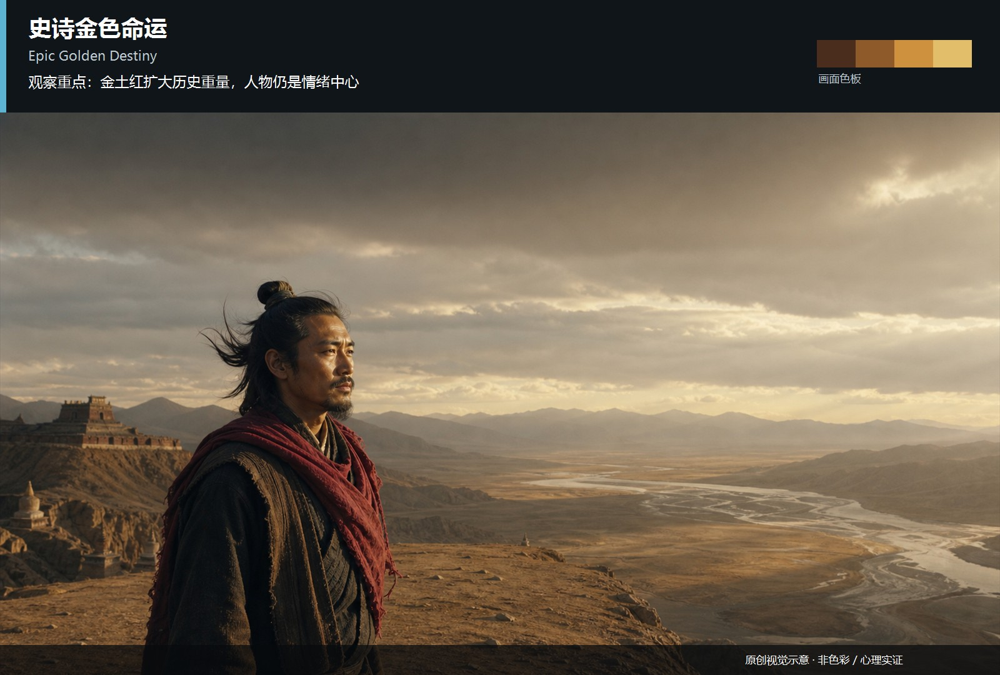

知识讲解：[A1-07 色彩与影调](../../knowledge/A-%E7%90%86%E8%AE%BA%E5%B1%82/A1-%E6%91%84%E5%BD%B1%E7%BB%84/A1-07%20%E8%89%B2%E5%BD%A9%E4%B8%8E%E5%BD%B1%E8%B0%83.md)

## 色彩与影调：16 · 灾难灰绿色（16-disaster-gray-green，原创教学示意）

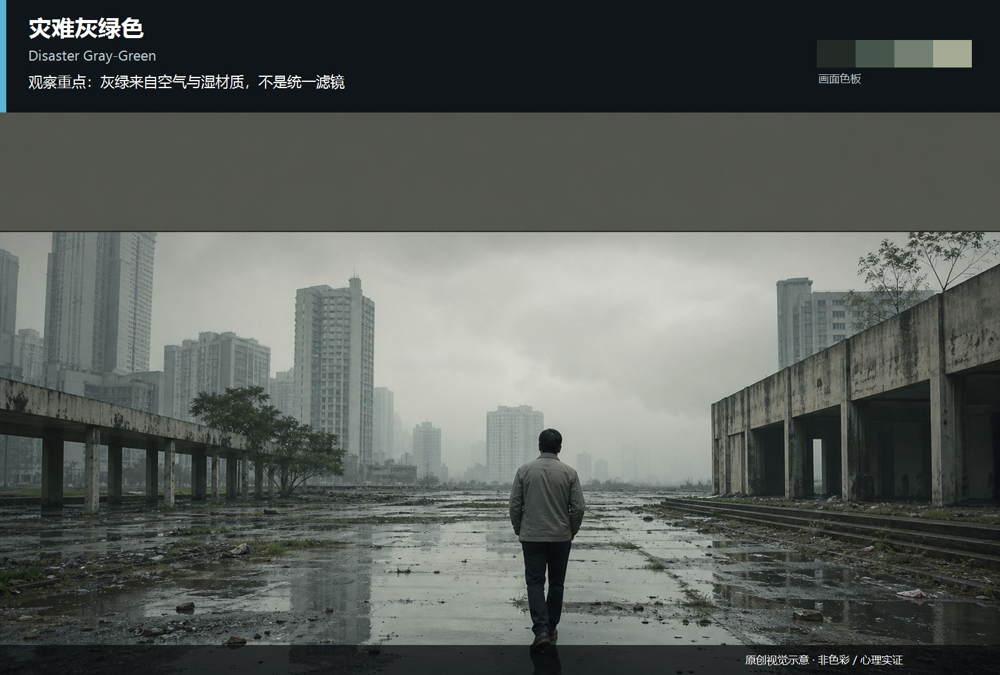

知识讲解：[A1-07 色彩与影调](../../knowledge/A-%E7%90%86%E8%AE%BA%E5%B1%82/A1-%E6%91%84%E5%BD%B1%E7%BB%84/A1-07%20%E8%89%B2%E5%BD%A9%E4%B8%8E%E5%BD%B1%E8%B0%83.md)

## 色彩与影调：17 · 黑色电影高反差（17-noir-high-contrast，原创教学示意）

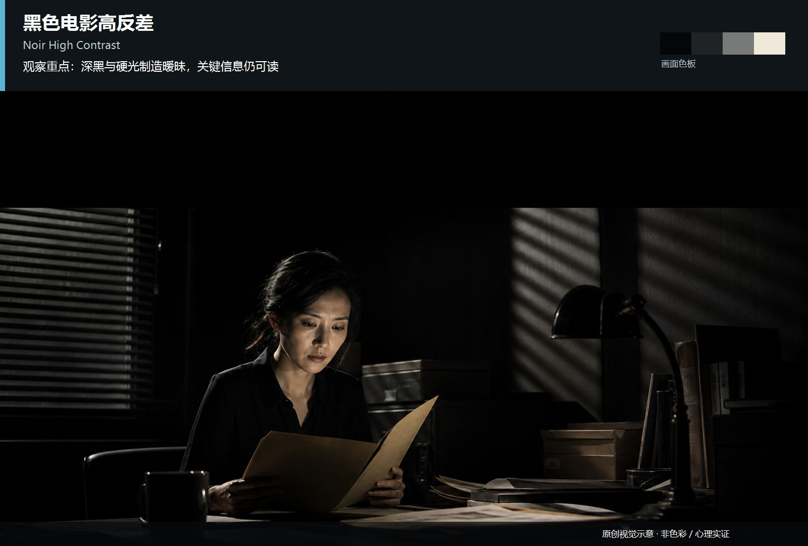

知识讲解：[A1-07 色彩与影调](../../knowledge/A-%E7%90%86%E8%AE%BA%E5%B1%82/A1-%E6%91%84%E5%BD%B1%E7%BB%84/A1-07%20%E8%89%B2%E5%BD%A9%E4%B8%8E%E5%BD%B1%E8%B0%83.md) · [A2-07 电影视觉风格坐标系与术语总纲](../../knowledge/A-%E7%90%86%E8%AE%BA%E5%B1%82/A2-%E5%AF%BC%E6%BC%94%E7%BB%84/A2-07%20%E7%94%B5%E5%BD%B1%E8%A7%86%E8%A7%89%E9%A3%8E%E6%A0%BC%E5%9D%90%E6%A0%87%E7%B3%BB%E4%B8%8E%E6%9C%AF%E8%AF%AD%E6%80%BB%E7%BA%B2.md)

## 色彩与影调：18 · 赛博朋克霓虹（18-cyberpunk-neon，原创教学示意）

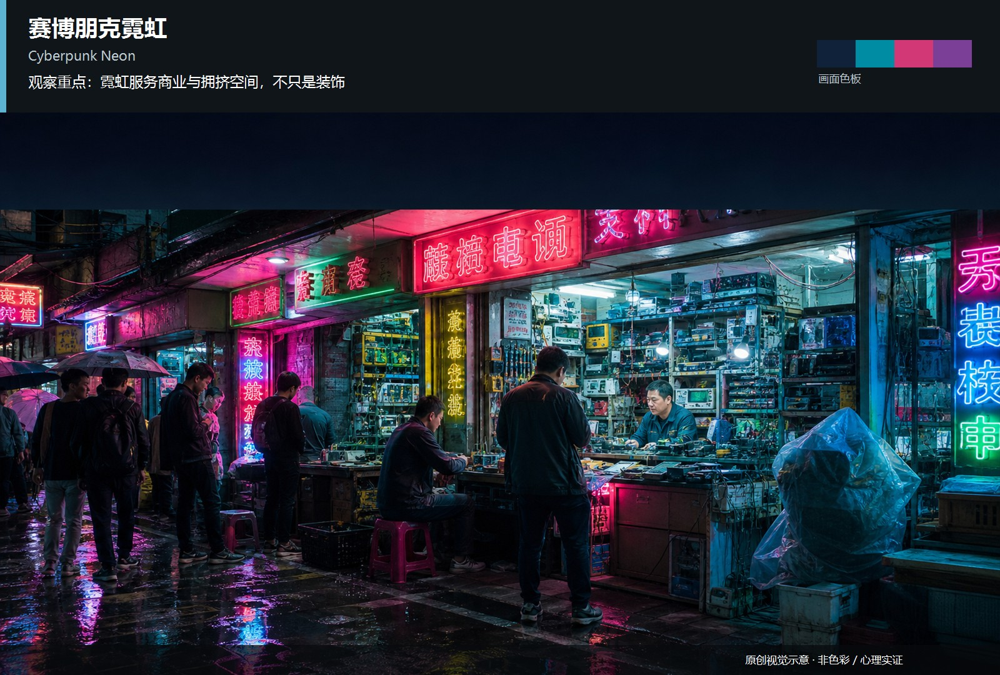

知识讲解：[A1-07 色彩与影调](../../knowledge/A-%E7%90%86%E8%AE%BA%E5%B1%82/A1-%E6%91%84%E5%BD%B1%E7%BB%84/A1-07%20%E8%89%B2%E5%BD%A9%E4%B8%8E%E5%BD%B1%E8%B0%83.md) · [A2-07 电影视觉风格坐标系与术语总纲](../../knowledge/A-%E7%90%86%E8%AE%BA%E5%B1%82/A2-%E5%AF%BC%E6%BC%94%E7%BB%84/A2-07%20%E7%94%B5%E5%BD%B1%E8%A7%86%E8%A7%89%E9%A3%8E%E6%A0%BC%E5%9D%90%E6%A0%87%E7%B3%BB%E4%B8%8E%E6%9C%AF%E8%AF%AD%E6%80%BB%E7%BA%B2.md)

## 色彩与影调：19 · 后末日褪色（19-faded-post-apocalypse，原创教学示意）

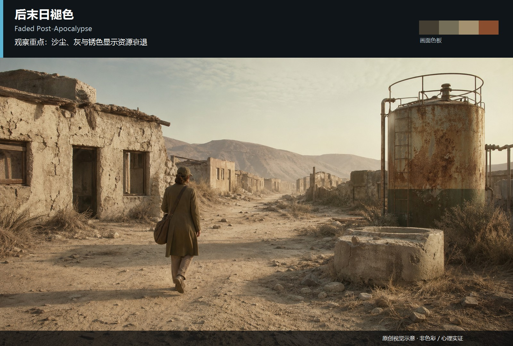

知识讲解：[A1-07 色彩与影调](../../knowledge/A-%E7%90%86%E8%AE%BA%E5%B1%82/A1-%E6%91%84%E5%BD%B1%E7%BB%84/A1-07%20%E8%89%B2%E5%BD%A9%E4%B8%8E%E5%BD%B1%E8%B0%83.md) · [A2-07 电影视觉风格坐标系与术语总纲](../../knowledge/A-%E7%90%86%E8%AE%BA%E5%B1%82/A2-%E5%AF%BC%E6%BC%94%E7%BB%84/A2-07%20%E7%94%B5%E5%BD%B1%E8%A7%86%E8%A7%89%E9%A3%8E%E6%A0%BC%E5%9D%90%E6%A0%87%E7%B3%BB%E4%B8%8E%E6%9C%AF%E8%AF%AD%E6%80%BB%E7%BA%B2.md)

## 色彩与影调：20 · 记忆暖滤镜（20-warm-memory-filter，原创教学示意）

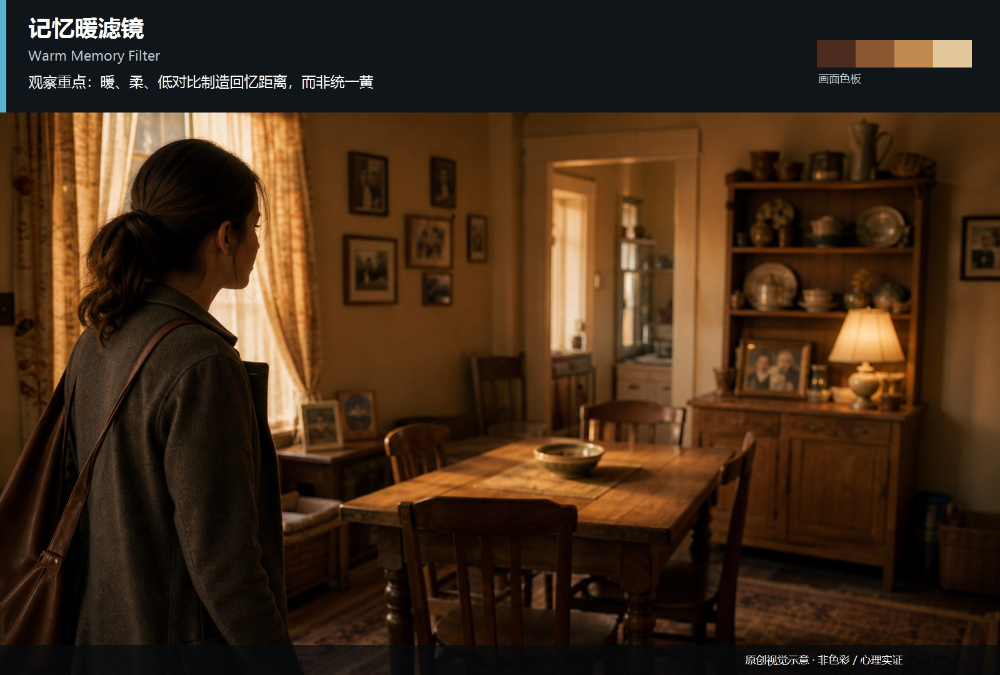

知识讲解：[A1-07 色彩与影调](../../knowledge/A-%E7%90%86%E8%AE%BA%E5%B1%82/A1-%E6%91%84%E5%BD%B1%E7%BB%84/A1-07%20%E8%89%B2%E5%BD%A9%E4%B8%8E%E5%BD%B1%E8%B0%83.md)

## 色彩与影调：21 · 梦境柔化（21-dream-softening，原创教学示意）

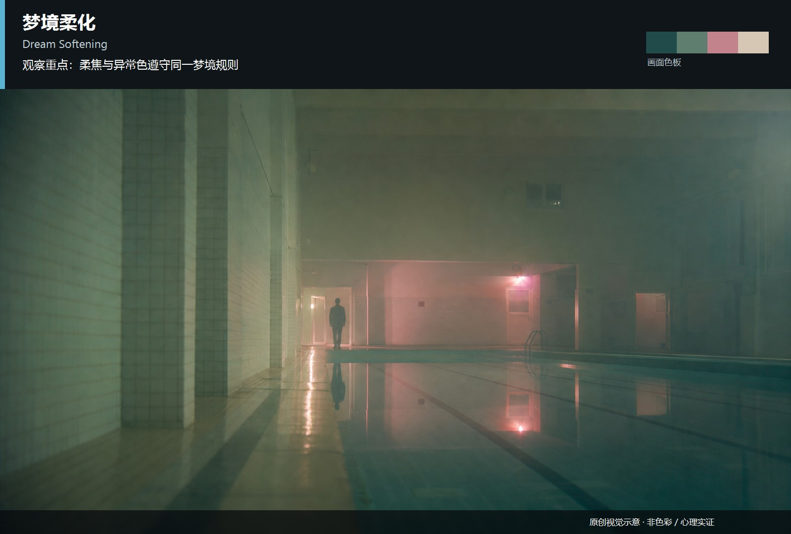

知识讲解：[A1-07 色彩与影调](../../knowledge/A-%E7%90%86%E8%AE%BA%E5%B1%82/A1-%E6%91%84%E5%BD%B1%E7%BB%84/A1-07%20%E8%89%B2%E5%BD%A9%E4%B8%8E%E5%BD%B1%E8%B0%83.md) · [A2-07 电影视觉风格坐标系与术语总纲](../../knowledge/A-%E7%90%86%E8%AE%BA%E5%B1%82/A2-%E5%AF%BC%E6%BC%94%E7%BB%84/A2-07%20%E7%94%B5%E5%BD%B1%E8%A7%86%E8%A7%89%E9%A3%8E%E6%A0%BC%E5%9D%90%E6%A0%87%E7%B3%BB%E4%B8%8E%E6%9C%AF%E8%AF%AD%E6%80%BB%E7%BA%B2.md)

## 色彩与影调：视觉示意 · 蓝橙互补色对比（22-orange-teal-complementary，原创教学示意）

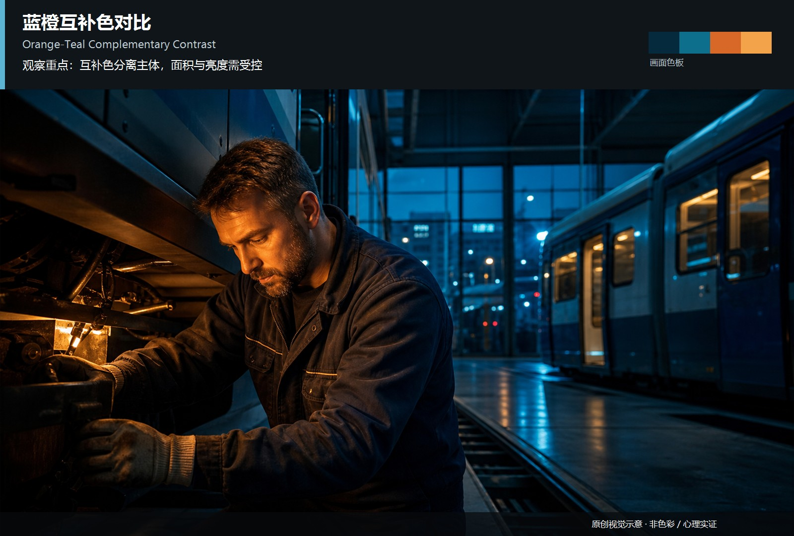

知识讲解：[A1-07 色彩与影调](../../knowledge/A-%E7%90%86%E8%AE%BA%E5%B1%82/A1-%E6%91%84%E5%BD%B1%E7%BB%84/A1-07%20%E8%89%B2%E5%BD%A9%E4%B8%8E%E5%BD%B1%E8%B0%83.md)

## 色彩与影调：视觉示意 · 低饱和／去饱和调色（23-desaturation-grading，原创教学示意）

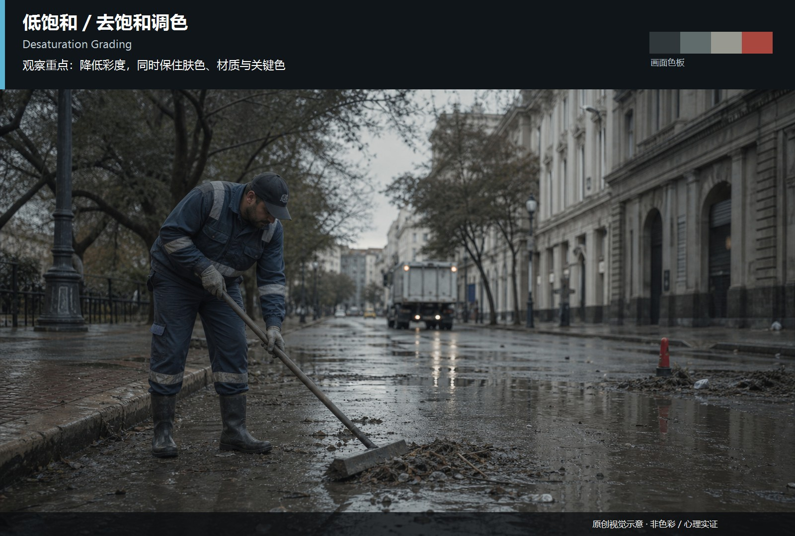

知识讲解：[A1-07 色彩与影调](../../knowledge/A-%E7%90%86%E8%AE%BA%E5%B1%82/A1-%E6%91%84%E5%BD%B1%E7%BB%84/A1-07%20%E8%89%B2%E5%BD%A9%E4%B8%8E%E5%BD%B1%E8%B0%83.md)

## 色彩与影调：视觉示意 · 单色配色方案（24-monochromatic-color，原创教学示意）

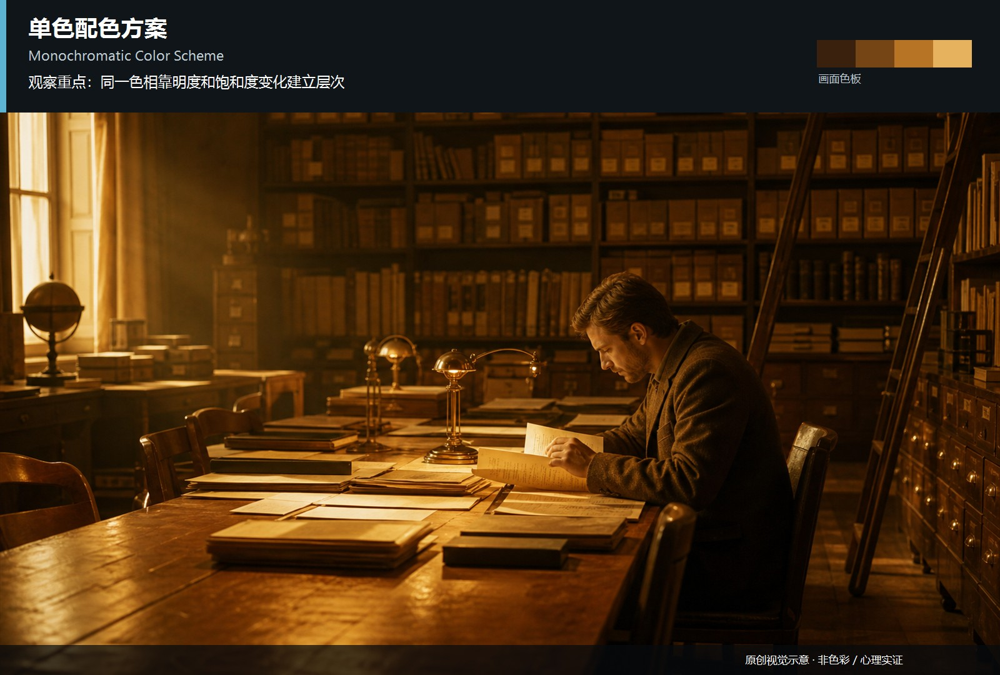

知识讲解：[A1-07 色彩与影调](../../knowledge/A-%E7%90%86%E8%AE%BA%E5%B1%82/A1-%E6%91%84%E5%BD%B1%E7%BB%84/A1-07%20%E8%89%B2%E5%BD%A9%E4%B8%8E%E5%BD%B1%E8%B0%83.md)
