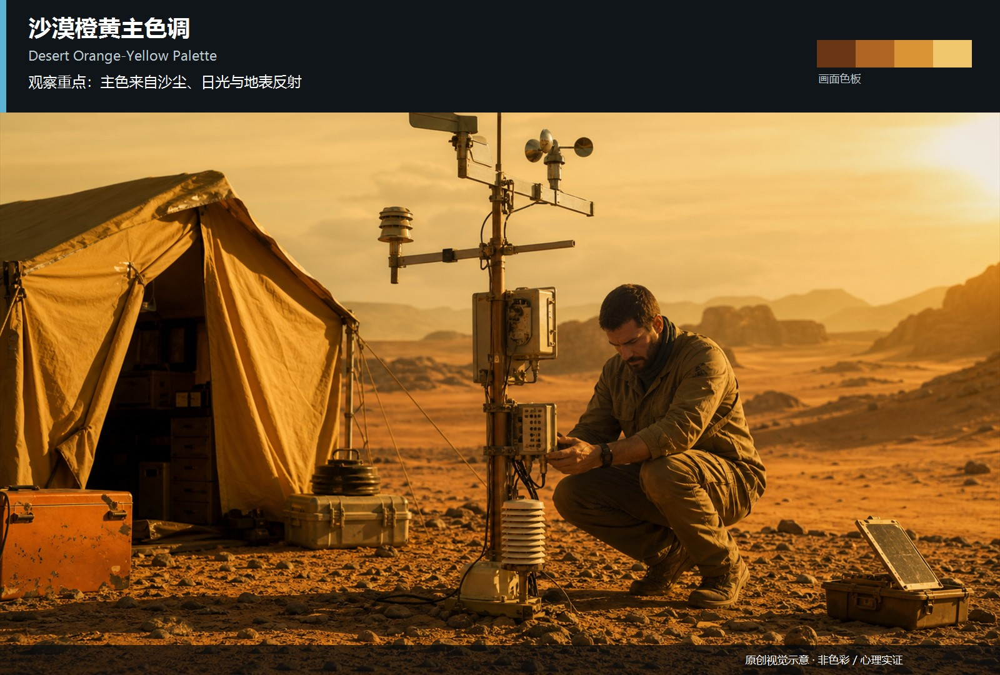
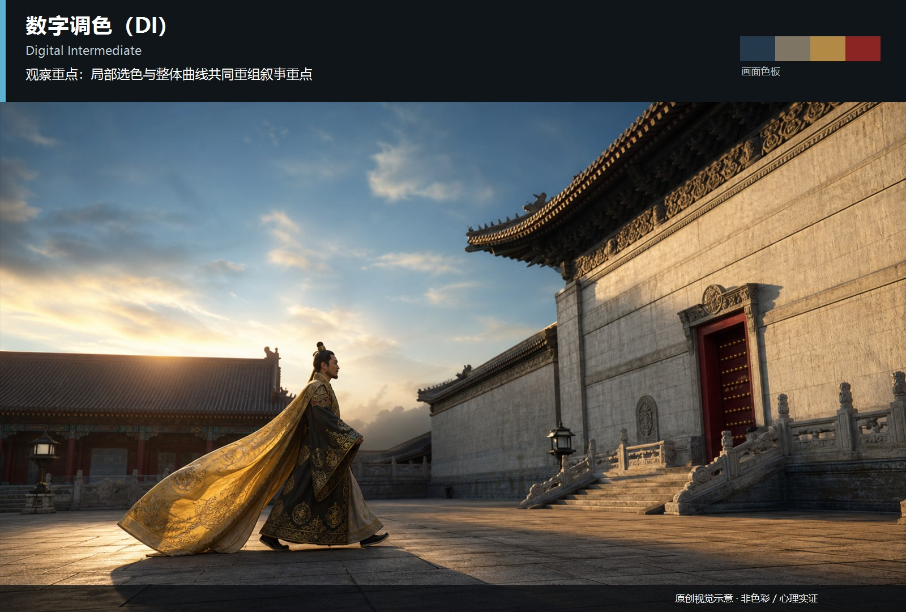
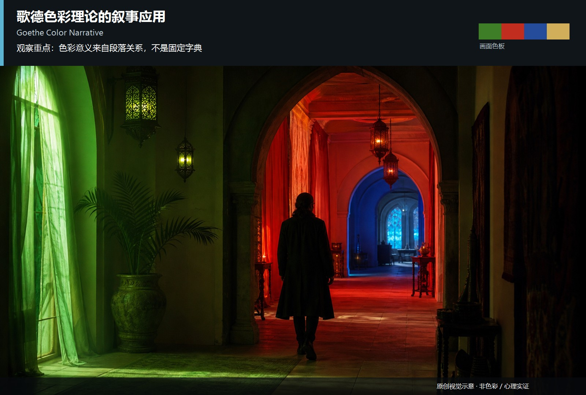
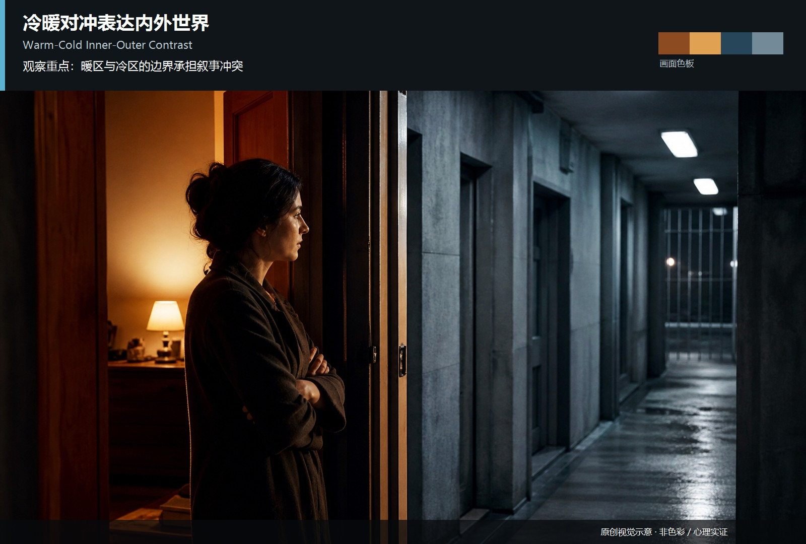

# color-tone · 25—34

[全部主题](../IMAGE_GALLERY.md) · [首页](../../README.md)

## 色彩与影调：视觉示意 · 暖色消除蓝色调（25-warm-tone-no-blue，原创教学示意）

知识讲解：[A1-07 色彩与影调](../../knowledge/A-%E7%90%86%E8%AE%BA%E5%B1%82/A1-%E6%91%84%E5%BD%B1%E7%BB%84/A1-07%20%E8%89%B2%E5%BD%A9%E4%B8%8E%E5%BD%B1%E8%B0%83.md)

## 色彩与影调：视觉示意 · 色彩编码人生阶段（26-color-coded-life-stages，原创教学示意）

知识讲解：[A1-07 色彩与影调](../../knowledge/A-%E7%90%86%E8%AE%BA%E5%B1%82/A1-%E6%91%84%E5%BD%B1%E7%BB%84/A1-07%20%E8%89%B2%E5%BD%A9%E4%B8%8E%E5%BD%B1%E8%B0%83.md)

## 色彩与影调：视觉示意 · 色彩分区区分世界观（27-color-zoning-worlds，原创教学示意）

知识讲解：[A1-07 色彩与影调](../../knowledge/A-%E7%90%86%E8%AE%BA%E5%B1%82/A1-%E6%91%84%E5%BD%B1%E7%BB%84/A1-07%20%E8%89%B2%E5%BD%A9%E4%B8%8E%E5%BD%B1%E8%B0%83.md)

## 色彩与影调：视觉示意 · 沙漠橙黄主色调（28-desert-orange-yellow，原创教学示意）

知识讲解：[A1-07 色彩与影调](../../knowledge/A-%E7%90%86%E8%AE%BA%E5%B1%82/A1-%E6%91%84%E5%BD%B1%E7%BB%84/A1-07%20%E8%89%B2%E5%BD%A9%E4%B8%8E%E5%BD%B1%E8%B0%83.md)

## 色彩与影调：视觉示意 · 数字调色（DI）的开创性应用（29-digital-intermediate，原创教学示意）

知识讲解：[A1-07 色彩与影调](../../knowledge/A-%E7%90%86%E8%AE%BA%E5%B1%82/A1-%E6%91%84%E5%BD%B1%E7%BB%84/A1-07%20%E8%89%B2%E5%BD%A9%E4%B8%8E%E5%BD%B1%E8%B0%83.md)

## 色彩与影调：视觉示意 · 漂白法／跳过漂白（30-bleach-bypass，原创教学示意）

知识讲解：[A1-07 色彩与影调](../../knowledge/A-%E7%90%86%E8%AE%BA%E5%B1%82/A1-%E6%91%84%E5%BD%B1%E7%BB%84/A1-07%20%E8%89%B2%E5%BD%A9%E4%B8%8E%E5%BD%B1%E8%B0%83.md)

## 色彩与影调：视觉示意 · 歌德色彩理论的叙事应用（31-goethe-color-narrative，原创教学示意）

知识讲解：[A1-07 色彩与影调](../../knowledge/A-%E7%90%86%E8%AE%BA%E5%B1%82/A1-%E6%91%84%E5%BD%B1%E7%BB%84/A1-07%20%E8%89%B2%E5%BD%A9%E4%B8%8E%E5%BD%B1%E8%B0%83.md)

## 色彩与影调：视觉示意 · 冷暖对冲表达内外世界对立（32-warm-cold-inner-outer，原创教学示意）

知识讲解：[A1-07 色彩与影调](../../knowledge/A-%E7%90%86%E8%AE%BA%E5%B1%82/A1-%E6%91%84%E5%BD%B1%E7%BB%84/A1-07%20%E8%89%B2%E5%BD%A9%E4%B8%8E%E5%BD%B1%E8%B0%83.md)

## 色彩与影调：视觉示意 · 冷色调表达疏离与系统感（33-cold-system-alienation，原创教学示意）

知识讲解：[A1-07 色彩与影调](../../knowledge/A-%E7%90%86%E8%AE%BA%E5%B1%82/A1-%E6%91%84%E5%BD%B1%E7%BB%84/A1-07%20%E8%89%B2%E5%BD%A9%E4%B8%8E%E5%BD%B1%E8%B0%83.md)

## 色彩与影调：视觉示意 · 三点布光中的色彩温控（34-three-point-color-temperature，原创教学示意）

知识讲解：[A1-07 色彩与影调](../../knowledge/A-%E7%90%86%E8%AE%BA%E5%B1%82/A1-%E6%91%84%E5%BD%B1%E7%BB%84/A1-07%20%E8%89%B2%E5%BD%A9%E4%B8%8E%E5%BD%B1%E8%B0%83.md)
