# composition · 1—23

[全部主题](../IMAGE_GALLERY.md) · [首页](../../README.md)

## 构图系统：既有综合速查层（基础参数与组合配方并存）（01-rule-of-thirds，原创教学示意）

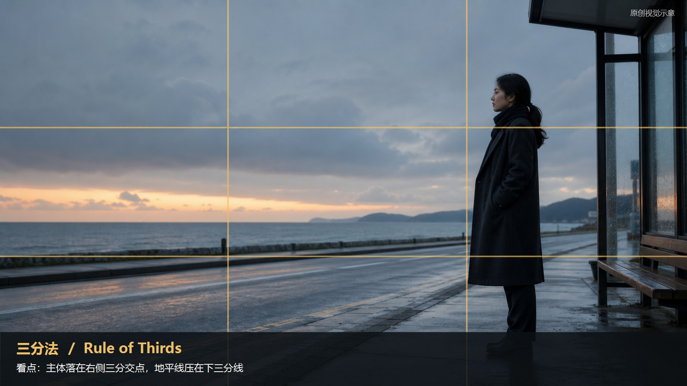

知识讲解：[A1-04 构图系统](../../knowledge/A-%E7%90%86%E8%AE%BA%E5%B1%82/A1-%E6%91%84%E5%BD%B1%E7%BB%84/A1-04%20%E6%9E%84%E5%9B%BE%E7%B3%BB%E7%BB%9F.md)

## 构图系统：既有综合速查层（基础参数与组合配方并存）（02-centered-composition，原创教学示意）

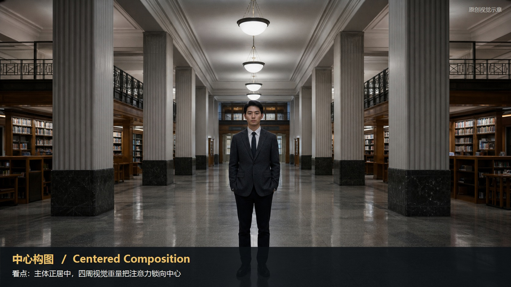

知识讲解：[A1-04 构图系统](../../knowledge/A-%E7%90%86%E8%AE%BA%E5%B1%82/A1-%E6%91%84%E5%BD%B1%E7%BB%84/A1-04%20%E6%9E%84%E5%9B%BE%E7%B3%BB%E7%BB%9F.md)

## 构图系统：既有综合速查层（基础参数与组合配方并存）（03-symmetrical-composition，原创教学示意）

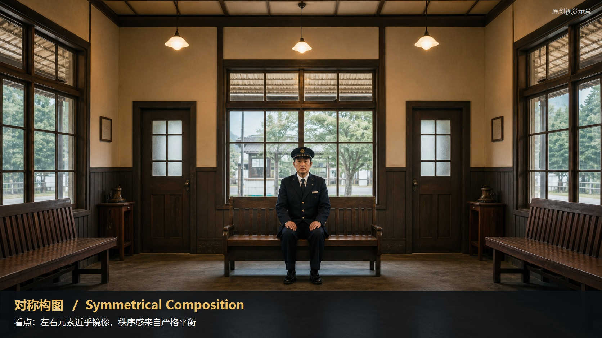

知识讲解：[A1-04 构图系统](../../knowledge/A-%E7%90%86%E8%AE%BA%E5%B1%82/A1-%E6%91%84%E5%BD%B1%E7%BB%84/A1-04%20%E6%9E%84%E5%9B%BE%E7%B3%BB%E7%BB%9F.md)

## 构图系统：既有综合速查层（基础参数与组合配方并存）（04-one-point-perspective，原创教学示意）

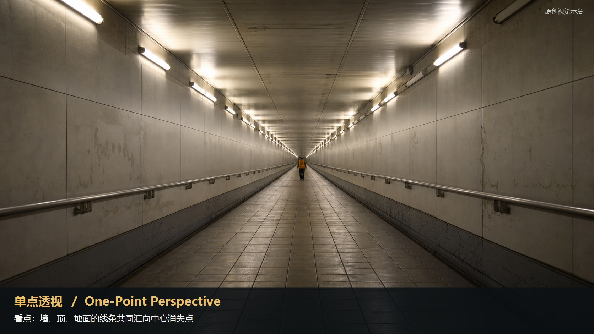

知识讲解：[A1-04 构图系统](../../knowledge/A-%E7%90%86%E8%AE%BA%E5%B1%82/A1-%E6%91%84%E5%BD%B1%E7%BB%84/A1-04%20%E6%9E%84%E5%9B%BE%E7%B3%BB%E7%BB%9F.md)

## 构图系统：既有综合速查层（基础参数与组合配方并存）（05-unbalanced-composition，原创教学示意）

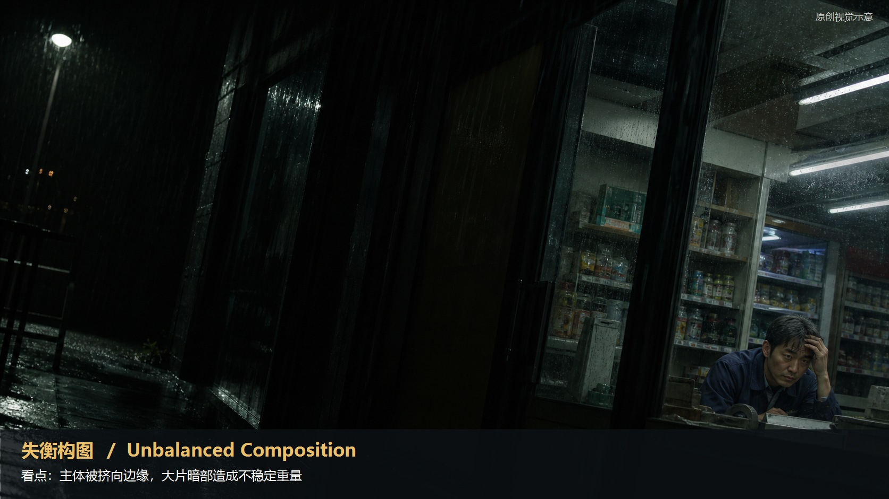

知识讲解：[A1-04 构图系统](../../knowledge/A-%E7%90%86%E8%AE%BA%E5%B1%82/A1-%E6%91%84%E5%BD%B1%E7%BB%84/A1-04%20%E6%9E%84%E5%9B%BE%E7%B3%BB%E7%BB%9F.md)

## 构图系统：既有综合速查层（基础参数与组合配方并存）（06-frame-within-frame，原创教学示意）

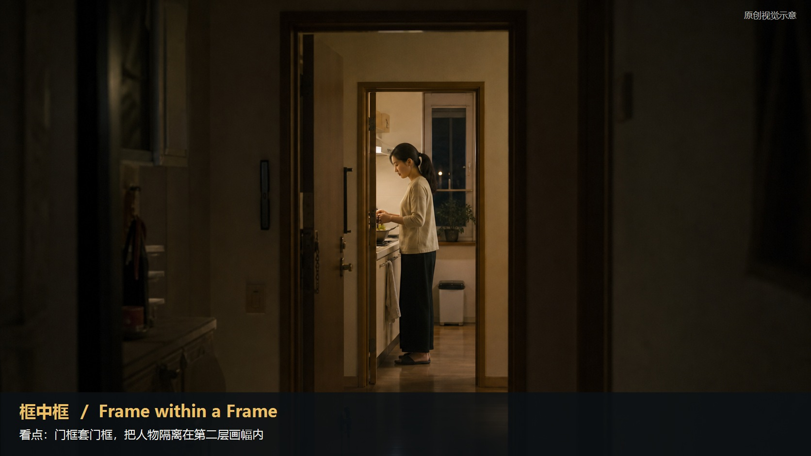

知识讲解：[A1-04 构图系统](../../knowledge/A-%E7%90%86%E8%AE%BA%E5%B1%82/A1-%E6%91%84%E5%BD%B1%E7%BB%84/A1-04%20%E6%9E%84%E5%9B%BE%E7%B3%BB%E7%BB%9F.md)

## 构图系统：既有综合速查层（基础参数与组合配方并存）（07-leading-lines，原创教学示意）

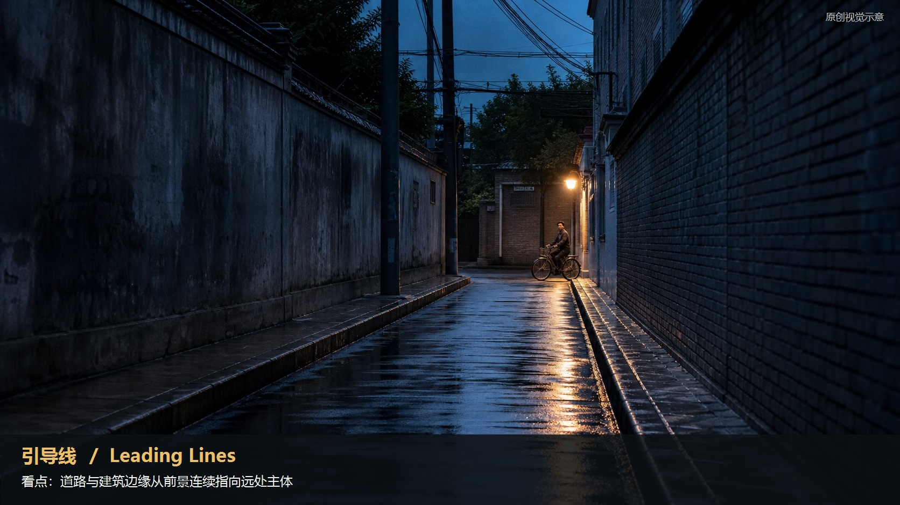

知识讲解：[A1-04 构图系统](../../knowledge/A-%E7%90%86%E8%AE%BA%E5%B1%82/A1-%E6%91%84%E5%BD%B1%E7%BB%84/A1-04%20%E6%9E%84%E5%9B%BE%E7%B3%BB%E7%BB%9F.md)

## 构图系统：既有综合速查层（基础参数与组合配方并存）（08-negative-space，原创教学示意）

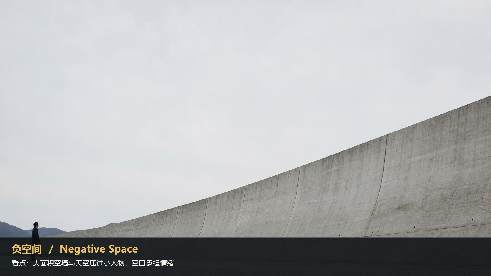

知识讲解：[A1-04 构图系统](../../knowledge/A-%E7%90%86%E8%AE%BA%E5%B1%82/A1-%E6%91%84%E5%BD%B1%E7%BB%84/A1-04%20%E6%9E%84%E5%9B%BE%E7%B3%BB%E7%BB%9F.md)

## 构图系统：既有综合速查层（基础参数与组合配方并存）（09-foreground-obstruction，原创教学示意）

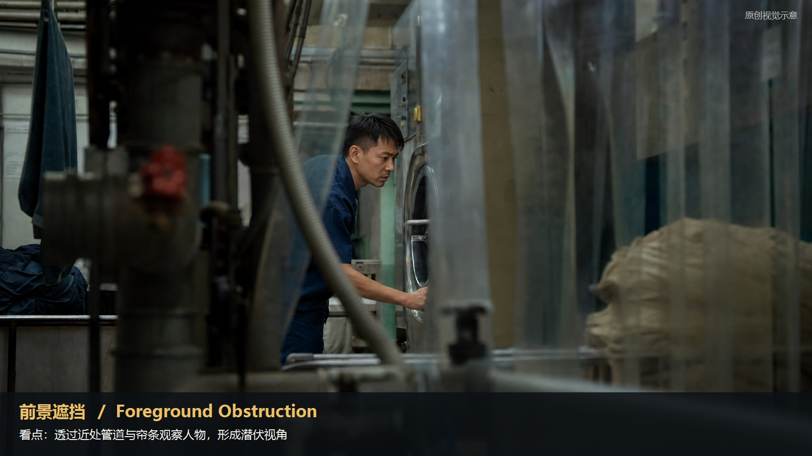

知识讲解：[A1-04 构图系统](../../knowledge/A-%E7%90%86%E8%AE%BA%E5%B1%82/A1-%E6%91%84%E5%BD%B1%E7%BB%84/A1-04%20%E6%9E%84%E5%9B%BE%E7%B3%BB%E7%BB%9F.md)

## 构图系统：既有综合速查层（基础参数与组合配方并存）（10-silhouette，原创教学示意）

知识讲解：[A1-04 构图系统](../../knowledge/A-%E7%90%86%E8%AE%BA%E5%B1%82/A1-%E6%91%84%E5%BD%B1%E7%BB%84/A1-04%20%E6%9E%84%E5%9B%BE%E7%B3%BB%E7%BB%9F.md)

## 构图系统：既有综合速查层（基础参数与组合配方并存）（11-back-view，原创教学示意）

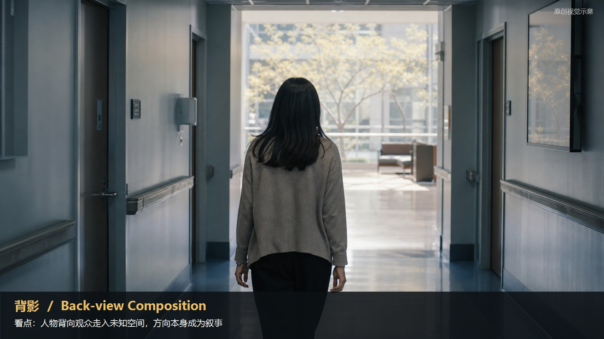

知识讲解：[A1-04 构图系统](../../knowledge/A-%E7%90%86%E8%AE%BA%E5%B1%82/A1-%E6%91%84%E5%BD%B1%E7%BB%84/A1-04%20%E6%9E%84%E5%9B%BE%E7%B3%BB%E7%BB%9F.md)

## 构图系统：既有综合速查层（基础参数与组合配方并存）（12-horizontal-composition，原创教学示意）

知识讲解：[A1-04 构图系统](../../knowledge/A-%E7%90%86%E8%AE%BA%E5%B1%82/A1-%E6%91%84%E5%BD%B1%E7%BB%84/A1-04%20%E6%9E%84%E5%9B%BE%E7%B3%BB%E7%BB%9F.md)

## 构图系统：既有综合速查层（基础参数与组合配方并存）（13-deep-space，原创教学示意）

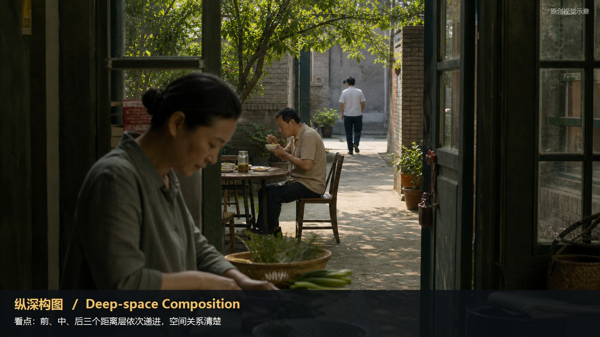

知识讲解：[A1-04 构图系统](../../knowledge/A-%E7%90%86%E8%AE%BA%E5%B1%82/A1-%E6%91%84%E5%BD%B1%E7%BB%84/A1-04%20%E6%9E%84%E5%9B%BE%E7%B3%BB%E7%BB%9F.md)

## 构图系统：既有综合速查层（基础参数与组合配方并存）（14-deep-focus-layers，原创教学示意）

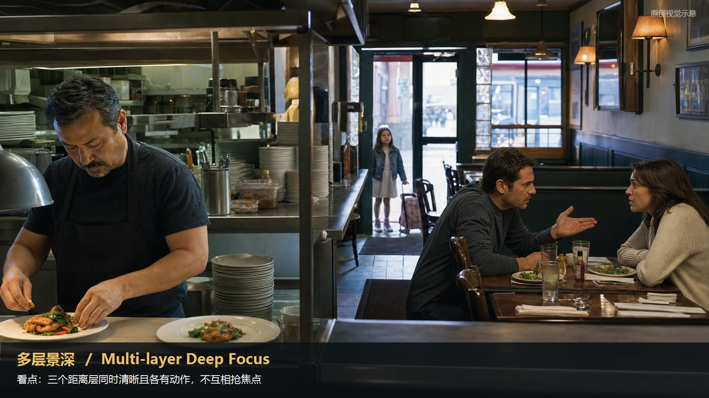

知识讲解：[A1-04 构图系统](../../knowledge/A-%E7%90%86%E8%AE%BA%E5%B1%82/A1-%E6%91%84%E5%BD%B1%E7%BB%84/A1-04%20%E6%9E%84%E5%9B%BE%E7%B3%BB%E7%BB%9F.md)

## 构图系统：既有综合速查层（基础参数与组合配方并存）（15-isolated-figure，原创教学示意）

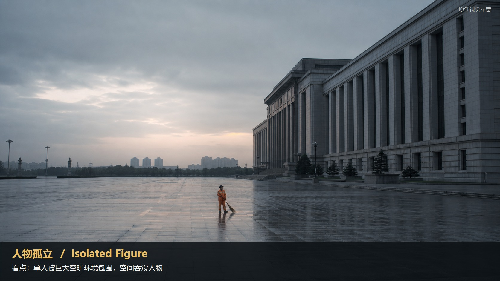

知识讲解：[A1-04 构图系统](../../knowledge/A-%E7%90%86%E8%AE%BA%E5%B1%82/A1-%E6%91%84%E5%BD%B1%E7%BB%84/A1-04%20%E6%9E%84%E5%9B%BE%E7%B3%BB%E7%BB%9F.md)

## 构图系统：既有综合速查层（基础参数与组合配方并存）（16-ensemble-composition，原创教学示意）

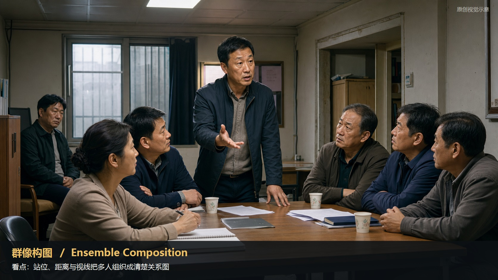

知识讲解：[A1-04 构图系统](../../knowledge/A-%E7%90%86%E8%AE%BA%E5%B1%82/A1-%E6%91%84%E5%BD%B1%E7%BB%84/A1-04%20%E6%9E%84%E5%9B%BE%E7%B3%BB%E7%BB%9F.md)

## 构图系统：既有综合速查层（基础参数与组合配方并存）（17-colossal-object，原创教学示意）

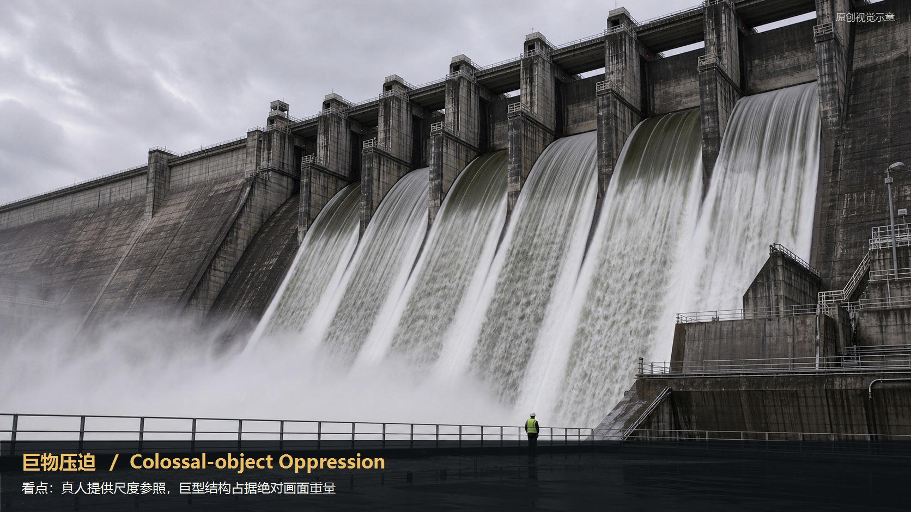

知识讲解：[A1-04 构图系统](../../knowledge/A-%E7%90%86%E8%AE%BA%E5%B1%82/A1-%E6%91%84%E5%BD%B1%E7%BB%84/A1-04%20%E6%9E%84%E5%9B%BE%E7%B3%BB%E7%BB%9F.md)

## 构图系统：既有综合速查层（基础参数与组合配方并存）（18-narrow-space，原创教学示意）

知识讲解：[A1-04 构图系统](../../knowledge/A-%E7%90%86%E8%AE%BA%E5%B1%82/A1-%E6%91%84%E5%BD%B1%E7%BB%84/A1-04%20%E6%9E%84%E5%9B%BE%E7%B3%BB%E7%BB%9F.md)

## 构图系统：既有综合速查层（基础参数与组合配方并存）（19-corridor-composition，原创教学示意）

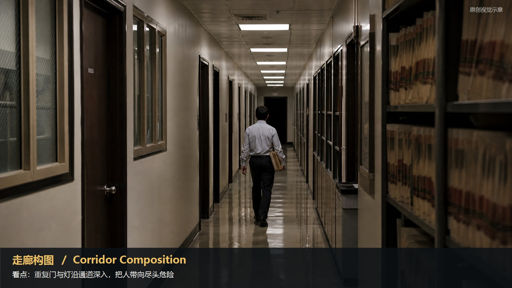

知识讲解：[A1-04 构图系统](../../knowledge/A-%E7%90%86%E8%AE%BA%E5%B1%82/A1-%E6%91%84%E5%BD%B1%E7%BB%84/A1-04%20%E6%9E%84%E5%9B%BE%E7%B3%BB%E7%BB%9F.md)

## 构图系统：既有综合速查层（基础参数与组合配方并存）（20-circular-composition，原创教学示意）

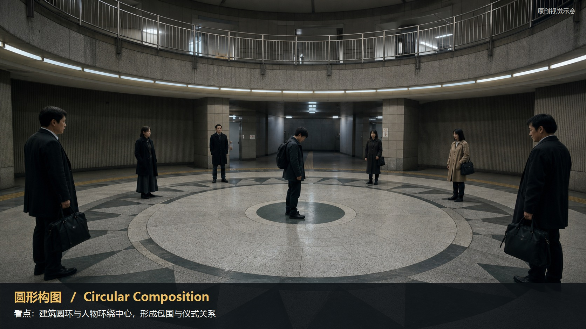

知识讲解：[A1-04 构图系统](../../knowledge/A-%E7%90%86%E8%AE%BA%E5%B1%82/A1-%E6%91%84%E5%BD%B1%E7%BB%84/A1-04%20%E6%9E%84%E5%9B%BE%E7%B3%BB%E7%BB%9F.md)

## 构图系统：既有综合速查层（基础参数与组合配方并存）（21-diagonal-composition，原创教学示意）

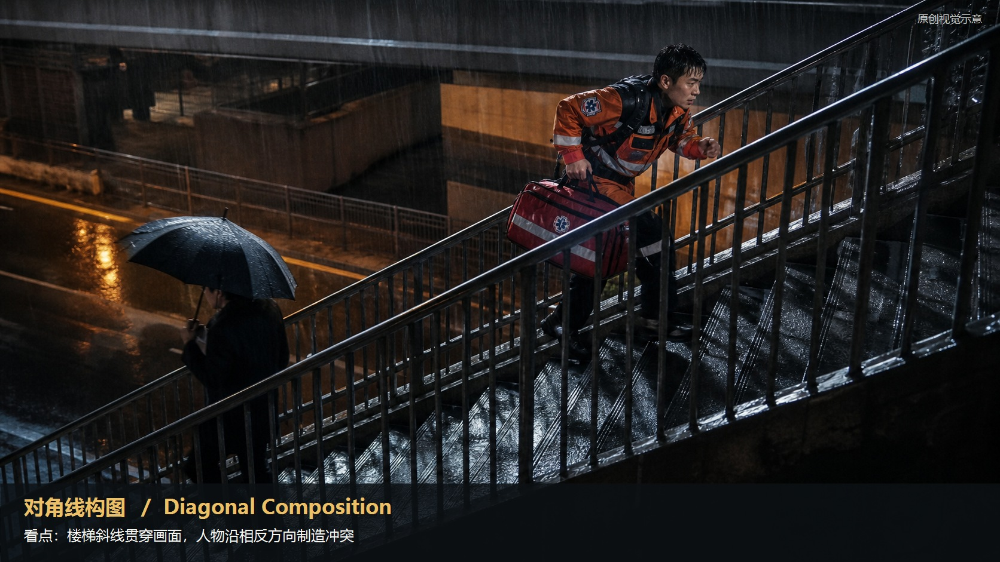

知识讲解：[A1-04 构图系统](../../knowledge/A-%E7%90%86%E8%AE%BA%E5%B1%82/A1-%E6%91%84%E5%BD%B1%E7%BB%84/A1-04%20%E6%9E%84%E5%9B%BE%E7%B3%BB%E7%BB%9F.md)

## 构图系统：既有综合速查层（基础参数与组合配方并存）（22-high-information-density，原创教学示意）

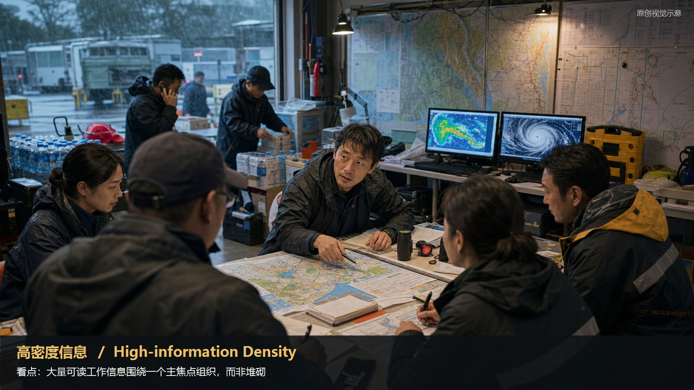

知识讲解：[A1-04 构图系统](../../knowledge/A-%E7%90%86%E8%AE%BA%E5%B1%82/A1-%E6%91%84%E5%BD%B1%E7%BB%84/A1-04%20%E6%9E%84%E5%9B%BE%E7%B3%BB%E7%BB%9F.md)

## 构图系统：既有综合速查层（基础参数与组合配方并存）（23-minimalist-composition，原创教学示意）

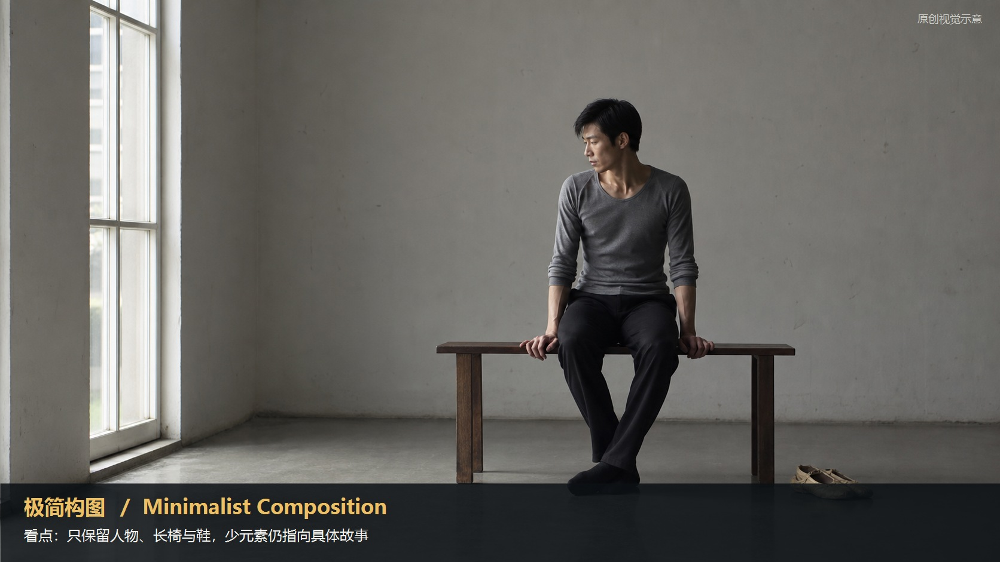

知识讲解：[A1-04 构图系统](../../knowledge/A-%E7%90%86%E8%AE%BA%E5%B1%82/A1-%E6%91%84%E5%BD%B1%E7%BB%84/A1-04%20%E6%9E%84%E5%9B%BE%E7%B3%BB%E7%BB%9F.md)
