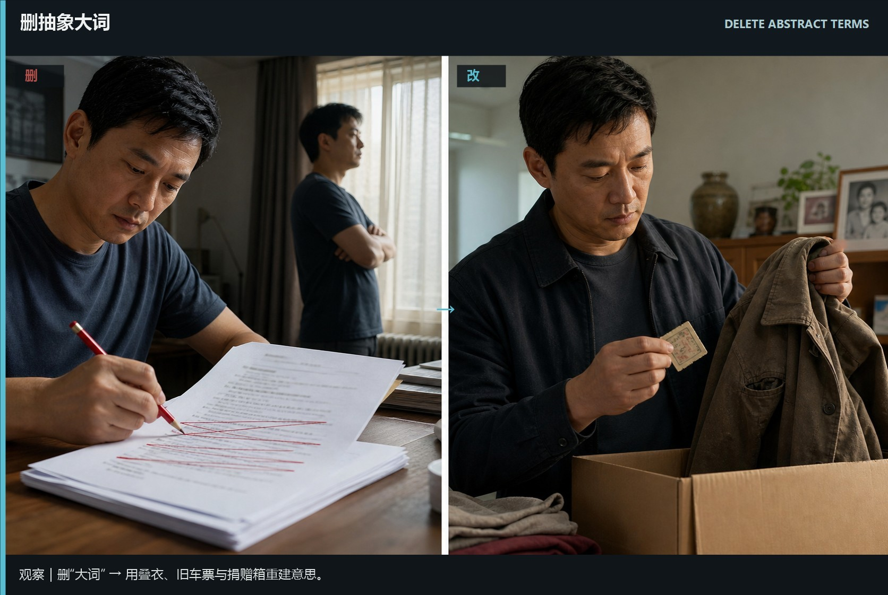
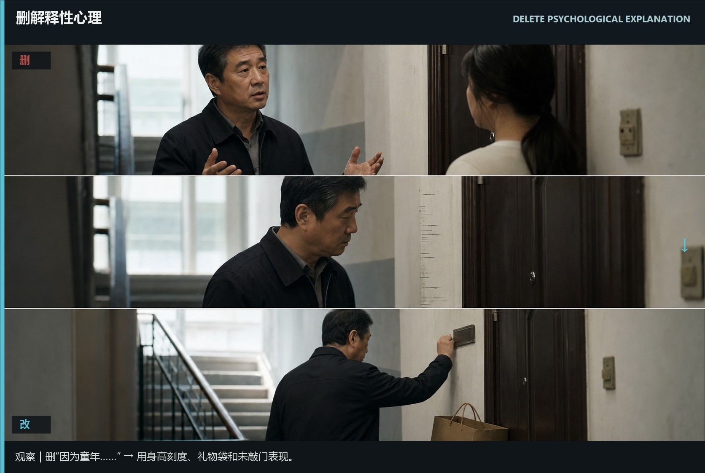
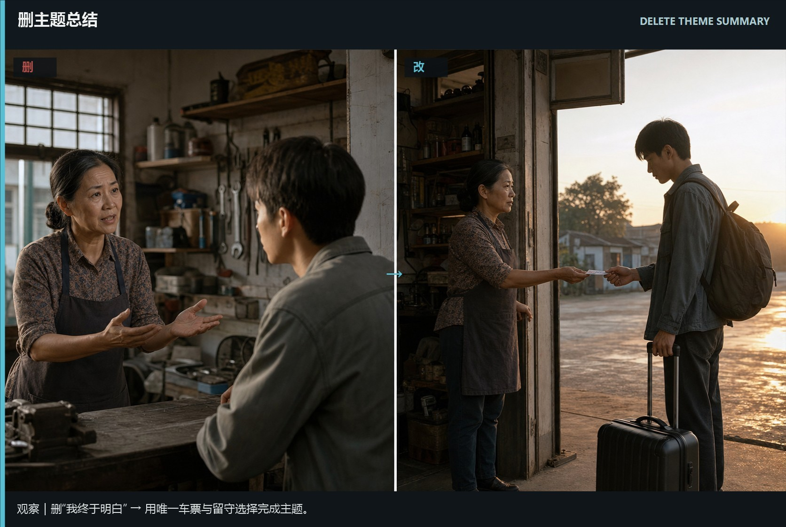
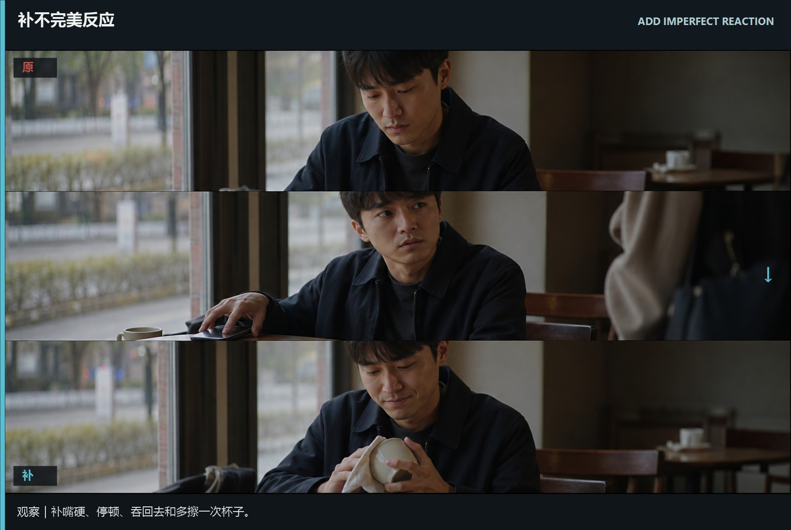
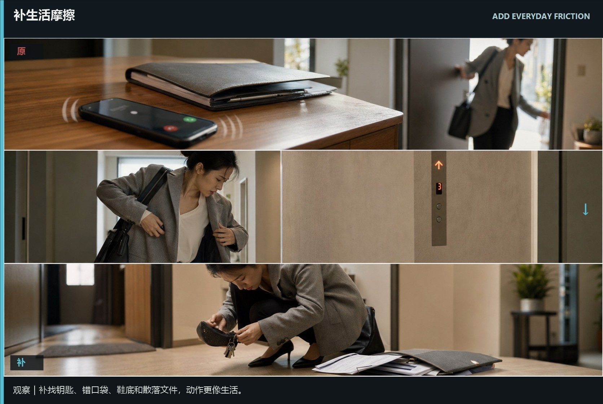
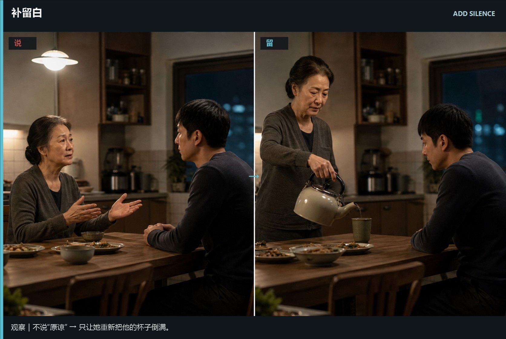

# de-ai-rewrite · 1—6

[全部主题](../IMAGE_GALLERY.md) · [首页](../../README.md)

## 去AI味改写流程：删抽象大词｜用具体动作重建意思（01-delete-abstract-terms，原创教学示意）

知识讲解：[A3-19 去AI味改写流程](../../knowledge/A-%E7%90%86%E8%AE%BA%E5%B1%82/A3-%E7%BC%96%E5%89%A7%E7%BB%84/A3-19%20%E5%8E%BBAI%E5%91%B3%E6%94%B9%E5%86%99%E6%B5%81%E7%A8%8B.md)

## 去AI味改写流程：删解释性心理｜让行为自己说话（02-delete-psychological-explanation，原创教学示意）

知识讲解：[A3-19 去AI味改写流程](../../knowledge/A-%E7%90%86%E8%AE%BA%E5%B1%82/A3-%E7%BC%96%E5%89%A7%E7%BB%84/A3-19%20%E5%8E%BBAI%E5%91%B3%E6%94%B9%E5%86%99%E6%B5%81%E7%A8%8B.md)

## 去AI味改写流程：删主题总结｜用最后选择代替总结（03-delete-theme-summary，原创教学示意）

知识讲解：[A3-19 去AI味改写流程](../../knowledge/A-%E7%90%86%E8%AE%BA%E5%B1%82/A3-%E7%BC%96%E5%89%A7%E7%BB%84/A3-19%20%E5%8E%BBAI%E5%91%B3%E6%94%B9%E5%86%99%E6%B5%81%E7%A8%8B.md)

## 去AI味改写流程：补不完美反应｜让反应带有毛边（04-add-imperfect-reaction，原创教学示意）

知识讲解：[A3-19 去AI味改写流程](../../knowledge/A-%E7%90%86%E8%AE%BA%E5%B1%82/A3-%E7%BC%96%E5%89%A7%E7%BB%84/A3-19%20%E5%8E%BBAI%E5%91%B3%E6%94%B9%E5%86%99%E6%B5%81%E7%A8%8B.md)

## 去AI味改写流程：补生活摩擦｜让场景产生日常阻力（05-add-everyday-friction，原创教学示意）

知识讲解：[A3-19 去AI味改写流程](../../knowledge/A-%E7%90%86%E8%AE%BA%E5%B1%82/A3-%E7%BC%96%E5%89%A7%E7%BB%84/A3-19%20%E5%8E%BBAI%E5%91%B3%E6%94%B9%E5%86%99%E6%B5%81%E7%A8%8B.md)

## 去AI味改写流程：补留白｜让动作替观众补全情绪（06-add-silence，原创教学示意）

知识讲解：[A3-19 去AI味改写流程](../../knowledge/A-%E7%90%86%E8%AE%BA%E5%B1%82/A3-%E7%BC%96%E5%89%A7%E7%BB%84/A3-19%20%E5%8E%BBAI%E5%91%B3%E6%94%B9%E5%86%99%E6%B5%81%E7%A8%8B.md)
