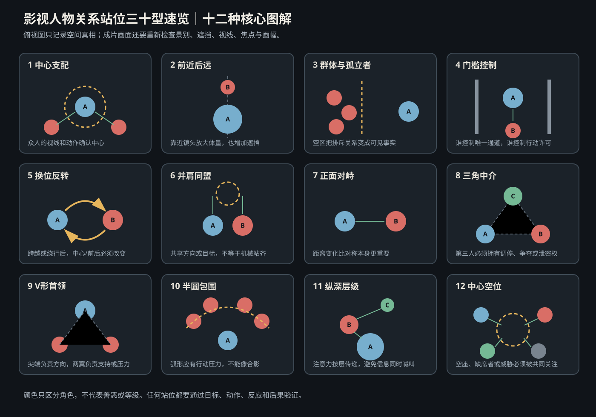
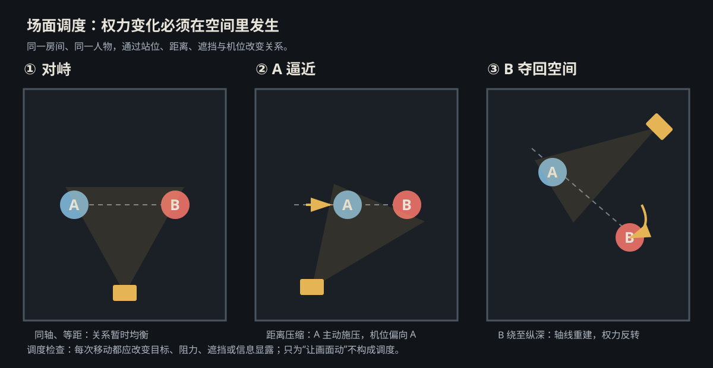
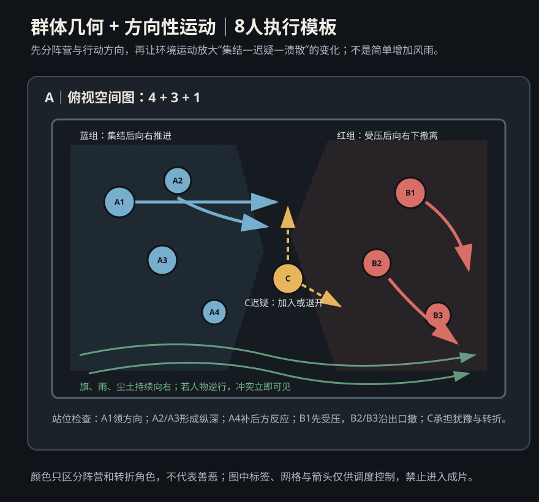
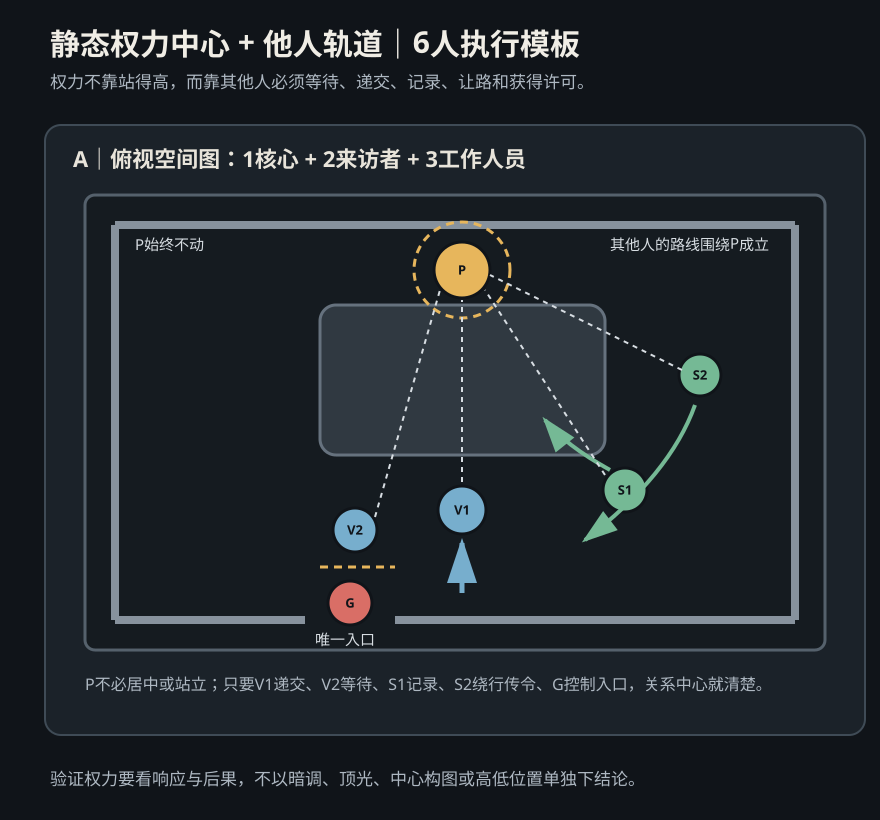
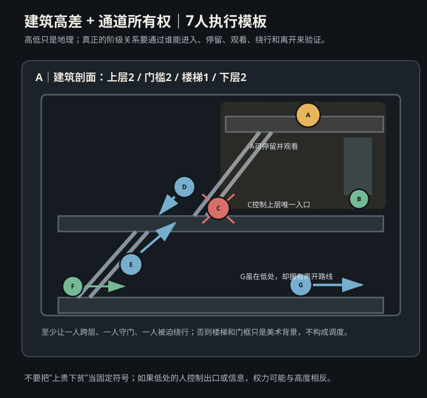
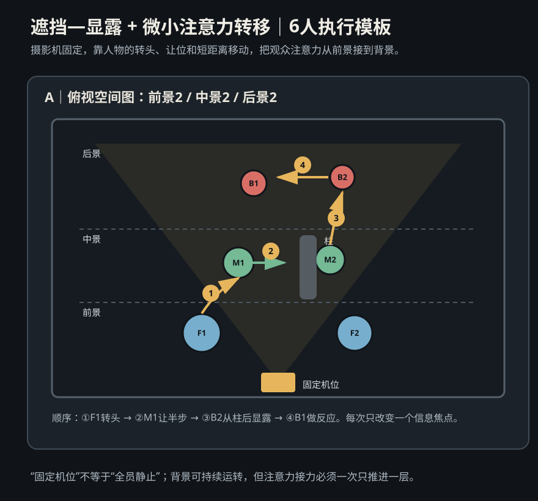
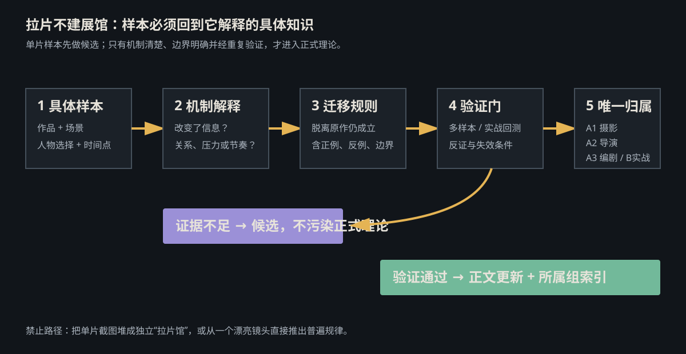

# diagrams · 1—7

[全部主题](../IMAGE_GALLERY.md) · [首页](../../README.md)

## 调度与场面调度：人物关系站位完整图谱（30型）（blocking-relationship-atlas，原创教学示意）

知识讲解：[A2-01 调度与场面调度](../../knowledge/A-%E7%90%86%E8%AE%BA%E5%B1%82/A2-%E5%AF%BC%E6%BC%94%E7%BB%84/A2-01%20%E8%B0%83%E5%BA%A6%E4%B8%8E%E5%9C%BA%E9%9D%A2%E8%B0%83%E5%BA%A6.md)

## 调度与场面调度：权力站位：不要把权力误写成单一姿势（blocking-power-shift，原创教学示意）

知识讲解：[A2-01 调度与场面调度](../../knowledge/A-%E7%90%86%E8%AE%BA%E5%B1%82/A2-%E5%AF%BC%E6%BC%94%E7%BB%84/A2-01%20%E8%B0%83%E5%BA%A6%E4%B8%8E%E5%9C%BA%E9%9D%A2%E8%B0%83%E5%BA%A6.md)

## 调度与场面调度：2. 黑泽明：群体几何 + 方向性运动 + 环境参与（blocking-kurosawa-group-direction，原创教学示意）

知识讲解：[A2-01 调度与场面调度](../../knowledge/A-%E7%90%86%E8%AE%BA%E5%B1%82/A2-%E5%AF%BC%E6%BC%94%E7%BB%84/A2-01%20%E8%B0%83%E5%BA%A6%E4%B8%8E%E5%9C%BA%E9%9D%A2%E8%B0%83%E5%BA%A6.md)

## 调度与场面调度：3. 科波拉 / 戈登·威利斯：静态权力中心 + 他人轨道（blocking-static-power-orbits，原创教学示意）

知识讲解：[A2-01 调度与场面调度](../../knowledge/A-%E7%90%86%E8%AE%BA%E5%B1%82/A2-%E5%AF%BC%E6%BC%94%E7%BB%84/A2-01%20%E8%B0%83%E5%BA%A6%E4%B8%8E%E5%9C%BA%E9%9D%A2%E8%B0%83%E5%BA%A6.md)

## 调度与场面调度：4. 奉俊昊：建筑高差 + 通道所有权 + 阶级移动（blocking-architecture-access，原创教学示意）

知识讲解：[A2-01 调度与场面调度](../../knowledge/A-%E7%90%86%E8%AE%BA%E5%B1%82/A2-%E5%AF%BC%E6%BC%94%E7%BB%84/A2-01%20%E8%B0%83%E5%BA%A6%E4%B8%8E%E5%9C%BA%E9%9D%A2%E8%B0%83%E5%BA%A6.md)

## 调度与场面调度：5. 侯孝贤 / 场面画传统：遮挡—显露 + 微小注意力转移（blocking-tableau-attention-relay，原创教学示意）

知识讲解：[A2-01 调度与场面调度](../../knowledge/A-%E7%90%86%E8%AE%BA%E5%B1%82/A2-%E5%AF%BC%E6%BC%94%E7%BB%84/A2-01%20%E8%B0%83%E5%BA%A6%E4%B8%8E%E5%9C%BA%E9%9D%A2%E8%B0%83%E5%BA%A6.md)

## 拉片与技法蒸馏：核心原则（shot-analysis-flow_v1.1，原创教学示意）

知识讲解：[A3-20 拉片与技法蒸馏](../../knowledge/A-%E7%90%86%E8%AE%BA%E5%B1%82/A3-%E7%BC%96%E5%89%A7%E7%BB%84/A3-20%20%E6%8B%89%E7%89%87%E4%B8%8E%E6%8A%80%E6%B3%95%E8%92%B8%E9%A6%8F.md)
