# dialogue-purpose-subtext · 1—19

[全部主题](../IMAGE_GALLERY.md) · [首页](../../README.md)

## 对白：目的与潜台词：获取信息（01-purpose-get-information，原创教学示意）

知识讲解：[A3-15 对白：目的与潜台词](../../knowledge/A-%E7%90%86%E8%AE%BA%E5%B1%82/A3-%E7%BC%96%E5%89%A7%E7%BB%84/A3-15%20%E5%AF%B9%E7%99%BD%EF%BC%9A%E7%9B%AE%E7%9A%84%E4%B8%8E%E6%BD%9C%E5%8F%B0%E8%AF%8D.md)

## 对白：目的与潜台词：保护自己（02-purpose-self-protection，原创教学示意）

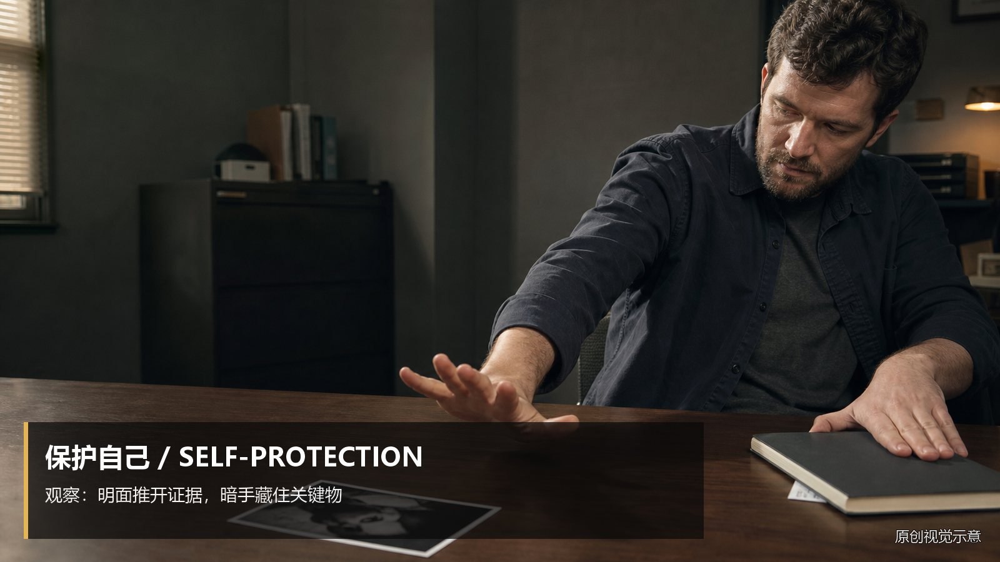

知识讲解：[A3-15 对白：目的与潜台词](../../knowledge/A-%E7%90%86%E8%AE%BA%E5%B1%82/A3-%E7%BC%96%E5%89%A7%E7%BB%84/A3-15%20%E5%AF%B9%E7%99%BD%EF%BC%9A%E7%9B%AE%E7%9A%84%E4%B8%8E%E6%BD%9C%E5%8F%B0%E8%AF%8D.md)

## 对白：目的与潜台词：攻击对方（03-purpose-attack，原创教学示意）

知识讲解：[A3-15 对白：目的与潜台词](../../knowledge/A-%E7%90%86%E8%AE%BA%E5%B1%82/A3-%E7%BC%96%E5%89%A7%E7%BB%84/A3-15%20%E5%AF%B9%E7%99%BD%EF%BC%9A%E7%9B%AE%E7%9A%84%E4%B8%8E%E6%BD%9C%E5%8F%B0%E8%AF%8D.md)

## 对白：目的与潜台词：维持体面（04-purpose-save-face，原创教学示意）

知识讲解：[A3-15 对白：目的与潜台词](../../knowledge/A-%E7%90%86%E8%AE%BA%E5%B1%82/A3-%E7%BC%96%E5%89%A7%E7%BB%84/A3-15%20%E5%AF%B9%E7%99%BD%EF%BC%9A%E7%9B%AE%E7%9A%84%E4%B8%8E%E6%BD%9C%E5%8F%B0%E8%AF%8D.md)

## 对白：目的与潜台词：争取时间（05-purpose-buy-time，原创教学示意）

知识讲解：[A3-15 对白：目的与潜台词](../../knowledge/A-%E7%90%86%E8%AE%BA%E5%B1%82/A3-%E7%BC%96%E5%89%A7%E7%BB%84/A3-15%20%E5%AF%B9%E7%99%BD%EF%BC%9A%E7%9B%AE%E7%9A%84%E4%B8%8E%E6%BD%9C%E5%8F%B0%E8%AF%8D.md)

## 对白：目的与潜台词：掩饰羞耻（06-purpose-mask-shame，原创教学示意）

知识讲解：[A3-15 对白：目的与潜台词](../../knowledge/A-%E7%90%86%E8%AE%BA%E5%B1%82/A3-%E7%BC%96%E5%89%A7%E7%BB%84/A3-15%20%E5%AF%B9%E7%99%BD%EF%BC%9A%E7%9B%AE%E7%9A%84%E4%B8%8E%E6%BD%9C%E5%8F%B0%E8%AF%8D.md)

## 对白：目的与潜台词：问天气（07-strategy-weather，原创教学示意）

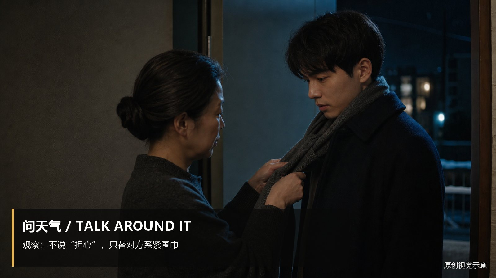

知识讲解：[A3-15 对白：目的与潜台词](../../knowledge/A-%E7%90%86%E8%AE%BA%E5%B1%82/A3-%E7%BC%96%E5%89%A7%E7%BB%84/A3-15%20%E5%AF%B9%E7%99%BD%EF%BC%9A%E7%9B%AE%E7%9A%84%E4%B8%8E%E6%BD%9C%E5%8F%B0%E8%AF%8D.md)

## 对白：目的与潜台词：挑错字（08-strategy-nitpick，原创教学示意）

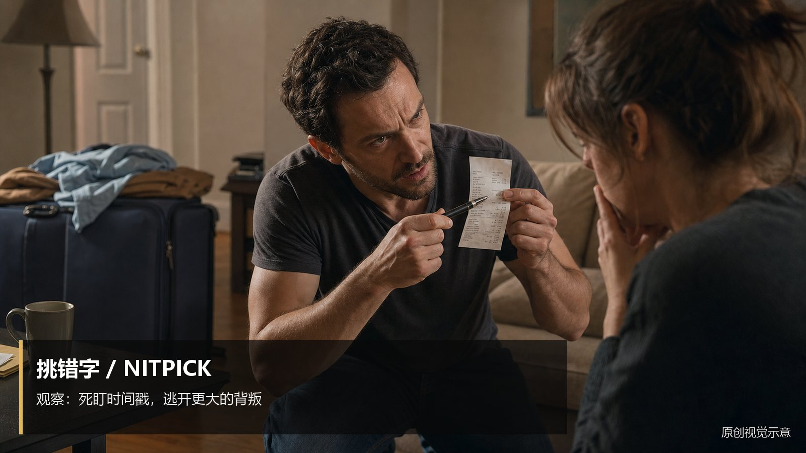

知识讲解：[A3-15 对白：目的与潜台词](../../knowledge/A-%E7%90%86%E8%AE%BA%E5%B1%82/A3-%E7%BC%96%E5%89%A7%E7%BB%84/A3-15%20%E5%AF%B9%E7%99%BD%EF%BC%9A%E7%9B%AE%E7%9A%84%E4%B8%8E%E6%BD%9C%E5%8F%B0%E8%AF%8D.md)

## 对白：目的与潜台词：提旧账（09-strategy-old-score，原创教学示意）

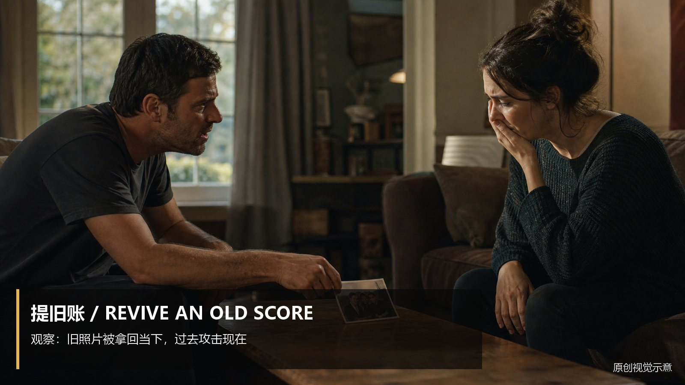

知识讲解：[A3-15 对白：目的与潜台词](../../knowledge/A-%E7%90%86%E8%AE%BA%E5%B1%82/A3-%E7%BC%96%E5%89%A7%E7%BB%84/A3-15%20%E5%AF%B9%E7%99%BD%EF%BC%9A%E7%9B%AE%E7%9A%84%E4%B8%8E%E6%BD%9C%E5%8F%B0%E8%AF%8D.md)

## 对白：目的与潜台词：转移话题（打岔）（10-strategy-deflect，原创教学示意）

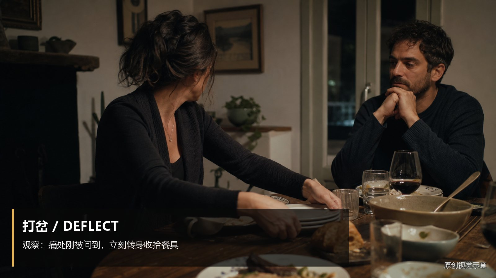

知识讲解：[A3-15 对白：目的与潜台词](../../knowledge/A-%E7%90%86%E8%AE%BA%E5%B1%82/A3-%E7%BC%96%E5%89%A7%E7%BB%84/A3-15%20%E5%AF%B9%E7%99%BD%EF%BC%9A%E7%9B%AE%E7%9A%84%E4%B8%8E%E6%BD%9C%E5%8F%B0%E8%AF%8D.md)

## 对白：目的与潜台词：把话咽回去（11-strategy-swallow-words，原创教学示意）

知识讲解：[A3-15 对白：目的与潜台词](../../knowledge/A-%E7%90%86%E8%AE%BA%E5%B1%82/A3-%E7%BC%96%E5%89%A7%E7%BB%84/A3-15%20%E5%AF%B9%E7%99%BD%EF%BC%9A%E7%9B%AE%E7%9A%84%E4%B8%8E%E6%BD%9C%E5%8F%B0%E8%AF%8D.md)

## 对白：目的与潜台词：删掉直说，让动作承载真正的话（12-delete-direct-explanation，原创教学示意）

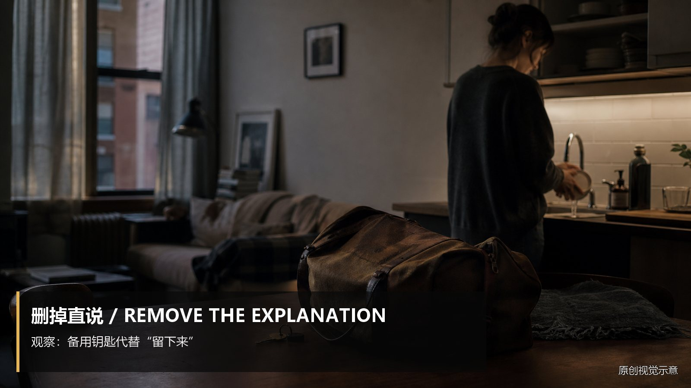

知识讲解：[A3-15 对白：目的与潜台词](../../knowledge/A-%E7%90%86%E8%AE%BA%E5%B1%82/A3-%E7%BC%96%E5%89%A7%E7%BB%84/A3-15%20%E5%AF%B9%E7%99%BD%EF%BC%9A%E7%9B%AE%E7%9A%84%E4%B8%8E%E6%BD%9C%E5%8F%B0%E8%AF%8D.md)

## 对白：目的与潜台词：允许断裂（13-allow-fracture，原创教学示意）

知识讲解：[A3-15 对白：目的与潜台词](../../knowledge/A-%E7%90%86%E8%AE%BA%E5%B1%82/A3-%E7%BC%96%E5%89%A7%E7%BB%84/A3-15%20%E5%AF%B9%E7%99%BD%EF%BC%9A%E7%9B%AE%E7%9A%84%E4%B8%8E%E6%BD%9C%E5%8F%B0%E8%AF%8D.md)

## 对白：目的与潜台词：让对白做选择（14-dialogue-makes-choice，原创教学示意）

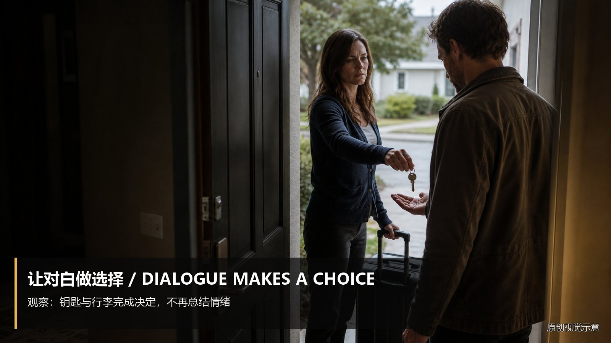

知识讲解：[A3-15 对白：目的与潜台词](../../knowledge/A-%E7%90%86%E8%AE%BA%E5%B1%82/A3-%E7%BC%96%E5%89%A7%E7%BB%84/A3-15%20%E5%AF%B9%E7%99%BD%EF%BC%9A%E7%9B%AE%E7%9A%84%E4%B8%8E%E6%BD%9C%E5%8F%B0%E8%AF%8D.md)

## 对白：目的与潜台词：被打断（15-real-interruption，原创教学示意）

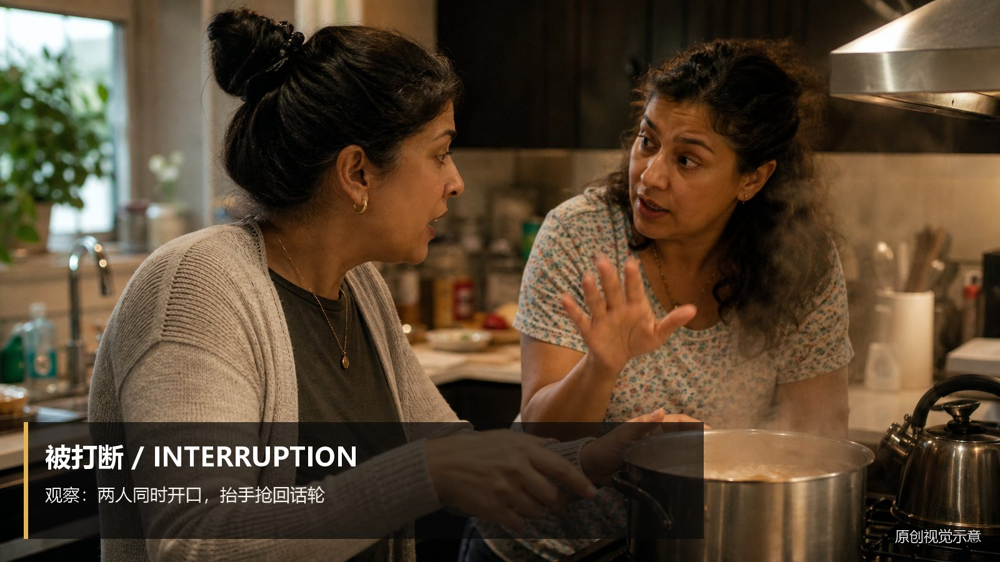

知识讲解：[A3-15 对白：目的与潜台词](../../knowledge/A-%E7%90%86%E8%AE%BA%E5%B1%82/A3-%E7%BC%96%E5%89%A7%E7%BB%84/A3-15%20%E5%AF%B9%E7%99%BD%EF%BC%9A%E7%9B%AE%E7%9A%84%E4%B8%8E%E6%BD%9C%E5%8F%B0%E8%AF%8D.md)

## 对白：目的与潜台词：重复（16-real-repetition，原创教学示意）

知识讲解：[A3-15 对白：目的与潜台词](../../knowledge/A-%E7%90%86%E8%AE%BA%E5%B1%82/A3-%E7%BC%96%E5%89%A7%E7%BB%84/A3-15%20%E5%AF%B9%E7%99%BD%EF%BC%9A%E7%9B%AE%E7%9A%84%E4%B8%8E%E6%BD%9C%E5%8F%B0%E8%AF%8D.md)

## 对白：目的与潜台词：口癖与犹豫（17-real-hesitation，原创教学示意）

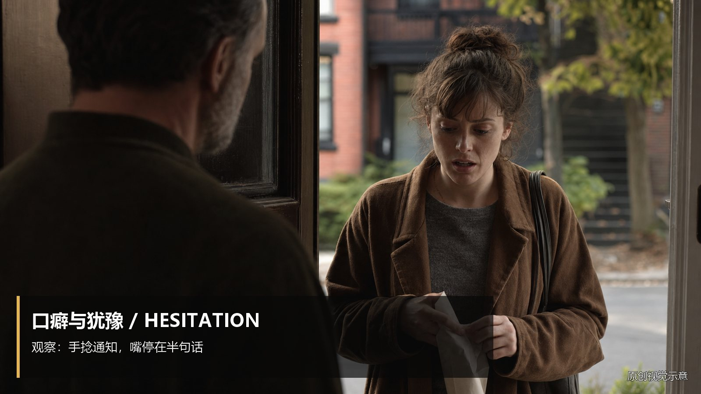

知识讲解：[A3-15 对白：目的与潜台词](../../knowledge/A-%E7%90%86%E8%AE%BA%E5%B1%82/A3-%E7%BC%96%E5%89%A7%E7%BB%84/A3-15%20%E5%AF%B9%E7%99%BD%EF%BC%9A%E7%9B%AE%E7%9A%84%E4%B8%8E%E6%BD%9C%E5%8F%B0%E8%AF%8D.md)

## 对白：目的与潜台词：误解对方意思（18-real-misunderstanding，原创教学示意）

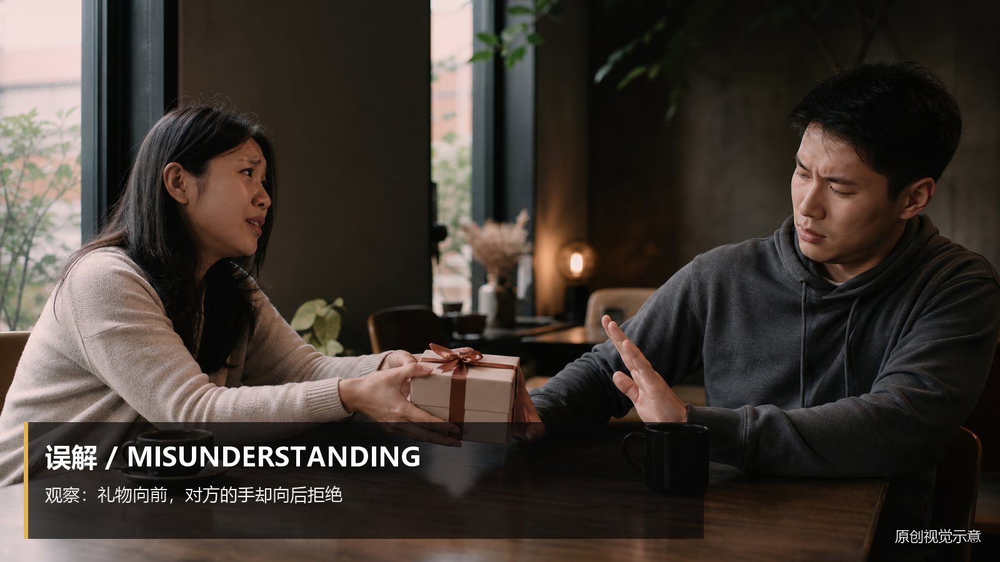

知识讲解：[A3-15 对白：目的与潜台词](../../knowledge/A-%E7%90%86%E8%AE%BA%E5%B1%82/A3-%E7%BC%96%E5%89%A7%E7%BB%84/A3-15%20%E5%AF%B9%E7%99%BD%EF%BC%9A%E7%9B%AE%E7%9A%84%E4%B8%8E%E6%BD%9C%E5%8F%B0%E8%AF%8D.md)

## 对白：目的与潜台词：答非所问（19-real-answer-not-question，原创教学示意）

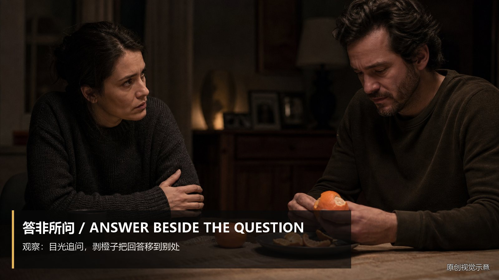

知识讲解：[A3-15 对白：目的与潜台词](../../knowledge/A-%E7%90%86%E8%AE%BA%E5%B1%82/A3-%E7%BC%96%E5%89%A7%E7%BB%84/A3-15%20%E5%AF%B9%E7%99%BD%EF%BC%9A%E7%9B%AE%E7%9A%84%E4%B8%8E%E6%BD%9C%E5%8F%B0%E8%AF%8D.md)
