# director-color-strategies · 1—12

[全部主题](../IMAGE_GALLERY.md) · [首页](../../README.md)

## 导演色彩风格：1. 张艺谋（A1-12-01-monochrome-chapter，原创教学示意）

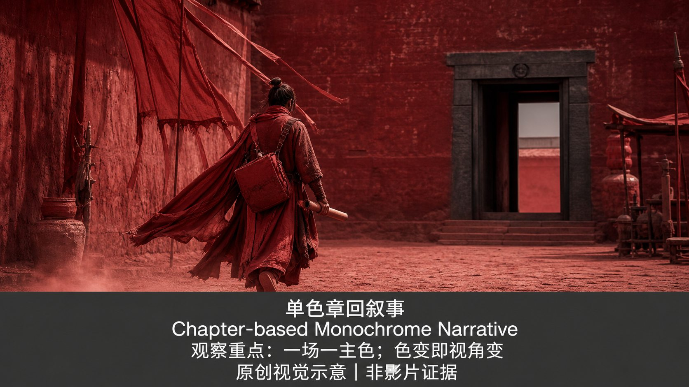

知识讲解：[A1-12 导演色彩风格](../../knowledge/A-%E7%90%86%E8%AE%BA%E5%B1%82/A1-%E6%91%84%E5%BD%B1%E7%BB%84/A1-12%20%E5%AF%BC%E6%BC%94%E8%89%B2%E5%BD%A9%E9%A3%8E%E6%A0%BC.md)

## 导演色彩风格：2. 王家卫（A1-12-02-environmental-color，原创教学示意）

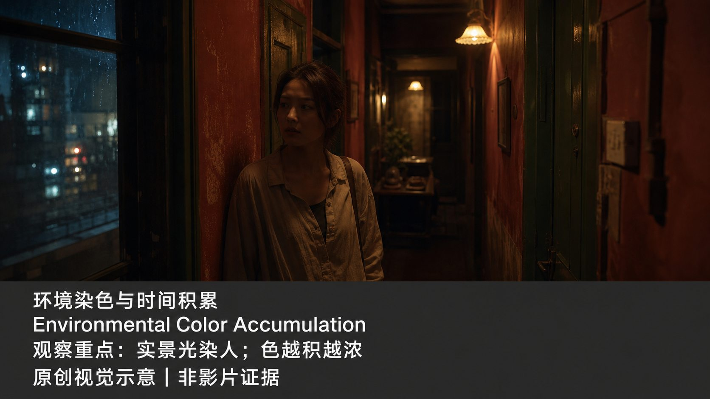

知识讲解：[A1-12 导演色彩风格](../../knowledge/A-%E7%90%86%E8%AE%BA%E5%B1%82/A1-%E6%91%84%E5%BD%B1%E7%BB%84/A1-12%20%E5%AF%BC%E6%BC%94%E8%89%B2%E5%BD%A9%E9%A3%8E%E6%A0%BC.md)

## 导演色彩风格：3. 朴赞郁（A1-12-03-complementary-reversal，原创教学示意）

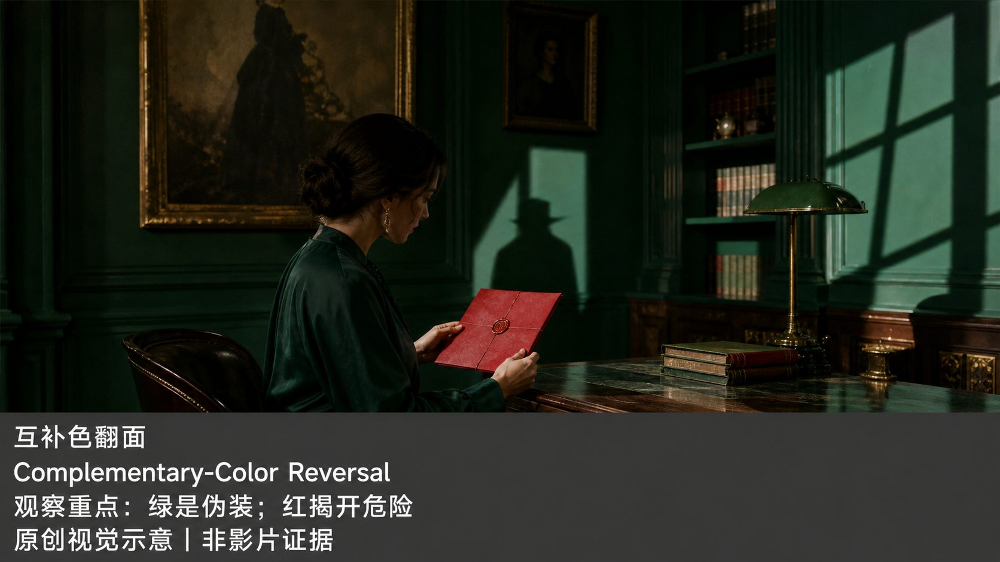

知识讲解：[A1-12 导演色彩风格](../../knowledge/A-%E7%90%86%E8%AE%BA%E5%B1%82/A1-%E6%91%84%E5%BD%B1%E7%BB%84/A1-12%20%E5%AF%BC%E6%BC%94%E8%89%B2%E5%BD%A9%E9%A3%8E%E6%A0%BC.md)

## 导演色彩风格：4. 黑泽明（A1-12-04-faction-color-blocking，原创教学示意）

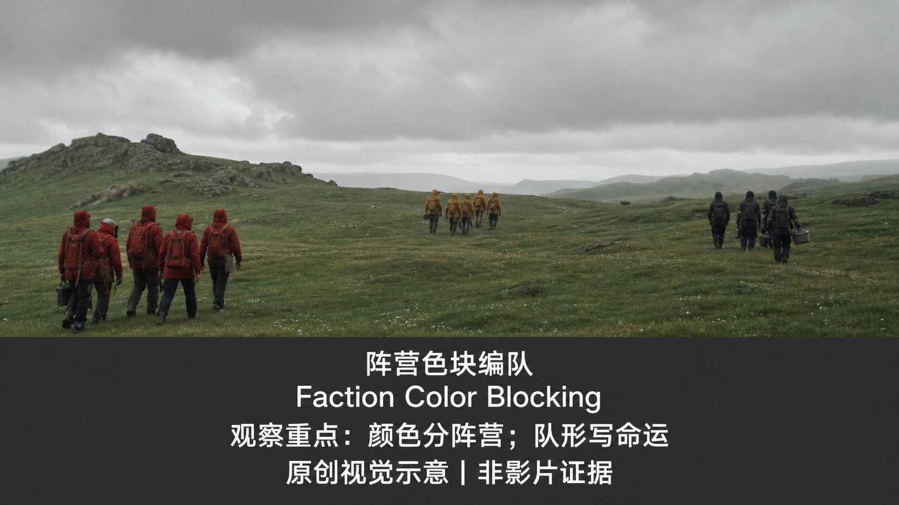

知识讲解：[A1-12 导演色彩风格](../../knowledge/A-%E7%90%86%E8%AE%BA%E5%B1%82/A1-%E6%91%84%E5%BD%B1%E7%BB%84/A1-12%20%E5%AF%BC%E6%BC%94%E8%89%B2%E5%BD%A9%E9%A3%8E%E6%A0%BC.md)

## 导演色彩风格：5. 是枝裕和（A1-12-05-cool-warm-turning-point，原创教学示意）

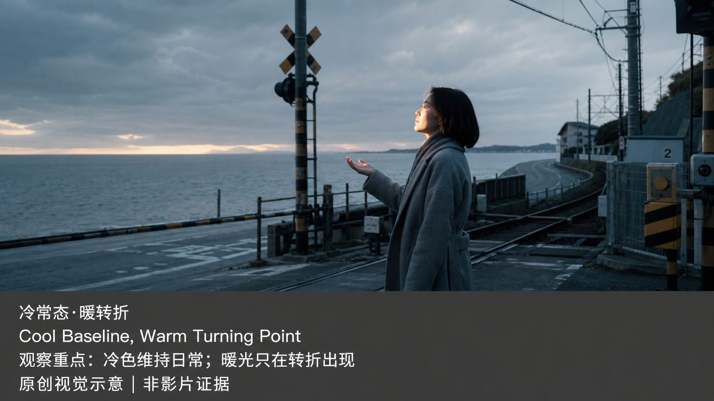

知识讲解：[A1-12 导演色彩风格](../../knowledge/A-%E7%90%86%E8%AE%BA%E5%B1%82/A1-%E6%91%84%E5%BD%B1%E7%BB%84/A1-12%20%E5%AF%BC%E6%BC%94%E8%89%B2%E5%BD%A9%E9%A3%8E%E6%A0%BC.md)

## 导演色彩风格：6. 佩德罗·阿莫多瓦（A1-12-06-primary-color-conflict，原创教学示意）

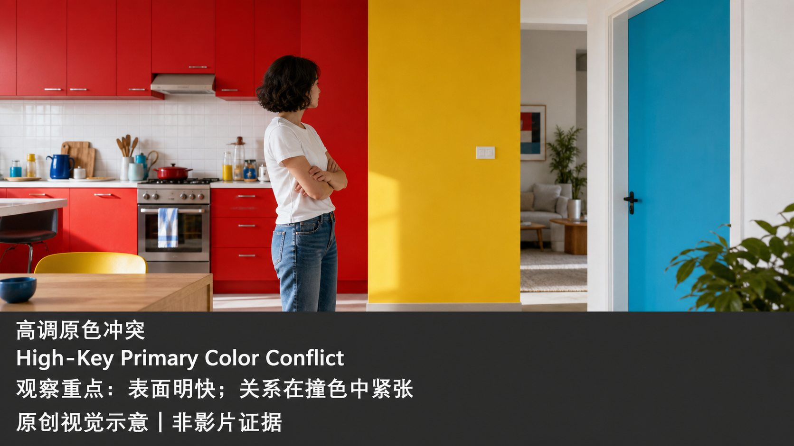

知识讲解：[A1-12 导演色彩风格](../../knowledge/A-%E7%90%86%E8%AE%BA%E5%B1%82/A1-%E6%91%84%E5%BD%B1%E7%BB%84/A1-12%20%E5%AF%BC%E6%BC%94%E8%89%B2%E5%BD%A9%E9%A3%8E%E6%A0%BC.md)

## 导演色彩风格：7. 克里斯托弗·诺兰（A1-12-07-single-warm-accent，原创教学示意）

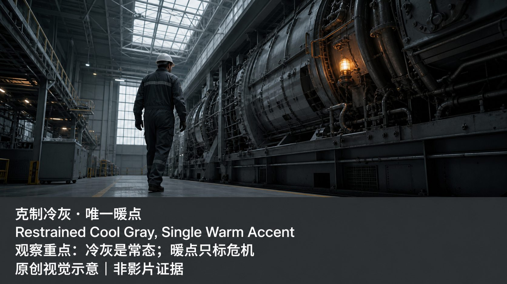

知识讲解：[A1-12 导演色彩风格](../../knowledge/A-%E7%90%86%E8%AE%BA%E5%B1%82/A1-%E6%91%84%E5%BD%B1%E7%BB%84/A1-12%20%E5%AF%BC%E6%BC%94%E8%89%B2%E5%BD%A9%E9%A3%8E%E6%A0%BC.md)

## 导演色彩风格：8. 丹尼斯·维伦纽瓦（A1-12-08-scene-monochrome-coding，原创教学示意）

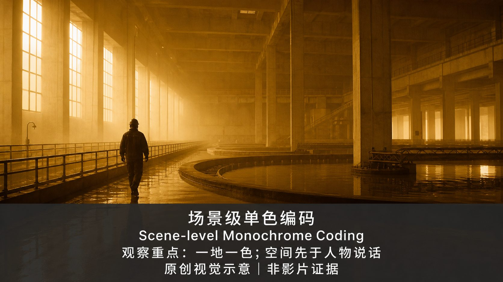

知识讲解：[A1-12 导演色彩风格](../../knowledge/A-%E7%90%86%E8%AE%BA%E5%B1%82/A1-%E6%91%84%E5%BD%B1%E7%BB%84/A1-12%20%E5%AF%BC%E6%BC%94%E8%89%B2%E5%BD%A9%E9%A3%8E%E6%A0%BC.md)

## 导演色彩风格：9. 韦斯·安德森（A1-12-09-limited-pastel-order，原创教学示意）

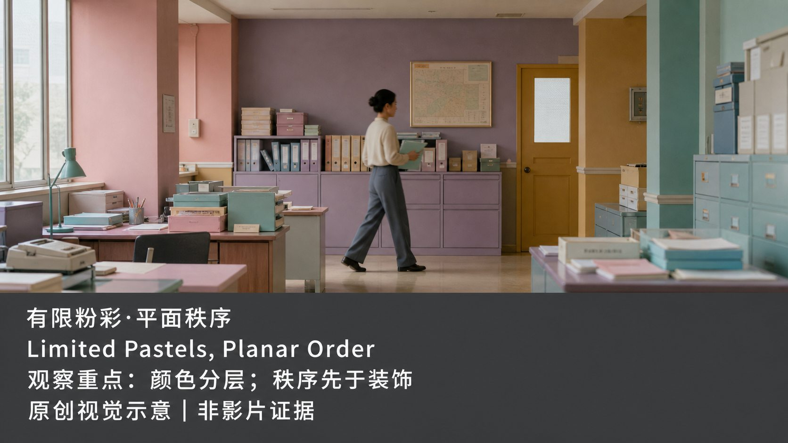

知识讲解：[A1-12 导演色彩风格](../../knowledge/A-%E7%90%86%E8%AE%BA%E5%B1%82/A1-%E6%91%84%E5%BD%B1%E7%BB%84/A1-12%20%E5%AF%BC%E6%BC%94%E8%89%B2%E5%BD%A9%E9%A3%8E%E6%A0%BC.md)

## 导演色彩风格：10. 斯坦利·库布里克（A1-12-10-warm-to-cold-decline，原创教学示意）

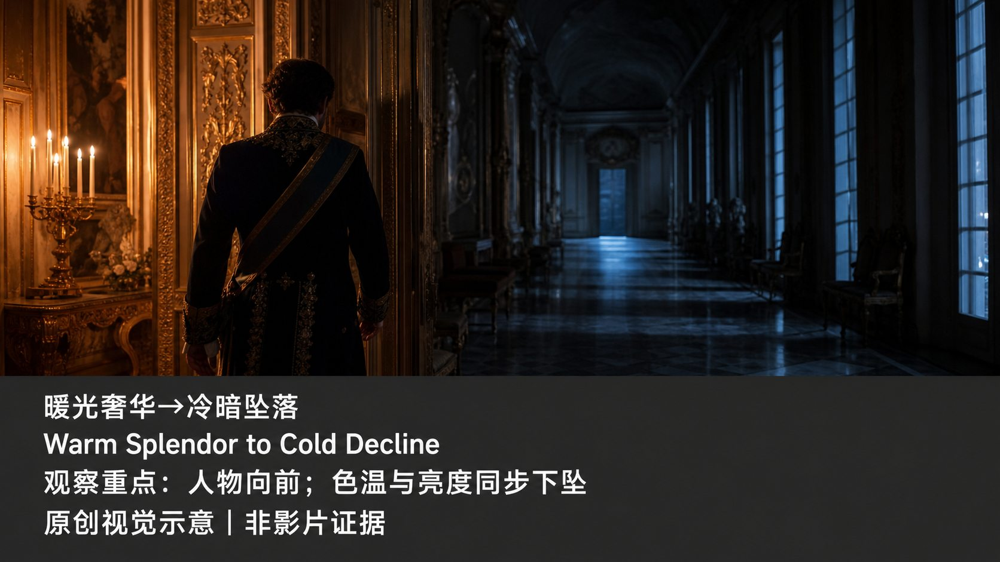

知识讲解：[A1-12 导演色彩风格](../../knowledge/A-%E7%90%86%E8%AE%BA%E5%B1%82/A1-%E6%91%84%E5%BD%B1%E7%BB%84/A1-12%20%E5%AF%BC%E6%BC%94%E8%89%B2%E5%BD%A9%E9%A3%8E%E6%A0%BC.md)

## 导演色彩风格：11. 大卫·芬奇（A1-12-11-sickly-ambient-cast，原创教学示意）

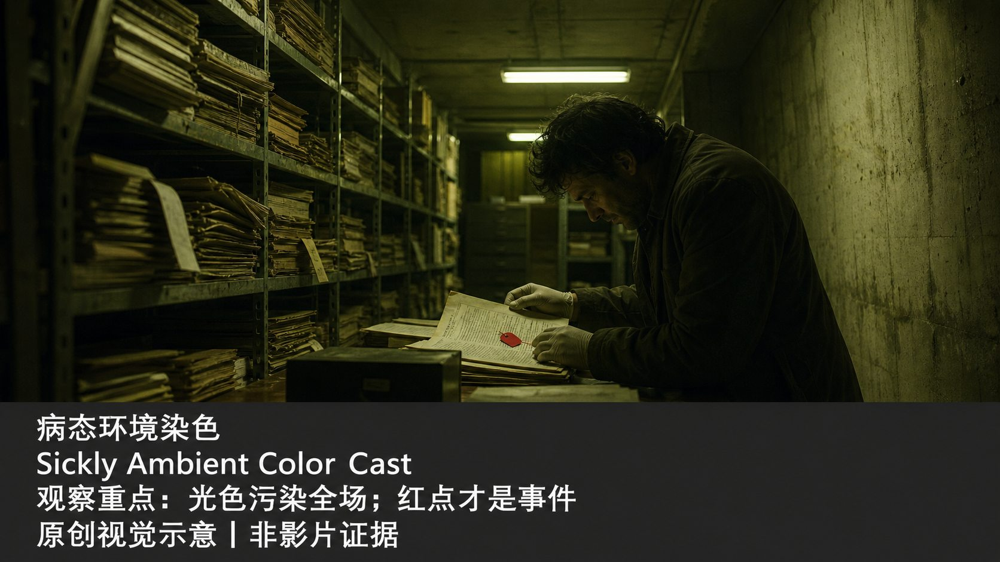

知识讲解：[A1-12 导演色彩风格](../../knowledge/A-%E7%90%86%E8%AE%BA%E5%B1%82/A1-%E6%91%84%E5%BD%B1%E7%BB%84/A1-12%20%E5%AF%BC%E6%BC%94%E8%89%B2%E5%BD%A9%E9%A3%8E%E6%A0%BC.md)

## 导演色彩风格：12. 雷德利·斯科特（A1-12-12-monochrome-world-rule，原创教学示意）

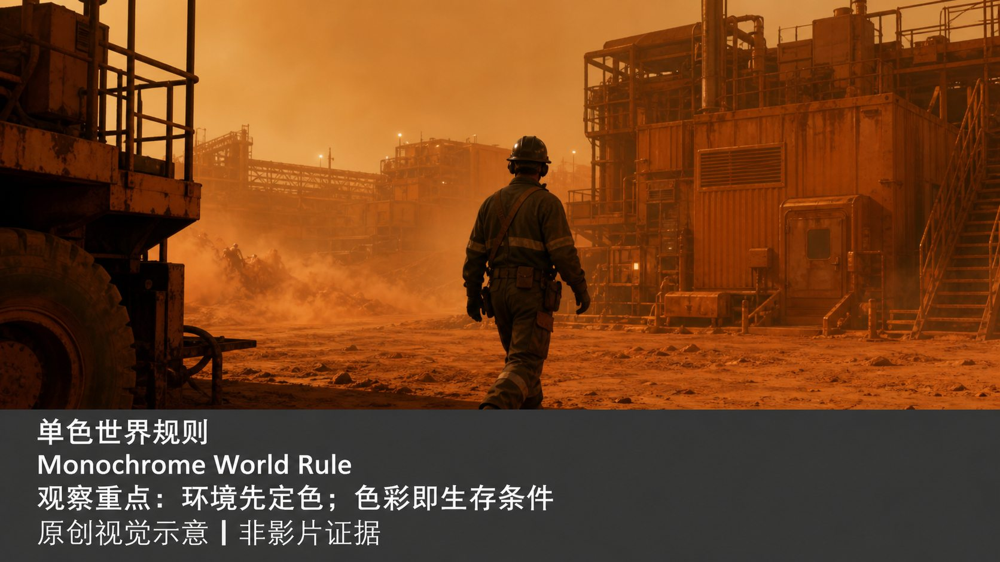

知识讲解：[A1-12 导演色彩风格](../../knowledge/A-%E7%90%86%E8%AE%BA%E5%B1%82/A1-%E6%91%84%E5%BD%B1%E7%BB%84/A1-12%20%E5%AF%BC%E6%BC%94%E8%89%B2%E5%BD%A9%E9%A3%8E%E6%A0%BC.md)
