# editing · 1—24

[全部主题](../IMAGE_GALLERY.md) · [首页](../../README.md)

## 剪辑表达：连续剪辑｜Continuity Editing（01-continuity-editing，原创教学示意）

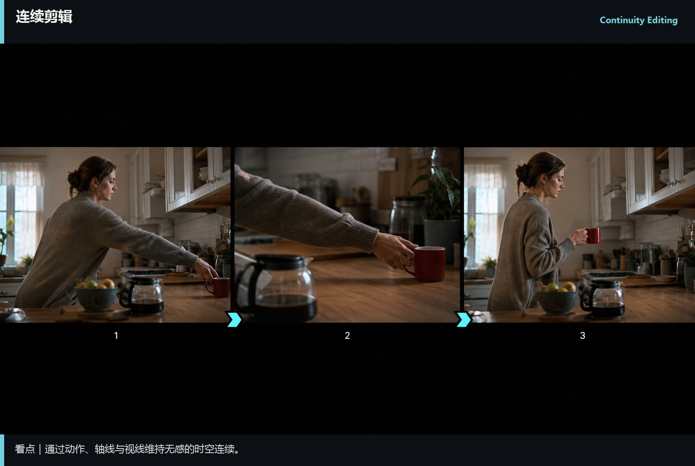

知识讲解：[A2-02 剪辑表达](../../knowledge/A-%E7%90%86%E8%AE%BA%E5%B1%82/A2-%E5%AF%BC%E6%BC%94%E7%BB%84/A2-02%20%E5%89%AA%E8%BE%91%E8%A1%A8%E8%BE%BE.md)

## 剪辑表达：交叉剪辑｜Cross-Cutting（02-cross-cutting，原创教学示意）

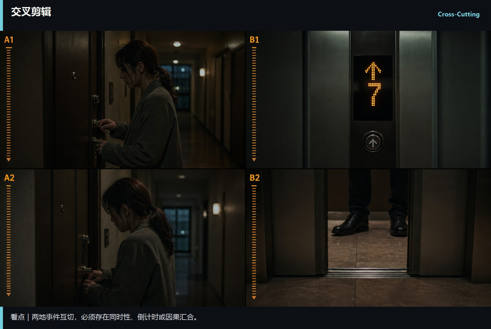

知识讲解：[A2-02 剪辑表达](../../knowledge/A-%E7%90%86%E8%AE%BA%E5%B1%82/A2-%E5%AF%BC%E6%BC%94%E7%BB%84/A2-02%20%E5%89%AA%E8%BE%91%E8%A1%A8%E8%BE%BE.md)

## 剪辑表达：平行剪辑｜Parallel Editing（03-parallel-editing，原创教学示意）

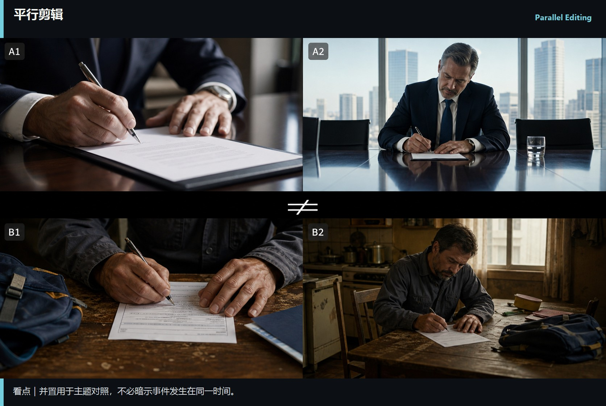

知识讲解：[A2-02 剪辑表达](../../knowledge/A-%E7%90%86%E8%AE%BA%E5%B1%82/A2-%E5%AF%BC%E6%BC%94%E7%BB%84/A2-02%20%E5%89%AA%E8%BE%91%E8%A1%A8%E8%BE%BE.md)

## 剪辑表达：蒙太奇｜Montage（04-montage，原创教学示意）

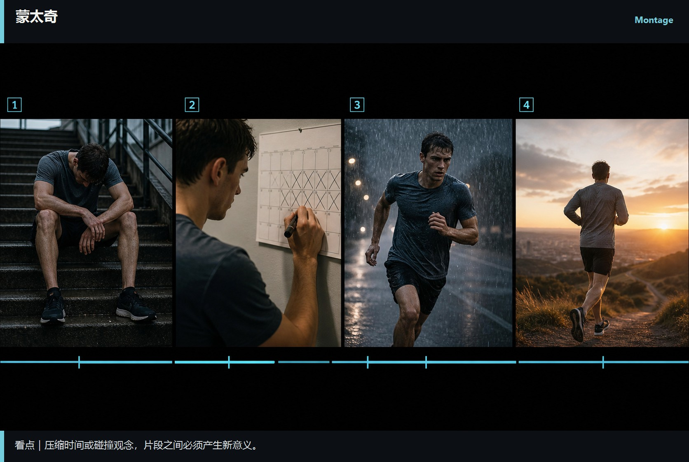

知识讲解：[A2-02 剪辑表达](../../knowledge/A-%E7%90%86%E8%AE%BA%E5%B1%82/A2-%E5%AF%BC%E6%BC%94%E7%BB%84/A2-02%20%E5%89%AA%E8%BE%91%E8%A1%A8%E8%BE%BE.md)

## 剪辑表达：匹配剪辑｜Match Cut（05-match-cut，原创教学示意）

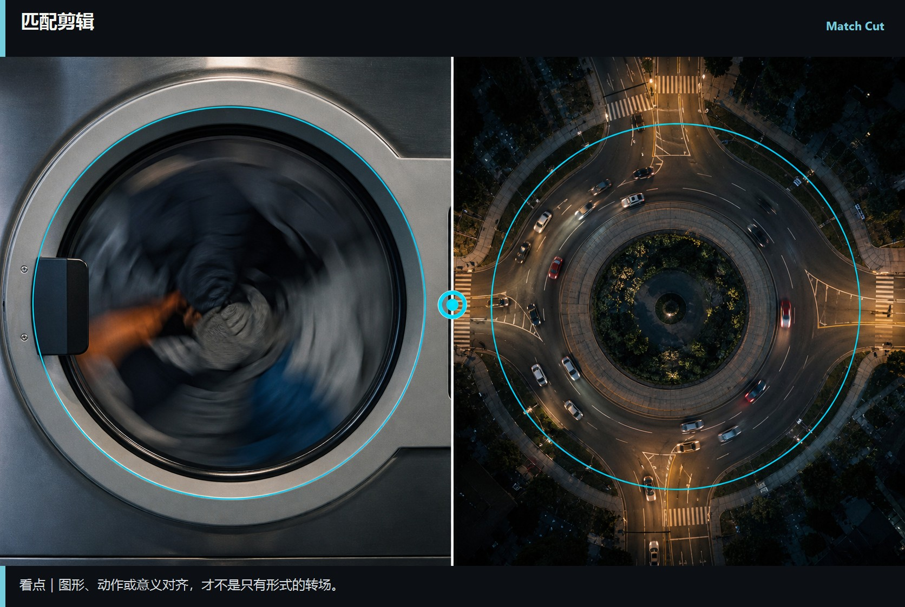

知识讲解：[A2-02 剪辑表达](../../knowledge/A-%E7%90%86%E8%AE%BA%E5%B1%82/A2-%E5%AF%BC%E6%BC%94%E7%BB%84/A2-02%20%E5%89%AA%E8%BE%91%E8%A1%A8%E8%BE%BE.md)

## 剪辑表达：动作剪辑｜Cut on Action（06-cut-on-action，原创教学示意）

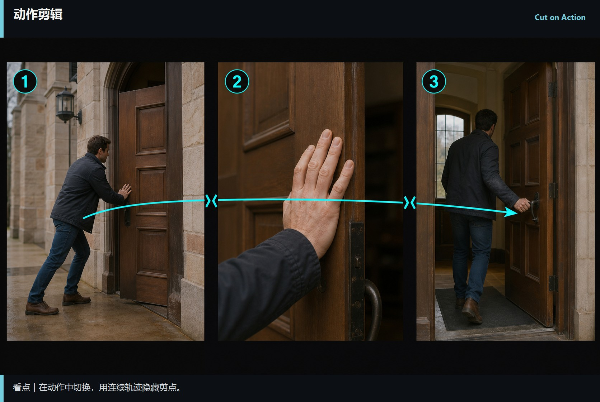

知识讲解：[A2-02 剪辑表达](../../knowledge/A-%E7%90%86%E8%AE%BA%E5%B1%82/A2-%E5%AF%BC%E6%BC%94%E7%BB%84/A2-02%20%E5%89%AA%E8%BE%91%E8%A1%A8%E8%BE%BE.md)

## 剪辑表达：跳切｜Jump Cut（07-jump-cut，原创教学示意）

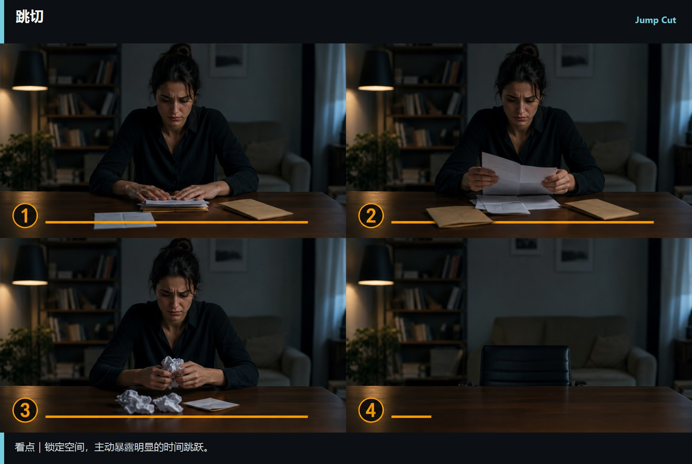

知识讲解：[A2-02 剪辑表达](../../knowledge/A-%E7%90%86%E8%AE%BA%E5%B1%82/A2-%E5%AF%BC%E6%BC%94%E7%BB%84/A2-02%20%E5%89%AA%E8%BE%91%E8%A1%A8%E8%BE%BE.md)

## 剪辑表达：硬切｜Hard Cut（08-hard-cut，原创教学示意）

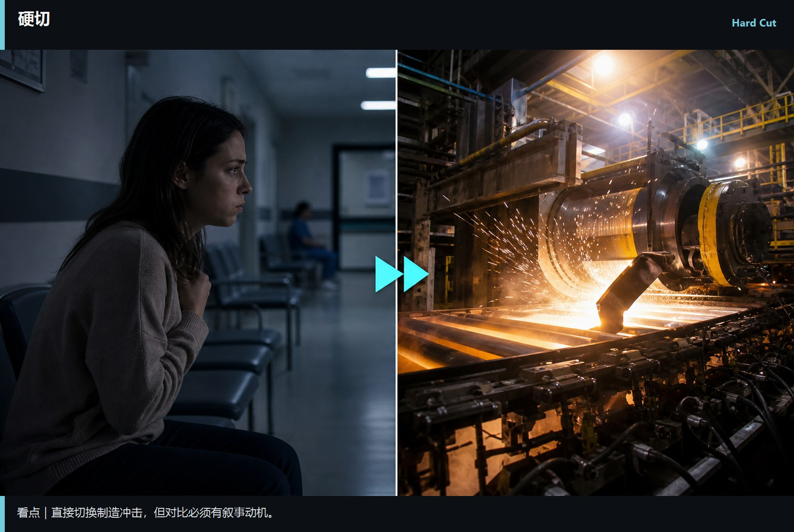

知识讲解：[A2-02 剪辑表达](../../knowledge/A-%E7%90%86%E8%AE%BA%E5%B1%82/A2-%E5%AF%BC%E6%BC%94%E7%BB%84/A2-02%20%E5%89%AA%E8%BE%91%E8%A1%A8%E8%BE%BE.md)

## 剪辑表达：淡入淡出｜Fade In / Fade Out（09-fade，原创教学示意）

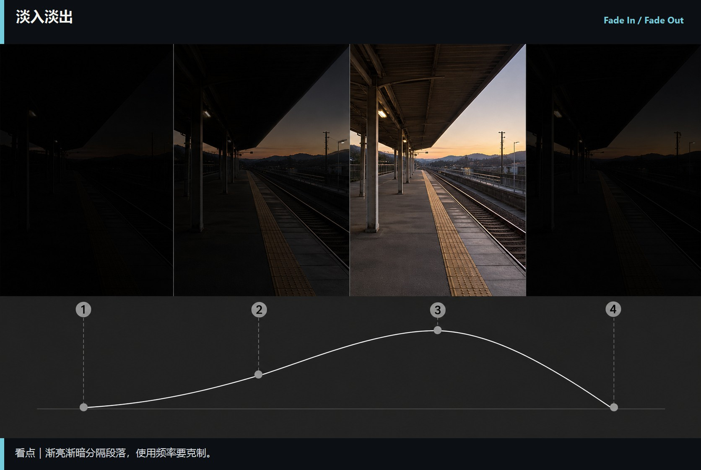

知识讲解：[A2-02 剪辑表达](../../knowledge/A-%E7%90%86%E8%AE%BA%E5%B1%82/A2-%E5%AF%BC%E6%BC%94%E7%BB%84/A2-02%20%E5%89%AA%E8%BE%91%E8%A1%A8%E8%BE%BE.md)

## 剪辑表达：叠化｜Dissolve（10-dissolve，原创教学示意）

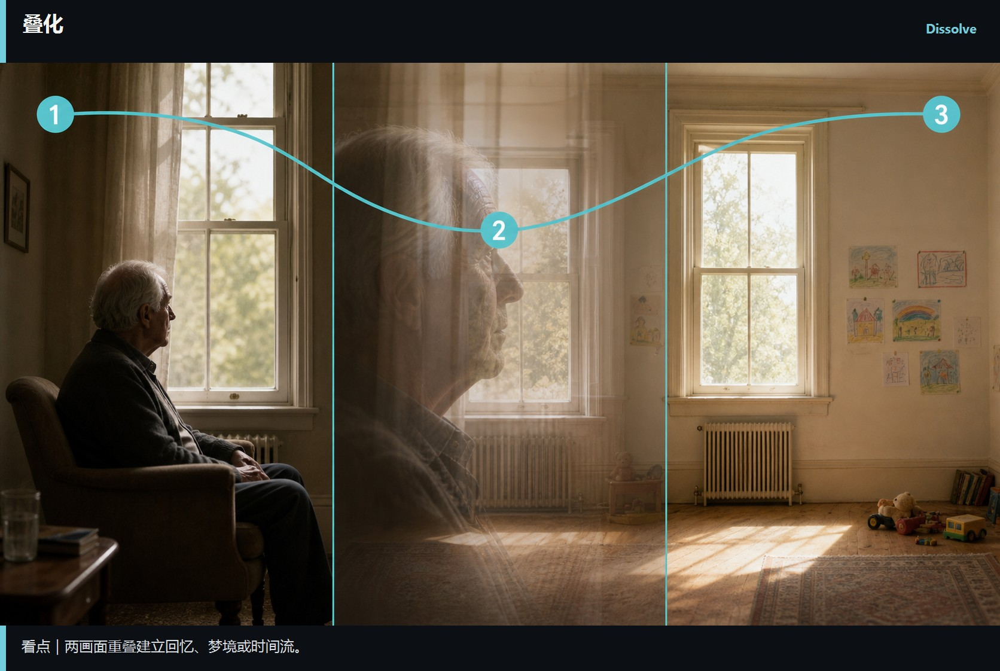

知识讲解：[A2-02 剪辑表达](../../knowledge/A-%E7%90%86%E8%AE%BA%E5%B1%82/A2-%E5%AF%BC%E6%BC%94%E7%BB%84/A2-02%20%E5%89%AA%E8%BE%91%E8%A1%A8%E8%BE%BE.md)

## 剪辑表达：声音桥｜Sound Bridge（11-sound-bridge，原创教学示意）

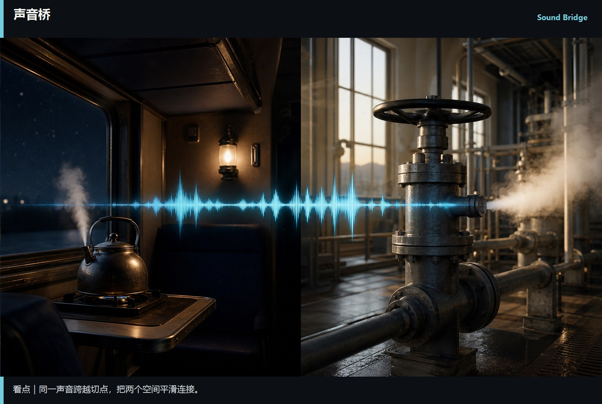

知识讲解：[A2-02 剪辑表达](../../knowledge/A-%E7%90%86%E8%AE%BA%E5%B1%82/A2-%E5%AF%BC%E6%BC%94%E7%BB%84/A2-02%20%E5%89%AA%E8%BE%91%E8%A1%A8%E8%BE%BE.md)

## 剪辑表达：J-cut｜J-Cut（12-j-cut，原创教学示意）

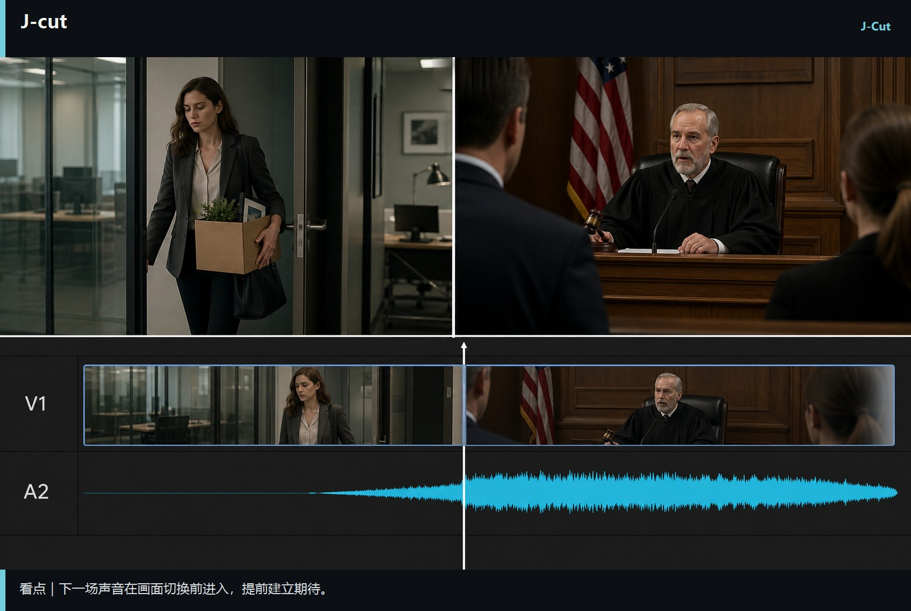

知识讲解：[A2-02 剪辑表达](../../knowledge/A-%E7%90%86%E8%AE%BA%E5%B1%82/A2-%E5%AF%BC%E6%BC%94%E7%BB%84/A2-02%20%E5%89%AA%E8%BE%91%E8%A1%A8%E8%BE%BE.md)

## 剪辑表达：L-cut｜L-Cut（13-l-cut，原创教学示意）

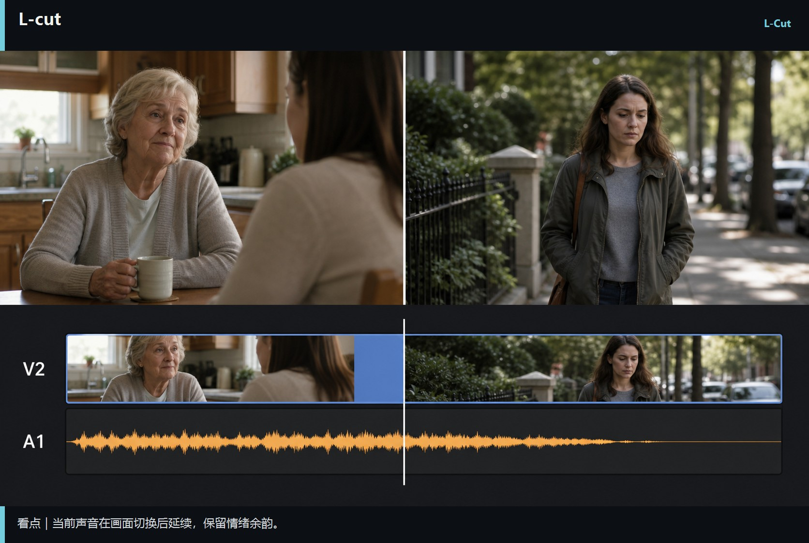

知识讲解：[A2-02 剪辑表达](../../knowledge/A-%E7%90%86%E8%AE%BA%E5%B1%82/A2-%E5%AF%BC%E6%BC%94%E7%BB%84/A2-02%20%E5%89%AA%E8%BE%91%E8%A1%A8%E8%BE%BE.md)

## 剪辑表达：反应剪辑｜Reaction Cut（14-reaction-cut，原创教学示意）

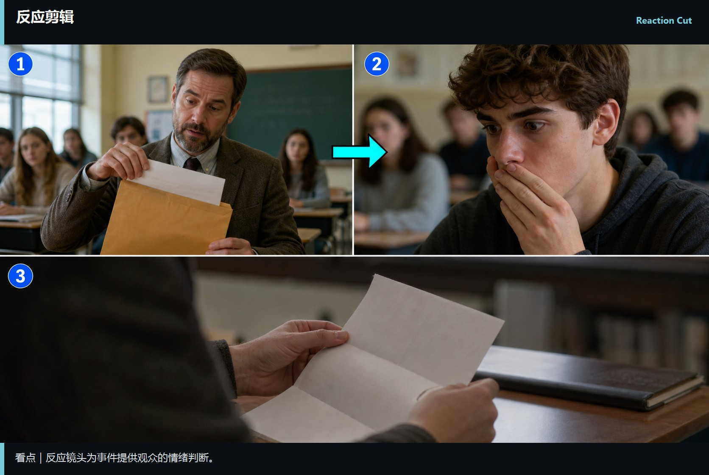

知识讲解：[A2-02 剪辑表达](../../knowledge/A-%E7%90%86%E8%AE%BA%E5%B1%82/A2-%E5%AF%BC%E6%BC%94%E7%BB%84/A2-02%20%E5%89%AA%E8%BE%91%E8%A1%A8%E8%BE%BE.md)

## 剪辑表达：省略剪辑｜Elliptical Editing（15-elliptical-editing，原创教学示意）

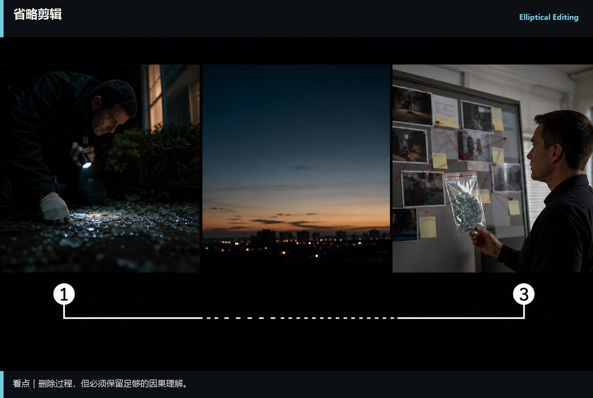

知识讲解：[A2-02 剪辑表达](../../knowledge/A-%E7%90%86%E8%AE%BA%E5%B1%82/A2-%E5%AF%BC%E6%BC%94%E7%BB%84/A2-02%20%E5%89%AA%E8%BE%91%E8%A1%A8%E8%BE%BE.md)

## 剪辑表达：节奏剪辑｜Rhythmic Editing（16-rhythmic-editing，原创教学示意）

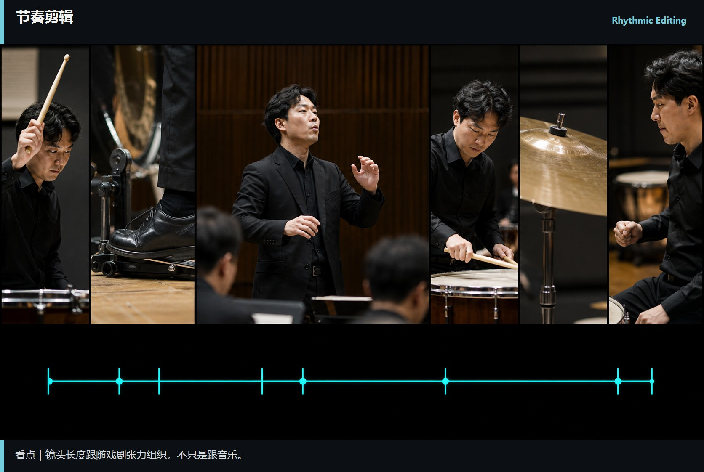

知识讲解：[A2-02 剪辑表达](../../knowledge/A-%E7%90%86%E8%AE%BA%E5%B1%82/A2-%E5%AF%BC%E6%BC%94%E7%BB%84/A2-02%20%E5%89%AA%E8%BE%91%E8%A1%A8%E8%BE%BE.md)

## 剪辑表达：音乐驱动剪辑｜Music-Driven Editing（17-music-driven-editing，原创教学示意）

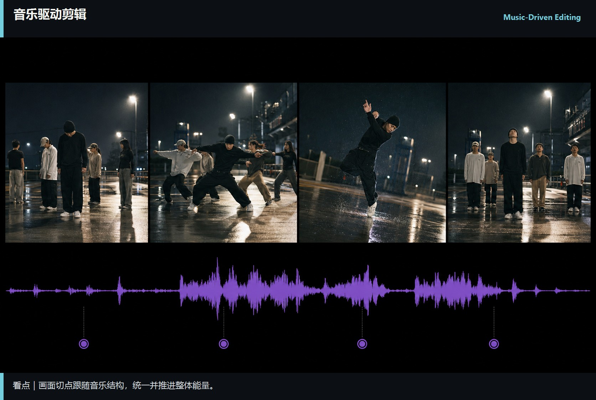

知识讲解：[A2-02 剪辑表达](../../knowledge/A-%E7%90%86%E8%AE%BA%E5%B1%82/A2-%E5%AF%BC%E6%BC%94%E7%BB%84/A2-02%20%E5%89%AA%E8%BE%91%E8%A1%A8%E8%BE%BE.md)

## 剪辑表达：快节奏动作剪辑｜Fast-Paced Action Editing（18-fast-action-editing，原创教学示意）

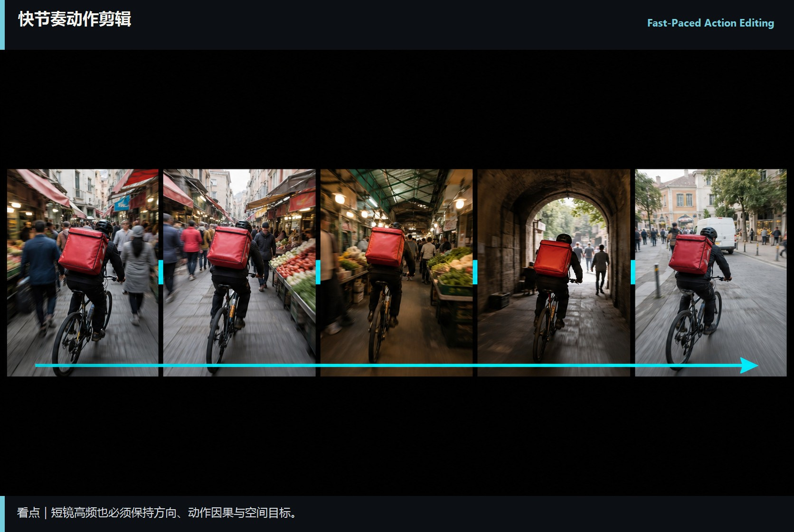

知识讲解：[A2-02 剪辑表达](../../knowledge/A-%E7%90%86%E8%AE%BA%E5%B1%82/A2-%E5%AF%BC%E6%BC%94%E7%BB%84/A2-02%20%E5%89%AA%E8%BE%91%E8%A1%A8%E8%BE%BE.md)

## 剪辑表达：慢节奏情绪剪辑｜Slow-Paced Emotional Editing（19-slow-emotional-editing，原创教学示意）

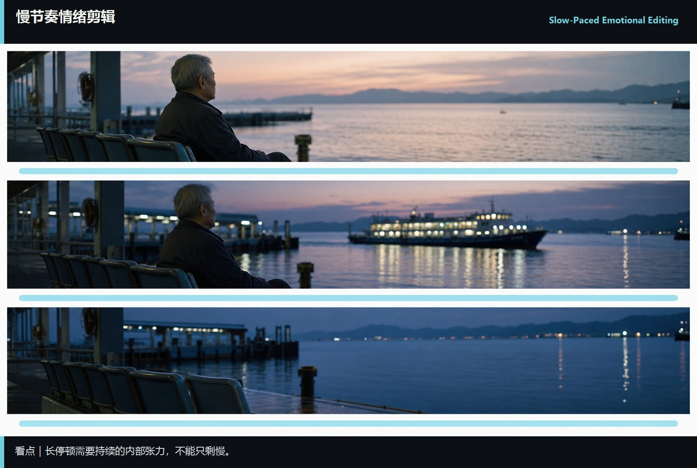

知识讲解：[A2-02 剪辑表达](../../knowledge/A-%E7%90%86%E8%AE%BA%E5%B1%82/A2-%E5%AF%BC%E6%BC%94%E7%BB%84/A2-02%20%E5%89%AA%E8%BE%91%E8%A1%A8%E8%BE%BE.md)

## 剪辑表达：时间压缩剪辑｜Time-Compression Editing（20-time-compression，原创教学示意）

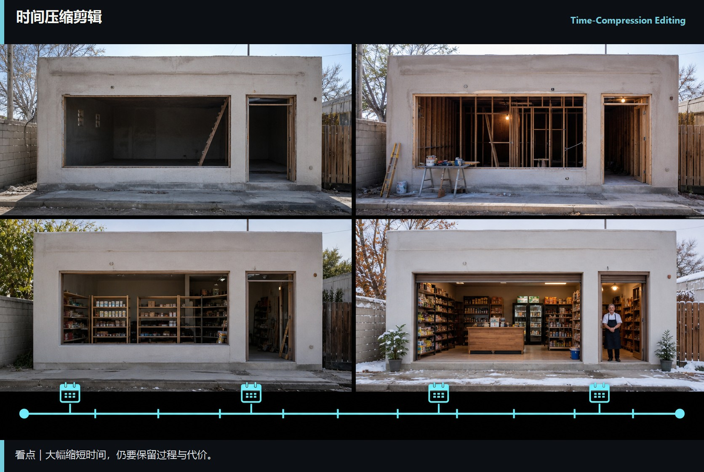

知识讲解：[A2-02 剪辑表达](../../knowledge/A-%E7%90%86%E8%AE%BA%E5%B1%82/A2-%E5%AF%BC%E6%BC%94%E7%BB%84/A2-02%20%E5%89%AA%E8%BE%91%E8%A1%A8%E8%BE%BE.md)

## 剪辑表达：多线交叉剪辑｜Multi-Thread Cross-Cutting（21-multi-thread-cross-cutting，原创教学示意）

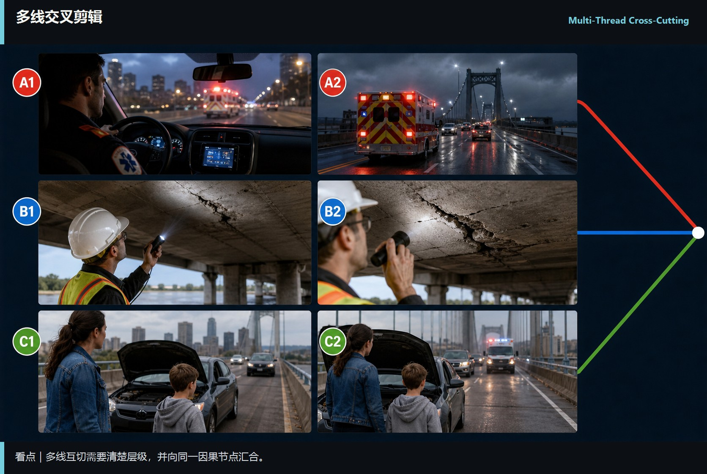

知识讲解：[A2-02 剪辑表达](../../knowledge/A-%E7%90%86%E8%AE%BA%E5%B1%82/A2-%E5%AF%BC%E6%BC%94%E7%BB%84/A2-02%20%E5%89%AA%E8%BE%91%E8%A1%A8%E8%BE%BE.md)

## 剪辑表达：战争连续压力剪辑｜Continuous-Pressure Editing（22-continuous-pressure-editing，原创教学示意）

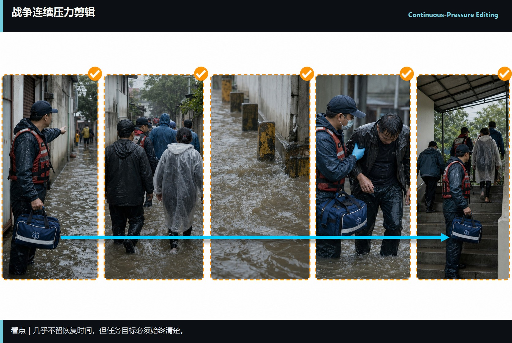

知识讲解：[A2-02 剪辑表达](../../knowledge/A-%E7%90%86%E8%AE%BA%E5%B1%82/A2-%E5%AF%BC%E6%BC%94%E7%BB%84/A2-02%20%E5%89%AA%E8%BE%91%E8%A1%A8%E8%BE%BE.md)

## 剪辑表达：悬疑信息延迟剪辑｜Delayed-Information Suspense（23-delayed-information-suspense，原创教学示意）

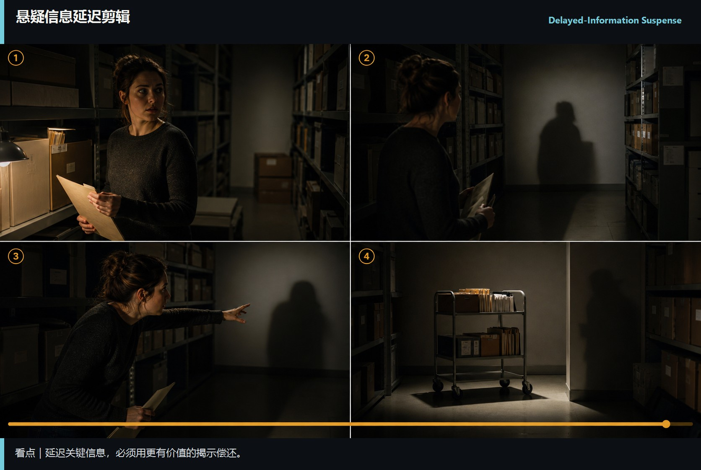

知识讲解：[A2-02 剪辑表达](../../knowledge/A-%E7%90%86%E8%AE%BA%E5%B1%82/A2-%E5%AF%BC%E6%BC%94%E7%BB%84/A2-02%20%E5%89%AA%E8%BE%91%E8%A1%A8%E8%BE%BE.md)

## 剪辑表达：灾难多点并行剪辑｜Multi-Location Disaster Parallel Editing（24-disaster-parallel-editing，原创教学示意）

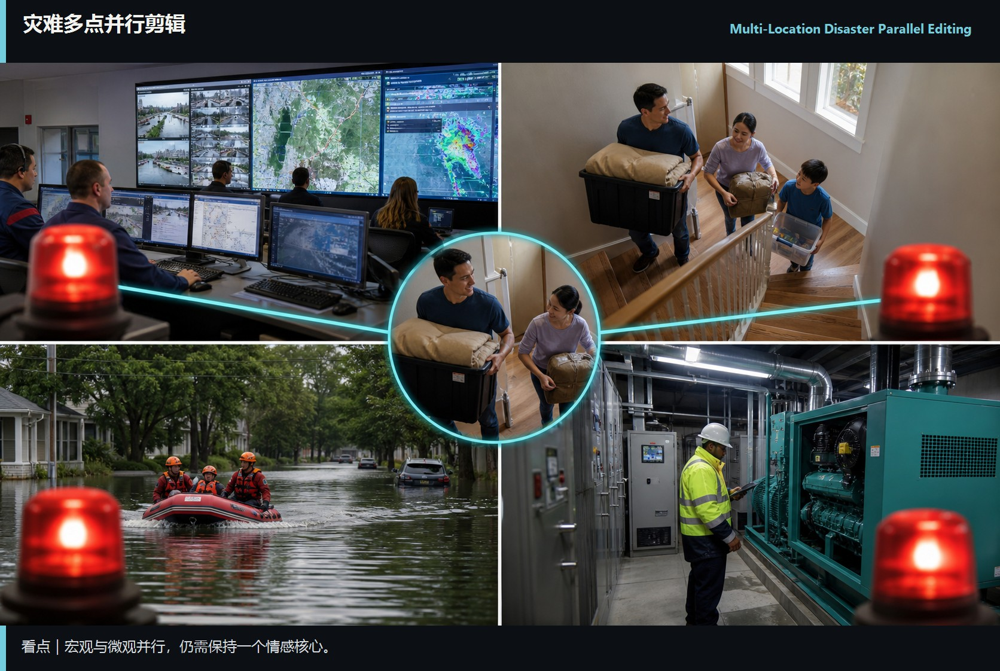

知识讲解：[A2-02 剪辑表达](../../knowledge/A-%E7%90%86%E8%AE%BA%E5%B1%82/A2-%E5%AF%BC%E6%BC%94%E7%BB%84/A2-02%20%E5%89%AA%E8%BE%91%E8%A1%A8%E8%BE%BE.md)
