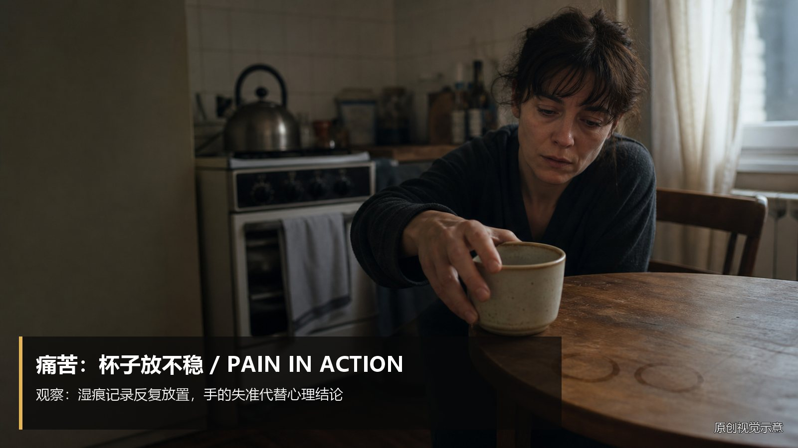
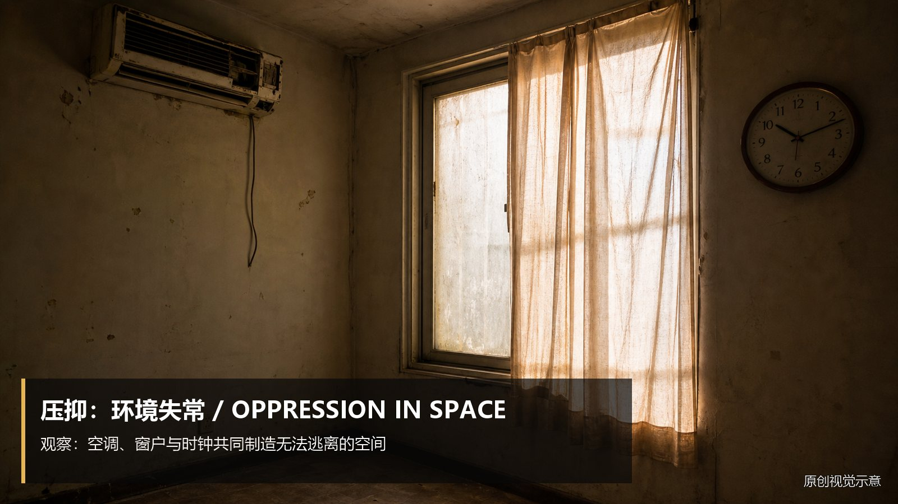
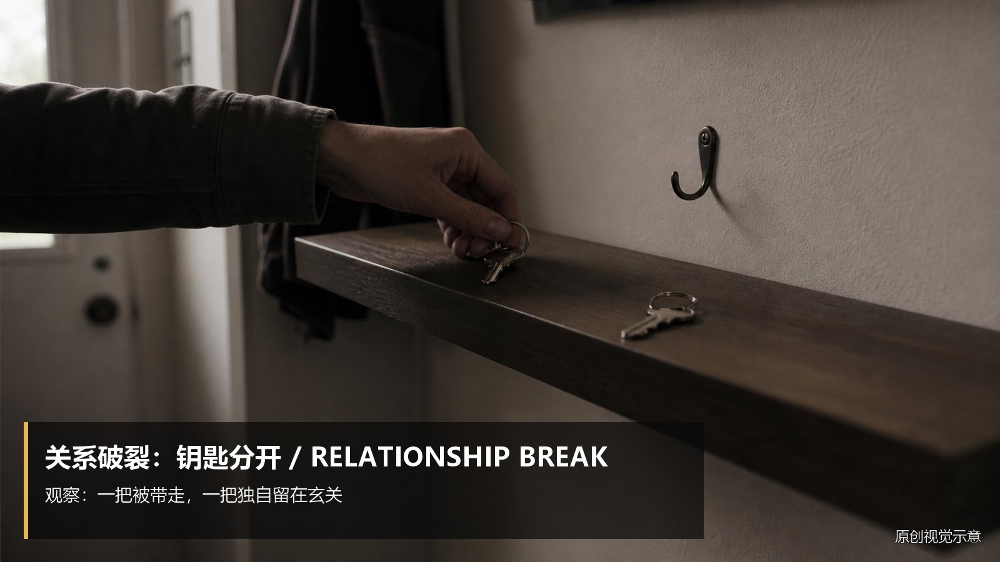
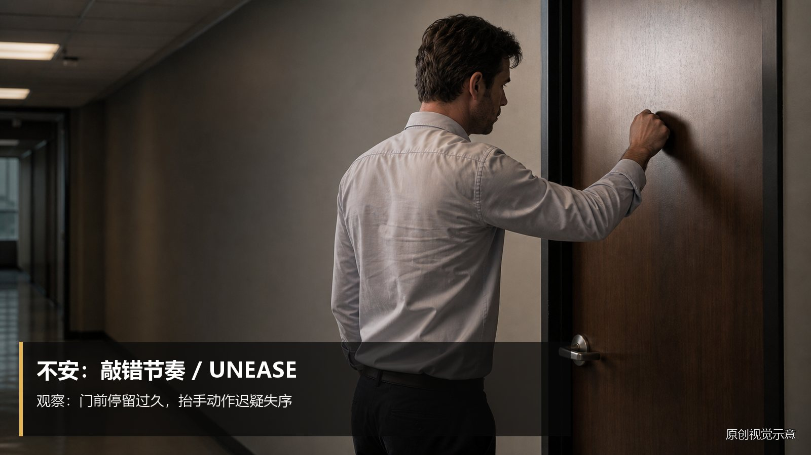
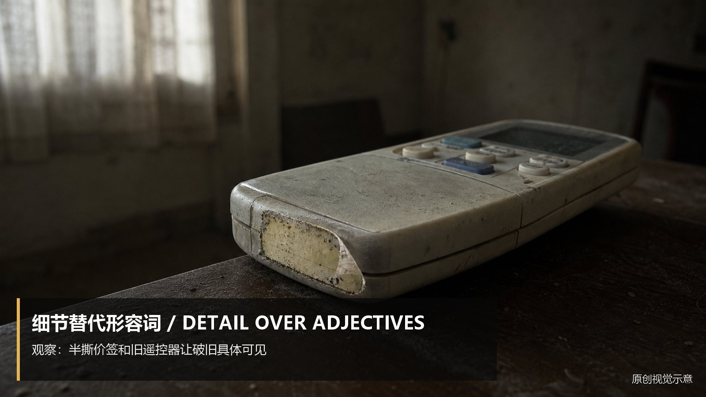

# emotion-externalization · 1—23

[全部主题](../IMAGE_GALLERY.md) · [首页](../../README.md)

## 情绪外化：动作与物件：很痛苦 → 杯子反复放不稳（01-translate-pain-cup，原创教学示意）

知识讲解：[A3-16 情绪外化：动作与物件](../../knowledge/A-%E7%90%86%E8%AE%BA%E5%B1%82/A3-%E7%BC%96%E5%89%A7%E7%BB%84/A3-16%20%E6%83%85%E7%BB%AA%E5%A4%96%E5%8C%96%EF%BC%9A%E5%8A%A8%E4%BD%9C%E4%B8%8E%E7%89%A9%E4%BB%B6.md)

## 情绪外化：动作与物件：很紧张 → 打火机始终没按到底（02-translate-nervous-lighter，原创教学示意）

知识讲解：[A3-16 情绪外化：动作与物件](../../knowledge/A-%E7%90%86%E8%AE%BA%E5%B1%82/A3-%E7%BC%96%E5%89%A7%E7%BB%84/A3-16%20%E6%83%85%E7%BB%AA%E5%A4%96%E5%8C%96%EF%BC%9A%E5%8A%A8%E4%BD%9C%E4%B8%8E%E7%89%A9%E4%BB%B6.md)

## 情绪外化：动作与物件：很生气 → 把咖啡推远（03-translate-anger-coffee，原创教学示意）

知识讲解：[A3-16 情绪外化：动作与物件](../../knowledge/A-%E7%90%86%E8%AE%BA%E5%B1%82/A3-%E7%BC%96%E5%89%A7%E7%BB%84/A3-16%20%E6%83%85%E7%BB%AA%E5%A4%96%E5%8C%96%EF%BC%9A%E5%8A%A8%E4%BD%9C%E4%B8%8E%E7%89%A9%E4%BB%B6.md)

## 情绪外化：动作与物件：崩溃了 → 手机翻扣又翻回（04-translate-collapse-phone，原创教学示意）

知识讲解：[A3-16 情绪外化：动作与物件](../../knowledge/A-%E7%90%86%E8%AE%BA%E5%B1%82/A3-%E7%BC%96%E5%89%A7%E7%BB%84/A3-16%20%E6%83%85%E7%BB%AA%E5%A4%96%E5%8C%96%EF%BC%9A%E5%8A%A8%E4%BD%9C%E4%B8%8E%E7%89%A9%E4%BB%B6.md)

## 情绪外化：动作与物件：很压抑 → 环境各处失常（05-translate-oppressive-room，原创教学示意）

知识讲解：[A3-16 情绪外化：动作与物件](../../knowledge/A-%E7%90%86%E8%AE%BA%E5%B1%82/A3-%E7%BC%96%E5%89%A7%E7%BB%84/A3-16%20%E6%83%85%E7%BB%AA%E5%A4%96%E5%8C%96%EF%BC%9A%E5%8A%A8%E4%BD%9C%E4%B8%8E%E7%89%A9%E4%BB%B6.md)

## 情绪外化：动作与物件：关系破裂 → 两把钥匙分开（06-translate-broken-relationship-keys，原创教学示意）

知识讲解：[A3-16 情绪外化：动作与物件](../../knowledge/A-%E7%90%86%E8%AE%BA%E5%B1%82/A3-%E7%BC%96%E5%89%A7%E7%BB%84/A3-16%20%E6%83%85%E7%BB%AA%E5%A4%96%E5%8C%96%EF%BC%9A%E5%8A%A8%E4%BD%9C%E4%B8%8E%E7%89%A9%E4%BB%B6.md)

## 情绪外化：动作与物件：犹豫／挣扎（07-action-hesitation-report，原创教学示意）

知识讲解：[A3-16 情绪外化：动作与物件](../../knowledge/A-%E7%90%86%E8%AE%BA%E5%B1%82/A3-%E7%BC%96%E5%89%A7%E7%BB%84/A3-16%20%E6%83%85%E7%BB%AA%E5%A4%96%E5%8C%96%EF%BC%9A%E5%8A%A8%E4%BD%9C%E4%B8%8E%E7%89%A9%E4%BB%B6.md)

## 情绪外化：动作与物件：后悔（08-action-regret-cup，原创教学示意）

知识讲解：[A3-16 情绪外化：动作与物件](../../knowledge/A-%E7%90%86%E8%AE%BA%E5%B1%82/A3-%E7%BC%96%E5%89%A7%E7%BB%84/A3-16%20%E6%83%85%E7%BB%AA%E5%A4%96%E5%8C%96%EF%BC%9A%E5%8A%A8%E4%BD%9C%E4%B8%8E%E7%89%A9%E4%BB%B6.md)

## 情绪外化：动作与物件：暗下决心（09-action-decision-water，原创教学示意）

知识讲解：[A3-16 情绪外化：动作与物件](../../knowledge/A-%E7%90%86%E8%AE%BA%E5%B1%82/A3-%E7%BC%96%E5%89%A7%E7%BB%84/A3-16%20%E6%83%85%E7%BB%AA%E5%A4%96%E5%8C%96%EF%BC%9A%E5%8A%A8%E4%BD%9C%E4%B8%8E%E7%89%A9%E4%BB%B6.md)

## 情绪外化：动作与物件：不安（10-action-unease-door，原创教学示意）

知识讲解：[A3-16 情绪外化：动作与物件](../../knowledge/A-%E7%90%86%E8%AE%BA%E5%B1%82/A3-%E7%BC%96%E5%89%A7%E7%BB%84/A3-16%20%E6%83%85%E7%BB%AA%E5%A4%96%E5%8C%96%EF%BC%9A%E5%8A%A8%E4%BD%9C%E4%B8%8E%E7%89%A9%E4%BB%B6.md)

## 情绪外化：动作与物件：释怀（11-action-release-amulet，原创教学示意）

知识讲解：[A3-16 情绪外化：动作与物件](../../knowledge/A-%E7%90%86%E8%AE%BA%E5%B1%82/A3-%E7%BC%96%E5%89%A7%E7%BB%84/A3-16%20%E6%83%85%E7%BB%AA%E5%A4%96%E5%8C%96%EF%BC%9A%E5%8A%A8%E4%BD%9C%E4%B8%8E%E7%89%A9%E4%BB%B6.md)

## 情绪外化：动作与物件：注意力的变化（12-action-attention-tea，原创教学示意）

知识讲解：[A3-16 情绪外化：动作与物件](../../knowledge/A-%E7%90%86%E8%AE%BA%E5%B1%82/A3-%E7%BC%96%E5%89%A7%E7%BB%84/A3-16%20%E6%83%85%E7%BB%AA%E5%A4%96%E5%8C%96%EF%BC%9A%E5%8A%A8%E4%BD%9C%E4%B8%8E%E7%89%A9%E4%BB%B6.md)

## 情绪外化：动作与物件：用一个物件细节替代形容词（13-detail-price-tag，原创教学示意）

知识讲解：[A3-16 情绪外化：动作与物件](../../knowledge/A-%E7%90%86%E8%AE%BA%E5%B1%82/A3-%E7%BC%96%E5%89%A7%E7%BB%84/A3-16%20%E6%83%85%E7%BB%AA%E5%A4%96%E5%8C%96%EF%BC%9A%E5%8A%A8%E4%BD%9C%E4%B8%8E%E7%89%A9%E4%BB%B6.md)

## 情绪外化：动作与物件：用一个动作细节替代形容词（14-detail-straighten-frame，原创教学示意）

知识讲解：[A3-16 情绪外化：动作与物件](../../knowledge/A-%E7%90%86%E8%AE%BA%E5%B1%82/A3-%E7%BC%96%E5%89%A7%E7%BB%84/A3-16%20%E6%83%85%E7%BB%AA%E5%A4%96%E5%8C%96%EF%BC%9A%E5%8A%A8%E4%BD%9C%E4%B8%8E%E7%89%A9%E4%BB%B6.md)

## 情绪外化：动作与物件：想念（15-object-missing-old-item，原创教学示意）

知识讲解：[A3-16 情绪外化：动作与物件](../../knowledge/A-%E7%90%86%E8%AE%BA%E5%B1%82/A3-%E7%BC%96%E5%89%A7%E7%BB%84/A3-16%20%E6%83%85%E7%BB%AA%E5%A4%96%E5%8C%96%EF%BC%9A%E5%8A%A8%E4%BD%9C%E4%B8%8E%E7%89%A9%E4%BB%B6.md)

## 情绪外化：动作与物件：愤怒（16-object-anger-can，原创教学示意）

知识讲解：[A3-16 情绪外化：动作与物件](../../knowledge/A-%E7%90%86%E8%AE%BA%E5%B1%82/A3-%E7%BC%96%E5%89%A7%E7%BB%84/A3-16%20%E6%83%85%E7%BB%AA%E5%A4%96%E5%8C%96%EF%BC%9A%E5%8A%A8%E4%BD%9C%E4%B8%8E%E7%89%A9%E4%BB%B6.md)

## 情绪外化：动作与物件：犹豫（17-object-hesitation-ring，原创教学示意）

知识讲解：[A3-16 情绪外化：动作与物件](../../knowledge/A-%E7%90%86%E8%AE%BA%E5%B1%82/A3-%E7%BC%96%E5%89%A7%E7%BB%84/A3-16%20%E6%83%85%E7%BB%AA%E5%A4%96%E5%8C%96%EF%BC%9A%E5%8A%A8%E4%BD%9C%E4%B8%8E%E7%89%A9%E4%BB%B6.md)

## 情绪外化：动作与物件：告别（18-object-farewell-leave-item，原创教学示意）

知识讲解：[A3-16 情绪外化：动作与物件](../../knowledge/A-%E7%90%86%E8%AE%BA%E5%B1%82/A3-%E7%BC%96%E5%89%A7%E7%BB%84/A3-16%20%E6%83%85%E7%BB%AA%E5%A4%96%E5%8C%96%EF%BC%9A%E5%8A%A8%E4%BD%9C%E4%B8%8E%E7%89%A9%E4%BB%B6.md)

## 情绪外化：动作与物件：原谅（19-object-forgiveness-repair，原创教学示意）

知识讲解：[A3-16 情绪外化：动作与物件](../../knowledge/A-%E7%90%86%E8%AE%BA%E5%B1%82/A3-%E7%BC%96%E5%89%A7%E7%BB%84/A3-16%20%E6%83%85%E7%BB%AA%E5%A4%96%E5%8C%96%EF%BC%9A%E5%8A%A8%E4%BD%9C%E4%B8%8E%E7%89%A9%E4%BB%B6.md)

## 情绪外化：动作与物件：恐惧（20-object-fear-check-lock，原创教学示意）

知识讲解：[A3-16 情绪外化：动作与物件](../../knowledge/A-%E7%90%86%E8%AE%BA%E5%B1%82/A3-%E7%BC%96%E5%89%A7%E7%BB%84/A3-16%20%E6%83%85%E7%BB%AA%E5%A4%96%E5%8C%96%EF%BC%9A%E5%8A%A8%E4%BD%9C%E4%B8%8E%E7%89%A9%E4%BB%B6.md)

## 情绪外化：动作与物件：羞耻（21-object-shame-hide-badge，原创教学示意）

知识讲解：[A3-16 情绪外化：动作与物件](../../knowledge/A-%E7%90%86%E8%AE%BA%E5%B1%82/A3-%E7%BC%96%E5%89%A7%E7%BB%84/A3-16%20%E6%83%85%E7%BB%AA%E5%A4%96%E5%8C%96%EF%BC%9A%E5%8A%A8%E4%BD%9C%E4%B8%8E%E7%89%A9%E4%BB%B6.md)

## 情绪外化：动作与物件：改变（22-object-changed-use，原创教学示意）

知识讲解：[A3-16 情绪外化：动作与物件](../../knowledge/A-%E7%90%86%E8%AE%BA%E5%B1%82/A3-%E7%BC%96%E5%89%A7%E7%BB%84/A3-16%20%E6%83%85%E7%BB%AA%E5%A4%96%E5%8C%96%EF%BC%9A%E5%8A%A8%E4%BD%9C%E4%B8%8E%E7%89%A9%E4%BB%B6.md)

## 情绪外化：动作与物件：一物三次出现（物件递进）（23-object-three-appearances，原创教学示意）

知识讲解：[A3-16 情绪外化：动作与物件](../../knowledge/A-%E7%90%86%E8%AE%BA%E5%B1%82/A3-%E7%BC%96%E5%89%A7%E7%BB%84/A3-16%20%E6%83%85%E7%BB%AA%E5%A4%96%E5%8C%96%EF%BC%9A%E5%8A%A8%E4%BD%9C%E4%B8%8E%E7%89%A9%E4%BB%B6.md)
