# focal-length · 1—23

[全部主题](../IMAGE_GALLERY.md) · [首页](../../README.md)

## 焦段与视觉心理：速查层（选什么）（01-14mm-ultra-wide，原创教学示意）

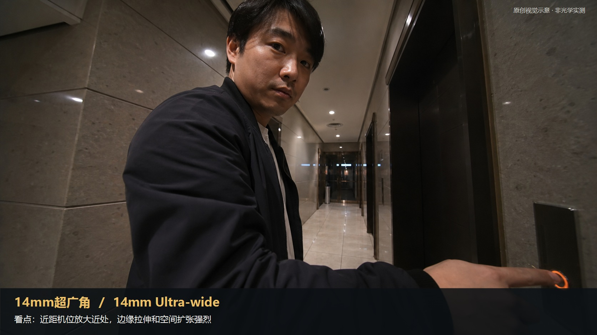

知识讲解：[A1-05 焦段与视觉心理](../../knowledge/A-%E7%90%86%E8%AE%BA%E5%B1%82/A1-%E6%91%84%E5%BD%B1%E7%BB%84/A1-05%20%E7%84%A6%E6%AE%B5%E4%B8%8E%E8%A7%86%E8%A7%89%E5%BF%83%E7%90%86.md)

## 焦段与视觉心理：速查层（选什么）（02-18mm-wide，原创教学示意）

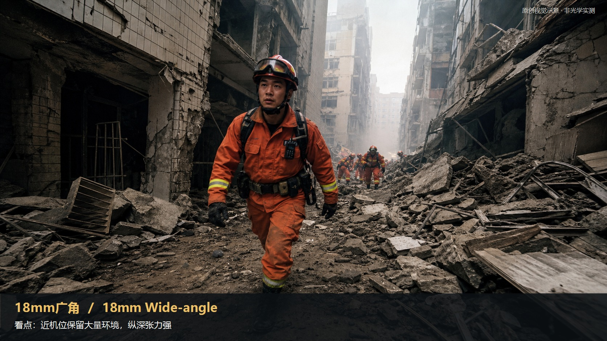

知识讲解：[A1-05 焦段与视觉心理](../../knowledge/A-%E7%90%86%E8%AE%BA%E5%B1%82/A1-%E6%91%84%E5%BD%B1%E7%BB%84/A1-05%20%E7%84%A6%E6%AE%B5%E4%B8%8E%E8%A7%86%E8%A7%89%E5%BF%83%E7%90%86.md)

## 焦段与视觉心理：速查层（选什么）（03-24mm-wide，原创教学示意）

知识讲解：[A1-05 焦段与视觉心理](../../knowledge/A-%E7%90%86%E8%AE%BA%E5%B1%82/A1-%E6%91%84%E5%BD%B1%E7%BB%84/A1-05%20%E7%84%A6%E6%AE%B5%E4%B8%8E%E8%A7%86%E8%A7%89%E5%BF%83%E7%90%86.md)

## 焦段与视觉心理：速查层（选什么）（04-28mm-mild-wide，原创教学示意）

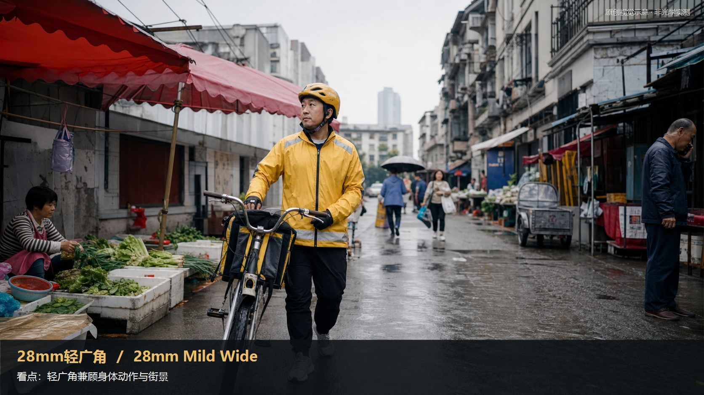

知识讲解：[A1-05 焦段与视觉心理](../../knowledge/A-%E7%90%86%E8%AE%BA%E5%B1%82/A1-%E6%91%84%E5%BD%B1%E7%BB%84/A1-05%20%E7%84%A6%E6%AE%B5%E4%B8%8E%E8%A7%86%E8%A7%89%E5%BF%83%E7%90%86.md)

## 焦段与视觉心理：速查层（选什么）（05-35mm-narrative-wide，原创教学示意）

知识讲解：[A1-05 焦段与视觉心理](../../knowledge/A-%E7%90%86%E8%AE%BA%E5%B1%82/A1-%E6%91%84%E5%BD%B1%E7%BB%84/A1-05%20%E7%84%A6%E6%AE%B5%E4%B8%8E%E8%A7%86%E8%A7%89%E5%BF%83%E7%90%86.md)

## 焦段与视觉心理：速查层（选什么）（06-40mm-observation，原创教学示意）

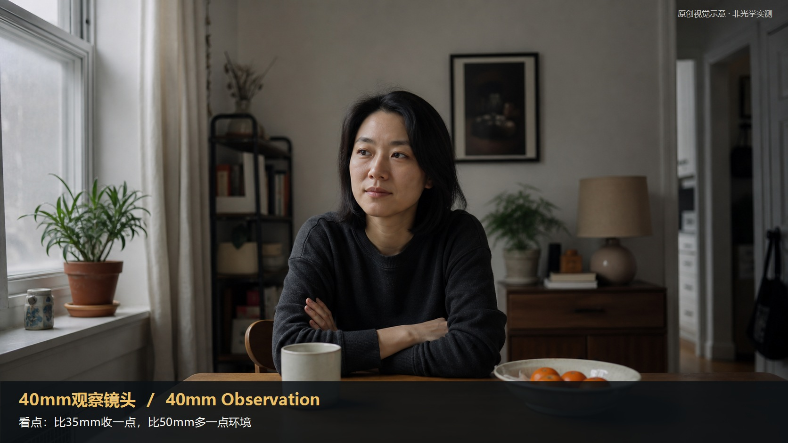

知识讲解：[A1-05 焦段与视觉心理](../../knowledge/A-%E7%90%86%E8%AE%BA%E5%B1%82/A1-%E6%91%84%E5%BD%B1%E7%BB%84/A1-05%20%E7%84%A6%E6%AE%B5%E4%B8%8E%E8%A7%86%E8%A7%89%E5%BF%83%E7%90%86.md)

## 焦段与视觉心理：速查层（选什么）（07-50mm-normal，原创教学示意）

知识讲解：[A1-05 焦段与视觉心理](../../knowledge/A-%E7%90%86%E8%AE%BA%E5%B1%82/A1-%E6%91%84%E5%BD%B1%E7%BB%84/A1-05%20%E7%84%A6%E6%AE%B5%E4%B8%8E%E8%A7%86%E8%A7%89%E5%BF%83%E7%90%86.md)

## 焦段与视觉心理：速查层（选什么）（08-65mm-short-telephoto，原创教学示意）

知识讲解：[A1-05 焦段与视觉心理](../../knowledge/A-%E7%90%86%E8%AE%BA%E5%B1%82/A1-%E6%91%84%E5%BD%B1%E7%BB%84/A1-05%20%E7%84%A6%E6%AE%B5%E4%B8%8E%E8%A7%86%E8%A7%89%E5%BF%83%E7%90%86.md)

## 焦段与视觉心理：速查层（选什么）（09-85mm-portrait，原创教学示意）

知识讲解：[A1-05 焦段与视觉心理](../../knowledge/A-%E7%90%86%E8%AE%BA%E5%B1%82/A1-%E6%91%84%E5%BD%B1%E7%BB%84/A1-05%20%E7%84%A6%E6%AE%B5%E4%B8%8E%E8%A7%86%E8%A7%89%E5%BF%83%E7%90%86.md)

## 焦段与视觉心理：速查层（选什么）（10-100-135mm-telephoto，原创教学示意）

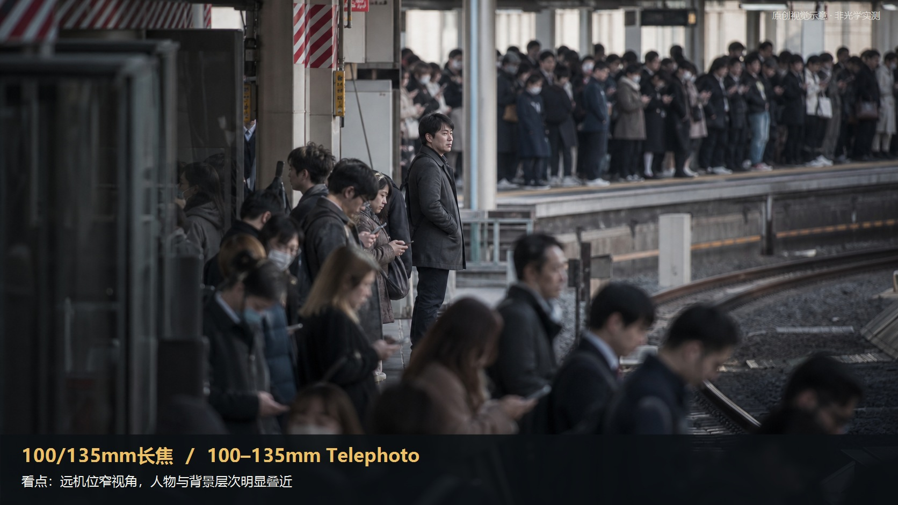

知识讲解：[A1-05 焦段与视觉心理](../../knowledge/A-%E7%90%86%E8%AE%BA%E5%B1%82/A1-%E6%91%84%E5%BD%B1%E7%BB%84/A1-05%20%E7%84%A6%E6%AE%B5%E4%B8%8E%E8%A7%86%E8%A7%89%E5%BF%83%E7%90%86.md)

## 焦段与视觉心理：速查层（选什么）（11-long-lens，原创教学示意）

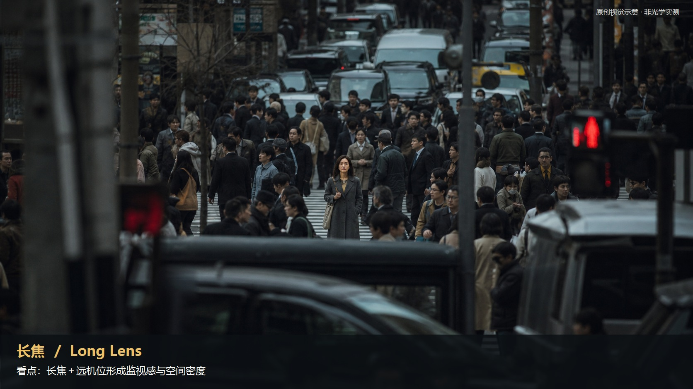

知识讲解：[A1-05 焦段与视觉心理](../../knowledge/A-%E7%90%86%E8%AE%BA%E5%B1%82/A1-%E6%91%84%E5%BD%B1%E7%BB%84/A1-05%20%E7%84%A6%E6%AE%B5%E4%B8%8E%E8%A7%86%E8%A7%89%E5%BF%83%E7%90%86.md)

## 焦段与视觉心理：速查层（选什么）（12-super-telephoto，原创教学示意）

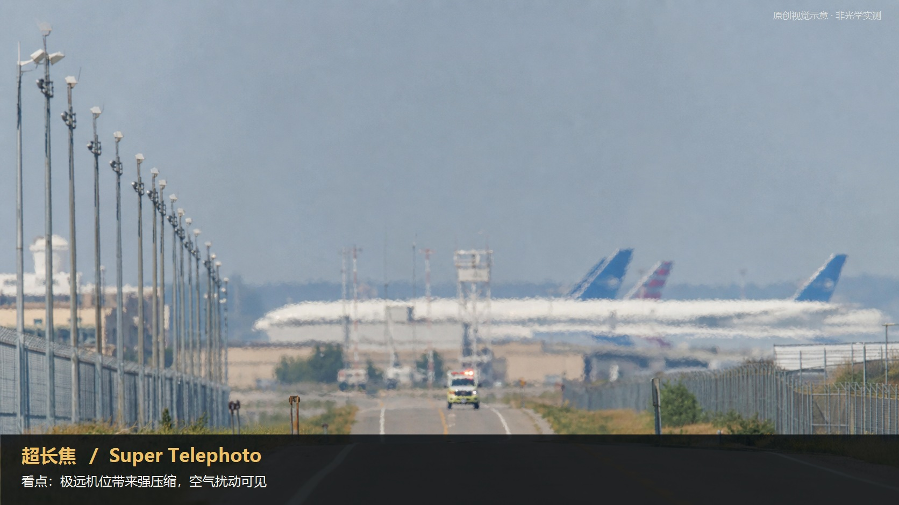

知识讲解：[A1-05 焦段与视觉心理](../../knowledge/A-%E7%90%86%E8%AE%BA%E5%B1%82/A1-%E6%91%84%E5%BD%B1%E7%BB%84/A1-05%20%E7%84%A6%E6%AE%B5%E4%B8%8E%E8%A7%86%E8%A7%89%E5%BF%83%E7%90%86.md)

## 焦段与视觉心理：速查层（选什么）（13-macro，原创教学示意）

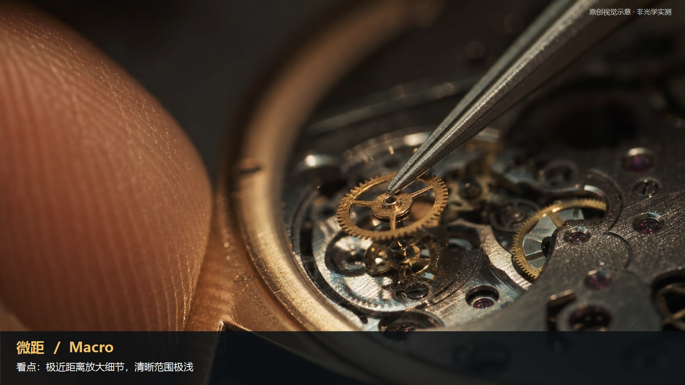

知识讲解：[A1-05 焦段与视觉心理](../../knowledge/A-%E7%90%86%E8%AE%BA%E5%B1%82/A1-%E6%91%84%E5%BD%B1%E7%BB%84/A1-05%20%E7%84%A6%E6%AE%B5%E4%B8%8E%E8%A7%86%E8%A7%89%E5%BF%83%E7%90%86.md)

## 焦段与视觉心理：速查层（选什么）（14-anamorphic，原创教学示意）

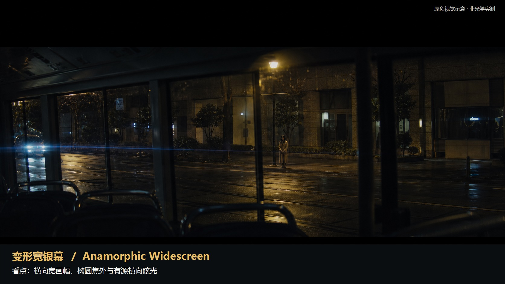

知识讲解：[A1-05 焦段与视觉心理](../../knowledge/A-%E7%90%86%E8%AE%BA%E5%B1%82/A1-%E6%91%84%E5%BD%B1%E7%BB%84/A1-05%20%E7%84%A6%E6%AE%B5%E4%B8%8E%E8%A7%86%E8%A7%89%E5%BF%83%E7%90%86.md)

## 焦段与视觉心理：速查层（选什么）（15-spherical-lens，原创教学示意）

知识讲解：[A1-05 焦段与视觉心理](../../knowledge/A-%E7%90%86%E8%AE%BA%E5%B1%82/A1-%E6%91%84%E5%BD%B1%E7%BB%84/A1-05%20%E7%84%A6%E6%AE%B5%E4%B8%8E%E8%A7%86%E8%A7%89%E5%BF%83%E7%90%86.md)

## 焦段与视觉心理：速查层（选什么）（16-imax-large-format，原创教学示意）

知识讲解：[A1-05 焦段与视觉心理](../../knowledge/A-%E7%90%86%E8%AE%BA%E5%B1%82/A1-%E6%91%84%E5%BD%B1%E7%BB%84/A1-05%20%E7%84%A6%E6%AE%B5%E4%B8%8E%E8%A7%86%E8%A7%89%E5%BF%83%E7%90%86.md)

## 焦段与视觉心理：速查层（选什么）（17-deep-focus，原创教学示意）

知识讲解：[A1-05 焦段与视觉心理](../../knowledge/A-%E7%90%86%E8%AE%BA%E5%B1%82/A1-%E6%91%84%E5%BD%B1%E7%BB%84/A1-05%20%E7%84%A6%E6%AE%B5%E4%B8%8E%E8%A7%86%E8%A7%89%E5%BF%83%E7%90%86.md)

## 焦段与视觉心理：速查层（选什么）（18-shallow-depth，原创教学示意）

知识讲解：[A1-05 焦段与视觉心理](../../knowledge/A-%E7%90%86%E8%AE%BA%E5%B1%82/A1-%E6%91%84%E5%BD%B1%E7%BB%84/A1-05%20%E7%84%A6%E6%AE%B5%E4%B8%8E%E8%A7%86%E8%A7%89%E5%BF%83%E7%90%86.md)

## 焦段与视觉心理：速查层（选什么）（19-long-lens-compression，原创教学示意）

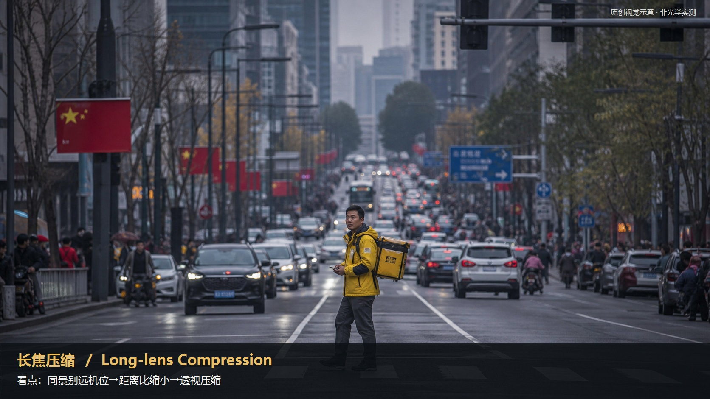

知识讲解：[A1-05 焦段与视觉心理](../../knowledge/A-%E7%90%86%E8%AE%BA%E5%B1%82/A1-%E6%91%84%E5%BD%B1%E7%BB%84/A1-05%20%E7%84%A6%E6%AE%B5%E4%B8%8E%E8%A7%86%E8%A7%89%E5%BF%83%E7%90%86.md)

## 焦段与视觉心理：速查层（选什么）（20-wide-angle-distortion，原创教学示意）

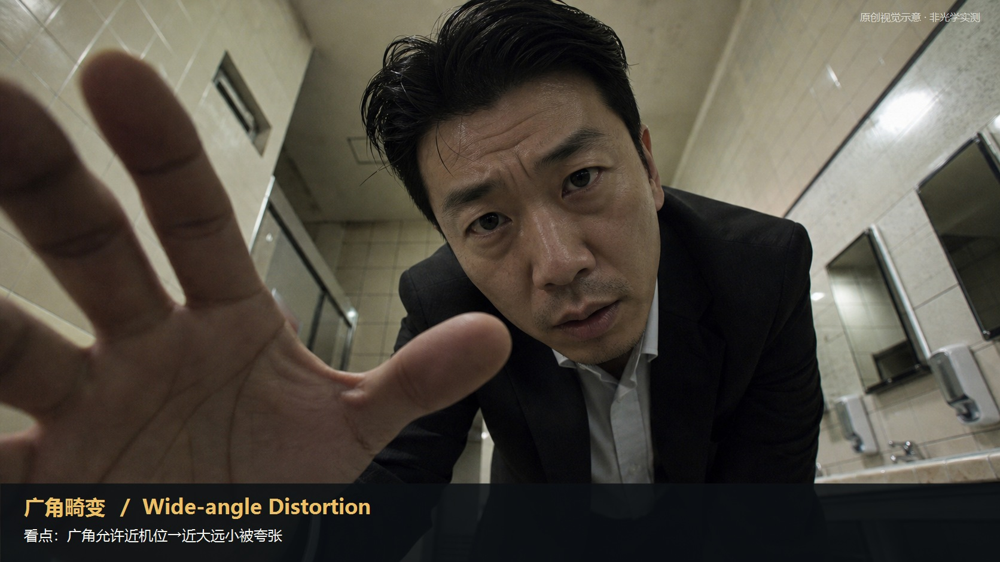

知识讲解：[A1-05 焦段与视觉心理](../../knowledge/A-%E7%90%86%E8%AE%BA%E5%B1%82/A1-%E6%91%84%E5%BD%B1%E7%BB%84/A1-05%20%E7%84%A6%E6%AE%B5%E4%B8%8E%E8%A7%86%E8%A7%89%E5%BF%83%E7%90%86.md)

## 焦段与视觉心理：速查层（选什么）（21-spatial-compression，原创教学示意）

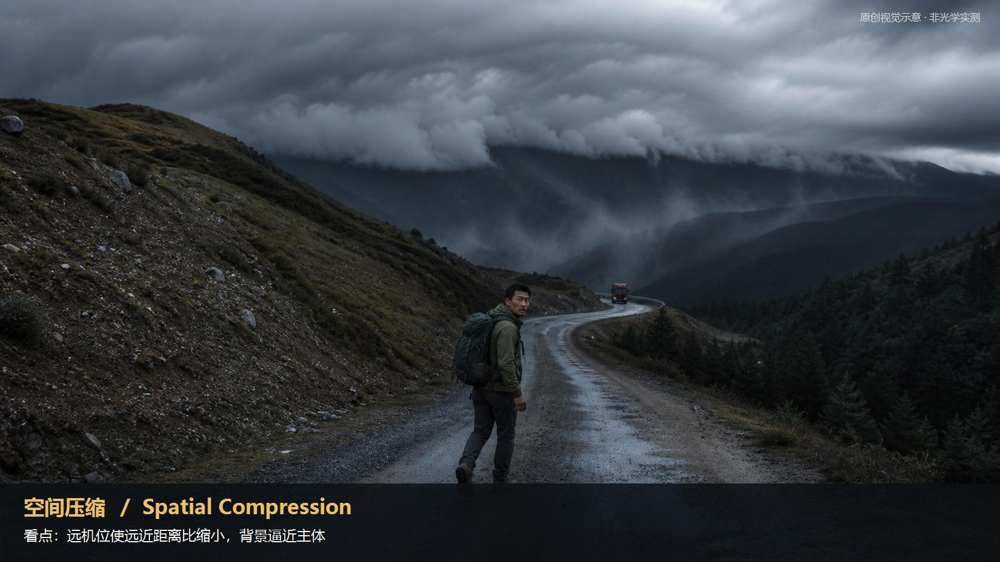

知识讲解：[A1-05 焦段与视觉心理](../../knowledge/A-%E7%90%86%E8%AE%BA%E5%B1%82/A1-%E6%91%84%E5%BD%B1%E7%BB%84/A1-05%20%E7%84%A6%E6%AE%B5%E4%B8%8E%E8%A7%86%E8%A7%89%E5%BF%83%E7%90%86.md)

## 焦段与视觉心理：速查层（选什么）（22-bokeh，原创教学示意）

知识讲解：[A1-05 焦段与视觉心理](../../knowledge/A-%E7%90%86%E8%AE%BA%E5%B1%82/A1-%E6%91%84%E5%BD%B1%E7%BB%84/A1-05%20%E7%84%A6%E6%AE%B5%E4%B8%8E%E8%A7%86%E8%A7%89%E5%BF%83%E7%90%86.md)

## 焦段与视觉心理：速查层（选什么）（23-realistic-depth，原创教学示意）

知识讲解：[A1-05 焦段与视觉心理](../../knowledge/A-%E7%90%86%E8%AE%BA%E5%B1%82/A1-%E6%91%84%E5%BD%B1%E7%BB%84/A1-05%20%E7%84%A6%E6%AE%B5%E4%B8%8E%E8%A7%86%E8%A7%89%E5%BF%83%E7%90%86.md)
