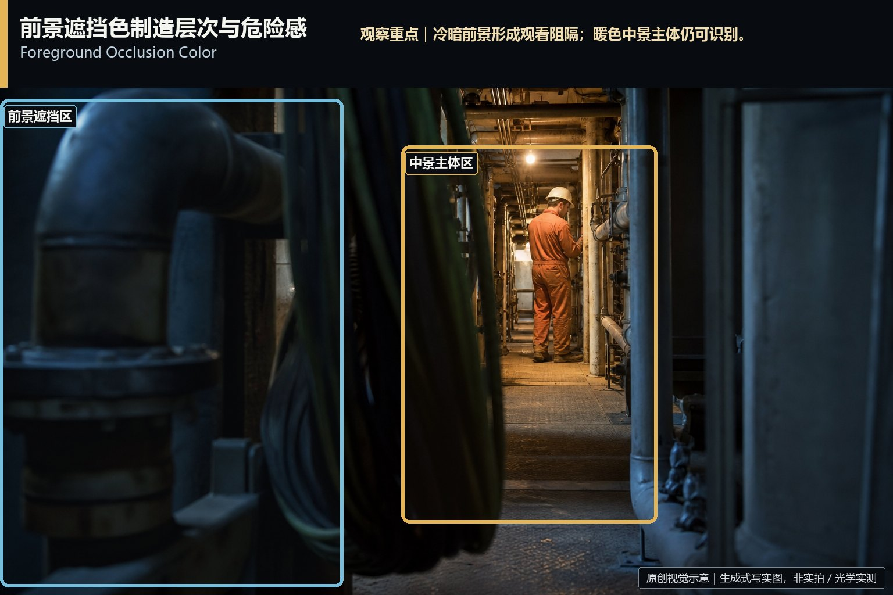
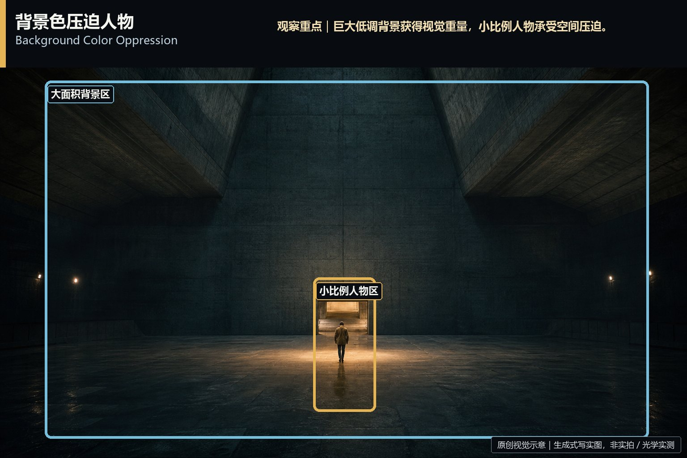
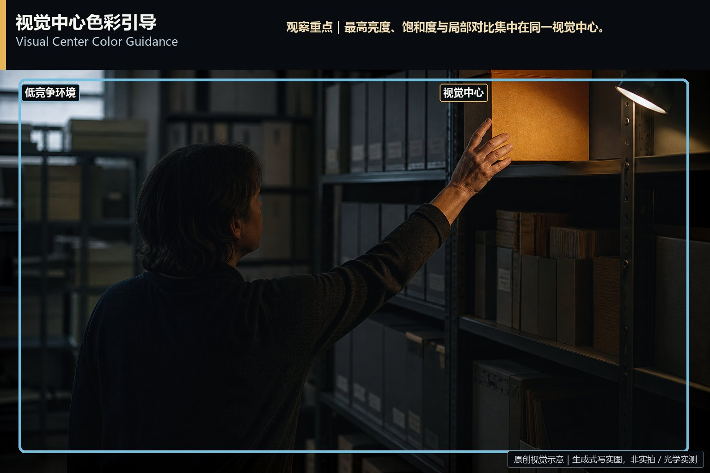
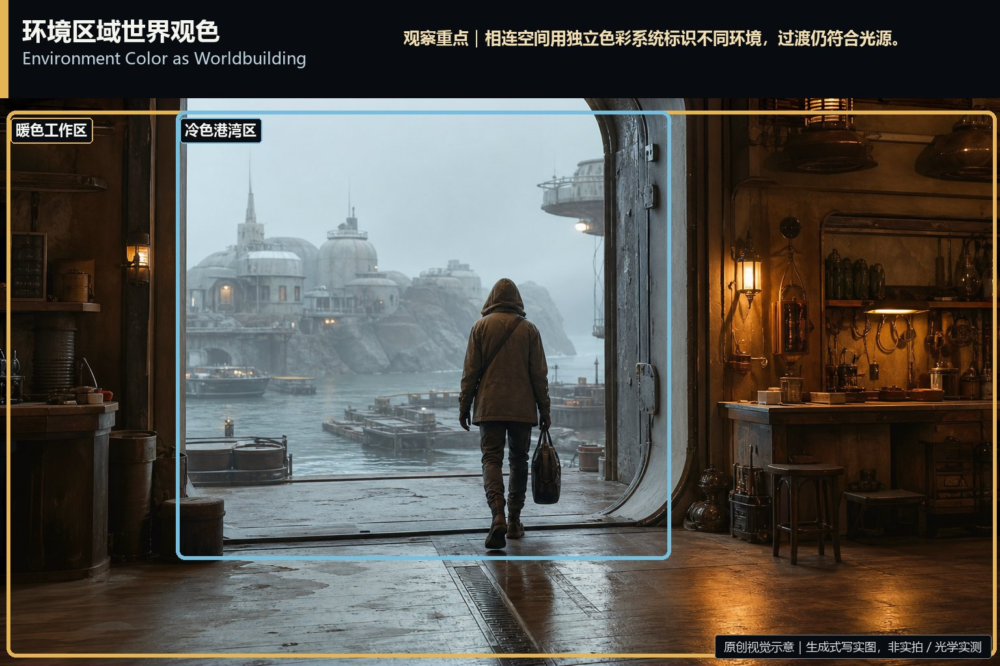
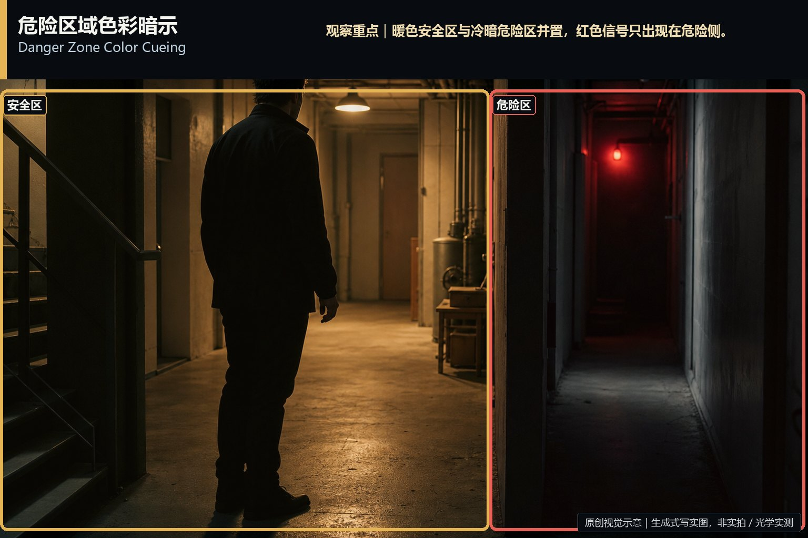
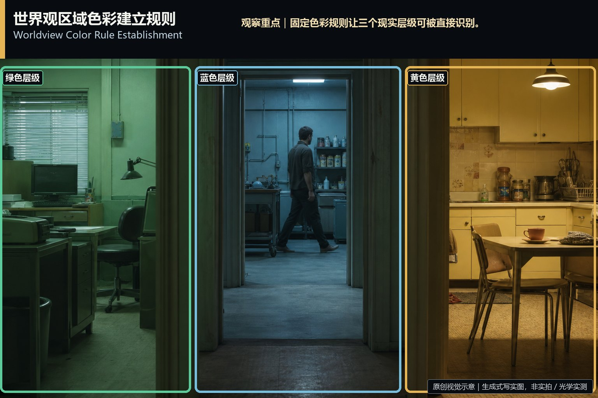
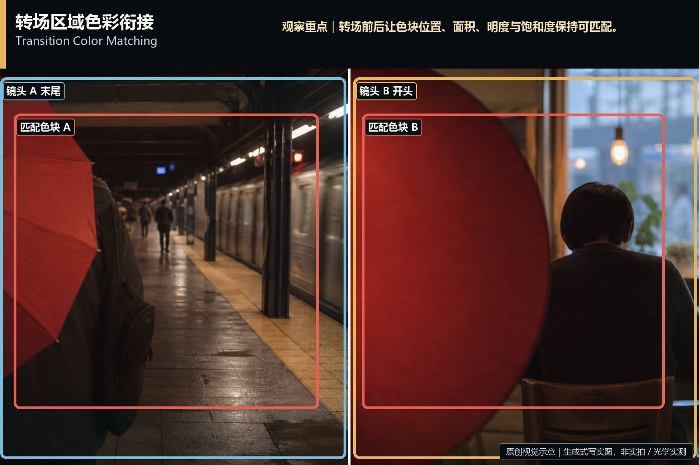
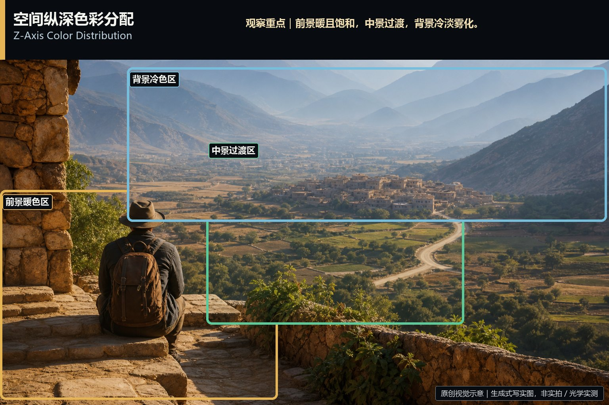

# frame-area-color · 1—10

[全部主题](../IMAGE_GALLERY.md) · [首页](../../README.md)

## 画面区域色彩分配：基础信息（01-foreground-occlusion-color，原创教学示意）

知识讲解：[A1-11 画面区域色彩分配](../../knowledge/A-%E7%90%86%E8%AE%BA%E5%B1%82/A1-%E6%91%84%E5%BD%B1%E7%BB%84/A1-11%20%E7%94%BB%E9%9D%A2%E5%8C%BA%E5%9F%9F%E8%89%B2%E5%BD%A9%E5%88%86%E9%85%8D.md)

## 画面区域色彩分配：基础信息（02-background-color-oppression，原创教学示意）

知识讲解：[A1-11 画面区域色彩分配](../../knowledge/A-%E7%90%86%E8%AE%BA%E5%B1%82/A1-%E6%91%84%E5%BD%B1%E7%BB%84/A1-11%20%E7%94%BB%E9%9D%A2%E5%8C%BA%E5%9F%9F%E8%89%B2%E5%BD%A9%E5%88%86%E9%85%8D.md)

## 画面区域色彩分配：基础信息（03-subject-background-separation，原创教学示意）

知识讲解：[A1-11 画面区域色彩分配](../../knowledge/A-%E7%90%86%E8%AE%BA%E5%B1%82/A1-%E6%91%84%E5%BD%B1%E7%BB%84/A1-11%20%E7%94%BB%E9%9D%A2%E5%8C%BA%E5%9F%9F%E8%89%B2%E5%BD%A9%E5%88%86%E9%85%8D.md)

## 画面区域色彩分配：基础信息（04-prop-color-narrative，原创教学示意）

知识讲解：[A1-11 画面区域色彩分配](../../knowledge/A-%E7%90%86%E8%AE%BA%E5%B1%82/A1-%E6%91%84%E5%BD%B1%E7%BB%84/A1-11%20%E7%94%BB%E9%9D%A2%E5%8C%BA%E5%9F%9F%E8%89%B2%E5%BD%A9%E5%88%86%E9%85%8D.md)

## 画面区域色彩分配：基础信息（05-visual-center-color-guidance，原创教学示意）

知识讲解：[A1-11 画面区域色彩分配](../../knowledge/A-%E7%90%86%E8%AE%BA%E5%B1%82/A1-%E6%91%84%E5%BD%B1%E7%BB%84/A1-11%20%E7%94%BB%E9%9D%A2%E5%8C%BA%E5%9F%9F%E8%89%B2%E5%BD%A9%E5%88%86%E9%85%8D.md)

## 画面区域色彩分配：基础信息（06-environment-color-worldbuilding，原创教学示意）

知识讲解：[A1-11 画面区域色彩分配](../../knowledge/A-%E7%90%86%E8%AE%BA%E5%B1%82/A1-%E6%91%84%E5%BD%B1%E7%BB%84/A1-11%20%E7%94%BB%E9%9D%A2%E5%8C%BA%E5%9F%9F%E8%89%B2%E5%BD%A9%E5%88%86%E9%85%8D.md)

## 画面区域色彩分配：基础信息（07-danger-zone-color-cueing，原创教学示意）

知识讲解：[A1-11 画面区域色彩分配](../../knowledge/A-%E7%90%86%E8%AE%BA%E5%B1%82/A1-%E6%91%84%E5%BD%B1%E7%BB%84/A1-11%20%E7%94%BB%E9%9D%A2%E5%8C%BA%E5%9F%9F%E8%89%B2%E5%BD%A9%E5%88%86%E9%85%8D.md)

## 画面区域色彩分配：基础信息（08-worldview-color-rules，原创教学示意）

知识讲解：[A1-11 画面区域色彩分配](../../knowledge/A-%E7%90%86%E8%AE%BA%E5%B1%82/A1-%E6%91%84%E5%BD%B1%E7%BB%84/A1-11%20%E7%94%BB%E9%9D%A2%E5%8C%BA%E5%9F%9F%E8%89%B2%E5%BD%A9%E5%88%86%E9%85%8D.md)

## 画面区域色彩分配：基础信息（09-transition-color-matching，原创教学示意）

知识讲解：[A1-11 画面区域色彩分配](../../knowledge/A-%E7%90%86%E8%AE%BA%E5%B1%82/A1-%E6%91%84%E5%BD%B1%E7%BB%84/A1-11%20%E7%94%BB%E9%9D%A2%E5%8C%BA%E5%9F%9F%E8%89%B2%E5%BD%A9%E5%88%86%E9%85%8D.md)

## 画面区域色彩分配：基础信息（10-z-axis-color-distribution，原创教学示意）

知识讲解：[A1-11 画面区域色彩分配](../../knowledge/A-%E7%90%86%E8%AE%BA%E5%B1%82/A1-%E6%91%84%E5%BD%B1%E7%BB%84/A1-11%20%E7%94%BB%E9%9D%A2%E5%8C%BA%E5%9F%9F%E8%89%B2%E5%BD%A9%E5%88%86%E9%85%8D.md)
