# genre-grammar · 1—19

[全部主题](../IMAGE_GALLERY.md) · [首页](../../README.md)

## 类型片语法：1. 科幻片（深度层见 二·一）（01-sci-fi，原创教学示意）

知识讲解：[A2-04 类型片语法](../../knowledge/A-%E7%90%86%E8%AE%BA%E5%B1%82/A2-%E5%AF%BC%E6%BC%94%E7%BB%84/A2-04%20%E7%B1%BB%E5%9E%8B%E7%89%87%E8%AF%AD%E6%B3%95.md) · [A2-07 电影视觉风格坐标系与术语总纲](../../knowledge/A-%E7%90%86%E8%AE%BA%E5%B1%82/A2-%E5%AF%BC%E6%BC%94%E7%BB%84/A2-07%20%E7%94%B5%E5%BD%B1%E8%A7%86%E8%A7%89%E9%A3%8E%E6%A0%BC%E5%9D%90%E6%A0%87%E7%B3%BB%E4%B8%8E%E6%9C%AF%E8%AF%AD%E6%80%BB%E7%BA%B2.md)

## 类型片语法：2. 硬科幻（02-hard-sci-fi，原创教学示意）

知识讲解：[A2-04 类型片语法](../../knowledge/A-%E7%90%86%E8%AE%BA%E5%B1%82/A2-%E5%AF%BC%E6%BC%94%E7%BB%84/A2-04%20%E7%B1%BB%E5%9E%8B%E7%89%87%E8%AF%AD%E6%B3%95.md)

## 类型片语法：3. 战争片（深度层见 二·二）（03-war，原创教学示意）

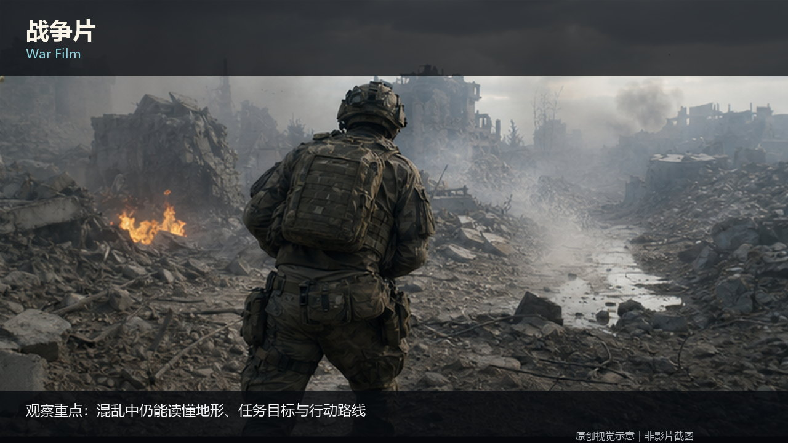

知识讲解：[A2-04 类型片语法](../../knowledge/A-%E7%90%86%E8%AE%BA%E5%B1%82/A2-%E5%AF%BC%E6%BC%94%E7%BB%84/A2-04%20%E7%B1%BB%E5%9E%8B%E7%89%87%E8%AF%AD%E6%B3%95.md)

## 类型片语法：4. 动作片（04-action，原创教学示意）

知识讲解：[A2-04 类型片语法](../../knowledge/A-%E7%90%86%E8%AE%BA%E5%B1%82/A2-%E5%AF%BC%E6%BC%94%E7%BB%84/A2-04%20%E7%B1%BB%E5%9E%8B%E7%89%87%E8%AF%AD%E6%B3%95.md)

## 类型片语法：5. 史诗片（深度层见 二·七）（05-epic，原创教学示意）

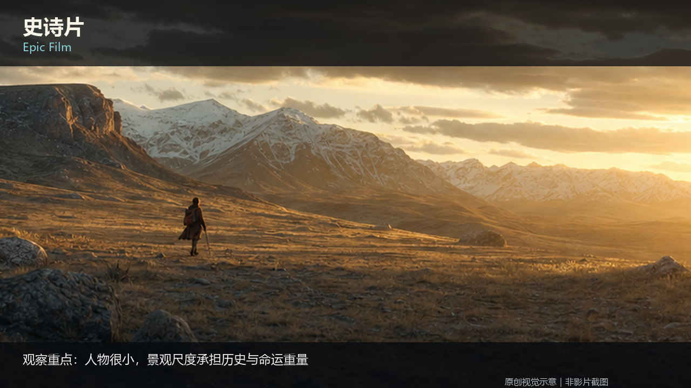

知识讲解：[A2-04 类型片语法](../../knowledge/A-%E7%90%86%E8%AE%BA%E5%B1%82/A2-%E5%AF%BC%E6%BC%94%E7%BB%84/A2-04%20%E7%B1%BB%E5%9E%8B%E7%89%87%E8%AF%AD%E6%B3%95.md)

## 类型片语法：6. 灾难片（06-disaster，原创教学示意）

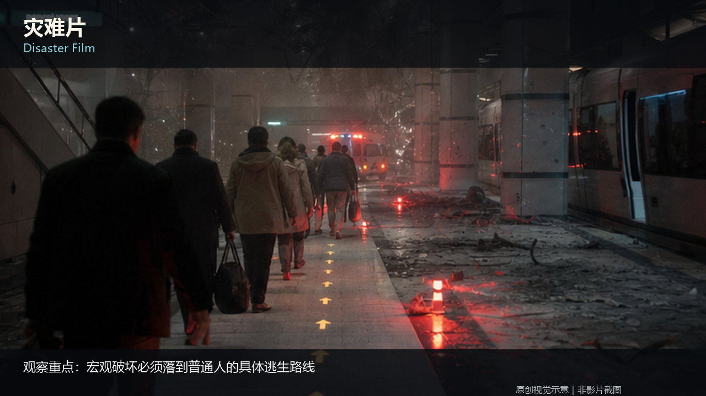

知识讲解：[A2-04 类型片语法](../../knowledge/A-%E7%90%86%E8%AE%BA%E5%B1%82/A2-%E5%AF%BC%E6%BC%94%E7%BB%84/A2-04%20%E7%B1%BB%E5%9E%8B%E7%89%87%E8%AF%AD%E6%B3%95.md)

## 类型片语法：7. 惊悚片（深度层见 二·六 恐怖/惊悚）（07-thriller，原创教学示意）

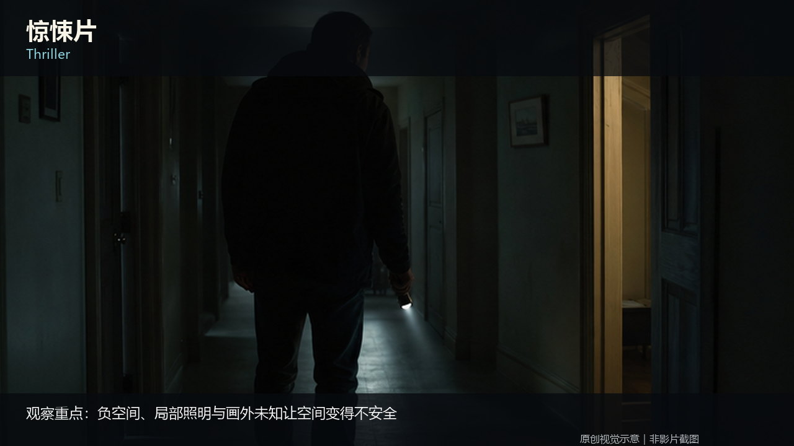

知识讲解：[A2-04 类型片语法](../../knowledge/A-%E7%90%86%E8%AE%BA%E5%B1%82/A2-%E5%AF%BC%E6%BC%94%E7%BB%84/A2-04%20%E7%B1%BB%E5%9E%8B%E7%89%87%E8%AF%AD%E6%B3%95.md)

## 类型片语法：8. 悬疑片（08-mystery，原创教学示意）

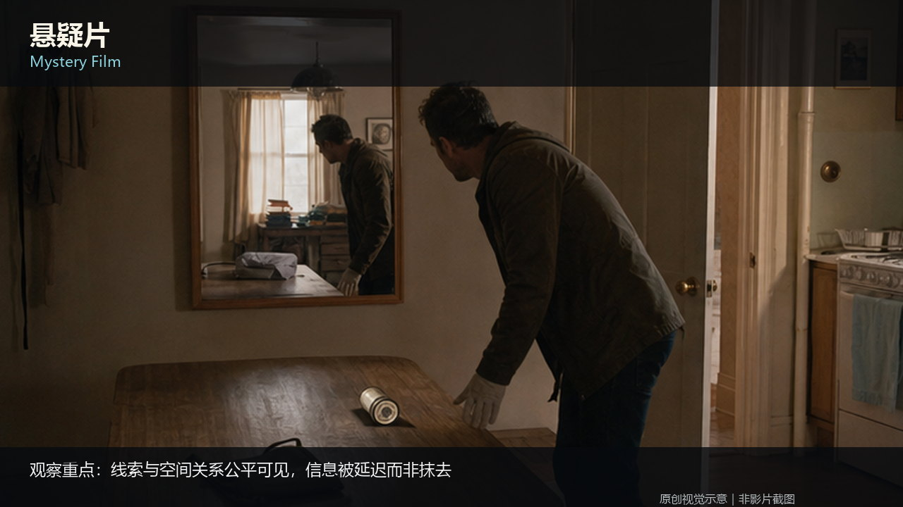

知识讲解：[A2-04 类型片语法](../../knowledge/A-%E7%90%86%E8%AE%BA%E5%B1%82/A2-%E5%AF%BC%E6%BC%94%E7%BB%84/A2-04%20%E7%B1%BB%E5%9E%8B%E7%89%87%E8%AF%AD%E6%B3%95.md)

## 类型片语法：9. 黑色电影（深度层见 二·三，新黑色见 二·四）（09-film-noir，原创教学示意）

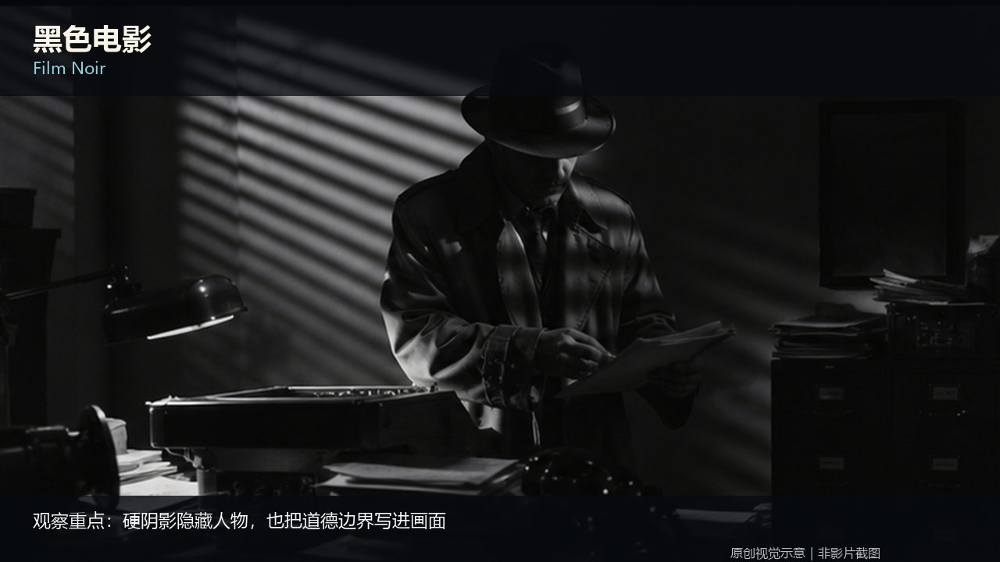

知识讲解：[A2-04 类型片语法](../../knowledge/A-%E7%90%86%E8%AE%BA%E5%B1%82/A2-%E5%AF%BC%E6%BC%94%E7%BB%84/A2-04%20%E7%B1%BB%E5%9E%8B%E7%89%87%E8%AF%AD%E6%B3%95.md) · [A2-07 电影视觉风格坐标系与术语总纲](../../knowledge/A-%E7%90%86%E8%AE%BA%E5%B1%82/A2-%E5%AF%BC%E6%BC%94%E7%BB%84/A2-07%20%E7%94%B5%E5%BD%B1%E8%A7%86%E8%A7%89%E9%A3%8E%E6%A0%BC%E5%9D%90%E6%A0%87%E7%B3%BB%E4%B8%8E%E6%9C%AF%E8%AF%AD%E6%80%BB%E7%BA%B2.md)

## 类型片语法：10. 纪录片（10-documentary，原创教学示意）

知识讲解：[A2-04 类型片语法](../../knowledge/A-%E7%90%86%E8%AE%BA%E5%B1%82/A2-%E5%AF%BC%E6%BC%94%E7%BB%84/A2-04%20%E7%B1%BB%E5%9E%8B%E7%89%87%E8%AF%AD%E6%B3%95.md)

## 类型片语法：11. 近未来军事科幻（11-near-future-military-sci-fi，原创教学示意）

知识讲解：[A2-04 类型片语法](../../knowledge/A-%E7%90%86%E8%AE%BA%E5%B1%82/A2-%E5%AF%BC%E6%BC%94%E7%BB%84/A2-04%20%E7%B1%BB%E5%9E%8B%E7%89%87%E8%AF%AD%E6%B3%95.md)

## 类型片语法：二·一 科幻电影美学（Sci-Fi Film Aesthetics）（12-sci-fi-core-mechanism，原创教学示意）

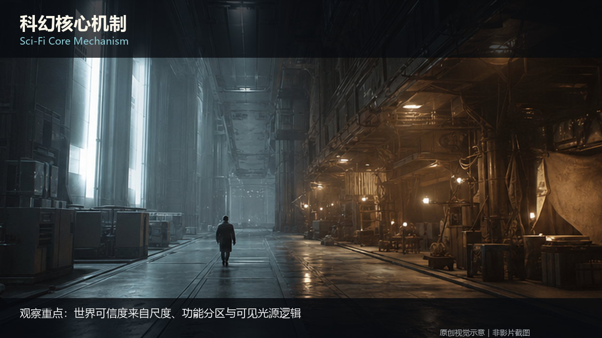

知识讲解：[A2-04 类型片语法](../../knowledge/A-%E7%90%86%E8%AE%BA%E5%B1%82/A2-%E5%AF%BC%E6%BC%94%E7%BB%84/A2-04%20%E7%B1%BB%E5%9E%8B%E7%89%87%E8%AF%AD%E6%B3%95.md)

## 类型片语法：二·二 战争电影美学（War Film Aesthetics）（13-war-technical-imperfection，原创教学示意）

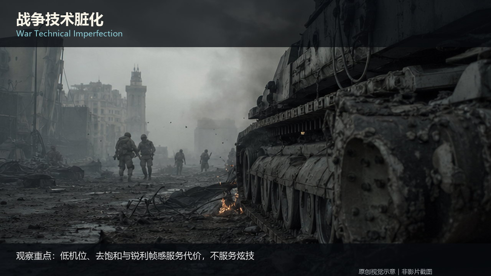

知识讲解：[A2-04 类型片语法](../../knowledge/A-%E7%90%86%E8%AE%BA%E5%B1%82/A2-%E5%AF%BC%E6%BC%94%E7%BB%84/A2-04%20%E7%B1%BB%E5%9E%8B%E7%89%87%E8%AF%AD%E6%B3%95.md)

## 类型片语法：二·三 黑色电影美学（Film Noir Aesthetics）（14-noir-core-mechanism，原创教学示意）

知识讲解：[A2-04 类型片语法](../../knowledge/A-%E7%90%86%E8%AE%BA%E5%B1%82/A2-%E5%AF%BC%E6%BC%94%E7%BB%84/A2-04%20%E7%B1%BB%E5%9E%8B%E7%89%87%E8%AF%AD%E6%B3%95.md)

## 类型片语法：二·四 新黑色电影美学（Neo-Noir Aesthetics）（15-neo-noir-core-mechanism，原创教学示意）

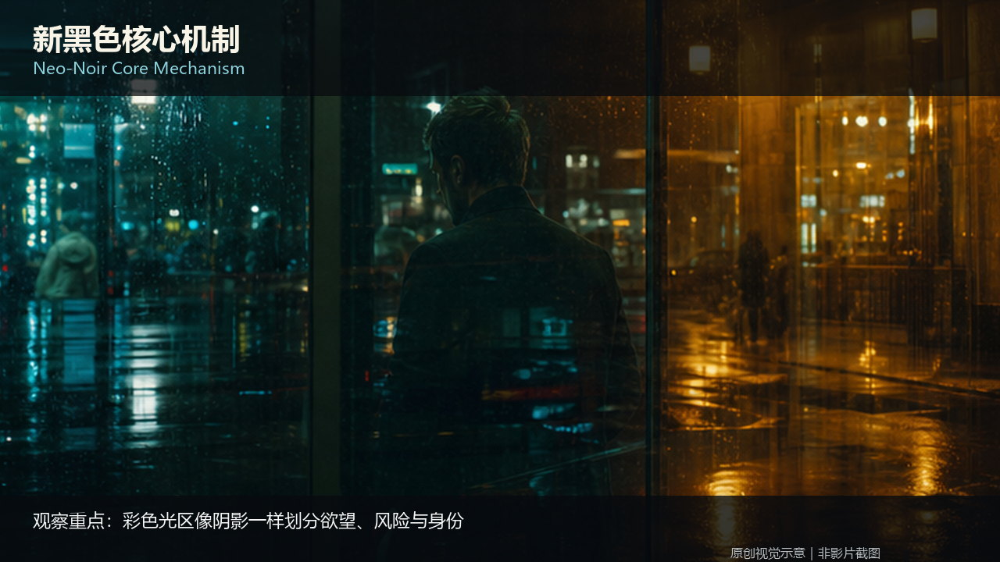

知识讲解：[A2-04 类型片语法](../../knowledge/A-%E7%90%86%E8%AE%BA%E5%B1%82/A2-%E5%AF%BC%E6%BC%94%E7%BB%84/A2-04%20%E7%B1%BB%E5%9E%8B%E7%89%87%E8%AF%AD%E6%B3%95.md)

## 类型片语法：二·五 赛博朋克美学（Cyberpunk Aesthetics）（16-cyberpunk，原创教学示意）

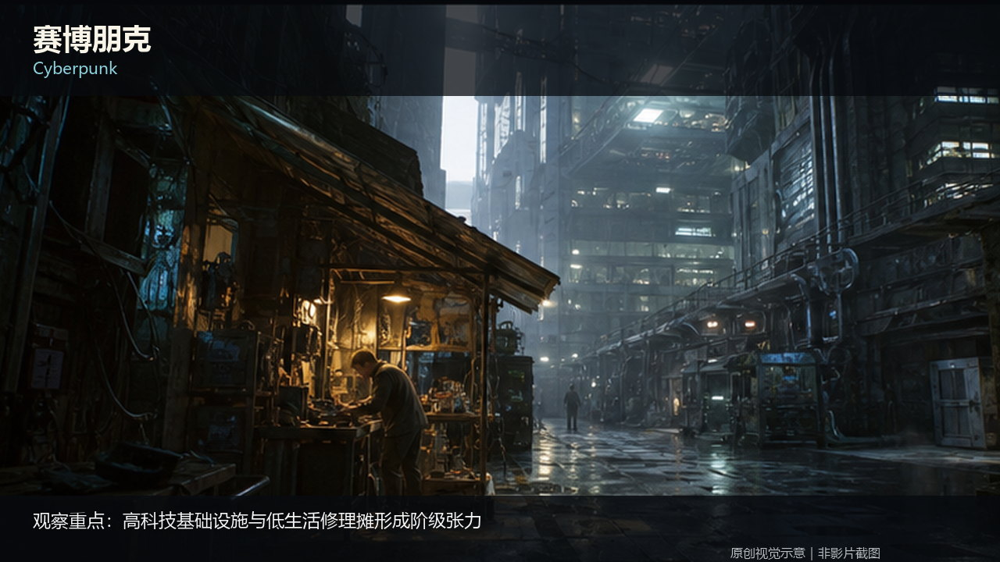

知识讲解：[A2-04 类型片语法](../../knowledge/A-%E7%90%86%E8%AE%BA%E5%B1%82/A2-%E5%AF%BC%E6%BC%94%E7%BB%84/A2-04%20%E7%B1%BB%E5%9E%8B%E7%89%87%E8%AF%AD%E6%B3%95.md) · [A2-07 电影视觉风格坐标系与术语总纲](../../knowledge/A-%E7%90%86%E8%AE%BA%E5%B1%82/A2-%E5%AF%BC%E6%BC%94%E7%BB%84/A2-07%20%E7%94%B5%E5%BD%B1%E8%A7%86%E8%A7%89%E9%A3%8E%E6%A0%BC%E5%9D%90%E6%A0%87%E7%B3%BB%E4%B8%8E%E6%9C%AF%E8%AF%AD%E6%80%BB%E7%BA%B2.md)

## 类型片语法：二·六 恐怖/惊悚美学（Horror/Thriller Aesthetics）（17-horror-thriller，原创教学示意）

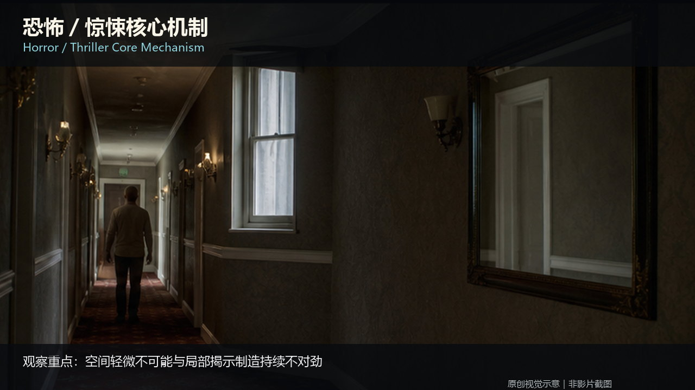

知识讲解：[A2-04 类型片语法](../../knowledge/A-%E7%90%86%E8%AE%BA%E5%B1%82/A2-%E5%AF%BC%E6%BC%94%E7%BB%84/A2-04%20%E7%B1%BB%E5%9E%8B%E7%89%87%E8%AF%AD%E6%B3%95.md)

## 类型片语法：二·七 史诗/历史美学（Epic/Historical Aesthetics）（18-epic-historical，原创教学示意）

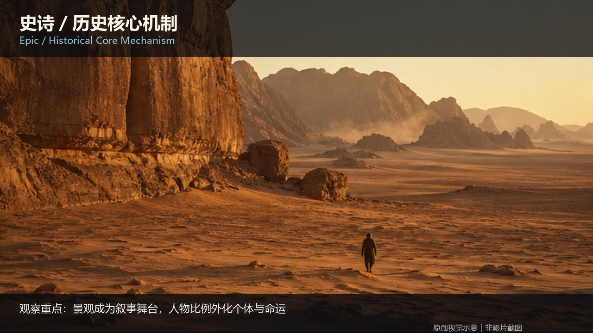

知识讲解：[A2-04 类型片语法](../../knowledge/A-%E7%90%86%E8%AE%BA%E5%B1%82/A2-%E5%AF%BC%E6%BC%94%E7%BB%84/A2-04%20%E7%B1%BB%E5%9E%8B%E7%89%87%E8%AF%AD%E6%B3%95.md)

## 类型片语法：二·八 文艺电影美学（Art-House/Arthouse Aesthetics）（19-arthouse，原创教学示意）

知识讲解：[A2-04 类型片语法](../../knowledge/A-%E7%90%86%E8%AE%BA%E5%B1%82/A2-%E5%AF%BC%E6%BC%94%E7%BB%84/A2-04%20%E7%B1%BB%E5%9E%8B%E7%89%87%E8%AF%AD%E6%B3%95.md) · [A2-07 电影视觉风格坐标系与术语总纲](../../knowledge/A-%E7%90%86%E8%AE%BA%E5%B1%82/A2-%E5%AF%BC%E6%BC%94%E7%BB%84/A2-07%20%E7%94%B5%E5%BD%B1%E8%A7%86%E8%A7%89%E9%A3%8E%E6%A0%BC%E5%9D%90%E6%A0%87%E7%B3%BB%E4%B8%8E%E6%9C%AF%E8%AF%AD%E6%80%BB%E7%BA%B2.md)
