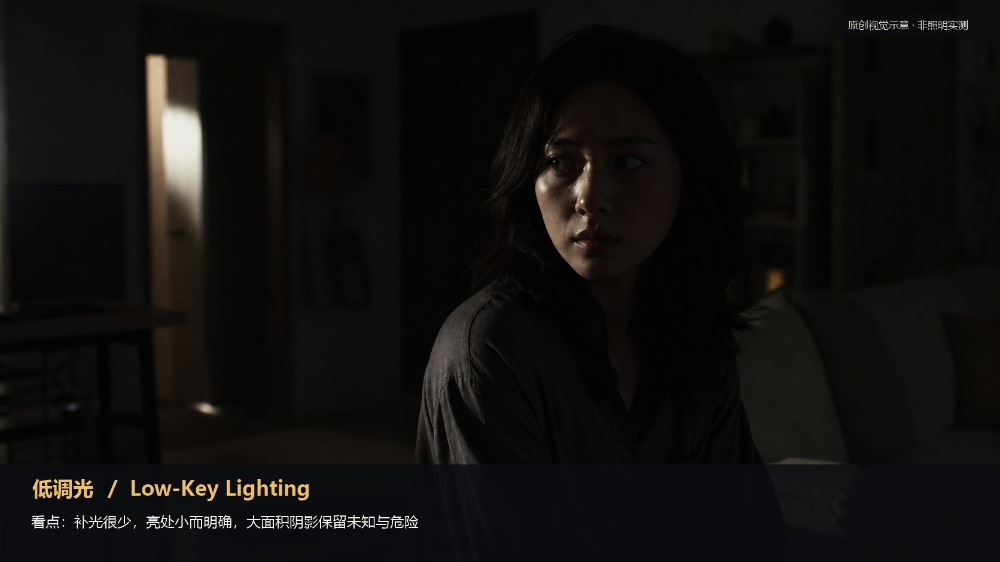
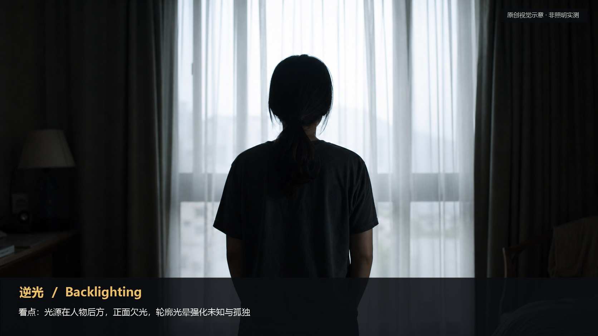
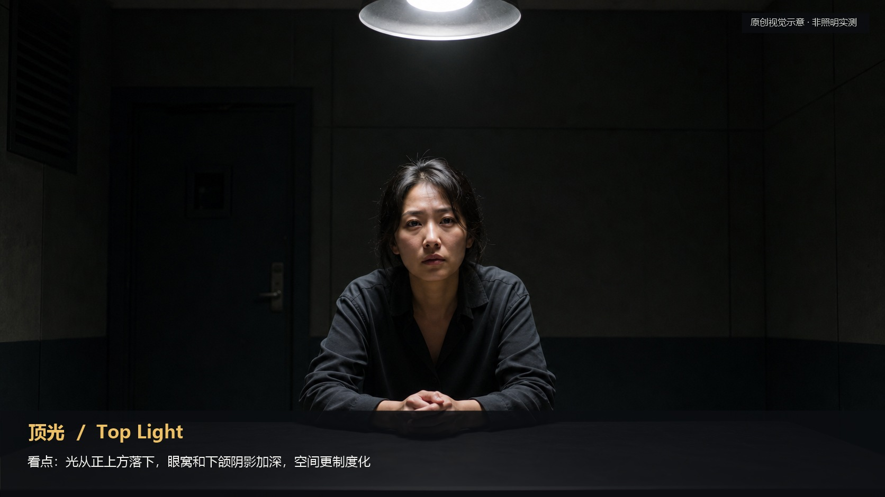
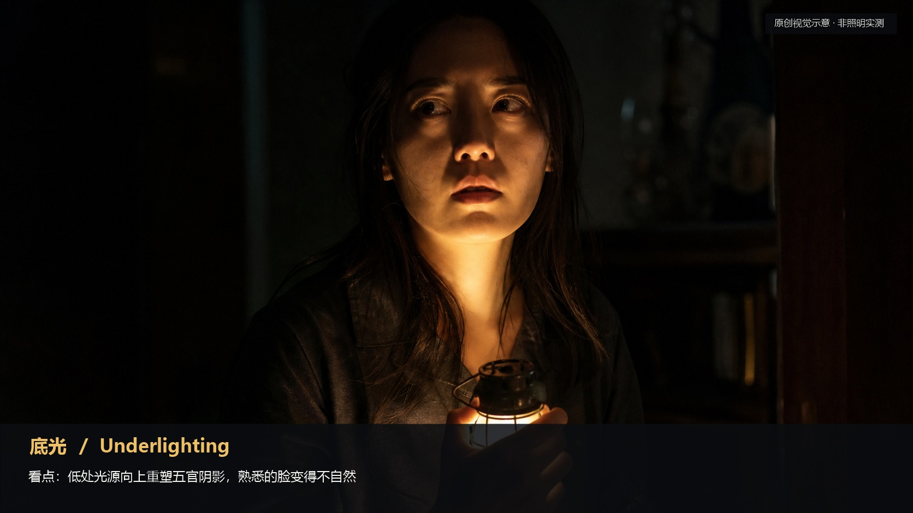
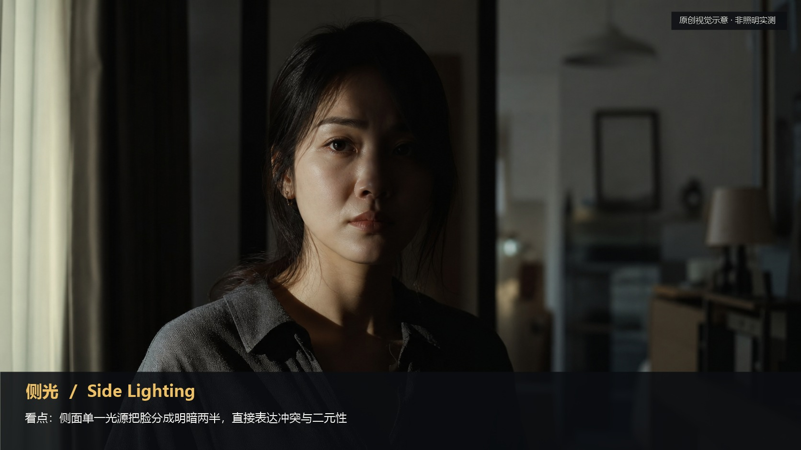
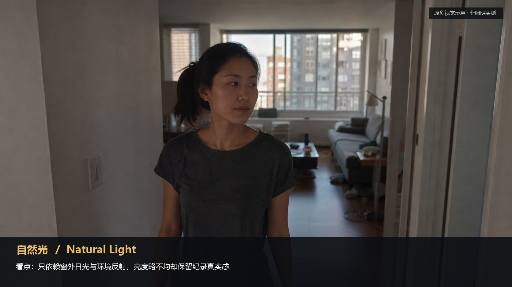
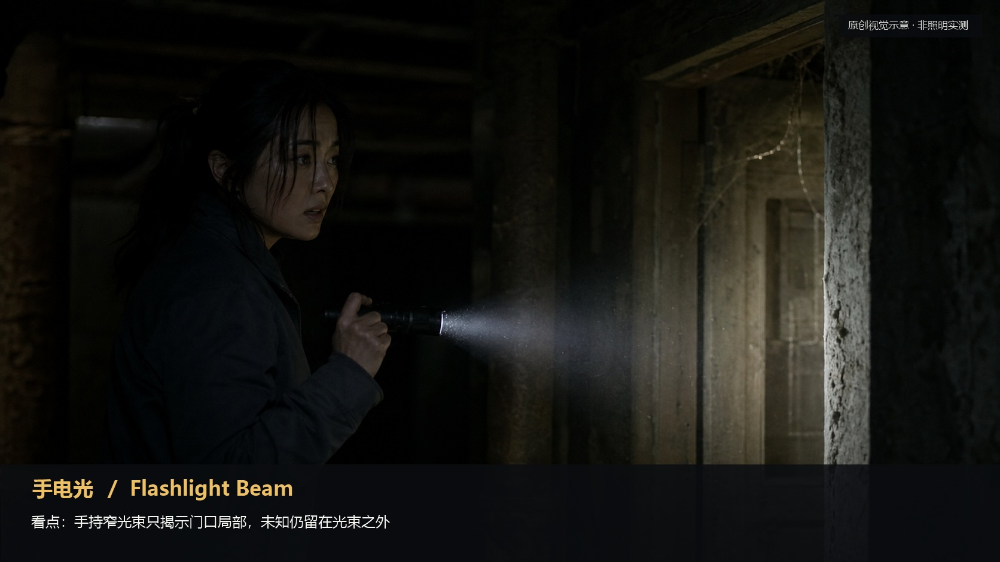
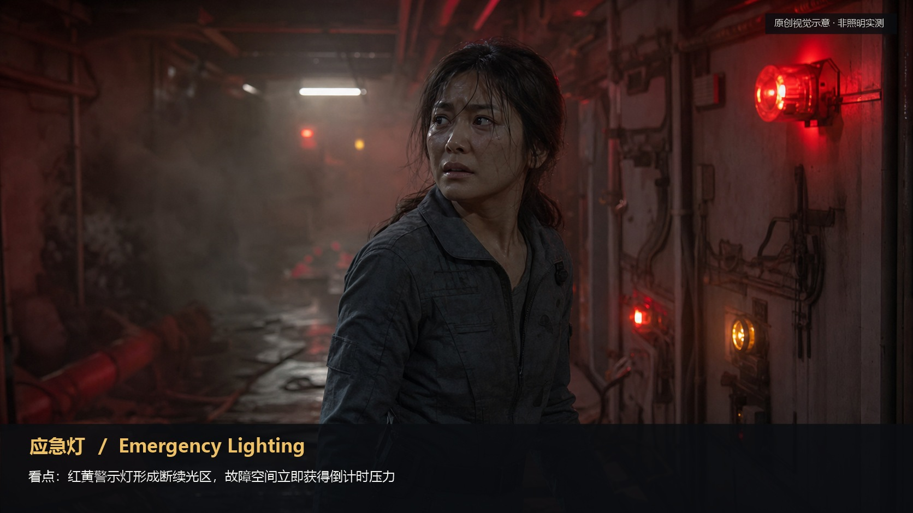
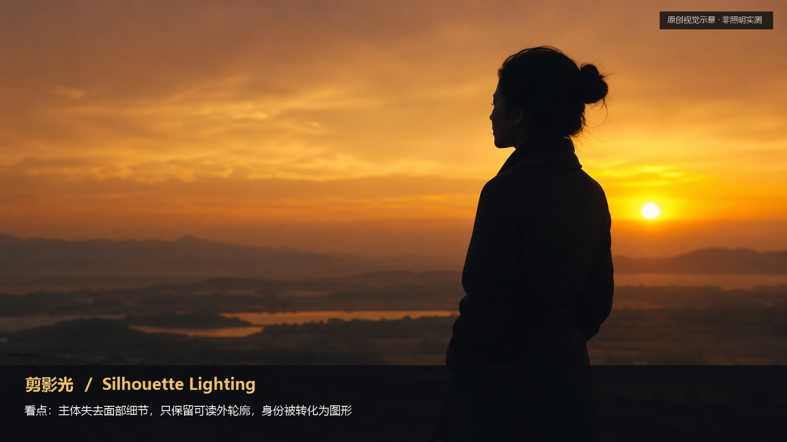
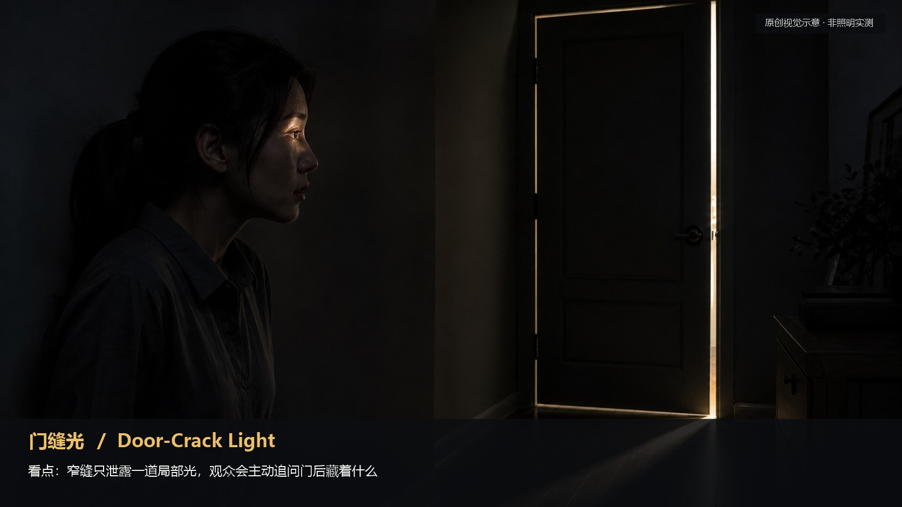

# lighting · 1—24

[全部主题](../IMAGE_GALLERY.md) · [首页](../../README.md)

## 光影表达系统：第一层 · 光影速查表（前身 09-07）（01-high-key，原创教学示意）

知识讲解：[A1-06 光影表达系统](../../knowledge/A-%E7%90%86%E8%AE%BA%E5%B1%82/A1-%E6%91%84%E5%BD%B1%E7%BB%84/A1-06%20%E5%85%89%E5%BD%B1%E8%A1%A8%E8%BE%BE%E7%B3%BB%E7%BB%9F.md)

## 光影表达系统：第一层 · 光影速查表（前身 09-07）（02-low-key，原创教学示意）

知识讲解：[A1-06 光影表达系统](../../knowledge/A-%E7%90%86%E8%AE%BA%E5%B1%82/A1-%E6%91%84%E5%BD%B1%E7%BB%84/A1-06%20%E5%85%89%E5%BD%B1%E8%A1%A8%E8%BE%BE%E7%B3%BB%E7%BB%9F.md)

## 光影表达系统：第一层 · 光影速查表（前身 09-07）（03-rembrandt，原创教学示意）

知识讲解：[A1-06 光影表达系统](../../knowledge/A-%E7%90%86%E8%AE%BA%E5%B1%82/A1-%E6%91%84%E5%BD%B1%E7%BB%84/A1-06%20%E5%85%89%E5%BD%B1%E8%A1%A8%E8%BE%BE%E7%B3%BB%E7%BB%9F.md)

## 光影表达系统：第一层 · 光影速查表（前身 09-07）（04-rim-light，原创教学示意）

知识讲解：[A1-06 光影表达系统](../../knowledge/A-%E7%90%86%E8%AE%BA%E5%B1%82/A1-%E6%91%84%E5%BD%B1%E7%BB%84/A1-06%20%E5%85%89%E5%BD%B1%E8%A1%A8%E8%BE%BE%E7%B3%BB%E7%BB%9F.md)

## 光影表达系统：第一层 · 光影速查表（前身 09-07）（05-backlight，原创教学示意）

知识讲解：[A1-06 光影表达系统](../../knowledge/A-%E7%90%86%E8%AE%BA%E5%B1%82/A1-%E6%91%84%E5%BD%B1%E7%BB%84/A1-06%20%E5%85%89%E5%BD%B1%E8%A1%A8%E8%BE%BE%E7%B3%BB%E7%BB%9F.md)

## 光影表达系统：第一层 · 光影速查表（前身 09-07）（06-top-light，原创教学示意）

知识讲解：[A1-06 光影表达系统](../../knowledge/A-%E7%90%86%E8%AE%BA%E5%B1%82/A1-%E6%91%84%E5%BD%B1%E7%BB%84/A1-06%20%E5%85%89%E5%BD%B1%E8%A1%A8%E8%BE%BE%E7%B3%BB%E7%BB%9F.md)

## 光影表达系统：第一层 · 光影速查表（前身 09-07）（07-underlight，原创教学示意）

知识讲解：[A1-06 光影表达系统](../../knowledge/A-%E7%90%86%E8%AE%BA%E5%B1%82/A1-%E6%91%84%E5%BD%B1%E7%BB%84/A1-06%20%E5%85%89%E5%BD%B1%E8%A1%A8%E8%BE%BE%E7%B3%BB%E7%BB%9F.md)

## 光影表达系统：第一层 · 光影速查表（前身 09-07）（08-side-light，原创教学示意）

知识讲解：[A1-06 光影表达系统](../../knowledge/A-%E7%90%86%E8%AE%BA%E5%B1%82/A1-%E6%91%84%E5%BD%B1%E7%BB%84/A1-06%20%E5%85%89%E5%BD%B1%E8%A1%A8%E8%BE%BE%E7%B3%BB%E7%BB%9F.md)

## 光影表达系统：第一层 · 光影速查表（前身 09-07）（09-hard-light，原创教学示意）

知识讲解：[A1-06 光影表达系统](../../knowledge/A-%E7%90%86%E8%AE%BA%E5%B1%82/A1-%E6%91%84%E5%BD%B1%E7%BB%84/A1-06%20%E5%85%89%E5%BD%B1%E8%A1%A8%E8%BE%BE%E7%B3%BB%E7%BB%9F.md)

## 光影表达系统：第一层 · 光影速查表（前身 09-07）（10-soft-light，原创教学示意）

知识讲解：[A1-06 光影表达系统](../../knowledge/A-%E7%90%86%E8%AE%BA%E5%B1%82/A1-%E6%91%84%E5%BD%B1%E7%BB%84/A1-06%20%E5%85%89%E5%BD%B1%E8%A1%A8%E8%BE%BE%E7%B3%BB%E7%BB%9F.md)

## 光影表达系统：第一层 · 光影速查表（前身 09-07）（11-natural-light，原创教学示意）

知识讲解：[A1-06 光影表达系统](../../knowledge/A-%E7%90%86%E8%AE%BA%E5%B1%82/A1-%E6%91%84%E5%BD%B1%E7%BB%84/A1-06%20%E5%85%89%E5%BD%B1%E8%A1%A8%E8%BE%BE%E7%B3%BB%E7%BB%9F.md)

## 光影表达系统：第一层 · 光影速查表（前身 09-07）（12-practical-light，原创教学示意）

知识讲解：[A1-06 光影表达系统](../../knowledge/A-%E7%90%86%E8%AE%BA%E5%B1%82/A1-%E6%91%84%E5%BD%B1%E7%BB%84/A1-06%20%E5%85%89%E5%BD%B1%E8%A1%A8%E8%BE%BE%E7%B3%BB%E7%BB%9F.md)

## 光影表达系统：第一层 · 光影速查表（前身 09-07）（13-candlelight，原创教学示意）

知识讲解：[A1-06 光影表达系统](../../knowledge/A-%E7%90%86%E8%AE%BA%E5%B1%82/A1-%E6%91%84%E5%BD%B1%E7%BB%84/A1-06%20%E5%85%89%E5%BD%B1%E8%A1%A8%E8%BE%BE%E7%B3%BB%E7%BB%9F.md)

## 光影表达系统：第一层 · 光影速查表（前身 09-07）（14-firelight，原创教学示意）

知识讲解：[A1-06 光影表达系统](../../knowledge/A-%E7%90%86%E8%AE%BA%E5%B1%82/A1-%E6%91%84%E5%BD%B1%E7%BB%84/A1-06%20%E5%85%89%E5%BD%B1%E8%A1%A8%E8%BE%BE%E7%B3%BB%E7%BB%9F.md)

## 光影表达系统：第一层 · 光影速查表（前身 09-07）（15-screen-light，原创教学示意）

知识讲解：[A1-06 光影表达系统](../../knowledge/A-%E7%90%86%E8%AE%BA%E5%B1%82/A1-%E6%91%84%E5%BD%B1%E7%BB%84/A1-06%20%E5%85%89%E5%BD%B1%E8%A1%A8%E8%BE%BE%E7%B3%BB%E7%BB%9F.md)

## 光影表达系统：第一层 · 光影速查表（前身 09-07）（16-flashlight，原创教学示意）

知识讲解：[A1-06 光影表达系统](../../knowledge/A-%E7%90%86%E8%AE%BA%E5%B1%82/A1-%E6%91%84%E5%BD%B1%E7%BB%84/A1-06%20%E5%85%89%E5%BD%B1%E8%A1%A8%E8%BE%BE%E7%B3%BB%E7%BB%9F.md)

## 光影表达系统：第一层 · 光影速查表（前身 09-07）（17-emergency-light，原创教学示意）

知识讲解：[A1-06 光影表达系统](../../knowledge/A-%E7%90%86%E8%AE%BA%E5%B1%82/A1-%E6%91%84%E5%BD%B1%E7%BB%84/A1-06%20%E5%85%89%E5%BD%B1%E8%A1%A8%E8%BE%BE%E7%B3%BB%E7%BB%9F.md)

## 光影表达系统：第一层 · 光影速查表（前身 09-07）（18-neon-light，原创教学示意）

知识讲解：[A1-06 光影表达系统](../../knowledge/A-%E7%90%86%E8%AE%BA%E5%B1%82/A1-%E6%91%84%E5%BD%B1%E7%BB%84/A1-06%20%E5%85%89%E5%BD%B1%E8%A1%A8%E8%BE%BE%E7%B3%BB%E7%BB%9F.md)

## 光影表达系统：第一层 · 光影速查表（前身 09-07）（19-industrial-white，原创教学示意）

知识讲解：[A1-06 光影表达系统](../../knowledge/A-%E7%90%86%E8%AE%BA%E5%B1%82/A1-%E6%91%84%E5%BD%B1%E7%BB%84/A1-06%20%E5%85%89%E5%BD%B1%E8%A1%A8%E8%BE%BE%E7%B3%BB%E7%BB%9F.md)

## 光影表达系统：第一层 · 光影速查表（前身 09-07）（20-surgical-top，原创教学示意）

知识讲解：[A1-06 光影表达系统](../../knowledge/A-%E7%90%86%E8%AE%BA%E5%B1%82/A1-%E6%91%84%E5%BD%B1%E7%BB%84/A1-06%20%E5%85%89%E5%BD%B1%E8%A1%A8%E8%BE%BE%E7%B3%BB%E7%BB%9F.md)

## 光影表达系统：第一层 · 光影速查表（前身 09-07）（21-film-noir，原创教学示意）

知识讲解：[A1-06 光影表达系统](../../knowledge/A-%E7%90%86%E8%AE%BA%E5%B1%82/A1-%E6%91%84%E5%BD%B1%E7%BB%84/A1-06%20%E5%85%89%E5%BD%B1%E8%A1%A8%E8%BE%BE%E7%B3%BB%E7%BB%9F.md)

## 光影表达系统：第一层 · 光影速查表（前身 09-07）（22-silhouette，原创教学示意）

知识讲解：[A1-06 光影表达系统](../../knowledge/A-%E7%90%86%E8%AE%BA%E5%B1%82/A1-%E6%91%84%E5%BD%B1%E7%BB%84/A1-06%20%E5%85%89%E5%BD%B1%E8%A1%A8%E8%BE%BE%E7%B3%BB%E7%BB%9F.md)

## 光影表达系统：第一层 · 光影速查表（前身 09-07）（23-window-light，原创教学示意）

知识讲解：[A1-06 光影表达系统](../../knowledge/A-%E7%90%86%E8%AE%BA%E5%B1%82/A1-%E6%91%84%E5%BD%B1%E7%BB%84/A1-06%20%E5%85%89%E5%BD%B1%E8%A1%A8%E8%BE%BE%E7%B3%BB%E7%BB%9F.md)

## 光影表达系统：第一层 · 光影速查表（前身 09-07）（24-door-crack，原创教学示意）

知识讲解：[A1-06 光影表达系统](../../knowledge/A-%E7%90%86%E8%AE%BA%E5%B1%82/A1-%E6%91%84%E5%BD%B1%E7%BB%84/A1-06%20%E5%85%89%E5%BD%B1%E8%A1%A8%E8%BE%BE%E7%B3%BB%E7%BB%9F.md)
