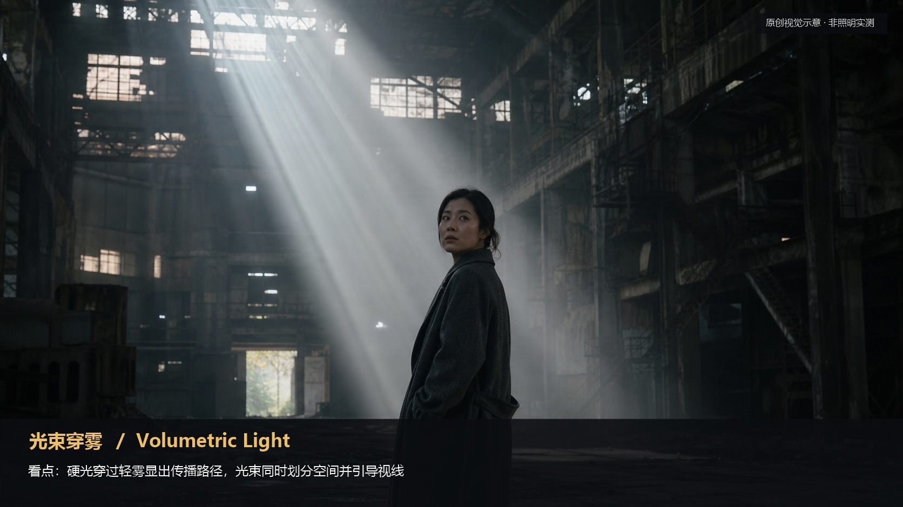
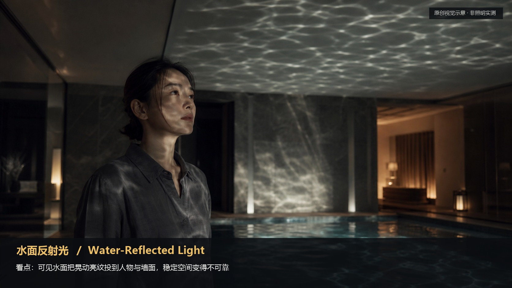

# lighting · 25—28

[全部主题](../IMAGE_GALLERY.md) · [首页](../../README.md)

## 光影表达系统：第一层 · 光影速查表（前身 09-07）（25-volumetric-beams，原创教学示意）

知识讲解：[A1-06 光影表达系统](../../knowledge/A-%E7%90%86%E8%AE%BA%E5%B1%82/A1-%E6%91%84%E5%BD%B1%E7%BB%84/A1-06%20%E5%85%89%E5%BD%B1%E8%A1%A8%E8%BE%BE%E7%B3%BB%E7%BB%9F.md)

## 光影表达系统：第一层 · 光影速查表（前身 09-07）（26-rain-reflection，原创教学示意）

知识讲解：[A1-06 光影表达系统](../../knowledge/A-%E7%90%86%E8%AE%BA%E5%B1%82/A1-%E6%91%84%E5%BD%B1%E7%BB%84/A1-06%20%E5%85%89%E5%BD%B1%E8%A1%A8%E8%BE%BE%E7%B3%BB%E7%BB%9F.md)

## 光影表达系统：第一层 · 光影速查表（前身 09-07）（27-water-reflection，原创教学示意）

知识讲解：[A1-06 光影表达系统](../../knowledge/A-%E7%90%86%E8%AE%BA%E5%B1%82/A1-%E6%91%84%E5%BD%B1%E7%BB%84/A1-06%20%E5%85%89%E5%BD%B1%E8%A1%A8%E8%BE%BE%E7%B3%BB%E7%BB%9F.md)

## 光影表达系统：第一层 · 光影速查表（前身 09-07）（28-warm-cool-conflict，原创教学示意）

知识讲解：[A1-06 光影表达系统](../../knowledge/A-%E7%90%86%E8%AE%BA%E5%B1%82/A1-%E6%91%84%E5%BD%B1%E7%BB%84/A1-06%20%E5%85%89%E5%BD%B1%E8%A1%A8%E8%BE%BE%E7%B3%BB%E7%BB%9F.md)
