# lighting-construction · 1—14

[全部主题](../IMAGE_GALLERY.md) · [首页](../../README.md)

## 光影构造：1. 低调照明(Low-key Lighting)（01-low-key-lighting，原创教学示意）

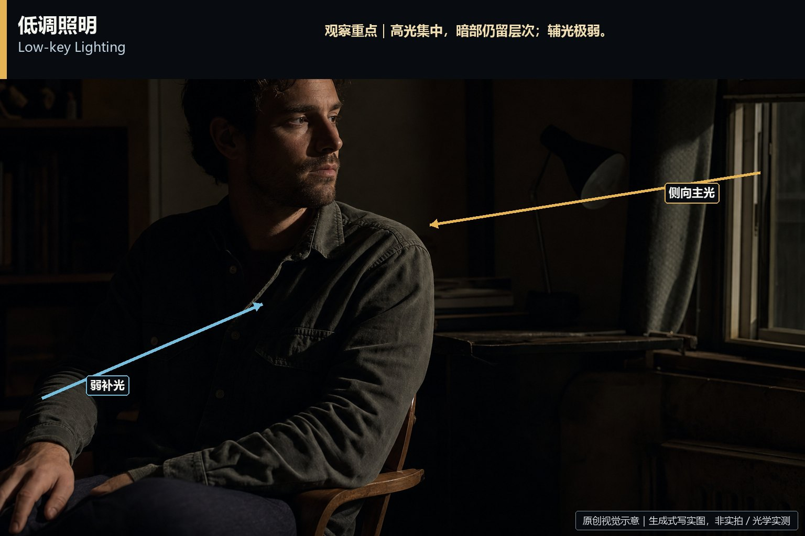

知识讲解：[A1-10 光影构造](../../knowledge/A-%E7%90%86%E8%AE%BA%E5%B1%82/A1-%E6%91%84%E5%BD%B1%E7%BB%84/A1-10%20%E5%85%89%E5%BD%B1%E6%9E%84%E9%80%A0.md)

## 光影构造：2. 高调照明(High-key Lighting)（02-high-key-lighting，原创教学示意）

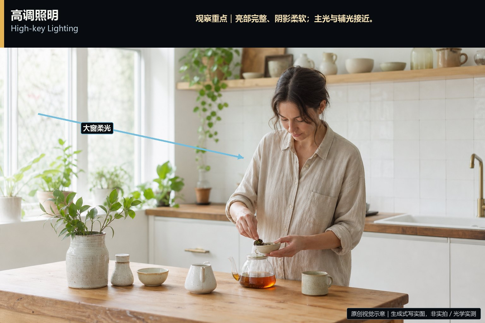

知识讲解：[A1-10 光影构造](../../knowledge/A-%E7%90%86%E8%AE%BA%E5%B1%82/A1-%E6%91%84%E5%BD%B1%E7%BB%84/A1-10%20%E5%85%89%E5%BD%B1%E6%9E%84%E9%80%A0.md)

## 光影构造：3. 三点布光(Three-point Lighting)（03-three-point-lighting，原创教学示意）

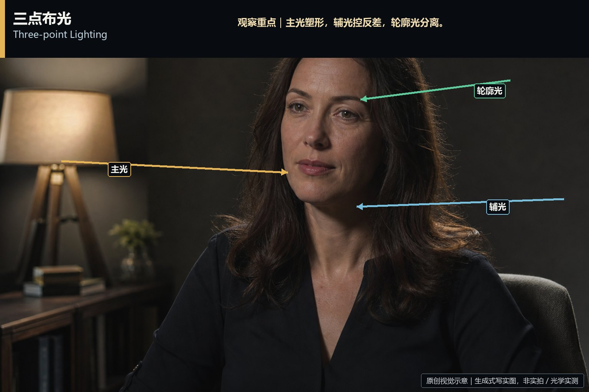

知识讲解：[A1-10 光影构造](../../knowledge/A-%E7%90%86%E8%AE%BA%E5%B1%82/A1-%E6%91%84%E5%BD%B1%E7%BB%84/A1-10%20%E5%85%89%E5%BD%B1%E6%9E%84%E9%80%A0.md)

## 光影构造：4. 明暗对比法(Chiaroscuro)（04-chiaroscuro，原创教学示意）

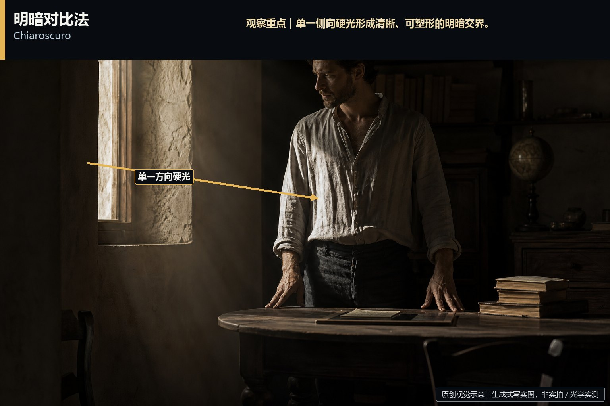

知识讲解：[A1-10 光影构造](../../knowledge/A-%E7%90%86%E8%AE%BA%E5%B1%82/A1-%E6%91%84%E5%BD%B1%E7%BB%84/A1-10%20%E5%85%89%E5%BD%B1%E6%9E%84%E9%80%A0.md)

## 光影构造：5. 伦勃朗光(Rembrandt Lighting)（05-rembrandt-lighting，原创教学示意）

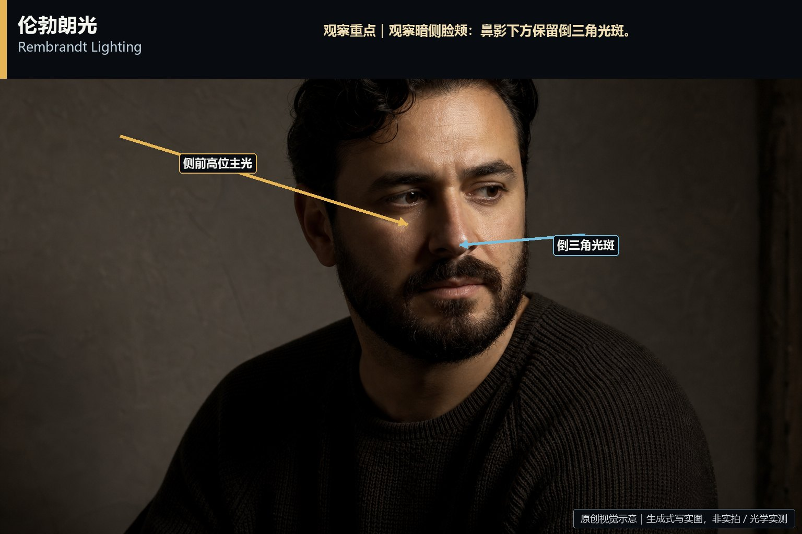

知识讲解：[A1-10 光影构造](../../knowledge/A-%E7%90%86%E8%AE%BA%E5%B1%82/A1-%E6%91%84%E5%BD%B1%E7%BB%84/A1-10%20%E5%85%89%E5%BD%B1%E6%9E%84%E9%80%A0.md)

## 光影构造：6. 黄金时刻(Golden Hour / 魔幻时刻)（06-golden-hour，原创教学示意）

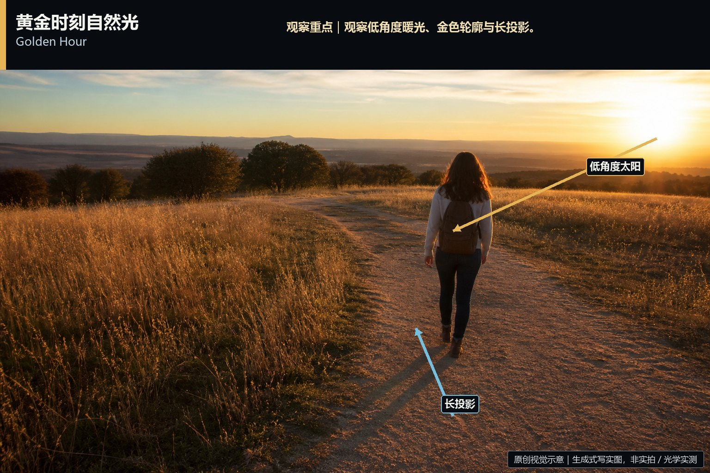

知识讲解：[A1-10 光影构造](../../knowledge/A-%E7%90%86%E8%AE%BA%E5%B1%82/A1-%E6%91%84%E5%BD%B1%E7%BB%84/A1-10%20%E5%85%89%E5%BD%B1%E6%9E%84%E9%80%A0.md)

## 光影构造：7. 烛光/极致低照度自然光(Candlelight / Practical-driven)（07-candlelight-practical-driven，原创教学示意）

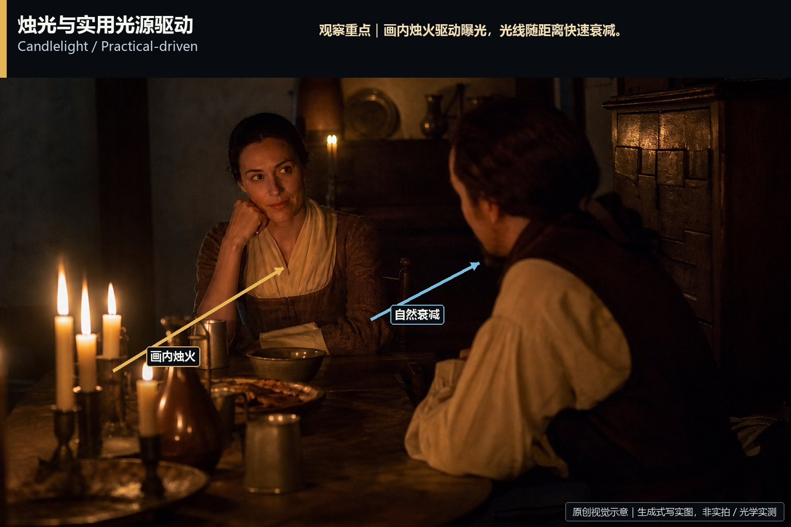

知识讲解：[A1-10 光影构造](../../knowledge/A-%E7%90%86%E8%AE%BA%E5%B1%82/A1-%E6%91%84%E5%BD%B1%E7%BB%84/A1-10%20%E5%85%89%E5%BD%B1%E6%9E%84%E9%80%A0.md)

## 光影构造：8. 雨天布光与湿润反射(Rain Lighting)（08-rain-lighting，原创教学示意）

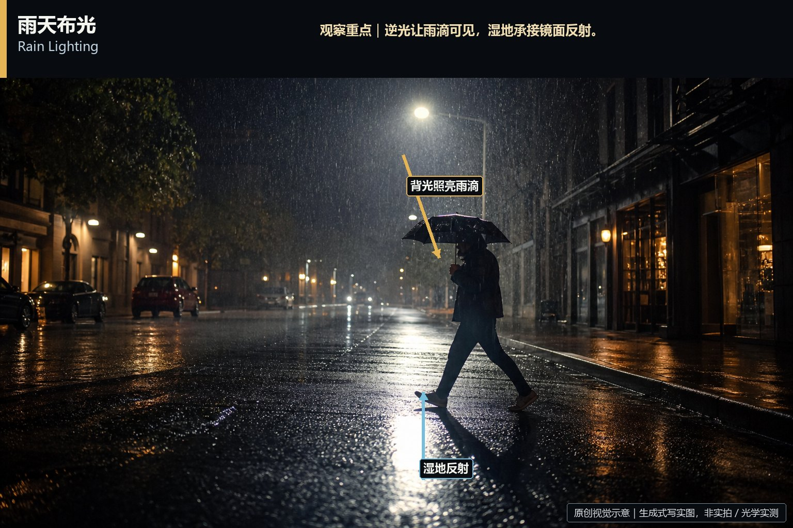

知识讲解：[A1-10 光影构造](../../knowledge/A-%E7%90%86%E8%AE%BA%E5%B1%82/A1-%E6%91%84%E5%BD%B1%E7%BB%84/A1-10%20%E5%85%89%E5%BD%B1%E6%9E%84%E9%80%A0.md)

## 光影构造：9. 逆光/轮廓光(Backlight / Rim Light)（09-backlight-rim-light，原创教学示意）

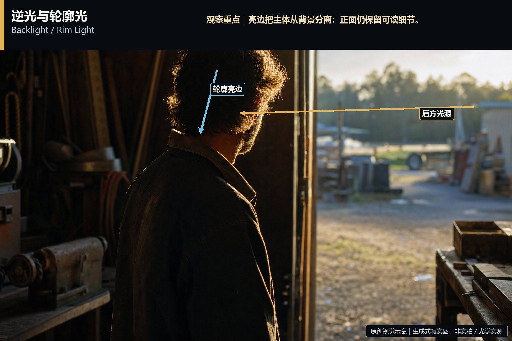

知识讲解：[A1-10 光影构造](../../knowledge/A-%E7%90%86%E8%AE%BA%E5%B1%82/A1-%E6%91%84%E5%BD%B1%E7%BB%84/A1-10%20%E5%85%89%E5%BD%B1%E6%9E%84%E9%80%A0.md)

## 光影构造：10. 侧光/明暗分割(Split Lighting)（10-split-lighting，原创教学示意）

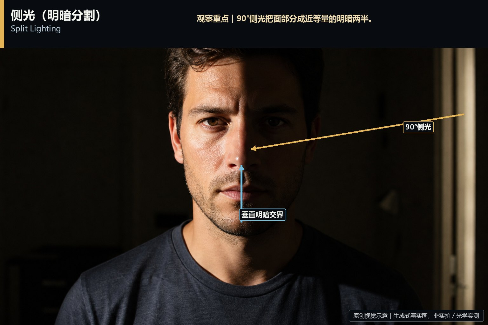

知识讲解：[A1-10 光影构造](../../knowledge/A-%E7%90%86%E8%AE%BA%E5%B1%82/A1-%E6%91%84%E5%BD%B1%E7%BB%84/A1-10%20%E5%85%89%E5%BD%B1%E6%9E%84%E9%80%A0.md)

## 光影构造：11. 顶光(Top Lighting)（11-top-lighting，原创教学示意）

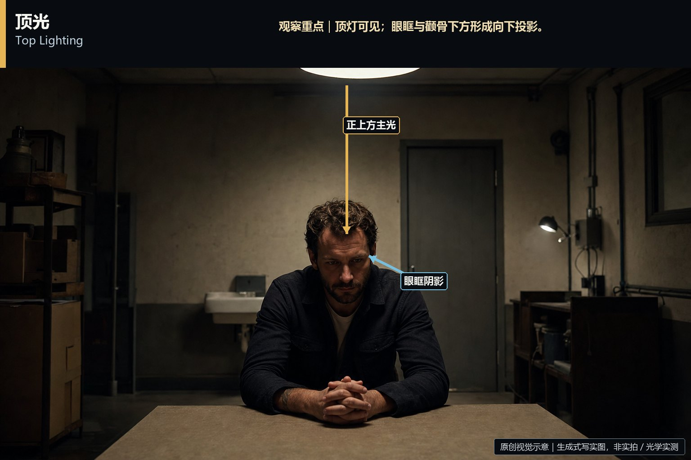

知识讲解：[A1-10 光影构造](../../knowledge/A-%E7%90%86%E8%AE%BA%E5%B1%82/A1-%E6%91%84%E5%BD%B1%E7%BB%84/A1-10%20%E5%85%89%E5%BD%B1%E6%9E%84%E9%80%A0.md)

## 光影构造：12. 实用光源/动机光(Practical Lighting)（12-practical-lighting，原创教学示意）

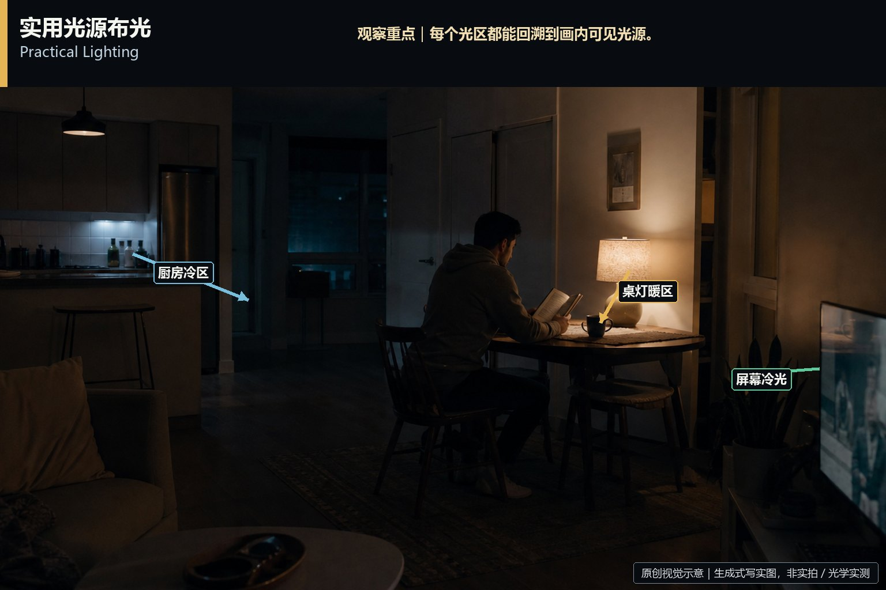

知识讲解：[A1-10 光影构造](../../knowledge/A-%E7%90%86%E8%AE%BA%E5%B1%82/A1-%E6%91%84%E5%BD%B1%E7%BB%84/A1-10%20%E5%85%89%E5%BD%B1%E6%9E%84%E9%80%A0.md)

## 光影构造：13. 蓝调时刻/冷调夜光(Blue Hour)（13-blue-hour，原创教学示意）

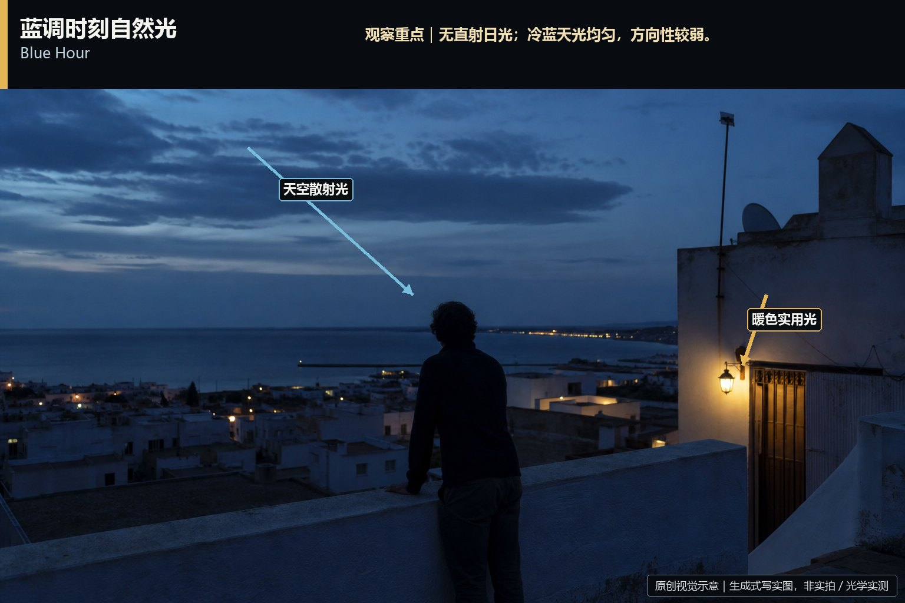

知识讲解：[A1-10 光影构造](../../knowledge/A-%E7%90%86%E8%AE%BA%E5%B1%82/A1-%E6%91%84%E5%BD%B1%E7%BB%84/A1-10%20%E5%85%89%E5%BD%B1%E6%9E%84%E9%80%A0.md)

## 光影构造：14. 高动态范围/胶片宽容度布光(HDR / Film Latitude)（14-high-dynamic-range，原创教学示意）

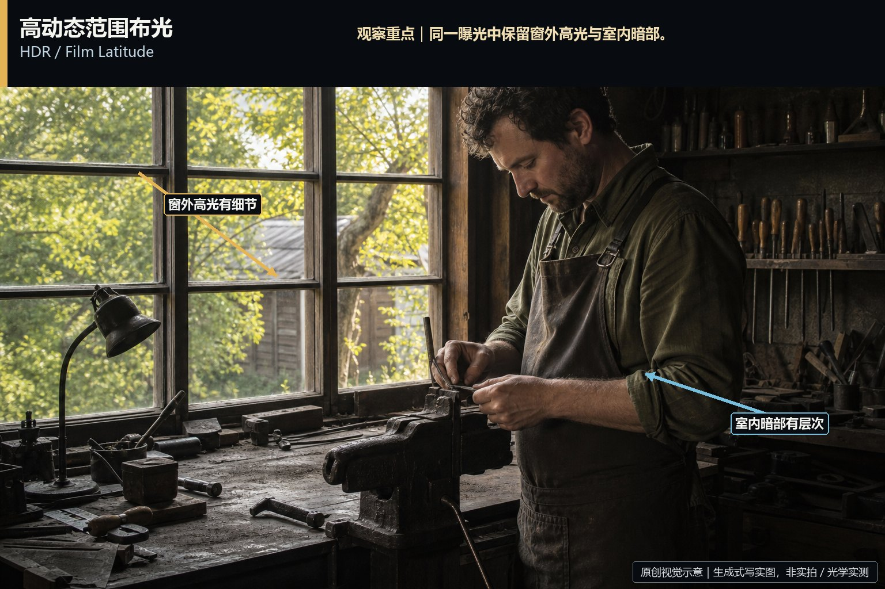

知识讲解：[A1-10 光影构造](../../knowledge/A-%E7%90%86%E8%AE%BA%E5%B1%82/A1-%E6%91%84%E5%BD%B1%E7%BB%84/A1-10%20%E5%85%89%E5%BD%B1%E6%9E%84%E9%80%A0.md)
