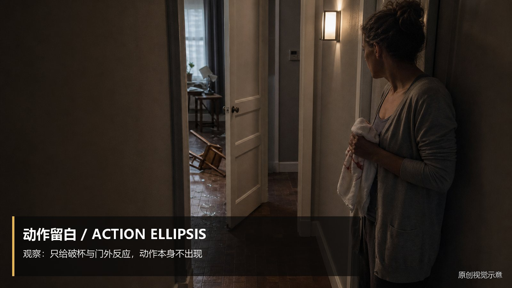
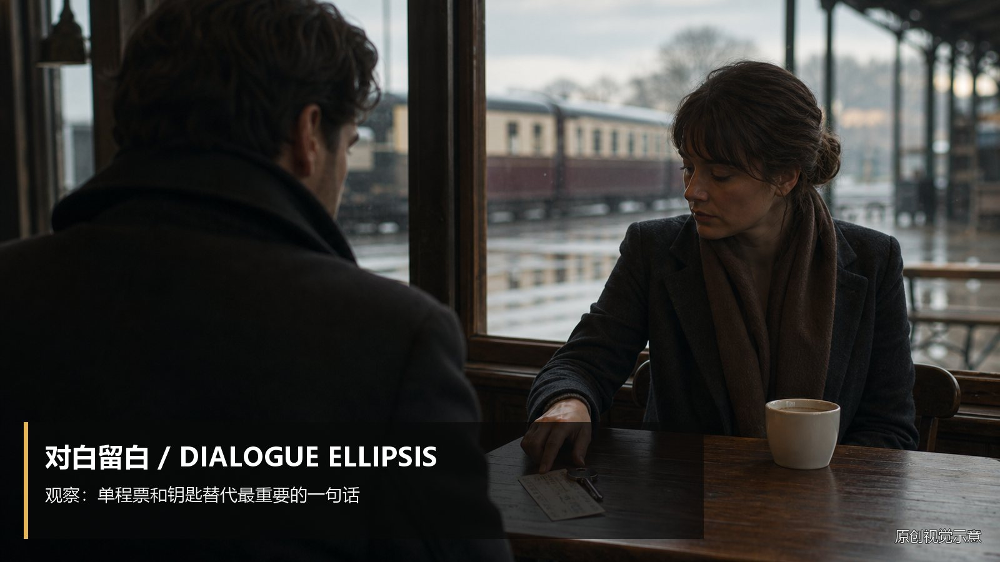
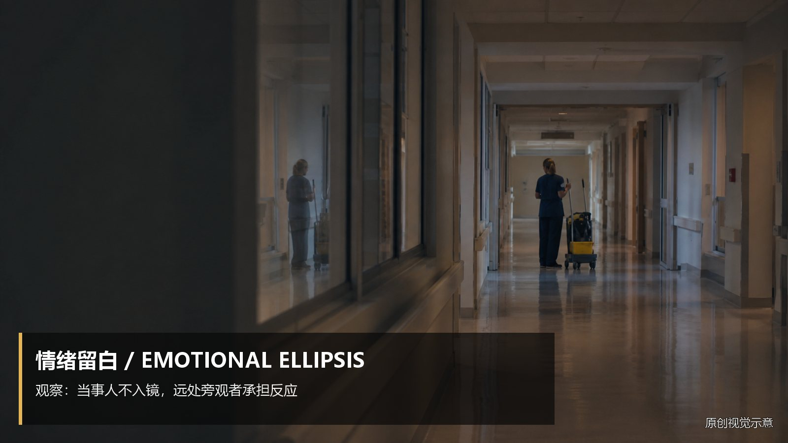
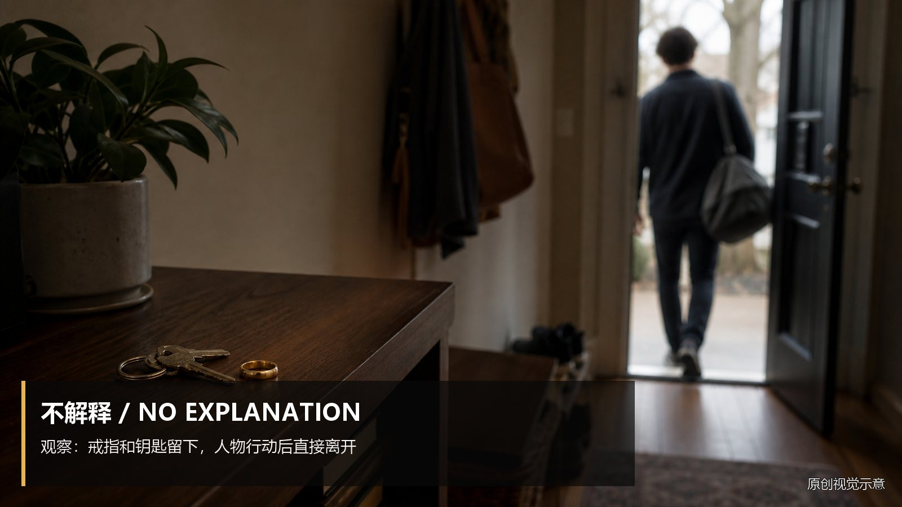
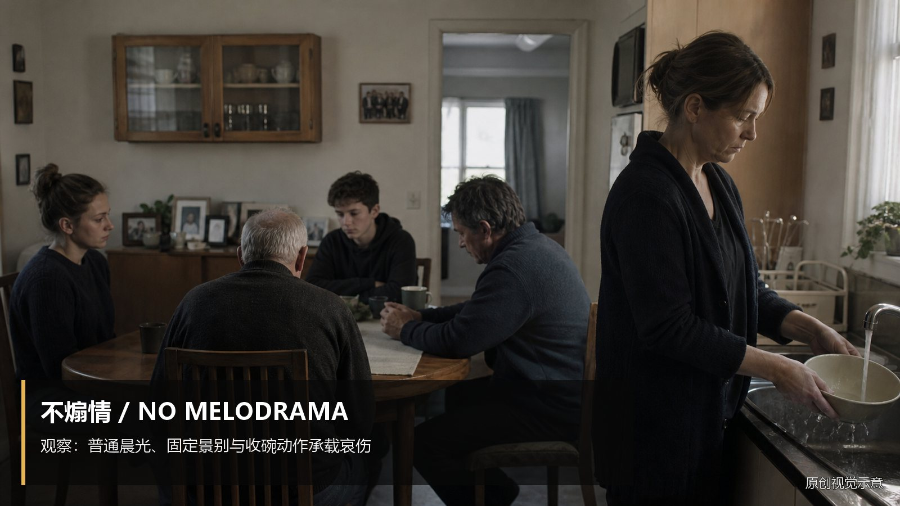

# restraint-negative-space · 1—6

[全部主题](../IMAGE_GALLERY.md) · [首页](../../README.md)

## 留白与克制：动作留白（01-action-ellipsis，原创教学示意）

知识讲解：[A3-17 留白与克制](../../knowledge/A-%E7%90%86%E8%AE%BA%E5%B1%82/A3-%E7%BC%96%E5%89%A7%E7%BB%84/A3-17%20%E7%95%99%E7%99%BD%E4%B8%8E%E5%85%8B%E5%88%B6.md)

## 留白与克制：对白留白（02-dialogue-ellipsis，原创教学示意）

知识讲解：[A3-17 留白与克制](../../knowledge/A-%E7%90%86%E8%AE%BA%E5%B1%82/A3-%E7%BC%96%E5%89%A7%E7%BB%84/A3-17%20%E7%95%99%E7%99%BD%E4%B8%8E%E5%85%8B%E5%88%B6.md)

## 留白与克制：情绪留白（03-emotion-ellipsis，原创教学示意）

知识讲解：[A3-17 留白与克制](../../knowledge/A-%E7%90%86%E8%AE%BA%E5%B1%82/A3-%E7%BC%96%E5%89%A7%E7%BB%84/A3-17%20%E7%95%99%E7%99%BD%E4%B8%8E%E5%85%8B%E5%88%B6.md)

## 留白与克制：不给满（04-one-new-information，原创教学示意）

知识讲解：[A3-17 留白与克制](../../knowledge/A-%E7%90%86%E8%AE%BA%E5%B1%82/A3-%E7%BC%96%E5%89%A7%E7%BB%84/A3-17%20%E7%95%99%E7%99%BD%E4%B8%8E%E5%85%8B%E5%88%B6.md)

## 留白与克制：不解释（05-no-explanation，原创教学示意）

知识讲解：[A3-17 留白与克制](../../knowledge/A-%E7%90%86%E8%AE%BA%E5%B1%82/A3-%E7%BC%96%E5%89%A7%E7%BB%84/A3-17%20%E7%95%99%E7%99%BD%E4%B8%8E%E5%85%8B%E5%88%B6.md)

## 留白与克制：不煽情（06-no-melodrama，原创教学示意）

知识讲解：[A3-17 留白与克制](../../knowledge/A-%E7%90%86%E8%AE%BA%E5%B1%82/A3-%E7%BC%96%E5%89%A7%E7%BB%84/A3-17%20%E7%95%99%E7%99%BD%E4%B8%8E%E5%85%8B%E5%88%B6.md)
