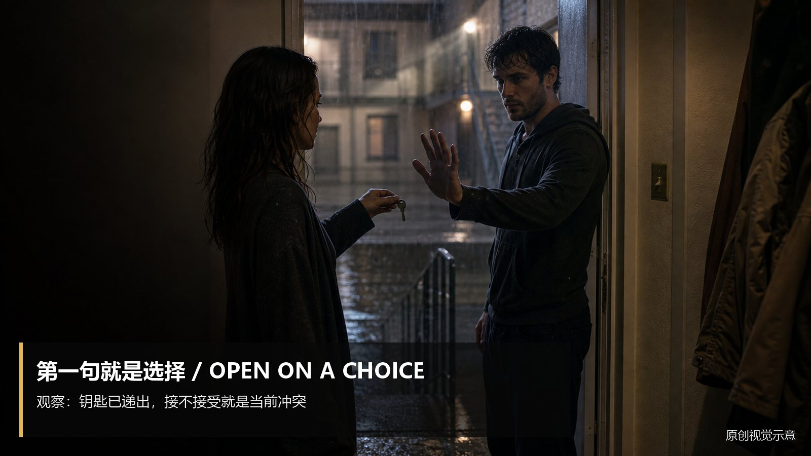
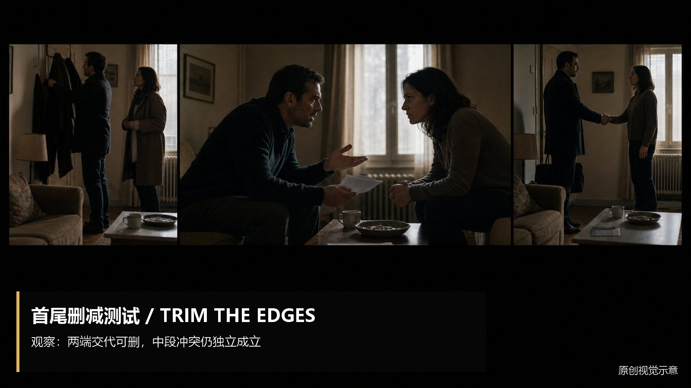

# scene-entry-exit · 1—7

[全部主题](../IMAGE_GALLERY.md) · [首页](../../README.md)

## 场景进出点设计：从冲突中段进入（01-in-medias-res，原创教学示意）

知识讲解：[A3-14 场景进出点设计](../../knowledge/A-%E7%90%86%E8%AE%BA%E5%B1%82/A3-%E7%BC%96%E5%89%A7%E7%BB%84/A3-14%20%E5%9C%BA%E6%99%AF%E8%BF%9B%E5%87%BA%E7%82%B9%E8%AE%BE%E8%AE%A1.md)

## 场景进出点设计：信息在行动中补齐（02-information-in-action，原创教学示意）

知识讲解：[A3-14 场景进出点设计](../../knowledge/A-%E7%90%86%E8%AE%BA%E5%B1%82/A3-%E7%BC%96%E5%89%A7%E7%BB%84/A3-14%20%E5%9C%BA%E6%99%AF%E8%BF%9B%E5%87%BA%E7%82%B9%E8%AE%BE%E8%AE%A1.md)

## 场景进出点设计：第一句就是冲突或选择（03-first-line-choice，原创教学示意）

知识讲解：[A3-14 场景进出点设计](../../knowledge/A-%E7%90%86%E8%AE%BA%E5%B1%82/A3-%E7%BC%96%E5%89%A7%E7%BB%84/A3-14%20%E5%9C%BA%E6%99%AF%E8%BF%9B%E5%87%BA%E7%82%B9%E8%AE%BE%E8%AE%A1.md)

## 场景进出点设计：新问题出现就切（04-exit-on-new-question，原创教学示意）

知识讲解：[A3-14 场景进出点设计](../../knowledge/A-%E7%90%86%E8%AE%BA%E5%B1%82/A3-%E7%BC%96%E5%89%A7%E7%BB%84/A3-14%20%E5%9C%BA%E6%99%AF%E8%BF%9B%E5%87%BA%E7%82%B9%E8%AE%BE%E8%AE%A1.md)

## 场景进出点设计：最重要的信息留后揭示（05-withhold-key-information，原创教学示意）

知识讲解：[A3-14 场景进出点设计](../../knowledge/A-%E7%90%86%E8%AE%BA%E5%B1%82/A3-%E7%BC%96%E5%89%A7%E7%BB%84/A3-14%20%E5%9C%BA%E6%99%AF%E8%BF%9B%E5%87%BA%E7%82%B9%E8%AE%BE%E8%AE%A1.md)

## 场景进出点设计：情绪到顶立刻切出（06-cut-at-emotional-peak，原创教学示意）

知识讲解：[A3-14 场景进出点设计](../../knowledge/A-%E7%90%86%E8%AE%BA%E5%B1%82/A3-%E7%BC%96%E5%89%A7%E7%BB%84/A3-14%20%E5%9C%BA%E6%99%AF%E8%BF%9B%E5%87%BA%E7%82%B9%E8%AE%BE%E8%AE%A1.md)

## 场景进出点设计：进出检验（07-trim-first-last-test，原创教学示意）

知识讲解：[A3-14 场景进出点设计](../../knowledge/A-%E7%90%86%E8%AE%BA%E5%B1%82/A3-%E7%BC%96%E5%89%A7%E7%BB%84/A3-14%20%E5%9C%BA%E6%99%AF%E8%BF%9B%E5%87%BA%E7%82%B9%E8%AE%BE%E8%AE%A1.md)
