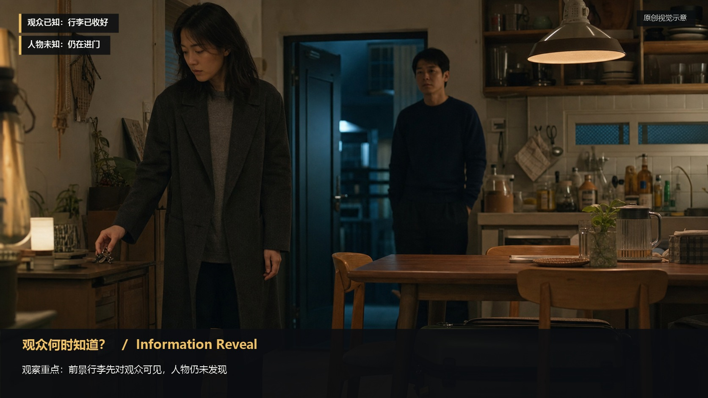
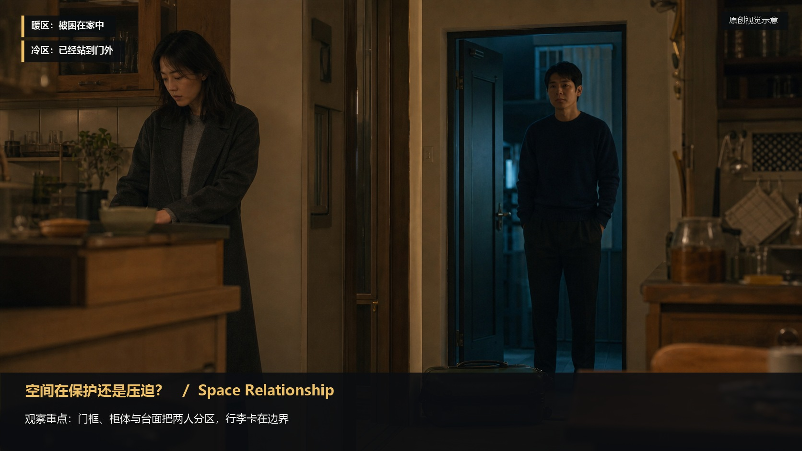
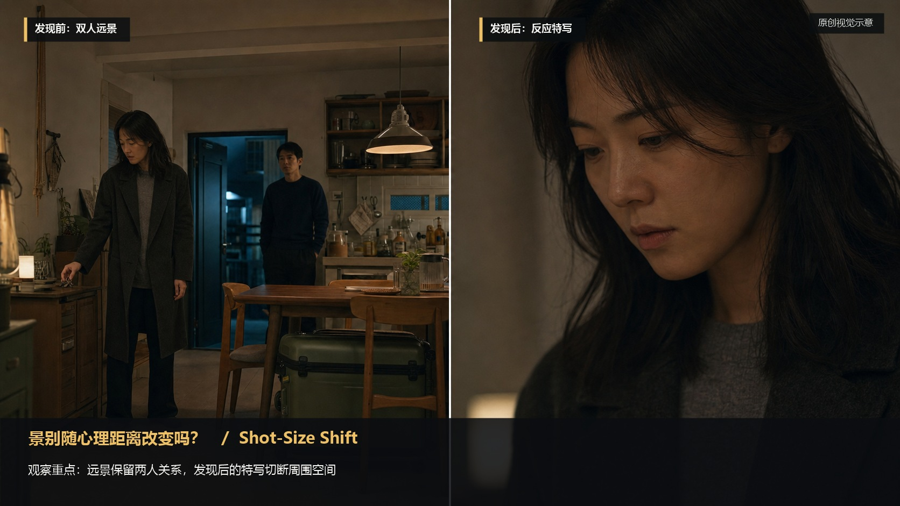
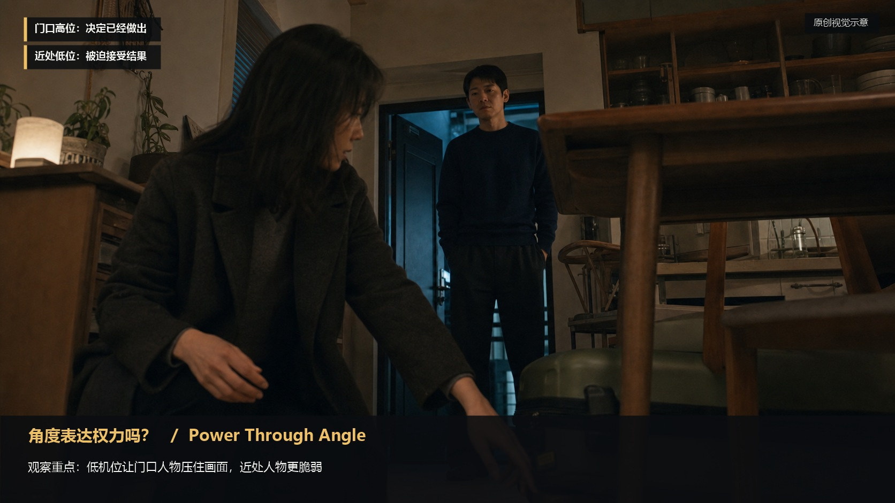
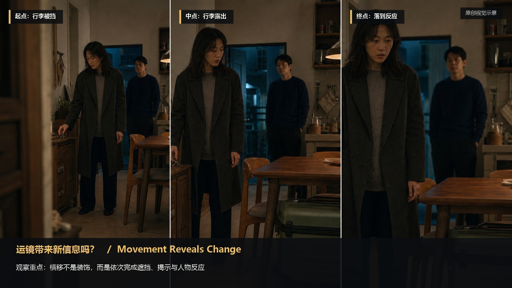
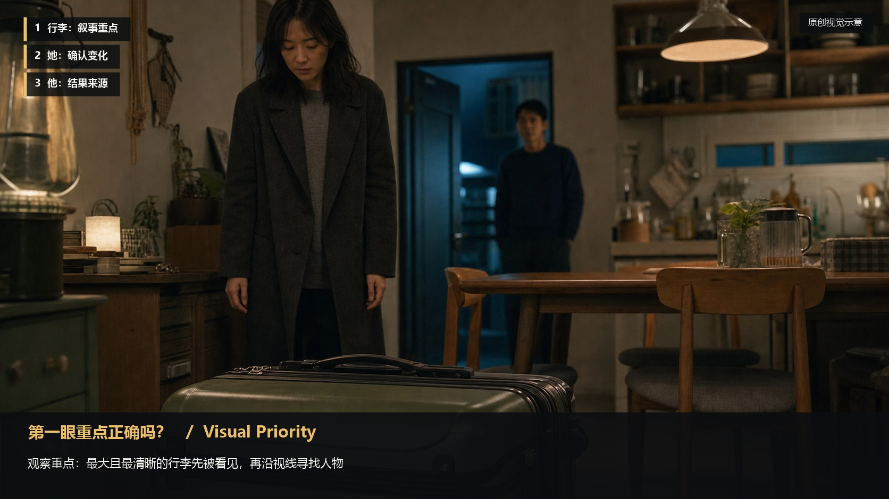
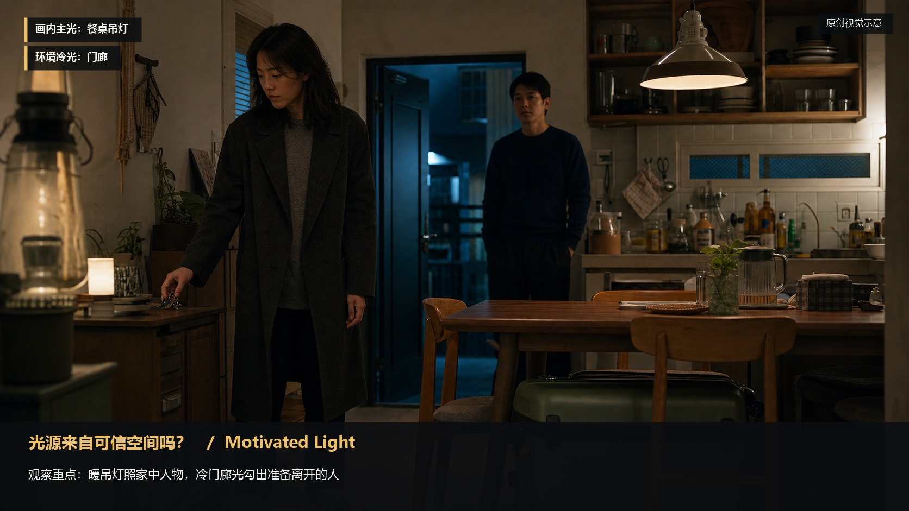
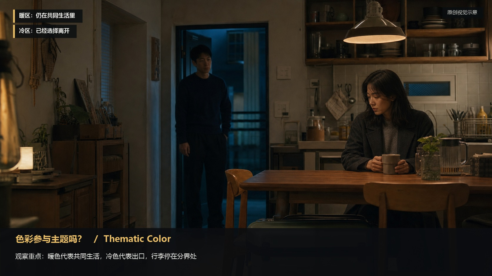
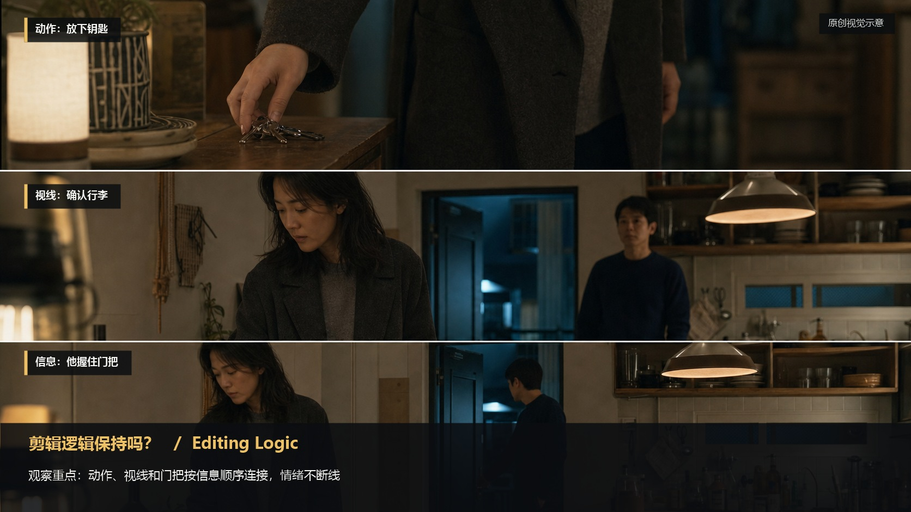
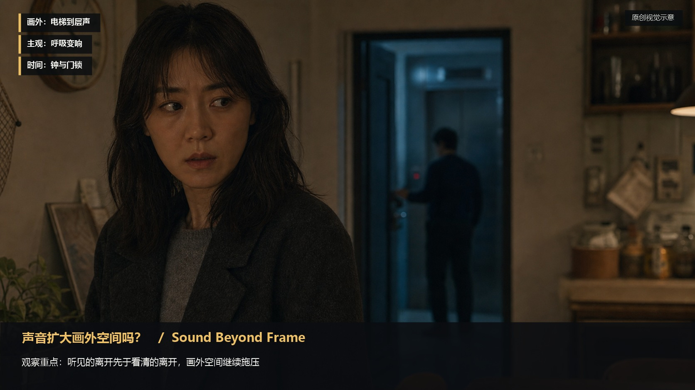

# script-visualization-checklist · 1—10

[全部主题](../IMAGE_GALLERY.md) · [首页](../../README.md)

## 剧本影像化检查表：十步检查清单（01-information-reveal，原创教学示意）

知识讲解：[A2-06 剧本影像化检查表](../../knowledge/A-%E7%90%86%E8%AE%BA%E5%B1%82/A2-%E5%AF%BC%E6%BC%94%E7%BB%84/A2-06%20%E5%89%A7%E6%9C%AC%E5%BD%B1%E5%83%8F%E5%8C%96%E6%A3%80%E6%9F%A5%E8%A1%A8.md)

## 剧本影像化检查表：十步检查清单（02-space-relationship，原创教学示意）

知识讲解：[A2-06 剧本影像化检查表](../../knowledge/A-%E7%90%86%E8%AE%BA%E5%B1%82/A2-%E5%AF%BC%E6%BC%94%E7%BB%84/A2-06%20%E5%89%A7%E6%9C%AC%E5%BD%B1%E5%83%8F%E5%8C%96%E6%A3%80%E6%9F%A5%E8%A1%A8.md)

## 剧本影像化检查表：十步检查清单（03-shot-size-shift，原创教学示意）

知识讲解：[A2-06 剧本影像化检查表](../../knowledge/A-%E7%90%86%E8%AE%BA%E5%B1%82/A2-%E5%AF%BC%E6%BC%94%E7%BB%84/A2-06%20%E5%89%A7%E6%9C%AC%E5%BD%B1%E5%83%8F%E5%8C%96%E6%A3%80%E6%9F%A5%E8%A1%A8.md)

## 剧本影像化检查表：十步检查清单（04-power-angle，原创教学示意）

知识讲解：[A2-06 剧本影像化检查表](../../knowledge/A-%E7%90%86%E8%AE%BA%E5%B1%82/A2-%E5%AF%BC%E6%BC%94%E7%BB%84/A2-06%20%E5%89%A7%E6%9C%AC%E5%BD%B1%E5%83%8F%E5%8C%96%E6%A3%80%E6%9F%A5%E8%A1%A8.md)

## 剧本影像化检查表：十步检查清单（05-movement-reveal，原创教学示意）

知识讲解：[A2-06 剧本影像化检查表](../../knowledge/A-%E7%90%86%E8%AE%BA%E5%B1%82/A2-%E5%AF%BC%E6%BC%94%E7%BB%84/A2-06%20%E5%89%A7%E6%9C%AC%E5%BD%B1%E5%83%8F%E5%8C%96%E6%A3%80%E6%9F%A5%E8%A1%A8.md)

## 剧本影像化检查表：十步检查清单（06-visual-priority，原创教学示意）

知识讲解：[A2-06 剧本影像化检查表](../../knowledge/A-%E7%90%86%E8%AE%BA%E5%B1%82/A2-%E5%AF%BC%E6%BC%94%E7%BB%84/A2-06%20%E5%89%A7%E6%9C%AC%E5%BD%B1%E5%83%8F%E5%8C%96%E6%A3%80%E6%9F%A5%E8%A1%A8.md)

## 剧本影像化检查表：十步检查清单（07-motivated-light，原创教学示意）

知识讲解：[A2-06 剧本影像化检查表](../../knowledge/A-%E7%90%86%E8%AE%BA%E5%B1%82/A2-%E5%AF%BC%E6%BC%94%E7%BB%84/A2-06%20%E5%89%A7%E6%9C%AC%E5%BD%B1%E5%83%8F%E5%8C%96%E6%A3%80%E6%9F%A5%E8%A1%A8.md)

## 剧本影像化检查表：十步检查清单（08-thematic-color，原创教学示意）

知识讲解：[A2-06 剧本影像化检查表](../../knowledge/A-%E7%90%86%E8%AE%BA%E5%B1%82/A2-%E5%AF%BC%E6%BC%94%E7%BB%84/A2-06%20%E5%89%A7%E6%9C%AC%E5%BD%B1%E5%83%8F%E5%8C%96%E6%A3%80%E6%9F%A5%E8%A1%A8.md)

## 剧本影像化检查表：十步检查清单（09-editing-logic，原创教学示意）

知识讲解：[A2-06 剧本影像化检查表](../../knowledge/A-%E7%90%86%E8%AE%BA%E5%B1%82/A2-%E5%AF%BC%E6%BC%94%E7%BB%84/A2-06%20%E5%89%A7%E6%9C%AC%E5%BD%B1%E5%83%8F%E5%8C%96%E6%A3%80%E6%9F%A5%E8%A1%A8.md)

## 剧本影像化检查表：十步检查清单（10-sound-offscreen，原创教学示意）

知识讲解：[A2-06 剧本影像化检查表](../../knowledge/A-%E7%90%86%E8%AE%BA%E5%B1%82/A2-%E5%AF%BC%E6%BC%94%E7%BB%84/A2-06%20%E5%89%A7%E6%9C%AC%E5%BD%B1%E5%83%8F%E5%8C%96%E6%A3%80%E6%9F%A5%E8%A1%A8.md)
