# shot-size · 1—14

[全部主题](../IMAGE_GALLERY.md) · [首页](../../README.md)

## 景别系统：大远景 / 极远景（A1-01-01-extreme-wide-shot，原创教学示意）

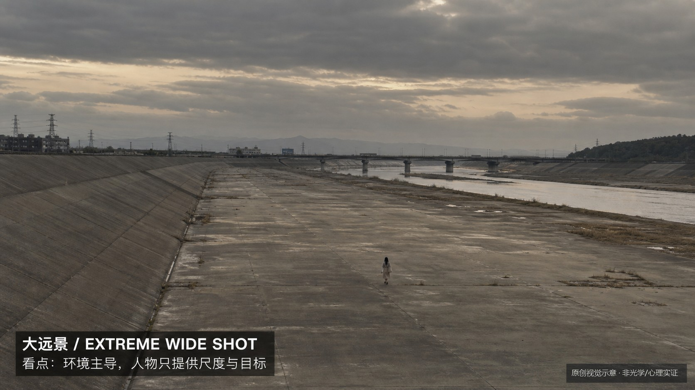

知识讲解：[A1-01 景别系统](../../knowledge/A-%E7%90%86%E8%AE%BA%E5%B1%82/A1-%E6%91%84%E5%BD%B1%E7%BB%84/A1-01%20%E6%99%AF%E5%88%AB%E7%B3%BB%E7%BB%9F.md)

## 景别系统：远景（A1-01-02-long-shot，原创教学示意）

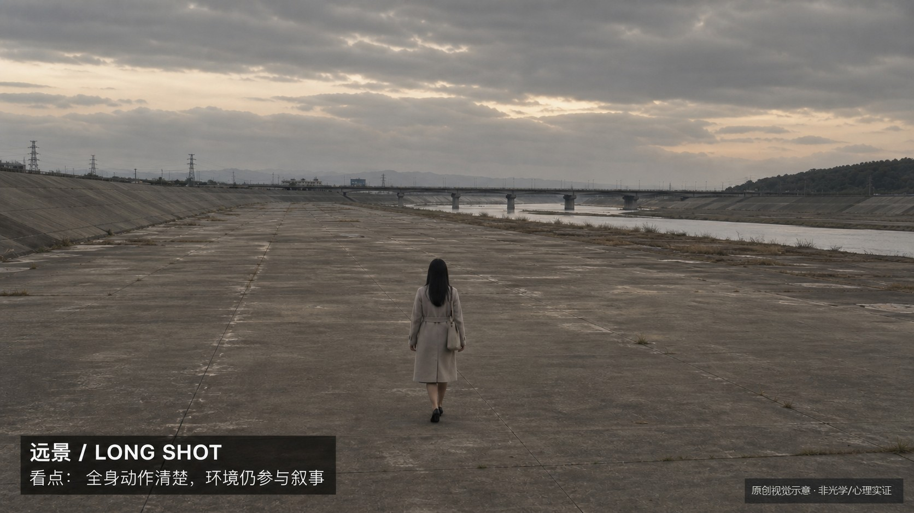

知识讲解：[A1-01 景别系统](../../knowledge/A-%E7%90%86%E8%AE%BA%E5%B1%82/A1-%E6%91%84%E5%BD%B1%E7%BB%84/A1-01%20%E6%99%AF%E5%88%AB%E7%B3%BB%E7%BB%9F.md)

## 景别系统：全景（A1-01-03-full-shot，原创教学示意）

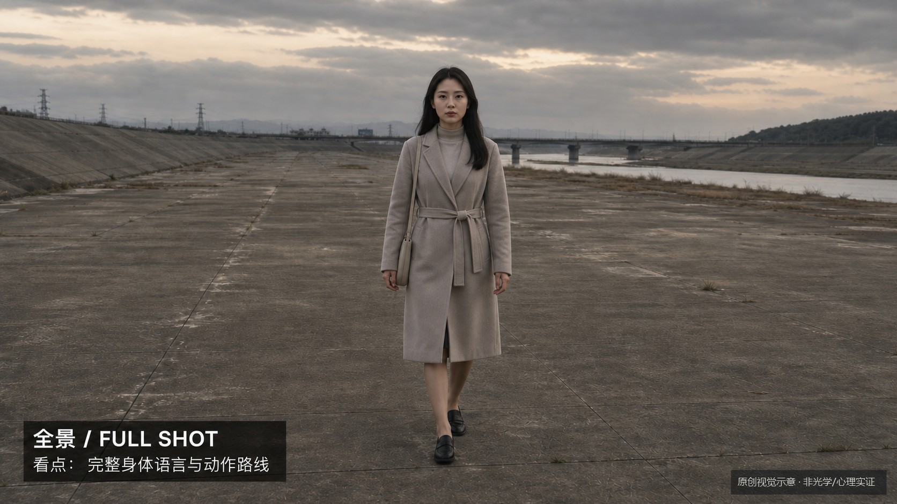

知识讲解：[A1-01 景别系统](../../knowledge/A-%E7%90%86%E8%AE%BA%E5%B1%82/A1-%E6%91%84%E5%BD%B1%E7%BB%84/A1-01%20%E6%99%AF%E5%88%AB%E7%B3%BB%E7%BB%9F.md)

## 景别系统：中远景（A1-01-04-medium-long-shot，原创教学示意）

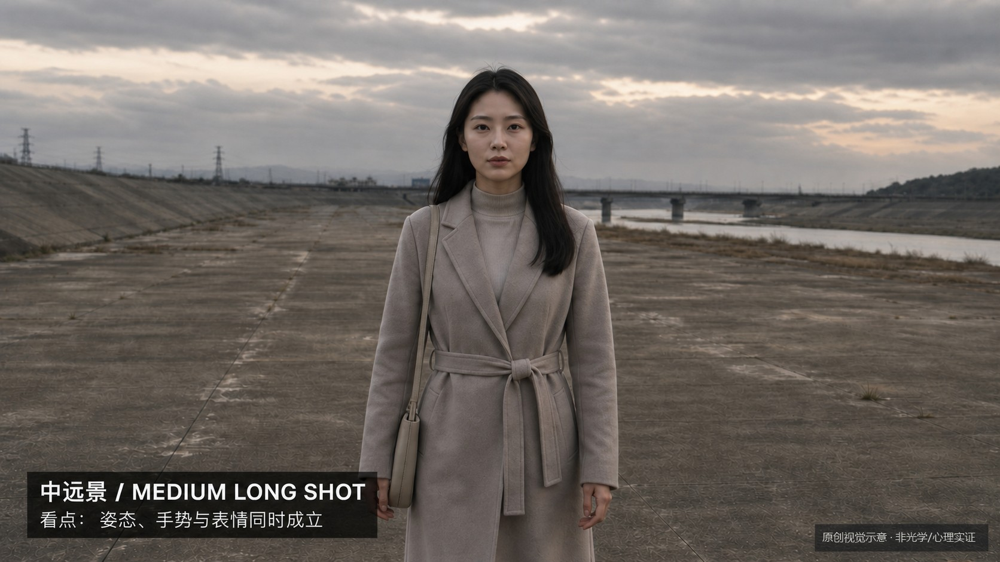

知识讲解：[A1-01 景别系统](../../knowledge/A-%E7%90%86%E8%AE%BA%E5%B1%82/A1-%E6%91%84%E5%BD%B1%E7%BB%84/A1-01%20%E6%99%AF%E5%88%AB%E7%B3%BB%E7%BB%9F.md)

## 景别系统：中景（A1-01-05-medium-shot，原创教学示意）

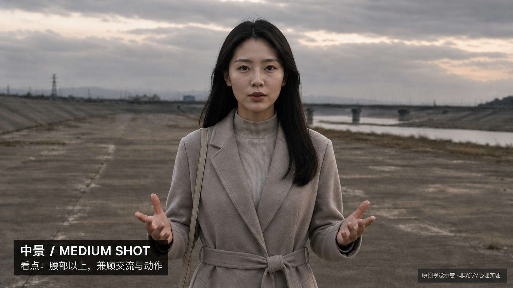

知识讲解：[A1-01 景别系统](../../knowledge/A-%E7%90%86%E8%AE%BA%E5%B1%82/A1-%E6%91%84%E5%BD%B1%E7%BB%84/A1-01%20%E6%99%AF%E5%88%AB%E7%B3%BB%E7%BB%9F.md)

## 景别系统：中近景（A1-01-06-medium-close-up，原创教学示意）

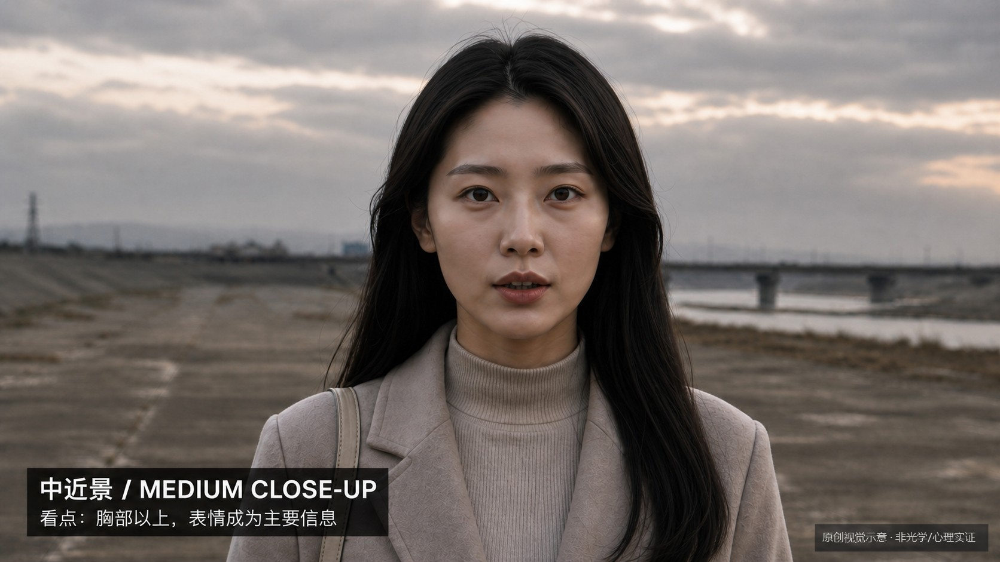

知识讲解：[A1-01 景别系统](../../knowledge/A-%E7%90%86%E8%AE%BA%E5%B1%82/A1-%E6%91%84%E5%BD%B1%E7%BB%84/A1-01%20%E6%99%AF%E5%88%AB%E7%B3%BB%E7%BB%9F.md)

## 景别系统：近景（A1-01-07-close-up，原创教学示意）

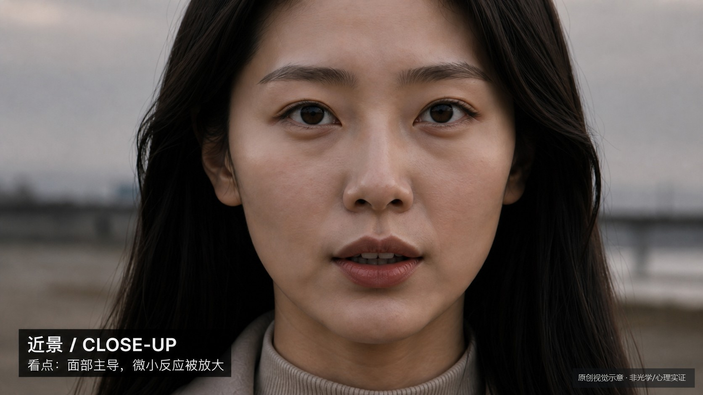

知识讲解：[A1-01 景别系统](../../knowledge/A-%E7%90%86%E8%AE%BA%E5%B1%82/A1-%E6%91%84%E5%BD%B1%E7%BB%84/A1-01%20%E6%99%AF%E5%88%AB%E7%B3%BB%E7%BB%9F.md)

## 景别系统：特写（A1-01-08-detail-shot，原创教学示意）

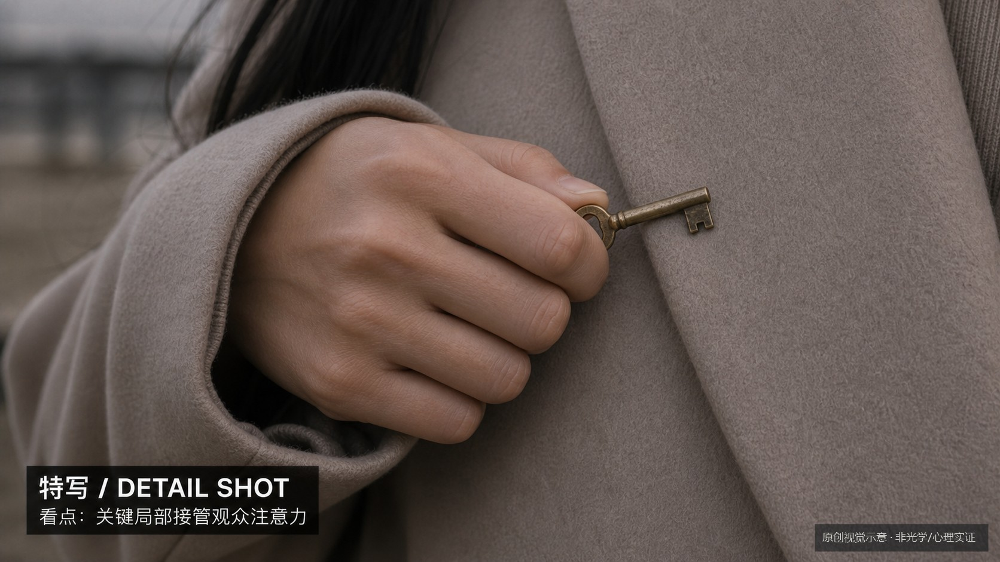

知识讲解：[A1-01 景别系统](../../knowledge/A-%E7%90%86%E8%AE%BA%E5%B1%82/A1-%E6%91%84%E5%BD%B1%E7%BB%84/A1-01%20%E6%99%AF%E5%88%AB%E7%B3%BB%E7%BB%9F.md)

## 景别系统：大特写（A1-01-09-big-close-up，原创教学示意）

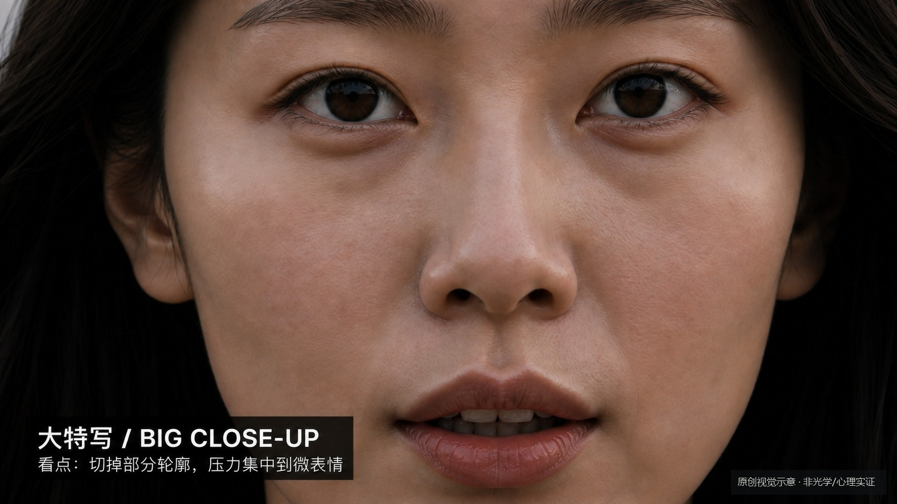

知识讲解：[A1-01 景别系统](../../knowledge/A-%E7%90%86%E8%AE%BA%E5%B1%82/A1-%E6%91%84%E5%BD%B1%E7%BB%84/A1-01%20%E6%99%AF%E5%88%AB%E7%B3%BB%E7%BB%9F.md)

## 景别系统：极特写（A1-01-10-extreme-close-up，原创教学示意）

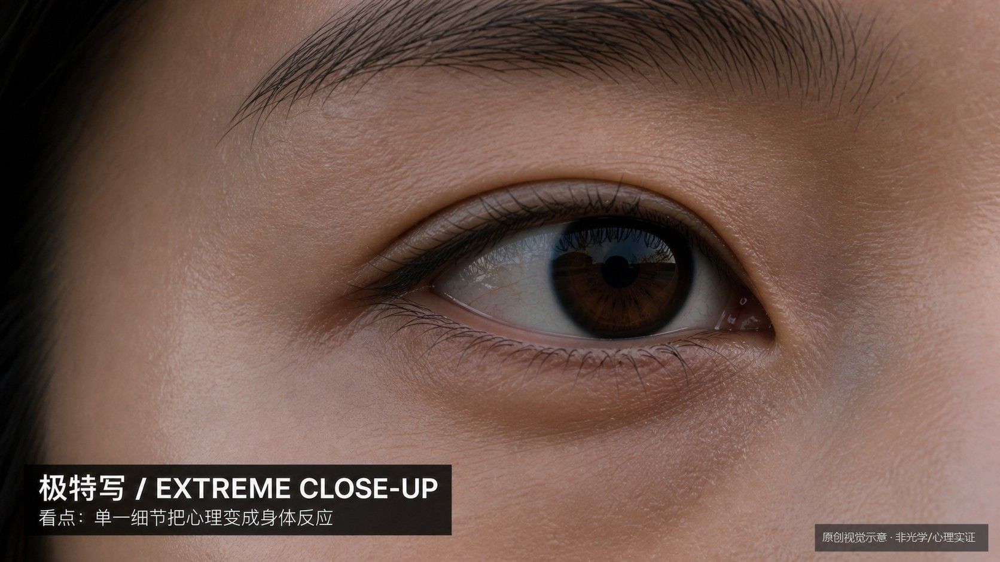

知识讲解：[A1-01 景别系统](../../knowledge/A-%E7%90%86%E8%AE%BA%E5%B1%82/A1-%E6%91%84%E5%BD%B1%E7%BB%84/A1-01%20%E6%99%AF%E5%88%AB%E7%B3%BB%E7%BB%9F.md)

## 景别系统：插入镜头（A1-01-11-insert-shot，原创教学示意）

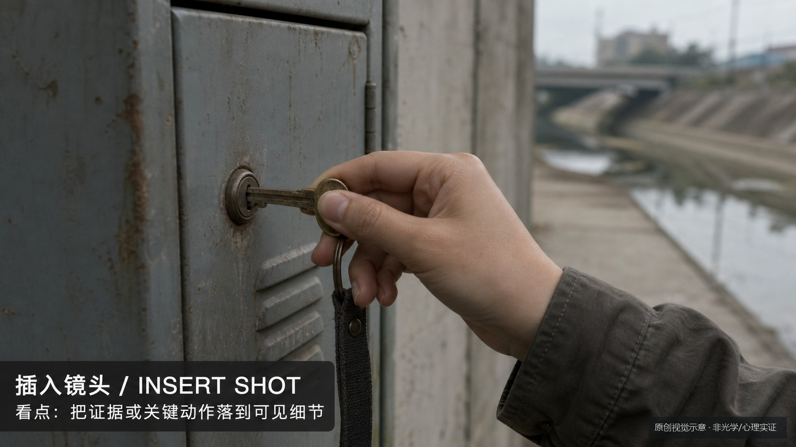

知识讲解：[A1-01 景别系统](../../knowledge/A-%E7%90%86%E8%AE%BA%E5%B1%82/A1-%E6%91%84%E5%BD%B1%E7%BB%84/A1-01%20%E6%99%AF%E5%88%AB%E7%B3%BB%E7%BB%9F.md)

## 景别系统：空镜（A1-01-12-empty-shot，原创教学示意）

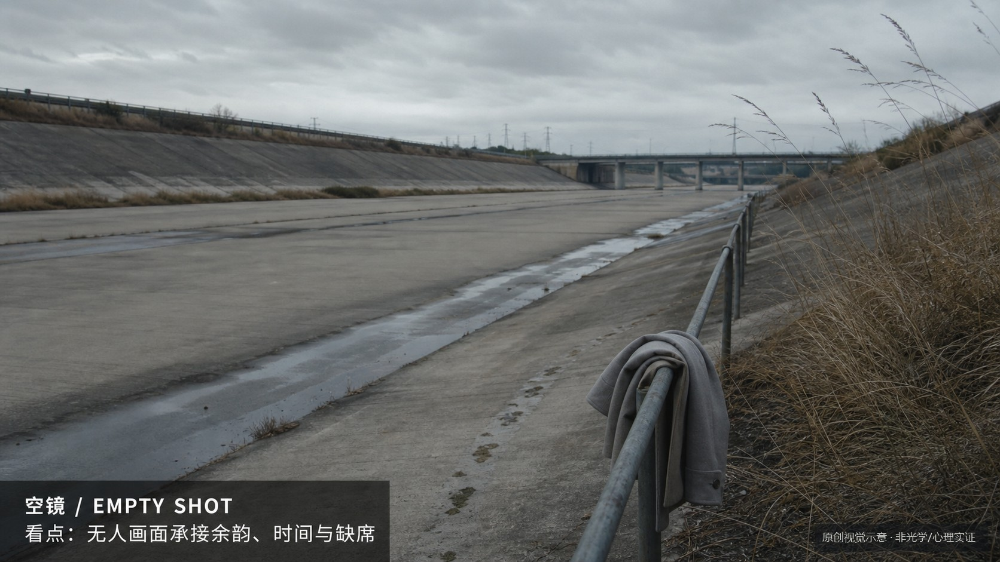

知识讲解：[A1-01 景别系统](../../knowledge/A-%E7%90%86%E8%AE%BA%E5%B1%82/A1-%E6%91%84%E5%BD%B1%E7%BB%84/A1-01%20%E6%99%AF%E5%88%AB%E7%B3%BB%E7%BB%9F.md)

## 景别系统：建立镜头（A1-01-13-establishing-shot，原创教学示意）

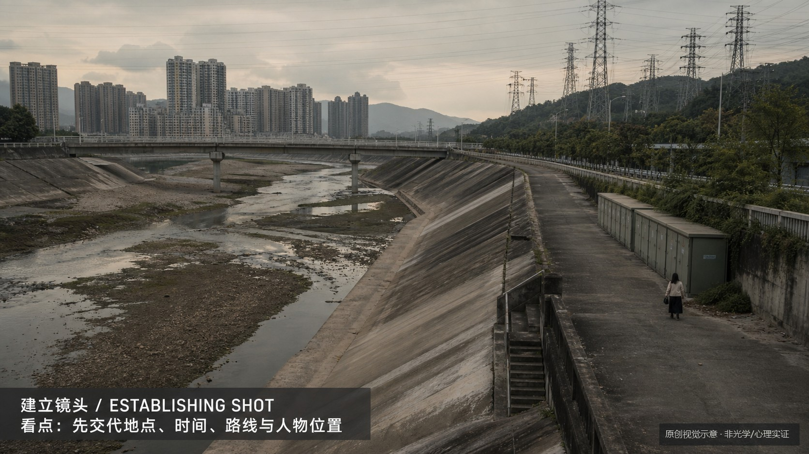

知识讲解：[A1-01 景别系统](../../knowledge/A-%E7%90%86%E8%AE%BA%E5%B1%82/A1-%E6%91%84%E5%BD%B1%E7%BB%84/A1-01%20%E6%99%AF%E5%88%AB%E7%B3%BB%E7%BB%9F.md)

## 景别系统：反应镜头（A1-01-14-reaction-shot，原创教学示意）

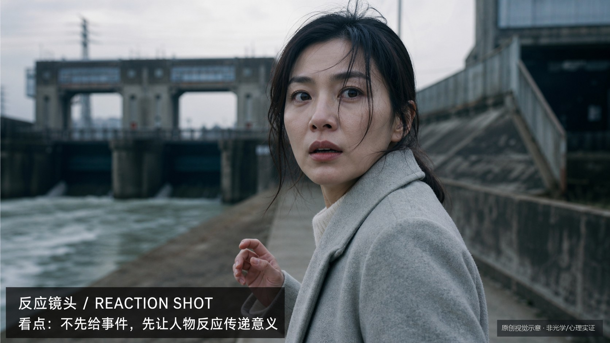

知识讲解：[A1-01 景别系统](../../knowledge/A-%E7%90%86%E8%AE%BA%E5%B1%82/A1-%E6%91%84%E5%BD%B1%E7%BB%84/A1-01%20%E6%99%AF%E5%88%AB%E7%B3%BB%E7%BB%9F.md)
