# sound-music · 1—24

[全部主题](../IMAGE_GALLERY.md) · [首页](../../README.md)

## 声音与音乐：环境声｜Ambient Sound（01-ambient-sound，原创教学示意）

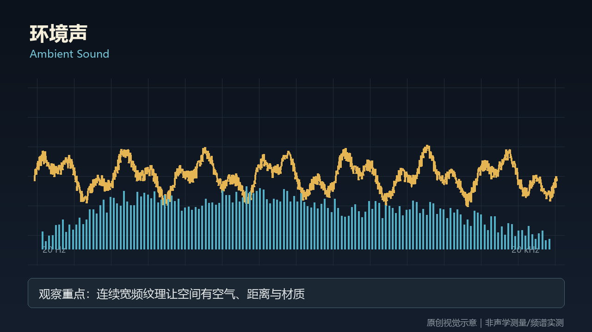

知识讲解：[A2-03 声音与音乐](../../knowledge/A-%E7%90%86%E8%AE%BA%E5%B1%82/A2-%E5%AF%BC%E6%BC%94%E7%BB%84/A2-03%20%E5%A3%B0%E9%9F%B3%E4%B8%8E%E9%9F%B3%E4%B9%90.md)

## 声音与音乐：低频轰鸣｜Low-Frequency Rumble（02-low-frequency-rumble，原创教学示意）

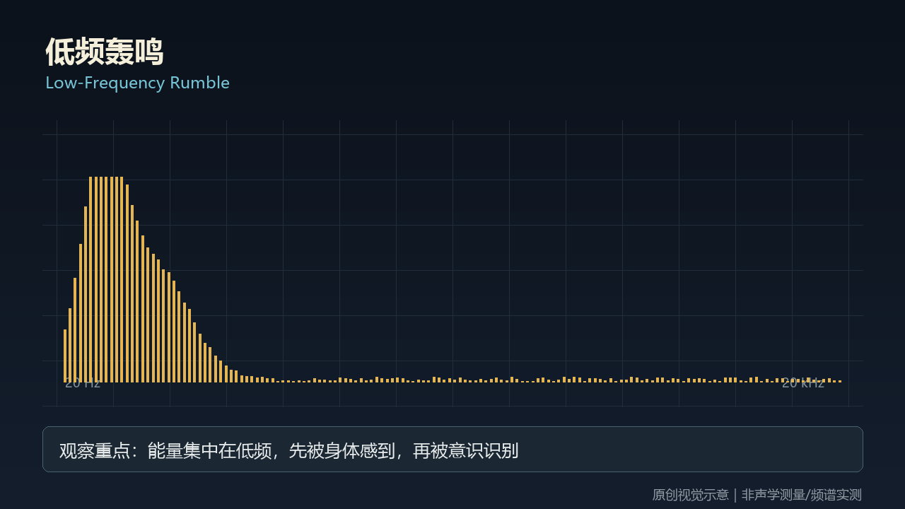

知识讲解：[A2-03 声音与音乐](../../knowledge/A-%E7%90%86%E8%AE%BA%E5%B1%82/A2-%E5%AF%BC%E6%BC%94%E7%BB%84/A2-03%20%E5%A3%B0%E9%9F%B3%E4%B8%8E%E9%9F%B3%E4%B9%90.md)

## 声音与音乐：心跳声｜Heartbeat（03-heartbeat，原创教学示意）

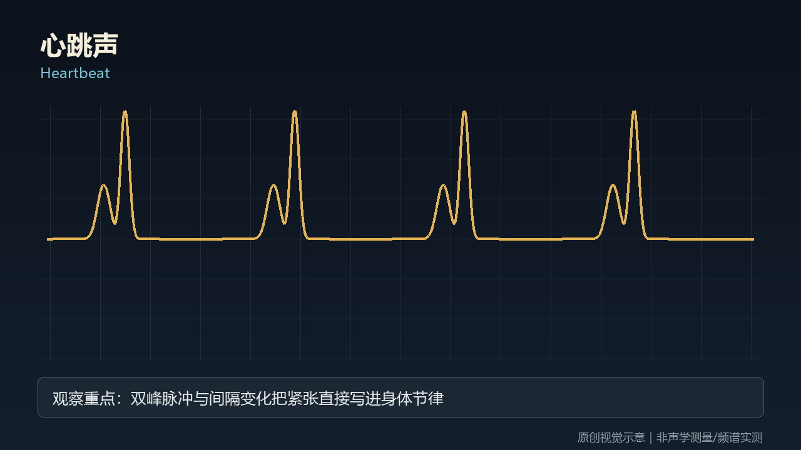

知识讲解：[A2-03 声音与音乐](../../knowledge/A-%E7%90%86%E8%AE%BA%E5%B1%82/A2-%E5%AF%BC%E6%BC%94%E7%BB%84/A2-03%20%E5%A3%B0%E9%9F%B3%E4%B8%8E%E9%9F%B3%E4%B9%90.md)

## 声音与音乐：呼吸声｜Breathing（04-breathing，原创教学示意）

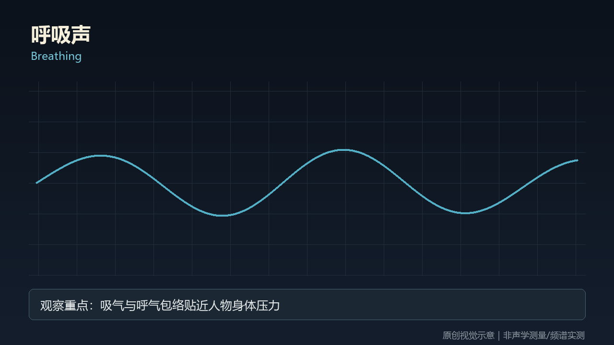

知识讲解：[A2-03 声音与音乐](../../knowledge/A-%E7%90%86%E8%AE%BA%E5%B1%82/A2-%E5%AF%BC%E6%BC%94%E7%BB%84/A2-03%20%E5%A3%B0%E9%9F%B3%E4%B8%8E%E9%9F%B3%E4%B9%90.md)

## 声音与音乐：无声处理｜Silence Treatment（05-silence-treatment，原创教学示意）

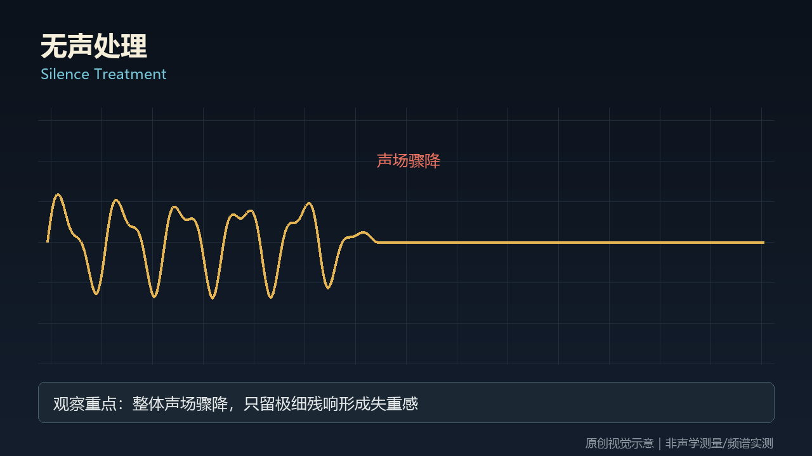

知识讲解：[A2-03 声音与音乐](../../knowledge/A-%E7%90%86%E8%AE%BA%E5%B1%82/A2-%E5%AF%BC%E6%BC%94%E7%BB%84/A2-03%20%E5%A3%B0%E9%9F%B3%E4%B8%8E%E9%9F%B3%E4%B9%90.md)

## 声音与音乐：声音先行｜Sound Pre-Lap / J-Cut（06-sound-prelap，原创教学示意）

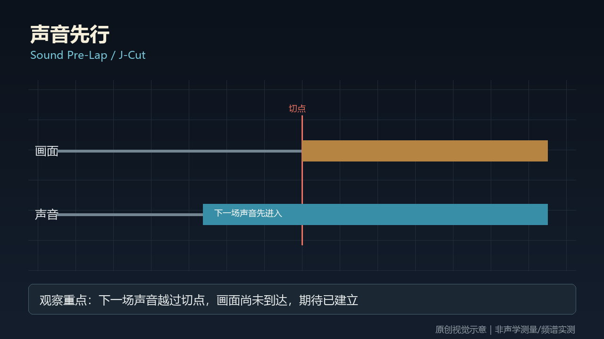

知识讲解：[A2-03 声音与音乐](../../knowledge/A-%E7%90%86%E8%AE%BA%E5%B1%82/A2-%E5%AF%BC%E6%BC%94%E7%BB%84/A2-03%20%E5%A3%B0%E9%9F%B3%E4%B8%8E%E9%9F%B3%E4%B9%90.md)

## 声音与音乐：声音延迟｜Delayed Sound（07-sound-delay，原创教学示意）

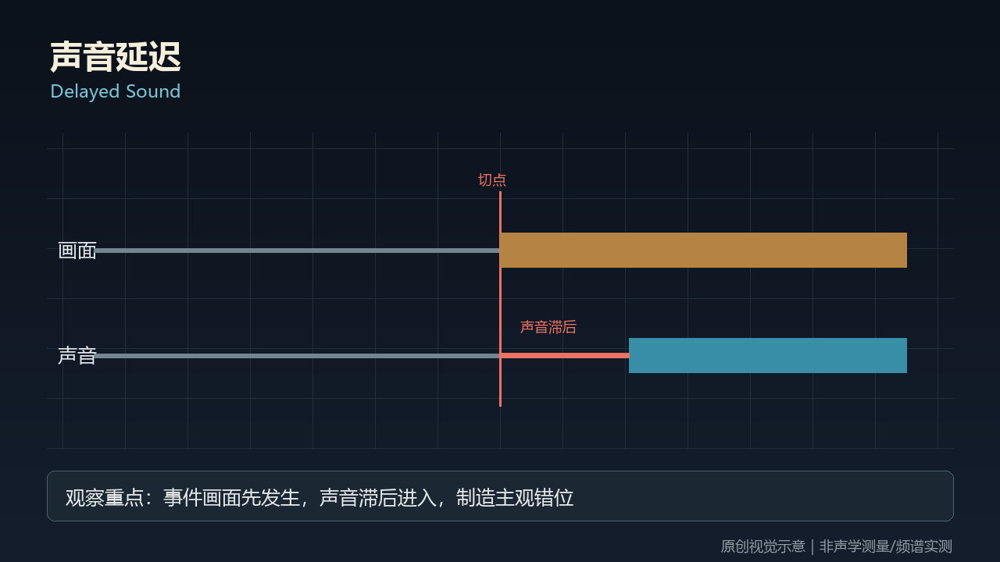

知识讲解：[A2-03 声音与音乐](../../knowledge/A-%E7%90%86%E8%AE%BA%E5%B1%82/A2-%E5%AF%BC%E6%BC%94%E7%BB%84/A2-03%20%E5%A3%B0%E9%9F%B3%E4%B8%8E%E9%9F%B3%E4%B9%90.md)

## 声音与音乐：声音桥｜Sound Bridge（08-sound-bridge，原创教学示意）

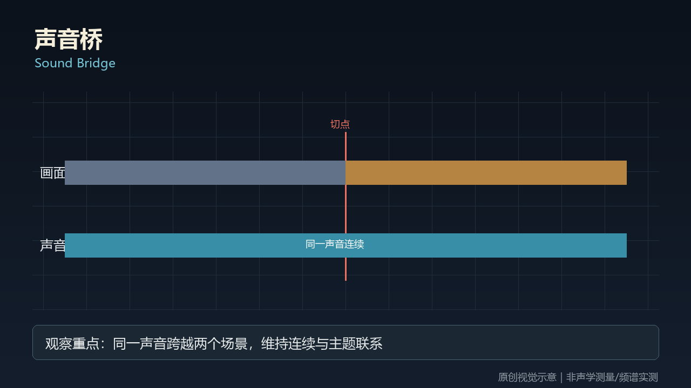

知识讲解：[A2-03 声音与音乐](../../knowledge/A-%E7%90%86%E8%AE%BA%E5%B1%82/A2-%E5%AF%BC%E6%BC%94%E7%BB%84/A2-03%20%E5%A3%B0%E9%9F%B3%E4%B8%8E%E9%9F%B3%E4%B9%90.md)

## 声音与音乐：音乐主题｜Leitmotif（09-leitmotif，原创教学示意）

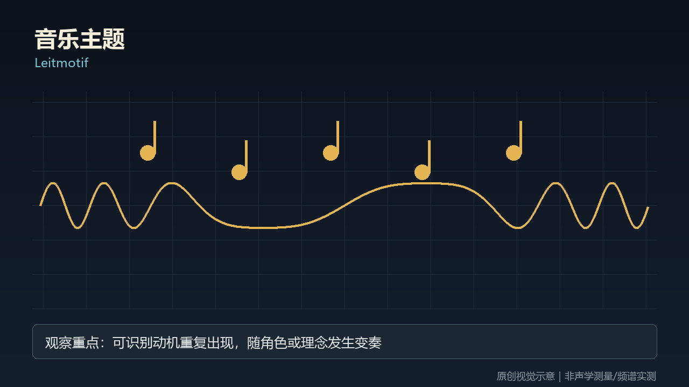

知识讲解：[A2-03 声音与音乐](../../knowledge/A-%E7%90%86%E8%AE%BA%E5%B1%82/A2-%E5%AF%BC%E6%BC%94%E7%BB%84/A2-03%20%E5%A3%B0%E9%9F%B3%E4%B8%8E%E9%9F%B3%E4%B9%90.md)

## 声音与音乐：战争耳鸣｜War Tinnitus（10-war-tinnitus，原创教学示意）

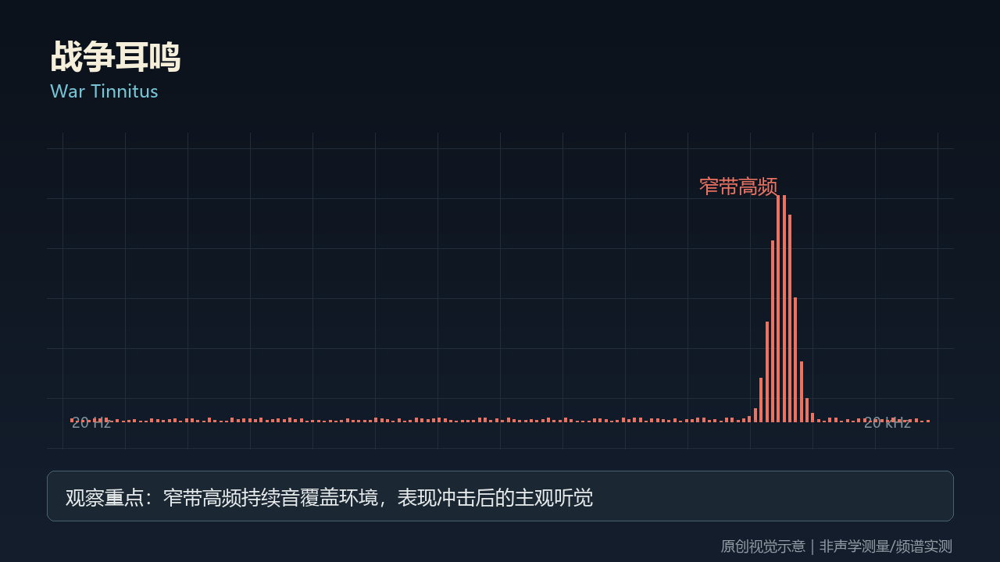

知识讲解：[A2-03 声音与音乐](../../knowledge/A-%E7%90%86%E8%AE%BA%E5%B1%82/A2-%E5%AF%BC%E6%BC%94%E7%BB%84/A2-03%20%E5%A3%B0%E9%9F%B3%E4%B8%8E%E9%9F%B3%E4%B9%90.md)

## 声音与音乐：深海压迫声｜Deep-Sea Pressure Sound（11-deep-sea-pressure，原创教学示意）

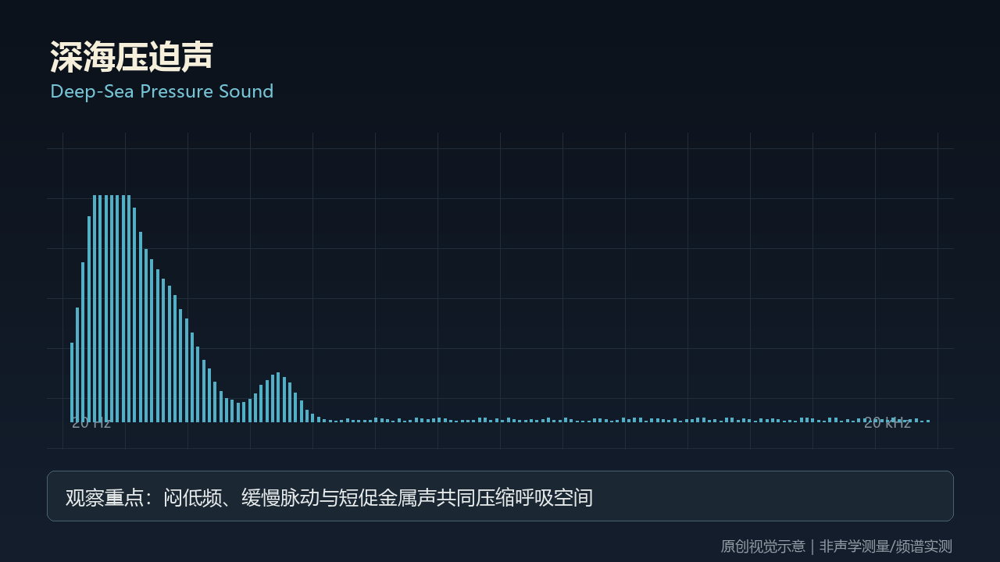

知识讲解：[A2-03 声音与音乐](../../knowledge/A-%E7%90%86%E8%AE%BA%E5%B1%82/A2-%E5%AF%BC%E6%BC%94%E7%BB%84/A2-03%20%E5%A3%B0%E9%9F%B3%E4%B8%8E%E9%9F%B3%E4%B9%90.md)

## 声音与音乐：机械低频｜Mechanical Low Frequency（12-mechanical-low-frequency，原创教学示意）

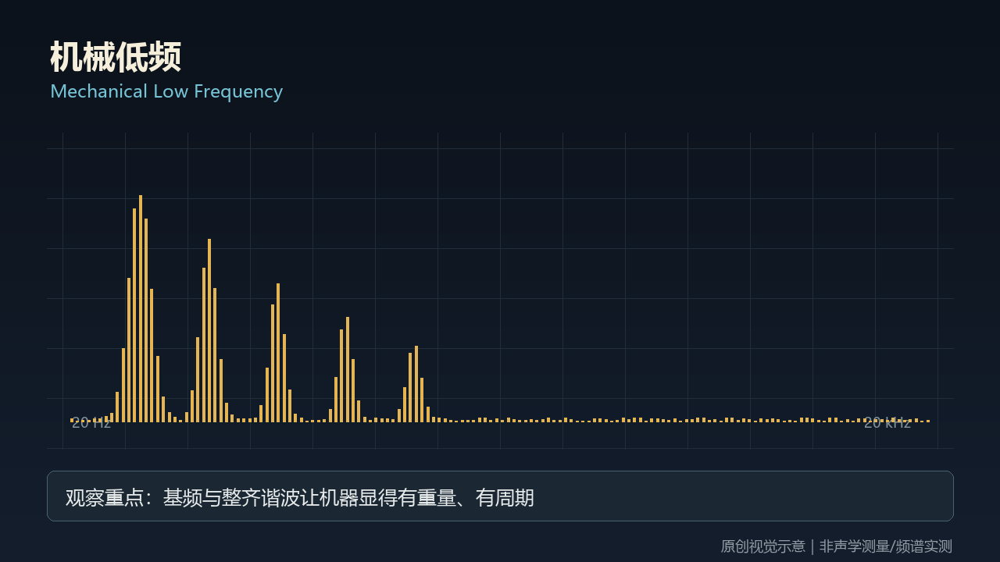

知识讲解：[A2-03 声音与音乐](../../knowledge/A-%E7%90%86%E8%AE%BA%E5%B1%82/A2-%E5%AF%BC%E6%BC%94%E7%BB%84/A2-03%20%E5%A3%B0%E9%9F%B3%E4%B8%8E%E9%9F%B3%E4%B9%90.md)

## 声音与音乐：AI声音设计｜AI Voice Design（13-ai-voice-design，原创教学示意）

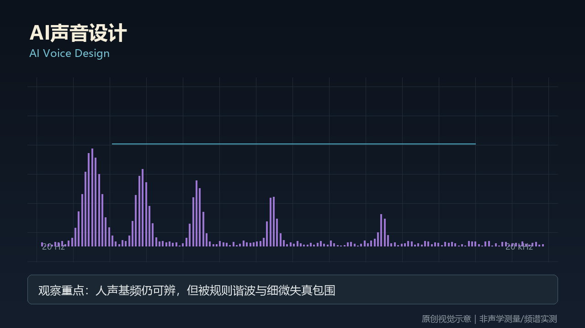

知识讲解：[A2-03 声音与音乐](../../knowledge/A-%E7%90%86%E8%AE%BA%E5%B1%82/A2-%E5%AF%BC%E6%BC%94%E7%BB%84/A2-03%20%E5%A3%B0%E9%9F%B3%E4%B8%8E%E9%9F%B3%E4%B9%90.md)

## 声音与音乐：广播声｜Broadcast Sound（14-broadcast-sound，原创教学示意）

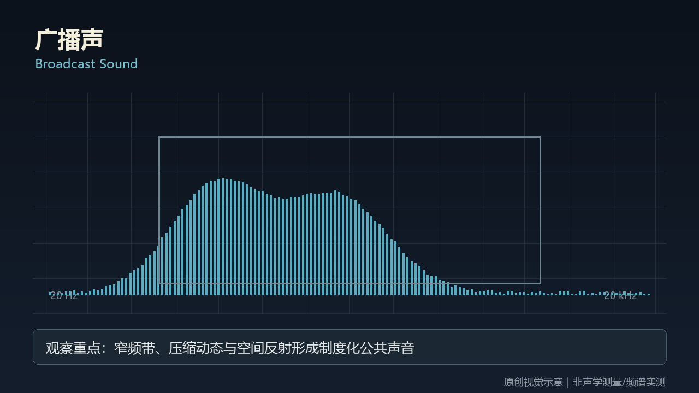

知识讲解：[A2-03 声音与音乐](../../knowledge/A-%E7%90%86%E8%AE%BA%E5%B1%82/A2-%E5%AF%BC%E6%BC%94%E7%BB%84/A2-03%20%E5%A3%B0%E9%9F%B3%E4%B8%8E%E9%9F%B3%E4%B9%90.md)

## 声音与音乐：警报声｜Alarm Sound（15-alarm-sound，原创教学示意）

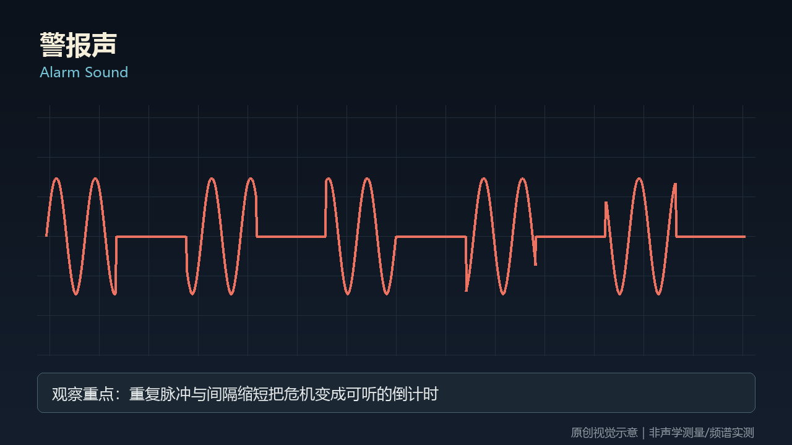

知识讲解：[A2-03 声音与音乐](../../knowledge/A-%E7%90%86%E8%AE%BA%E5%B1%82/A2-%E5%AF%BC%E6%BC%94%E7%BB%84/A2-03%20%E5%A3%B0%E9%9F%B3%E4%B8%8E%E9%9F%B3%E4%B9%90.md)

## 声音与音乐：雨声｜Rain Sound（16-rain-sound，原创教学示意）

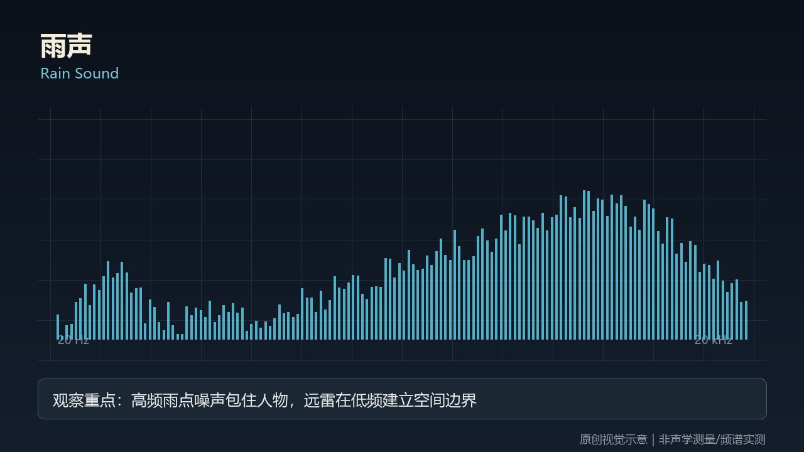

知识讲解：[A2-03 声音与音乐](../../knowledge/A-%E7%90%86%E8%AE%BA%E5%B1%82/A2-%E5%AF%BC%E6%BC%94%E7%BB%84/A2-03%20%E5%A3%B0%E9%9F%B3%E4%B8%8E%E9%9F%B3%E4%B9%90.md)

## 声音与音乐：海浪声｜Ocean Waves（17-ocean-waves，原创教学示意）

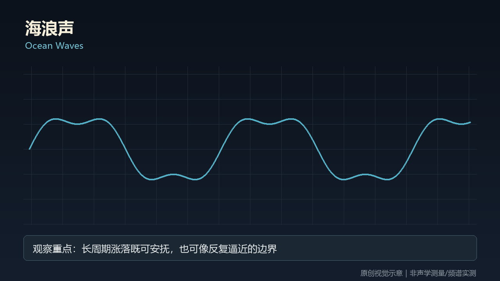

知识讲解：[A2-03 声音与音乐](../../knowledge/A-%E7%90%86%E8%AE%BA%E5%B1%82/A2-%E5%AF%BC%E6%BC%94%E7%BB%84/A2-03%20%E5%A3%B0%E9%9F%B3%E4%B8%8E%E9%9F%B3%E4%B9%90.md)

## 声音与音乐：金属摩擦｜Metal Scrape（18-metal-scrape，原创教学示意）

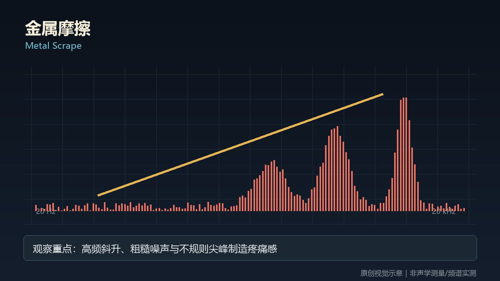

知识讲解：[A2-03 声音与音乐](../../knowledge/A-%E7%90%86%E8%AE%BA%E5%B1%82/A2-%E5%AF%BC%E6%BC%94%E7%BB%84/A2-03%20%E5%A3%B0%E9%9F%B3%E4%B8%8E%E9%9F%B3%E4%B9%90.md)

## 声音与音乐：液压声｜Hydraulic Sound（19-hydraulic-sound，原创教学示意）

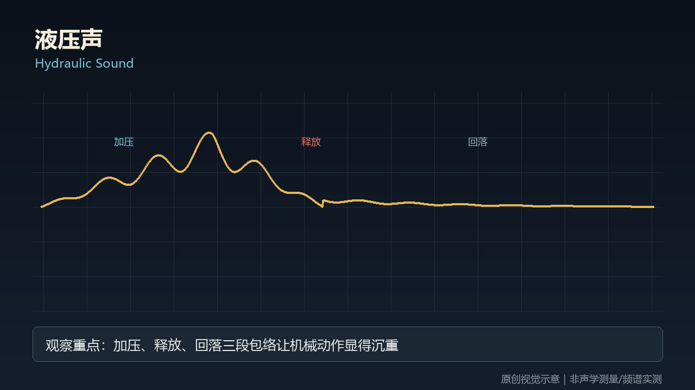

知识讲解：[A2-03 声音与音乐](../../knowledge/A-%E7%90%86%E8%AE%BA%E5%B1%82/A2-%E5%AF%BC%E6%BC%94%E7%BB%84/A2-03%20%E5%A3%B0%E9%9F%B3%E4%B8%8E%E9%9F%B3%E4%B9%90.md)

## 声音与音乐：爆炸后失聪｜Post-Blast Deafness（20-post-blast-deafness，原创教学示意）

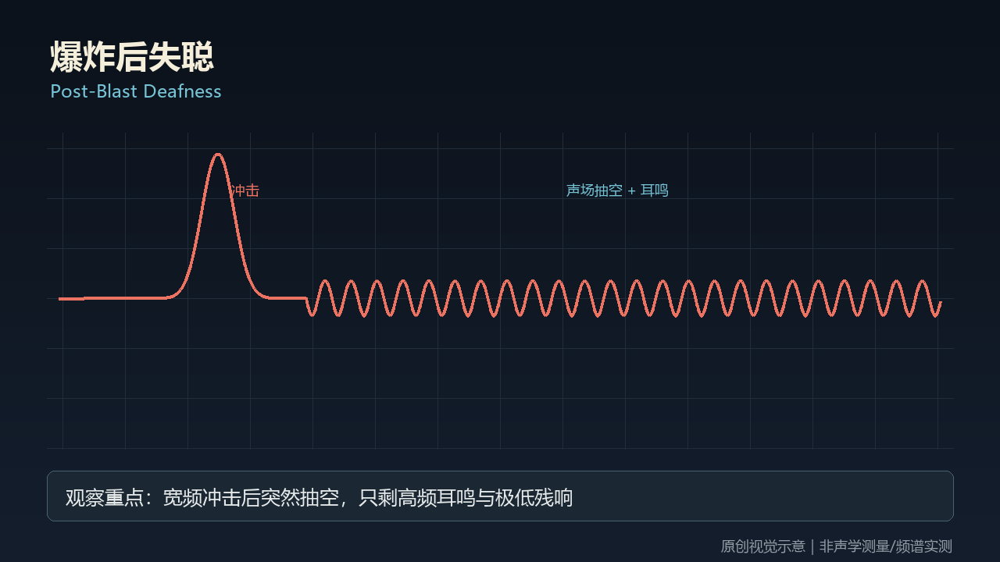

知识讲解：[A2-03 声音与音乐](../../knowledge/A-%E7%90%86%E8%AE%BA%E5%B1%82/A2-%E5%AF%BC%E6%BC%94%E7%BB%84/A2-03%20%E5%A3%B0%E9%9F%B3%E4%B8%8E%E9%9F%B3%E4%B9%90.md)

## 声音与音乐：人群噪声｜Crowd Noise（21-crowd-noise，原创教学示意）

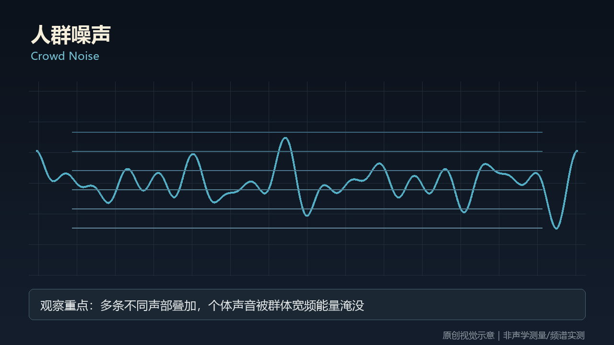

知识讲解：[A2-03 声音与音乐](../../knowledge/A-%E7%90%86%E8%AE%BA%E5%B1%82/A2-%E5%AF%BC%E6%BC%94%E7%BB%84/A2-03%20%E5%A3%B0%E9%9F%B3%E4%B8%8E%E9%9F%B3%E4%B9%90.md)

## 声音与音乐：远处战斗声｜Distant Battle Sound（22-distant-battle-sound，原创教学示意）

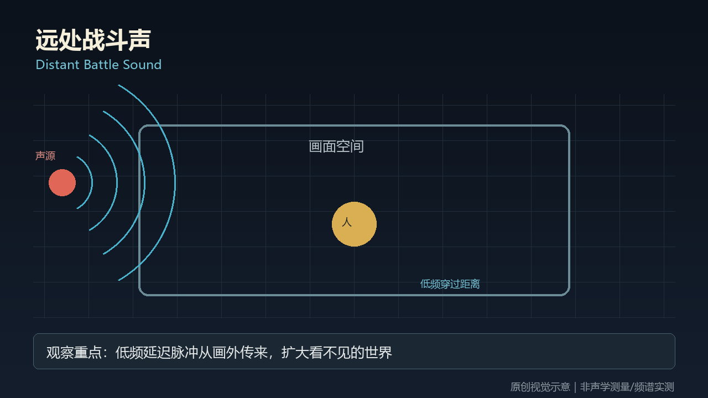

知识讲解：[A2-03 声音与音乐](../../knowledge/A-%E7%90%86%E8%AE%BA%E5%B1%82/A2-%E5%AF%BC%E6%BC%94%E7%BB%84/A2-03%20%E5%A3%B0%E9%9F%B3%E4%B8%8E%E9%9F%B3%E4%B9%90.md)

## 声音与音乐：画外声｜Offscreen Sound（23-offscreen-sound，原创教学示意）

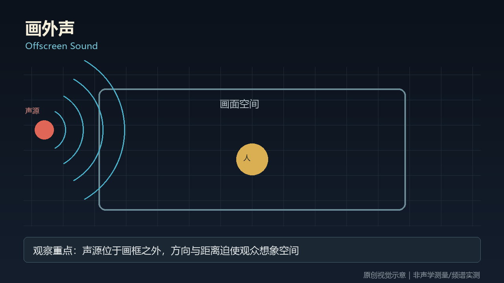

知识讲解：[A2-03 声音与音乐](../../knowledge/A-%E7%90%86%E8%AE%BA%E5%B1%82/A2-%E5%AF%BC%E6%BC%94%E7%BB%84/A2-03%20%E5%A3%B0%E9%9F%B3%E4%B8%8E%E9%9F%B3%E4%B9%90.md)

## 声音与音乐：旁白｜Voice-Over（24-voice-over，原创教学示意）

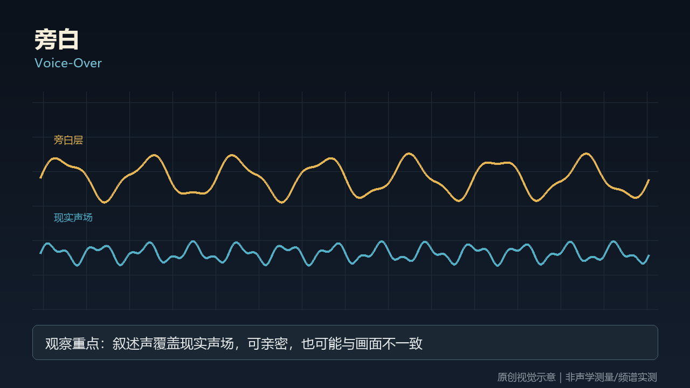

知识讲解：[A2-03 声音与音乐](../../knowledge/A-%E7%90%86%E8%AE%BA%E5%B1%82/A2-%E5%AF%BC%E6%BC%94%E7%BB%84/A2-03%20%E5%A3%B0%E9%9F%B3%E4%B8%8E%E9%9F%B3%E4%B9%90.md)
