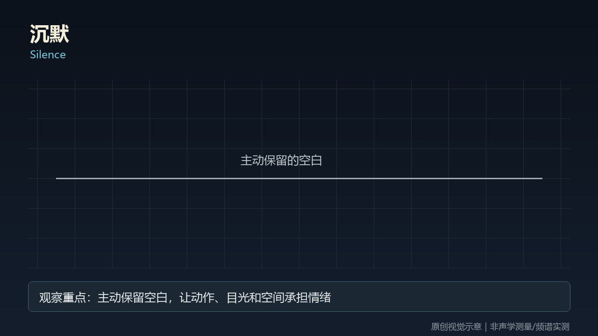
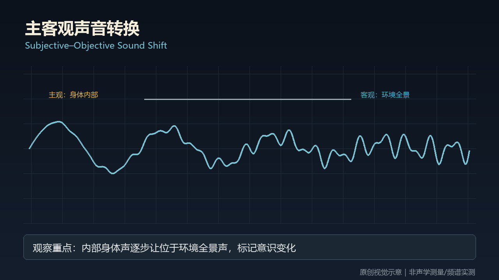

# sound-music · 25—26

[全部主题](../IMAGE_GALLERY.md) · [首页](../../README.md)

## 声音与音乐：沉默｜Silence（25-silence，原创教学示意）

知识讲解：[A2-03 声音与音乐](../../knowledge/A-%E7%90%86%E8%AE%BA%E5%B1%82/A2-%E5%AF%BC%E6%BC%94%E7%BB%84/A2-03%20%E5%A3%B0%E9%9F%B3%E4%B8%8E%E9%9F%B3%E4%B9%90.md)

## 声音与音乐：主客观声音转换｜Subjective–Objective Sound Shift（26-subjective-objective-transition，原创教学示意）

知识讲解：[A2-03 声音与音乐](../../knowledge/A-%E7%90%86%E8%AE%BA%E5%B1%82/A2-%E5%AF%BC%E6%BC%94%E7%BB%84/A2-03%20%E5%A3%B0%E9%9F%B3%E4%B8%8E%E9%9F%B3%E4%B9%90.md)
