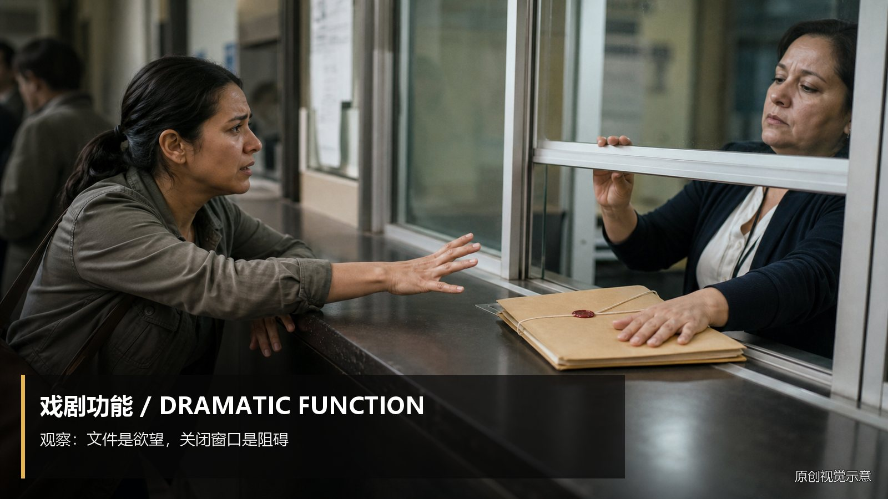
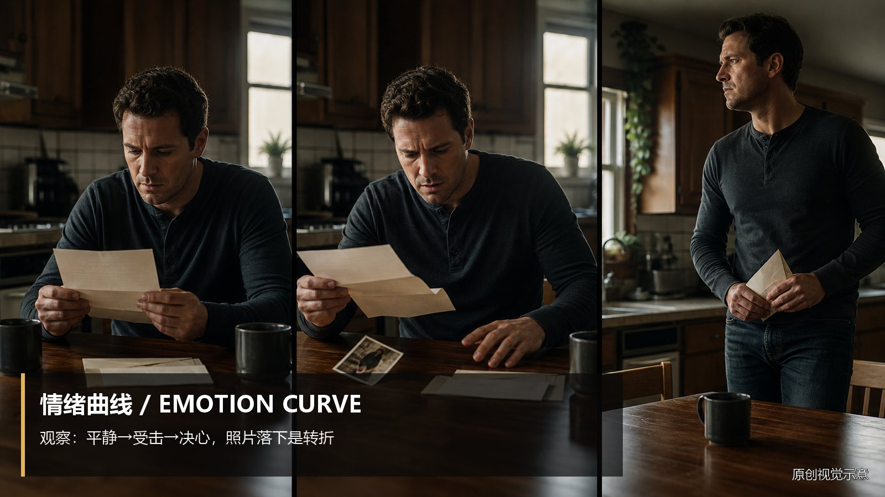
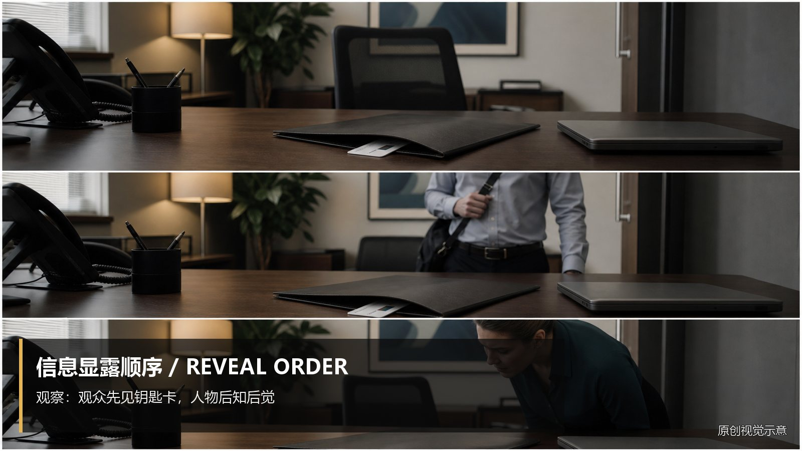
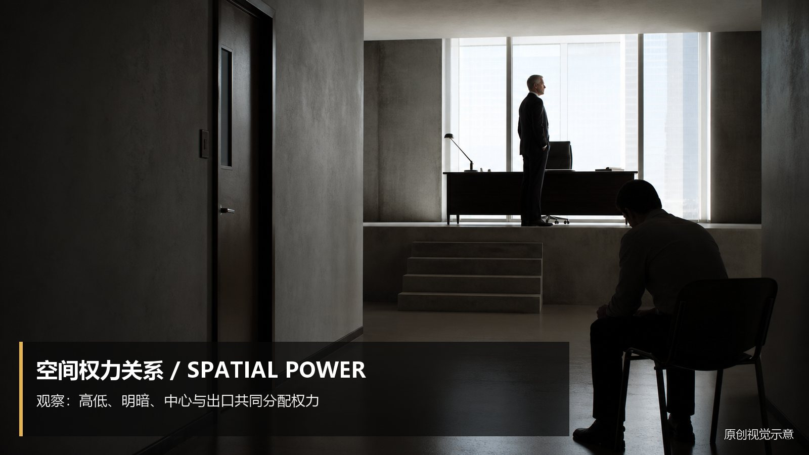

# storyboard-preanalysis · 1—9

[全部主题](../IMAGE_GALLERY.md) · [首页](../../README.md)

## 剧本转分镜前置分析：1｜戏剧功能（01-dramatic-function，原创教学示意）

知识讲解：[A3-22 剧本转分镜前置分析](../../knowledge/A-%E7%90%86%E8%AE%BA%E5%B1%82/A3-%E7%BC%96%E5%89%A7%E7%BB%84/A3-22%20%E5%89%A7%E6%9C%AC%E8%BD%AC%E5%88%86%E9%95%9C%E5%89%8D%E7%BD%AE%E5%88%86%E6%9E%90.md)

## 剧本转分镜前置分析：2｜情绪曲线（02-emotion-curve，原创教学示意）

知识讲解：[A3-22 剧本转分镜前置分析](../../knowledge/A-%E7%90%86%E8%AE%BA%E5%B1%82/A3-%E7%BC%96%E5%89%A7%E7%BB%84/A3-22%20%E5%89%A7%E6%9C%AC%E8%BD%AC%E5%88%86%E9%95%9C%E5%89%8D%E7%BD%AE%E5%88%86%E6%9E%90.md)

## 剧本转分镜前置分析：3｜信息显露顺序（03-information-order，原创教学示意）

知识讲解：[A3-22 剧本转分镜前置分析](../../knowledge/A-%E7%90%86%E8%AE%BA%E5%B1%82/A3-%E7%BC%96%E5%89%A7%E7%BB%84/A3-22%20%E5%89%A7%E6%9C%AC%E8%BD%AC%E5%88%86%E9%95%9C%E5%89%8D%E7%BD%AE%E5%88%86%E6%9E%90.md)

## 剧本转分镜前置分析：4｜空间中的权力关系（04-spatial-power，原创教学示意）

知识讲解：[A3-22 剧本转分镜前置分析](../../knowledge/A-%E7%90%86%E8%AE%BA%E5%B1%82/A3-%E7%BC%96%E5%89%A7%E7%BB%84/A3-22%20%E5%89%A7%E6%9C%AC%E8%BD%AC%E5%88%86%E9%95%9C%E5%89%8D%E7%BD%AE%E5%88%86%E6%9E%90.md)

## 剧本转分镜前置分析：人物在隐瞒（05-concealment-shot-logic，原创教学示意）

知识讲解：[A3-22 剧本转分镜前置分析](../../knowledge/A-%E7%90%86%E8%AE%BA%E5%B1%82/A3-%E7%BC%96%E5%89%A7%E7%BB%84/A3-22%20%E5%89%A7%E6%9C%AC%E8%BD%AC%E5%88%86%E9%95%9C%E5%89%8D%E7%BD%AE%E5%88%86%E6%9E%90.md)

## 剧本转分镜前置分析：人物终于选择（06-choice-camera-nears，原创教学示意）

知识讲解：[A3-22 剧本转分镜前置分析](../../knowledge/A-%E7%90%86%E8%AE%BA%E5%B1%82/A3-%E7%BC%96%E5%89%A7%E7%BB%84/A3-22%20%E5%89%A7%E6%9C%AC%E8%BD%AC%E5%88%86%E9%95%9C%E5%89%8D%E7%BD%AE%E5%88%86%E6%9E%90.md)

## 剧本转分镜前置分析：信息差（07-information-gap，原创教学示意）

知识讲解：[A3-22 剧本转分镜前置分析](../../knowledge/A-%E7%90%86%E8%AE%BA%E5%B1%82/A3-%E7%BC%96%E5%89%A7%E7%BB%84/A3-22%20%E5%89%A7%E6%9C%AC%E8%BD%AC%E5%88%86%E9%95%9C%E5%89%8D%E7%BD%AE%E5%88%86%E6%9E%90.md)

## 剧本转分镜前置分析：权力翻转（08-power-reversal，原创教学示意）

知识讲解：[A3-22 剧本转分镜前置分析](../../knowledge/A-%E7%90%86%E8%AE%BA%E5%B1%82/A3-%E7%BC%96%E5%89%A7%E7%BB%84/A3-22%20%E5%89%A7%E6%9C%AC%E8%BD%AC%E5%88%86%E9%95%9C%E5%89%8D%E7%BD%AE%E5%88%86%E6%9E%90.md)

## 剧本转分镜前置分析：情绪积累到爆发（09-emotion-tightening，原创教学示意）

知识讲解：[A3-22 剧本转分镜前置分析](../../knowledge/A-%E7%90%86%E8%AE%BA%E5%B1%82/A3-%E7%BC%96%E5%89%A7%E7%BB%84/A3-22%20%E5%89%A7%E6%9C%AC%E8%BD%AC%E5%88%86%E9%95%9C%E5%89%8D%E7%BD%AE%E5%88%86%E6%9E%90.md)
