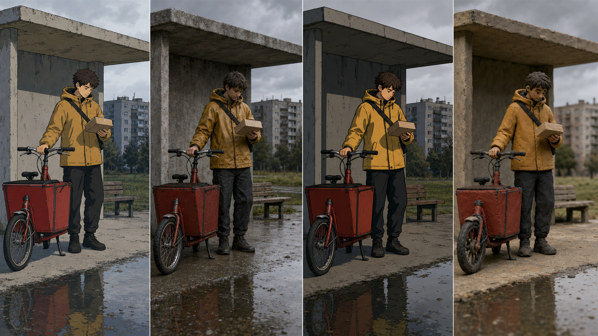
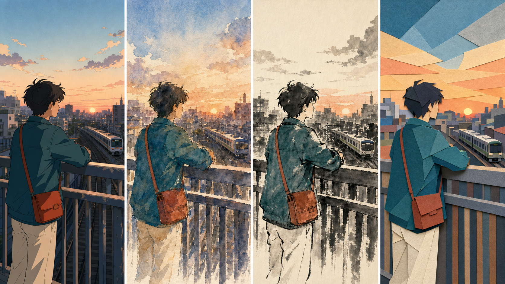
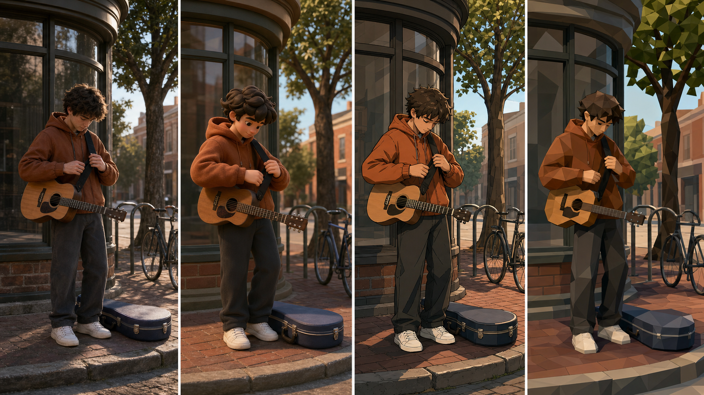
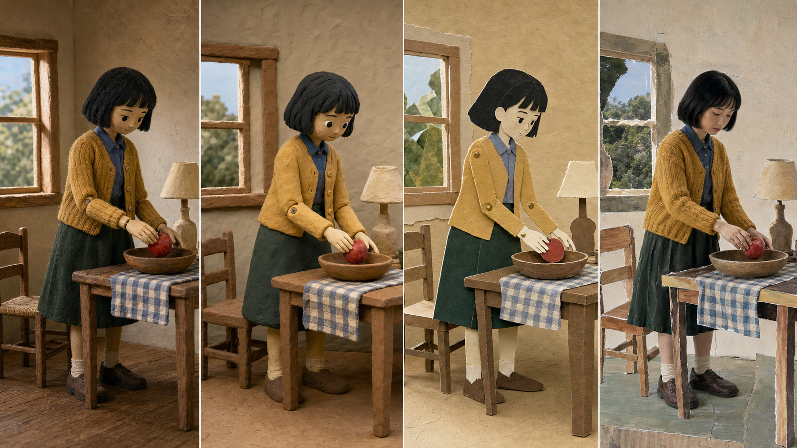
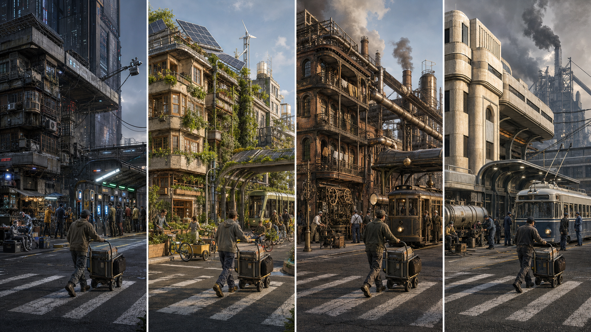
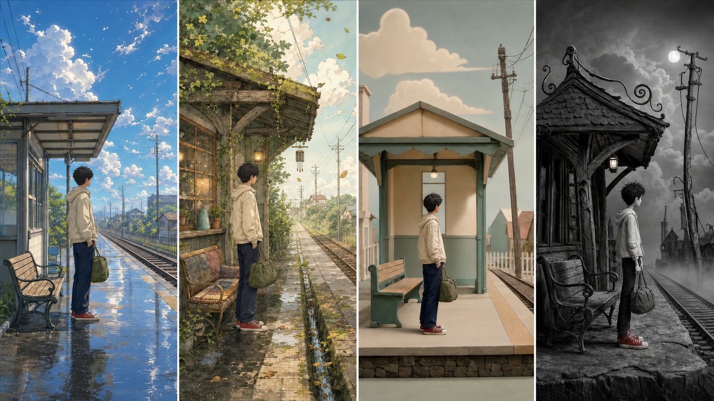
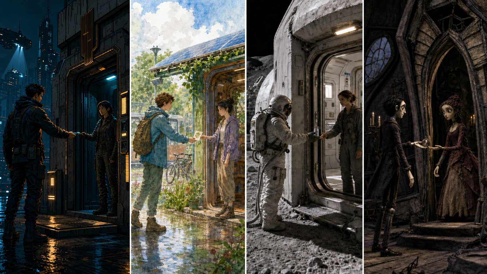

# style-atlas · 1—8

[全部主题](../IMAGE_GALLERY.md) · [首页](../../README.md)

## 电影视觉风格坐标系与术语总纲：同一场景，只改变制作外观（01_production_appearances，原创教学示意）

知识讲解：[A2-07 电影视觉风格坐标系与术语总纲](../../knowledge/A-%E7%90%86%E8%AE%BA%E5%B1%82/A2-%E5%AF%BC%E6%BC%94%E7%BB%84/A2-07%20%E7%94%B5%E5%BD%B1%E8%A7%86%E8%A7%89%E9%A3%8E%E6%A0%BC%E5%9D%90%E6%A0%87%E7%B3%BB%E4%B8%8E%E6%9C%AF%E8%AF%AD%E6%80%BB%E7%BA%B2.md) · [VISUAL_MANIFEST](../../knowledge/A-%E7%90%86%E8%AE%BA%E5%B1%82/A2-%E5%AF%BC%E6%BC%94%E7%BB%84/assets/A2-07_visual_atlas_v0.2/VISUAL_MANIFEST.md)

## 电影视觉风格坐标系与术语总纲：同一城市黄昏，四种2D画面家族（02_2d_image_families，原创教学示意）

知识讲解：[A2-07 电影视觉风格坐标系与术语总纲](../../knowledge/A-%E7%90%86%E8%AE%BA%E5%B1%82/A2-%E5%AF%BC%E6%BC%94%E7%BB%84/A2-07%20%E7%94%B5%E5%BD%B1%E8%A7%86%E8%A7%89%E9%A3%8E%E6%A0%BC%E5%9D%90%E6%A0%87%E7%B3%BB%E4%B8%8E%E6%9C%AF%E8%AF%AD%E6%80%BB%E7%BA%B2.md) · [VISUAL_MANIFEST](../../knowledge/A-%E7%90%86%E8%AE%BA%E5%B1%82/A2-%E5%AF%BC%E6%BC%94%E7%BB%84/assets/A2-07_visual_atlas_v0.2/VISUAL_MANIFEST.md)

## 电影视觉风格坐标系与术语总纲：同一街角人物，四种3D渲染家族（03_3d_rendering_families，原创教学示意）

知识讲解：[A2-07 电影视觉风格坐标系与术语总纲](../../knowledge/A-%E7%90%86%E8%AE%BA%E5%B1%82/A2-%E5%AF%BC%E6%BC%94%E7%BB%84/A2-07%20%E7%94%B5%E5%BD%B1%E8%A7%86%E8%A7%89%E9%A3%8E%E6%A0%BC%E5%9D%90%E6%A0%87%E7%B3%BB%E4%B8%8E%E6%9C%AF%E8%AF%AD%E6%80%BB%E7%BA%B2.md) · [VISUAL_MANIFEST](../../knowledge/A-%E7%90%86%E8%AE%BA%E5%B1%82/A2-%E5%AF%BC%E6%BC%94%E7%BB%84/assets/A2-07_visual_atlas_v0.2/VISUAL_MANIFEST.md)

## 电影视觉风格坐标系与术语总纲：同一室内动作，四种实体/混合媒介（04_physical_mixed_media，原创教学示意）

知识讲解：[A2-07 电影视觉风格坐标系与术语总纲](../../knowledge/A-%E7%90%86%E8%AE%BA%E5%B1%82/A2-%E5%AF%BC%E6%BC%94%E7%BB%84/A2-07%20%E7%94%B5%E5%BD%B1%E8%A7%86%E8%A7%89%E9%A3%8E%E6%A0%BC%E5%9D%90%E6%A0%87%E7%B3%BB%E4%B8%8E%E6%9C%AF%E8%AF%AD%E6%80%BB%E7%BA%B2.md) · [VISUAL_MANIFEST](../../knowledge/A-%E7%90%86%E8%AE%BA%E5%B1%82/A2-%E5%AF%BC%E6%BC%94%E7%BB%84/assets/A2-07_visual_atlas_v0.2/VISUAL_MANIFEST.md)

## 电影视觉风格坐标系与术语总纲：同一城市街区，四种未来世界不是“换配色”（05_future_world_genres，原创教学示意）

知识讲解：[A2-07 电影视觉风格坐标系与术语总纲](../../knowledge/A-%E7%90%86%E8%AE%BA%E5%B1%82/A2-%E5%AF%BC%E6%BC%94%E7%BB%84/A2-07%20%E7%94%B5%E5%BD%B1%E8%A7%86%E8%A7%89%E9%A3%8E%E6%A0%BC%E5%9D%90%E6%A0%87%E7%B3%BB%E4%B8%8E%E6%9C%AF%E8%AF%AD%E6%80%BB%E7%BA%B2.md) · [VISUAL_MANIFEST](../../knowledge/A-%E7%90%86%E8%AE%BA%E5%B1%82/A2-%E5%AF%BC%E6%BC%94%E7%BB%84/assets/A2-07_visual_atlas_v0.2/VISUAL_MANIFEST.md)

## 电影视觉风格坐标系与术语总纲：同一站台人物，把四种口语称呼翻译成通用机制（06_popular_style_decoding，原创教学示意）

知识讲解：[A2-07 电影视觉风格坐标系与术语总纲](../../knowledge/A-%E7%90%86%E8%AE%BA%E5%B1%82/A2-%E5%AF%BC%E6%BC%94%E7%BB%84/A2-07%20%E7%94%B5%E5%BD%B1%E8%A7%86%E8%A7%89%E9%A3%8E%E6%A0%BC%E5%9D%90%E6%A0%87%E7%B3%BB%E4%B8%8E%E6%9C%AF%E8%AF%AD%E6%80%BB%E7%BA%B2.md) · [VISUAL_MANIFEST](../../knowledge/A-%E7%90%86%E8%AE%BA%E5%B1%82/A2-%E5%AF%BC%E6%BC%94%E7%BB%84/assets/A2-07_visual_atlas_v0.2/VISUAL_MANIFEST.md)

## 电影视觉风格坐标系与术语总纲：四套完整组合A：同一“入口交换物件”动作（07_complete_combinations_a，原创教学示意）

知识讲解：[A2-07 电影视觉风格坐标系与术语总纲](../../knowledge/A-%E7%90%86%E8%AE%BA%E5%B1%82/A2-%E5%AF%BC%E6%BC%94%E7%BB%84/A2-07%20%E7%94%B5%E5%BD%B1%E8%A7%86%E8%A7%89%E9%A3%8E%E6%A0%BC%E5%9D%90%E6%A0%87%E7%B3%BB%E4%B8%8E%E6%9C%AF%E8%AF%AD%E6%80%BB%E7%BA%B2.md) · [VISUAL_MANIFEST](../../knowledge/A-%E7%90%86%E8%AE%BA%E5%B1%82/A2-%E5%AF%BC%E6%BC%94%E7%BB%84/assets/A2-07_visual_atlas_v0.2/VISUAL_MANIFEST.md)

## 电影视觉风格坐标系与术语总纲：四套完整组合B：同一“旅人提灯走向庇护所”动作（08_complete_combinations_b，原创教学示意）

知识讲解：[A2-07 电影视觉风格坐标系与术语总纲](../../knowledge/A-%E7%90%86%E8%AE%BA%E5%B1%82/A2-%E5%AF%BC%E6%BC%94%E7%BB%84/A2-07%20%E7%94%B5%E5%BD%B1%E8%A7%86%E8%A7%89%E9%A3%8E%E6%A0%BC%E5%9D%90%E6%A0%87%E7%B3%BB%E4%B8%8E%E6%9C%AF%E8%AF%AD%E6%80%BB%E7%BA%B2.md) · [VISUAL_MANIFEST](../../knowledge/A-%E7%90%86%E8%AE%BA%E5%B1%82/A2-%E5%AF%BC%E6%BC%94%E7%BB%84/assets/A2-07_visual_atlas_v0.2/VISUAL_MANIFEST.md)
