# style-mechanisms · 1—24

[全部主题](../IMAGE_GALLERY.md) · [首页](../../README.md)

## 导演与摄影指导风格：克里斯托弗·诺兰｜Christopher Nolan（01-nolan，原创教学示意）

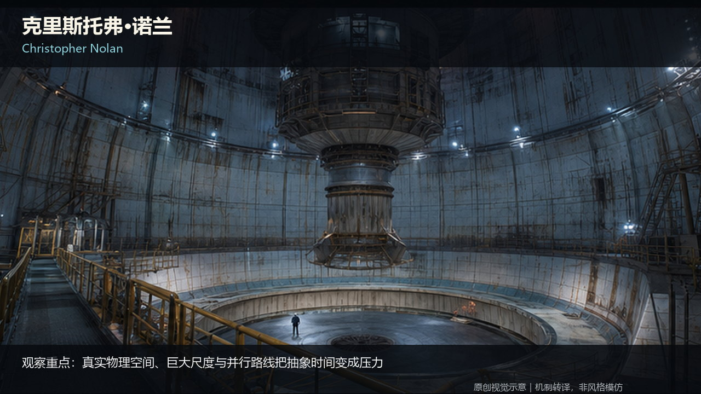

知识讲解：[A2-05 导演与摄影指导风格](../../knowledge/A-%E7%90%86%E8%AE%BA%E5%B1%82/A2-%E5%AF%BC%E6%BC%94%E7%BB%84/A2-05%20%E5%AF%BC%E6%BC%94%E4%B8%8E%E6%91%84%E5%BD%B1%E6%8C%87%E5%AF%BC%E9%A3%8E%E6%A0%BC.md)

## 导演与摄影指导风格：史蒂文·斯皮尔伯格｜Steven Spielberg（02-spielberg，原创教学示意）

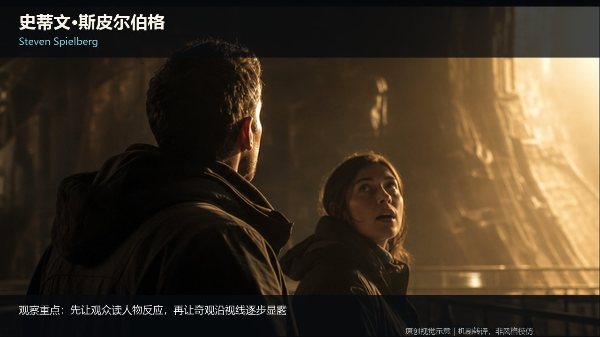

知识讲解：[A2-05 导演与摄影指导风格](../../knowledge/A-%E7%90%86%E8%AE%BA%E5%B1%82/A2-%E5%AF%BC%E6%BC%94%E7%BB%84/A2-05%20%E5%AF%BC%E6%BC%94%E4%B8%8E%E6%91%84%E5%BD%B1%E6%8C%87%E5%AF%BC%E9%A3%8E%E6%A0%BC.md)

## 导演与摄影指导风格：迈克尔·贝｜Michael Bay（03-michael-bay，原创教学示意）

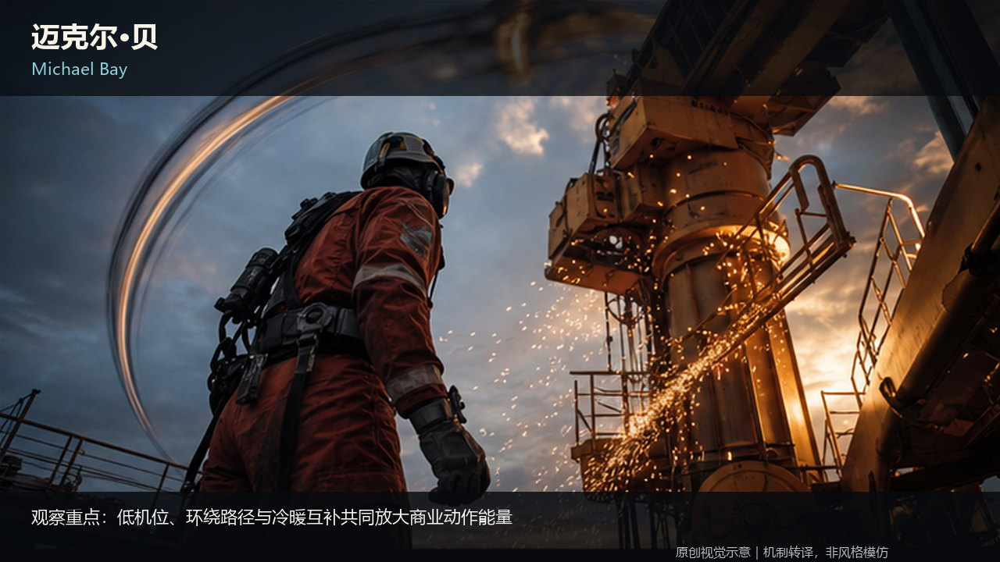

知识讲解：[A2-05 导演与摄影指导风格](../../knowledge/A-%E7%90%86%E8%AE%BA%E5%B1%82/A2-%E5%AF%BC%E6%BC%94%E7%BB%84/A2-05%20%E5%AF%BC%E6%BC%94%E4%B8%8E%E6%91%84%E5%BD%B1%E6%8C%87%E5%AF%BC%E9%A3%8E%E6%A0%BC.md)

## 导演与摄影指导风格：丹尼斯·维伦纽瓦｜Denis Villeneuve（04-villeneuve，原创教学示意）

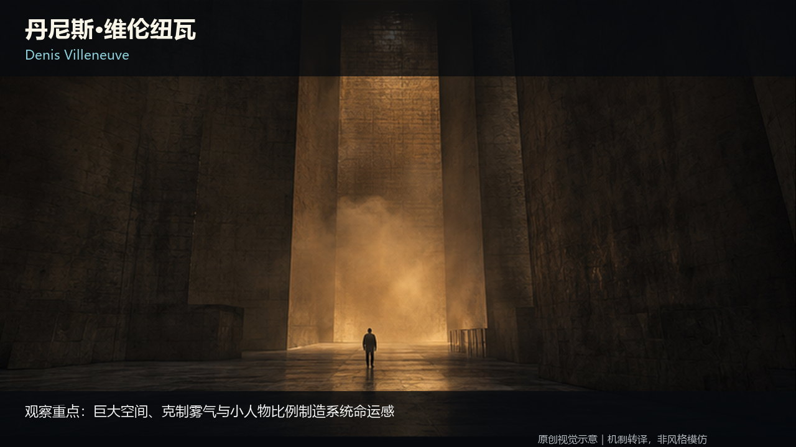

知识讲解：[A2-05 导演与摄影指导风格](../../knowledge/A-%E7%90%86%E8%AE%BA%E5%B1%82/A2-%E5%AF%BC%E6%BC%94%E7%BB%84/A2-05%20%E5%AF%BC%E6%BC%94%E4%B8%8E%E6%91%84%E5%BD%B1%E6%8C%87%E5%AF%BC%E9%A3%8E%E6%A0%BC.md) · [A2-07 电影视觉风格坐标系与术语总纲](../../knowledge/A-%E7%90%86%E8%AE%BA%E5%B1%82/A2-%E5%AF%BC%E6%BC%94%E7%BB%84/A2-07%20%E7%94%B5%E5%BD%B1%E8%A7%86%E8%A7%89%E9%A3%8E%E6%A0%BC%E5%9D%90%E6%A0%87%E7%B3%BB%E4%B8%8E%E6%9C%AF%E8%AF%AD%E6%80%BB%E7%BA%B2.md)

## 导演与摄影指导风格：雷德利·斯科特｜Ridley Scott（05-ridley-scott，原创教学示意）

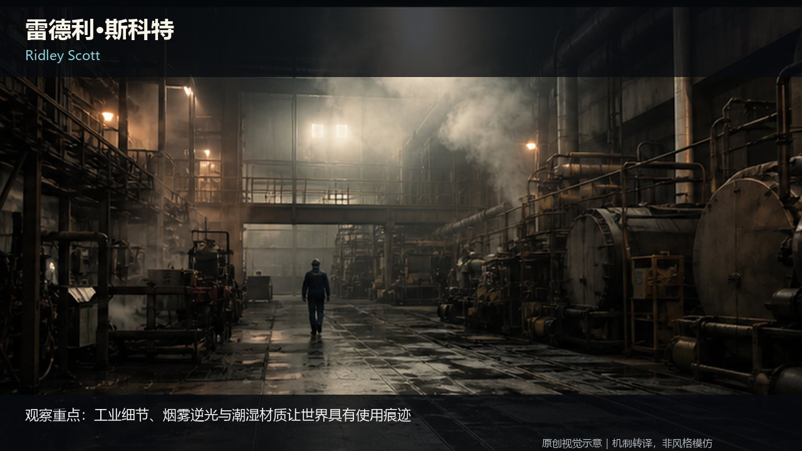

知识讲解：[A2-05 导演与摄影指导风格](../../knowledge/A-%E7%90%86%E8%AE%BA%E5%B1%82/A2-%E5%AF%BC%E6%BC%94%E7%BB%84/A2-05%20%E5%AF%BC%E6%BC%94%E4%B8%8E%E6%91%84%E5%BD%B1%E6%8C%87%E5%AF%BC%E9%A3%8E%E6%A0%BC.md)

## 导演与摄影指导风格：大卫·芬奇｜David Fincher（06-fincher，原创教学示意）

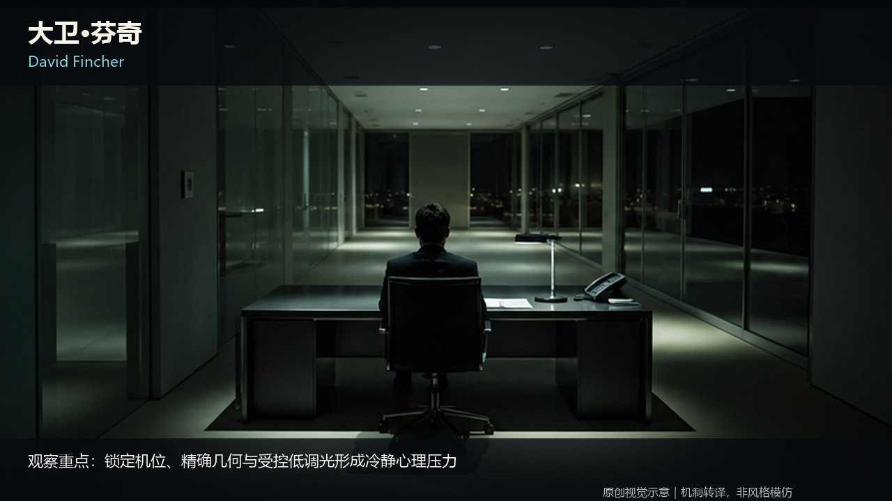

知识讲解：[A2-05 导演与摄影指导风格](../../knowledge/A-%E7%90%86%E8%AE%BA%E5%B1%82/A2-%E5%AF%BC%E6%BC%94%E7%BB%84/A2-05%20%E5%AF%BC%E6%BC%94%E4%B8%8E%E6%91%84%E5%BD%B1%E6%8C%87%E5%AF%BC%E9%A3%8E%E6%A0%BC.md)

## 导演与摄影指导风格：斯坦利·库布里克｜Stanley Kubrick（07-kubrick，原创教学示意）

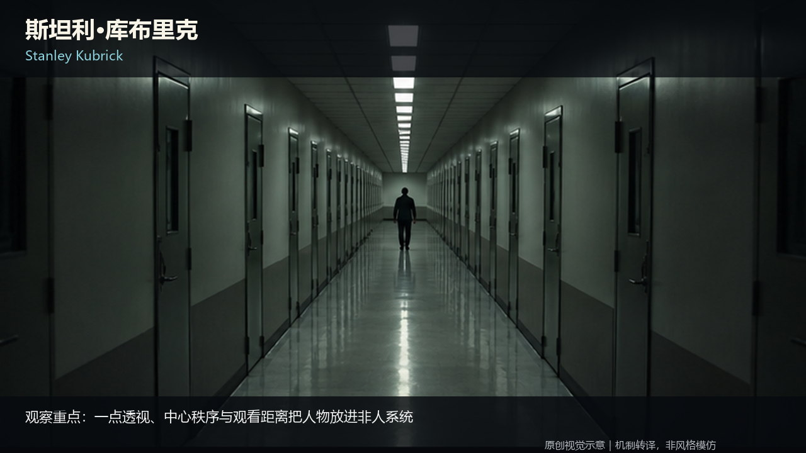

知识讲解：[A2-05 导演与摄影指导风格](../../knowledge/A-%E7%90%86%E8%AE%BA%E5%B1%82/A2-%E5%AF%BC%E6%BC%94%E7%BB%84/A2-05%20%E5%AF%BC%E6%BC%94%E4%B8%8E%E6%91%84%E5%BD%B1%E6%8C%87%E5%AF%BC%E9%A3%8E%E6%A0%BC.md)

## 导演与摄影指导风格：罗杰·迪金斯｜Roger Deakins（08-deakins，原创教学示意）

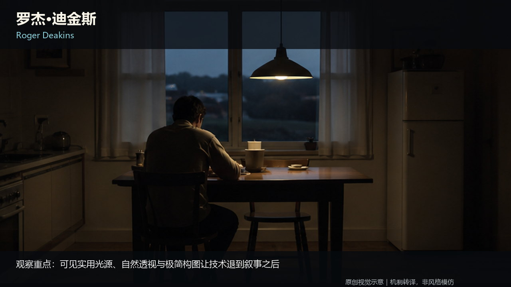

知识讲解：[A2-05 导演与摄影指导风格](../../knowledge/A-%E7%90%86%E8%AE%BA%E5%B1%82/A2-%E5%AF%BC%E6%BC%94%E7%BB%84/A2-05%20%E5%AF%BC%E6%BC%94%E4%B8%8E%E6%91%84%E5%BD%B1%E6%8C%87%E5%AF%BC%E9%A3%8E%E6%A0%BC.md)

## 导演与摄影指导风格：1. 詹姆斯·卡梅隆 James Cameron（导演）（09-cameron，原创教学示意）

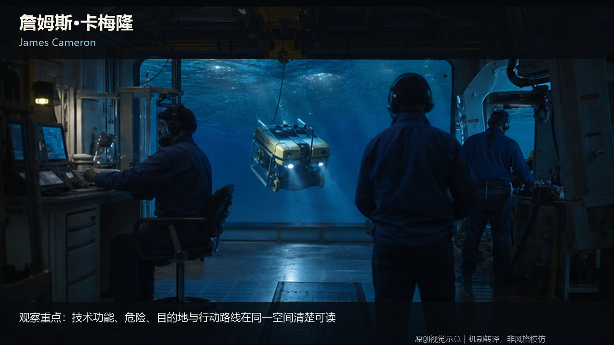

知识讲解：[A2-05 导演与摄影指导风格](../../knowledge/A-%E7%90%86%E8%AE%BA%E5%B1%82/A2-%E5%AF%BC%E6%BC%94%E7%BB%84/A2-05%20%E5%AF%BC%E6%BC%94%E4%B8%8E%E6%91%84%E5%BD%B1%E6%8C%87%E5%AF%BC%E9%A3%8E%E6%A0%BC.md)

## 导演与摄影指导风格：2. 阿尔弗雷德·希区柯克 Alfred Hitchcock（导演）（10-hitchcock，原创教学示意）

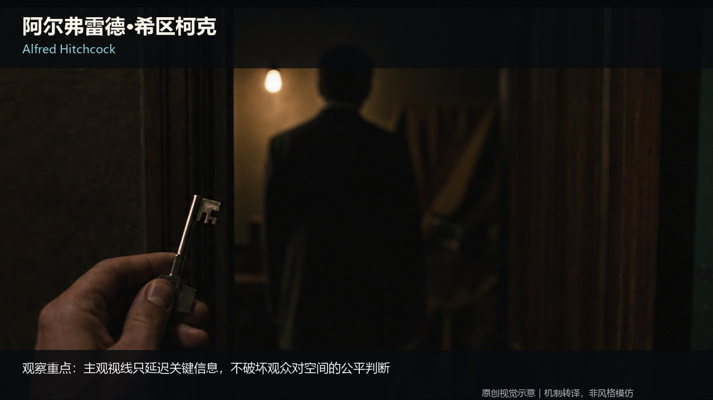

知识讲解：[A2-05 导演与摄影指导风格](../../knowledge/A-%E7%90%86%E8%AE%BA%E5%B1%82/A2-%E5%AF%BC%E6%BC%94%E7%BB%84/A2-05%20%E5%AF%BC%E6%BC%94%E4%B8%8E%E6%91%84%E5%BD%B1%E6%8C%87%E5%AF%BC%E9%A3%8E%E6%A0%BC.md)

## 导演与摄影指导风格：3. 黑泽明 Akira Kurosawa（导演）（11-kurosawa，原创教学示意）

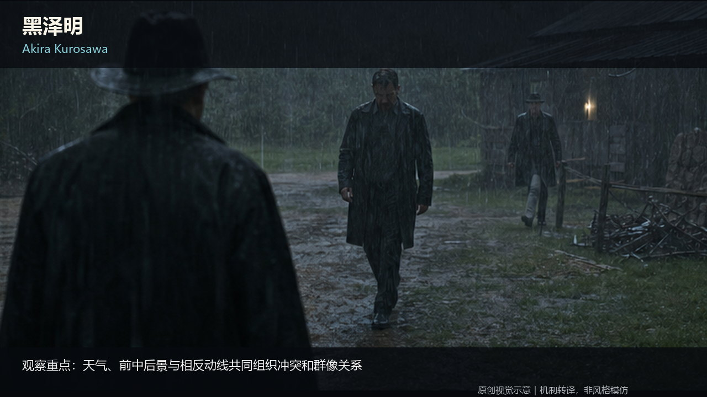

知识讲解：[A2-05 导演与摄影指导风格](../../knowledge/A-%E7%90%86%E8%AE%BA%E5%B1%82/A2-%E5%AF%BC%E6%BC%94%E7%BB%84/A2-05%20%E5%AF%BC%E6%BC%94%E4%B8%8E%E6%91%84%E5%BD%B1%E6%8C%87%E5%AF%BC%E9%A3%8E%E6%A0%BC.md) · [A2-07 电影视觉风格坐标系与术语总纲](../../knowledge/A-%E7%90%86%E8%AE%BA%E5%B1%82/A2-%E5%AF%BC%E6%BC%94%E7%BB%84/A2-07%20%E7%94%B5%E5%BD%B1%E8%A7%86%E8%A7%89%E9%A3%8E%E6%A0%BC%E5%9D%90%E6%A0%87%E7%B3%BB%E4%B8%8E%E6%9C%AF%E8%AF%AD%E6%80%BB%E7%BA%B2.md)

## 导演与摄影指导风格：4. 马丁·斯科塞斯 Martin Scorsese（导演）（12-scorsese，原创教学示意）

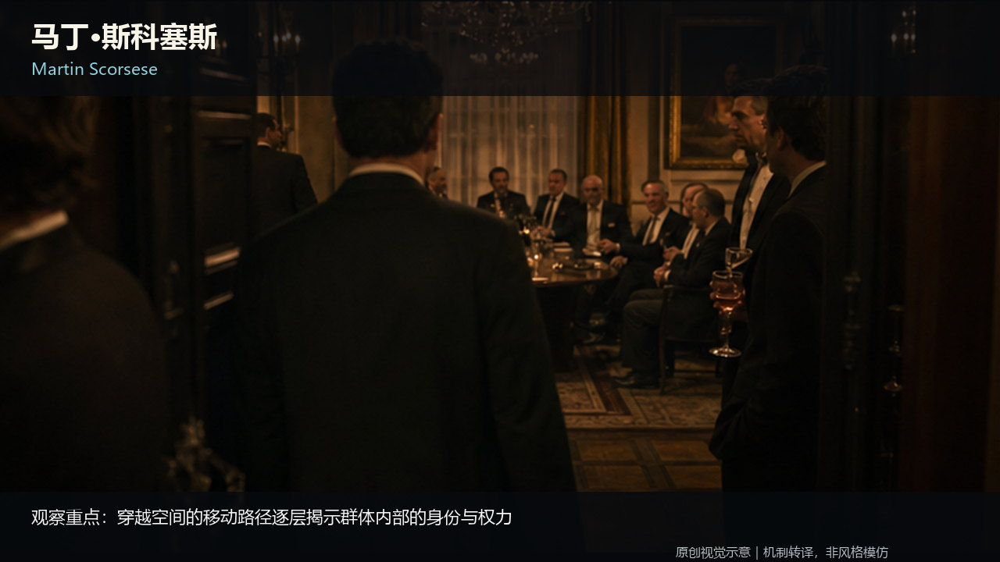

知识讲解：[A2-05 导演与摄影指导风格](../../knowledge/A-%E7%90%86%E8%AE%BA%E5%B1%82/A2-%E5%AF%BC%E6%BC%94%E7%BB%84/A2-05%20%E5%AF%BC%E6%BC%94%E4%B8%8E%E6%91%84%E5%BD%B1%E6%8C%87%E5%AF%BC%E9%A3%8E%E6%A0%BC.md)

## 导演与摄影指导风格：5. 王家卫 Wong Kar-wai（导演）（13-wong-kar-wai，原创教学示意）

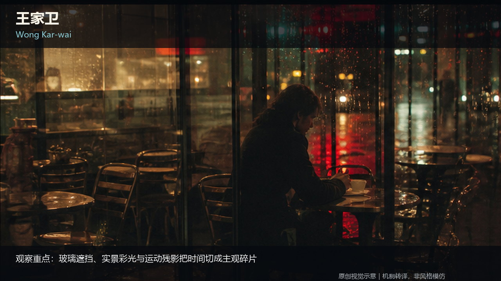

知识讲解：[A2-05 导演与摄影指导风格](../../knowledge/A-%E7%90%86%E8%AE%BA%E5%B1%82/A2-%E5%AF%BC%E6%BC%94%E7%BB%84/A2-05%20%E5%AF%BC%E6%BC%94%E4%B8%8E%E6%91%84%E5%BD%B1%E6%8C%87%E5%AF%BC%E9%A3%8E%E6%A0%BC.md) · [A2-07 电影视觉风格坐标系与术语总纲](../../knowledge/A-%E7%90%86%E8%AE%BA%E5%B1%82/A2-%E5%AF%BC%E6%BC%94%E7%BB%84/A2-07%20%E7%94%B5%E5%BD%B1%E8%A7%86%E8%A7%89%E9%A3%8E%E6%A0%BC%E5%9D%90%E6%A0%87%E7%B3%BB%E4%B8%8E%E6%9C%AF%E8%AF%AD%E6%80%BB%E7%BA%B2.md)

## 导演与摄影指导风格：6. 张艺谋 Zhang Yimou（导演）（14-zhang-yimou，原创教学示意）

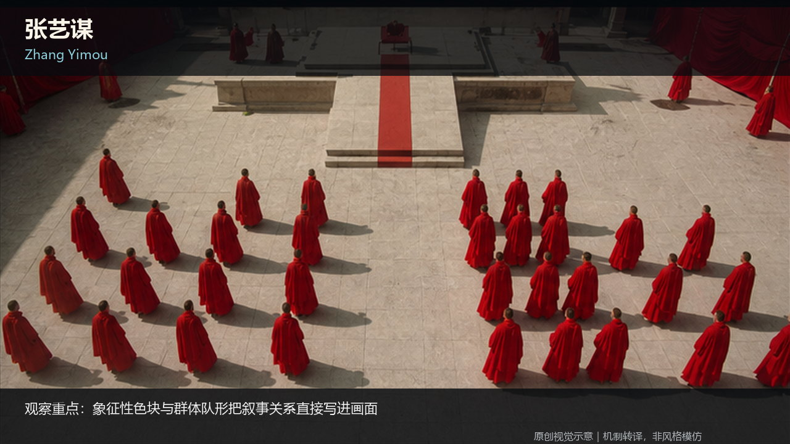

知识讲解：[A2-05 导演与摄影指导风格](../../knowledge/A-%E7%90%86%E8%AE%BA%E5%B1%82/A2-%E5%AF%BC%E6%BC%94%E7%BB%84/A2-05%20%E5%AF%BC%E6%BC%94%E4%B8%8E%E6%91%84%E5%BD%B1%E6%8C%87%E5%AF%BC%E9%A3%8E%E6%A0%BC.md)

## 导演与摄影指导风格：7. 安德烈·塔可夫斯基 Andrei Tarkovsky（导演）（15-tarkovsky，原创教学示意）

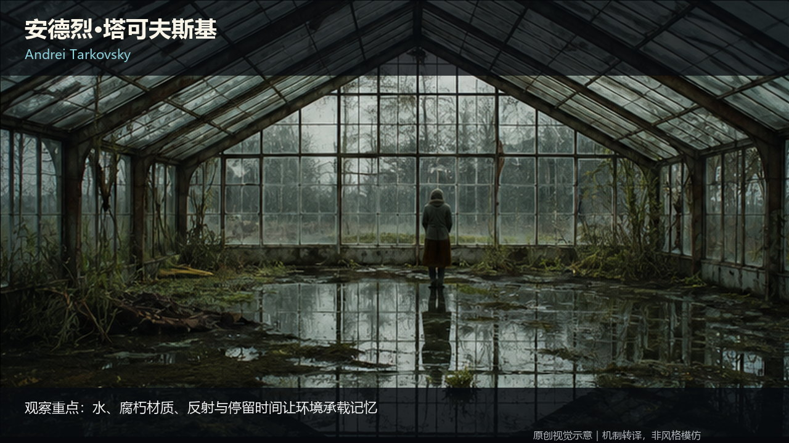

知识讲解：[A2-05 导演与摄影指导风格](../../knowledge/A-%E7%90%86%E8%AE%BA%E5%B1%82/A2-%E5%AF%BC%E6%BC%94%E7%BB%84/A2-05%20%E5%AF%BC%E6%BC%94%E4%B8%8E%E6%91%84%E5%BD%B1%E6%8C%87%E5%AF%BC%E9%A3%8E%E6%A0%BC.md)

## 导演与摄影指导风格：8. 托尼·斯科特 Tony Scott（导演）（16-tony-scott，原创教学示意）

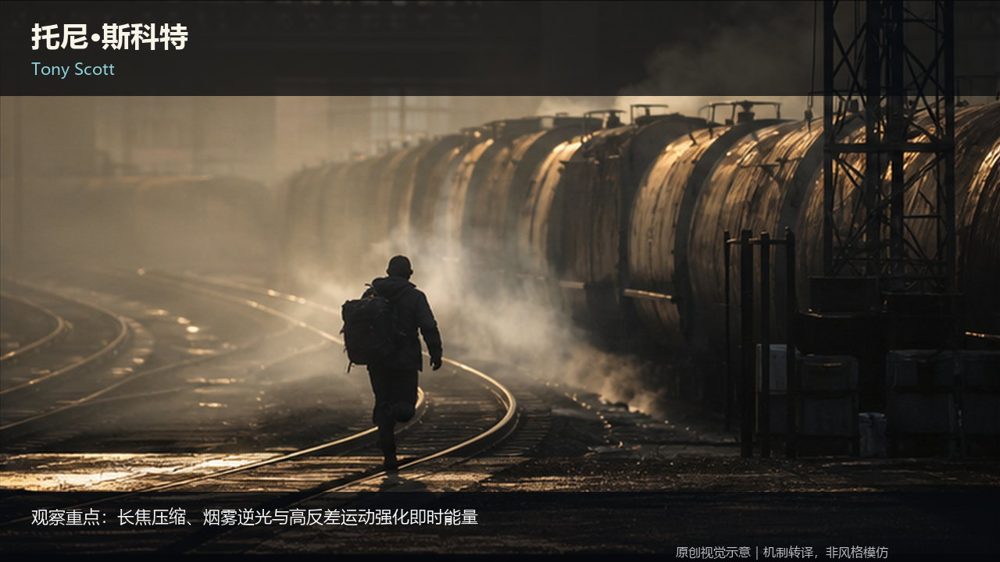

知识讲解：[A2-05 导演与摄影指导风格](../../knowledge/A-%E7%90%86%E8%AE%BA%E5%B1%82/A2-%E5%AF%BC%E6%BC%94%E7%BB%84/A2-05%20%E5%AF%BC%E6%BC%94%E4%B8%8E%E6%91%84%E5%BD%B1%E6%8C%87%E5%AF%BC%E9%A3%8E%E6%A0%BC.md)

## 导演与摄影指导风格：9. 保罗·格林格拉斯 Paul Greengrass（导演）（17-greengrass，原创教学示意）

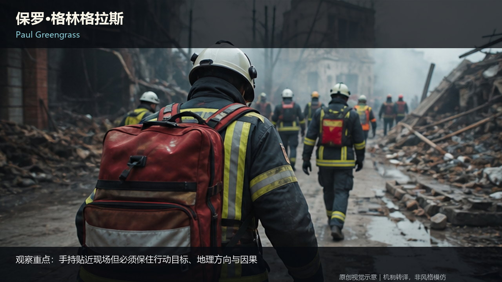

知识讲解：[A2-05 导演与摄影指导风格](../../knowledge/A-%E7%90%86%E8%AE%BA%E5%B1%82/A2-%E5%AF%BC%E6%BC%94%E7%BB%84/A2-05%20%E5%AF%BC%E6%BC%94%E4%B8%8E%E6%91%84%E5%BD%B1%E6%8C%87%E5%AF%BC%E9%A3%8E%E6%A0%BC.md)

## 导演与摄影指导风格：10. 阿方索·卡隆 Alfonso Cuarón（导演）（18-cuaron，原创教学示意）

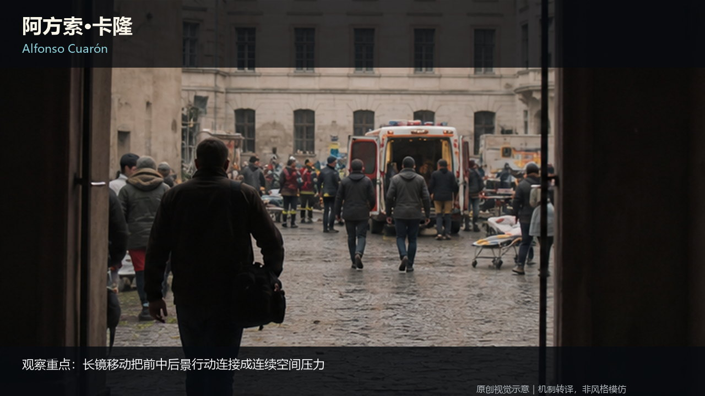

知识讲解：[A2-05 导演与摄影指导风格](../../knowledge/A-%E7%90%86%E8%AE%BA%E5%B1%82/A2-%E5%AF%BC%E6%BC%94%E7%BB%84/A2-05%20%E5%AF%BC%E6%BC%94%E4%B8%8E%E6%91%84%E5%BD%B1%E6%8C%87%E5%AF%BC%E9%A3%8E%E6%A0%BC.md)

## 导演与摄影指导风格：11. 乔治·米勒 George Miller（导演）（19-george-miller，原创教学示意）

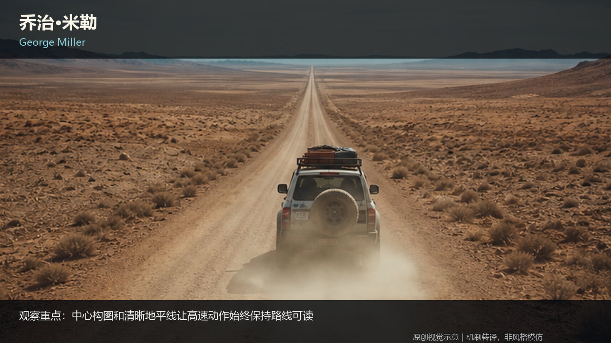

知识讲解：[A2-05 导演与摄影指导风格](../../knowledge/A-%E7%90%86%E8%AE%BA%E5%B1%82/A2-%E5%AF%BC%E6%BC%94%E7%BB%84/A2-05%20%E5%AF%BC%E6%BC%94%E4%B8%8E%E6%91%84%E5%BD%B1%E6%8C%87%E5%AF%BC%E9%A3%8E%E6%A0%BC.md)

## 导演与摄影指导风格：12. 山姆·门德斯 Sam Mendes（导演）（20-sam-mendes，原创教学示意）

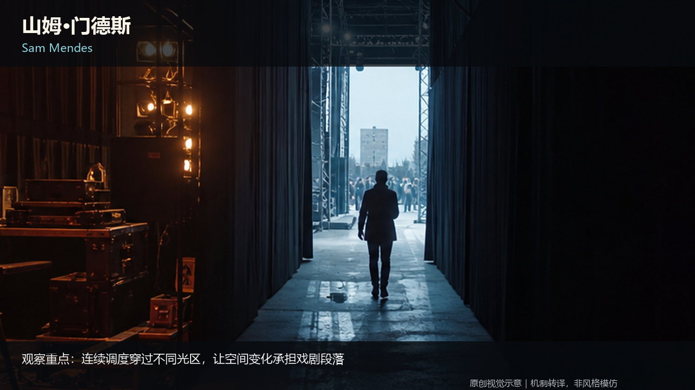

知识讲解：[A2-05 导演与摄影指导风格](../../knowledge/A-%E7%90%86%E8%AE%BA%E5%B1%82/A2-%E5%AF%BC%E6%BC%94%E7%BB%84/A2-05%20%E5%AF%BC%E6%BC%94%E4%B8%8E%E6%91%84%E5%BD%B1%E6%8C%87%E5%AF%BC%E9%A3%8E%E6%A0%BC.md)

## 导演与摄影指导风格：二·1 罗杰·迪金斯 Roger Deakins（摄影师/DP）（21-deakins-deep，原创教学示意）

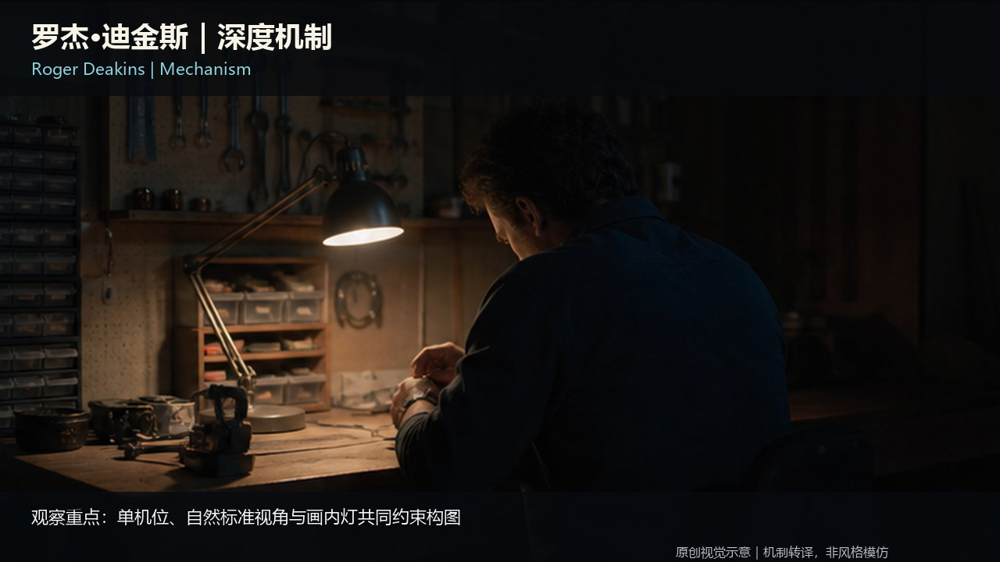

知识讲解：[A2-05 导演与摄影指导风格](../../knowledge/A-%E7%90%86%E8%AE%BA%E5%B1%82/A2-%E5%AF%BC%E6%BC%94%E7%BB%84/A2-05%20%E5%AF%BC%E6%BC%94%E4%B8%8E%E6%91%84%E5%BD%B1%E6%8C%87%E5%AF%BC%E9%A3%8E%E6%A0%BC.md)

## 导演与摄影指导风格：二·2 艾曼努埃尔·卢贝兹基 Emmanuel Lubezki（摄影师/DP）（22-lubezki，原创教学示意）

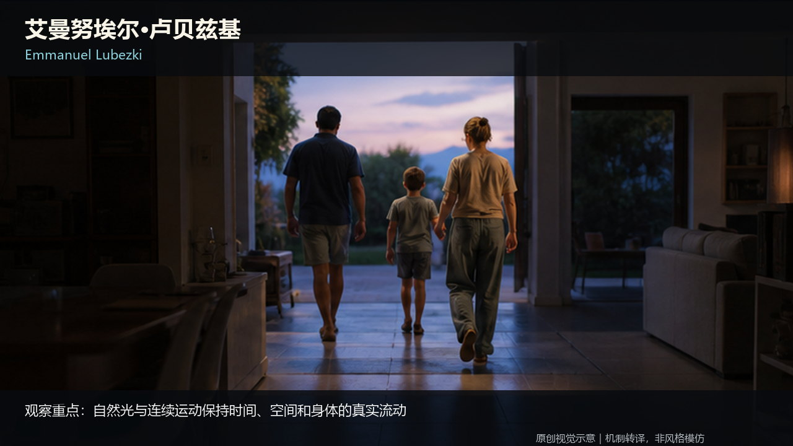

知识讲解：[A2-05 导演与摄影指导风格](../../knowledge/A-%E7%90%86%E8%AE%BA%E5%B1%82/A2-%E5%AF%BC%E6%BC%94%E7%BB%84/A2-05%20%E5%AF%BC%E6%BC%94%E4%B8%8E%E6%91%84%E5%BD%B1%E6%8C%87%E5%AF%BC%E9%A3%8E%E6%A0%BC.md)

## 导演与摄影指导风格：二·3 戈登·威利斯 Gordon Willis（摄影师/DP）（23-gordon-willis，原创教学示意）

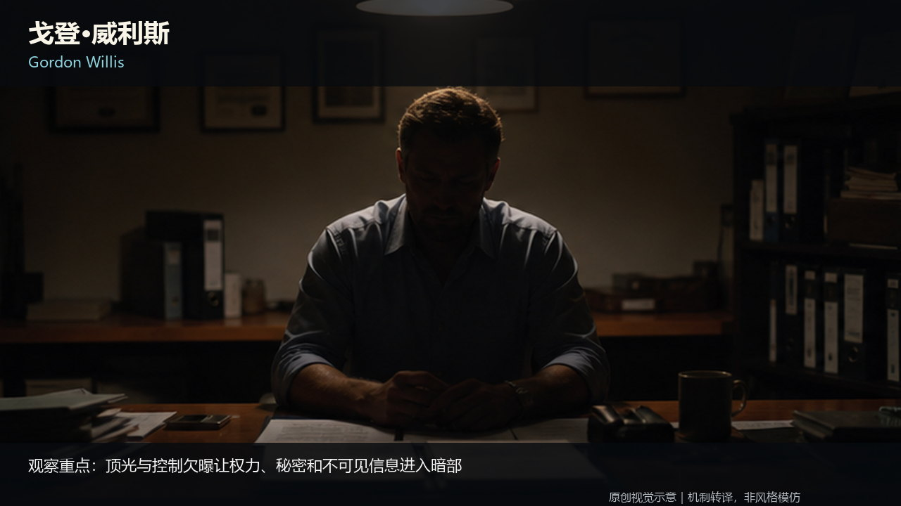

知识讲解：[A2-05 导演与摄影指导风格](../../knowledge/A-%E7%90%86%E8%AE%BA%E5%B1%82/A2-%E5%AF%BC%E6%BC%94%E7%BB%84/A2-05%20%E5%AF%BC%E6%BC%94%E4%B8%8E%E6%91%84%E5%BD%B1%E6%8C%87%E5%AF%BC%E9%A3%8E%E6%A0%BC.md)

## 导演与摄影指导风格：二·4 维托里奥·斯托拉罗 Vittorio Storaro（摄影师/DP）（24-storaro，原创教学示意）

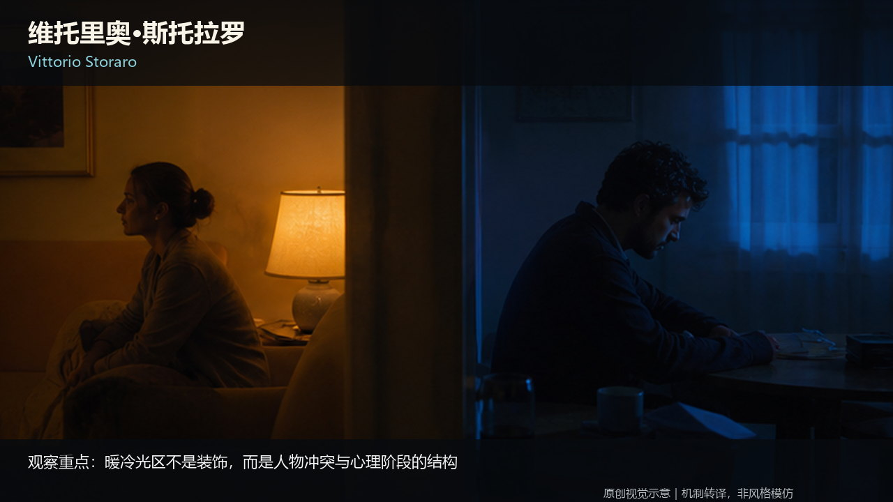

知识讲解：[A2-05 导演与摄影指导风格](../../knowledge/A-%E7%90%86%E8%AE%BA%E5%B1%82/A2-%E5%AF%BC%E6%BC%94%E7%BB%84/A2-05%20%E5%AF%BC%E6%BC%94%E4%B8%8E%E6%91%84%E5%BD%B1%E6%8C%87%E5%AF%BC%E9%A3%8E%E6%A0%BC.md)
