# style-mechanisms · 25—35

[全部主题](../IMAGE_GALLERY.md) · [首页](../../README.md)

## 导演与摄影指导风格：二·5 克里斯托弗·诺兰 Christopher Nolan（导演）+ 霍伊特·范·霍伊特马 Hoyte van Hoytema（DP）（25-nolan-hoytema，原创教学示意）

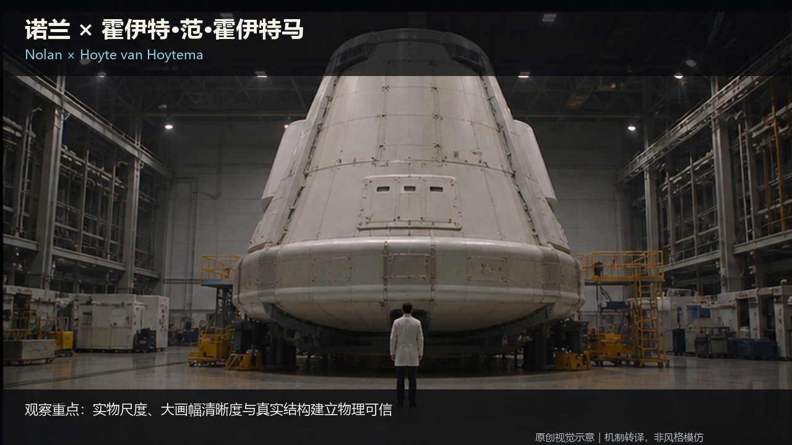

知识讲解：[A2-05 导演与摄影指导风格](../../knowledge/A-%E7%90%86%E8%AE%BA%E5%B1%82/A2-%E5%AF%BC%E6%BC%94%E7%BB%84/A2-05%20%E5%AF%BC%E6%BC%94%E4%B8%8E%E6%91%84%E5%BD%B1%E6%8C%87%E5%AF%BC%E9%A3%8E%E6%A0%BC.md)

## 导演与摄影指导风格：二·6 丹尼斯·维伦纽瓦 Denis Villeneuve（导演）+ 罗杰·迪金斯 / 格雷格·弗雷泽（DP）（26-villeneuve-dp，原创教学示意）

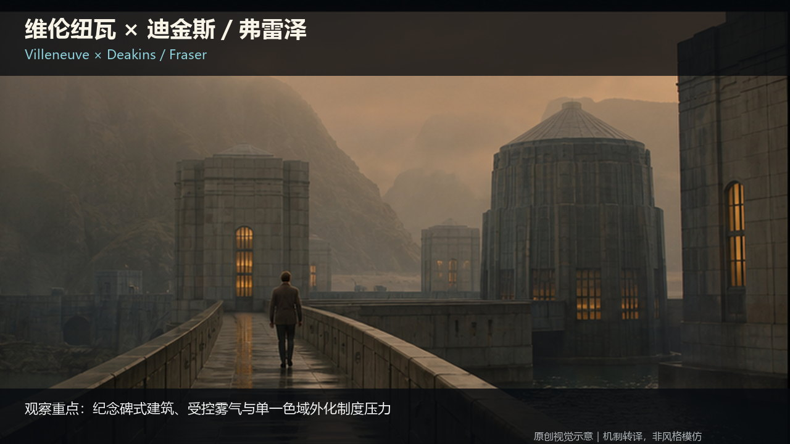

知识讲解：[A2-05 导演与摄影指导风格](../../knowledge/A-%E7%90%86%E8%AE%BA%E5%B1%82/A2-%E5%AF%BC%E6%BC%94%E7%BB%84/A2-05%20%E5%AF%BC%E6%BC%94%E4%B8%8E%E6%91%84%E5%BD%B1%E6%8C%87%E5%AF%BC%E9%A3%8E%E6%A0%BC.md)

## 导演与摄影指导风格：二·7 韦斯·安德森 Wes Anderson（导演）+ 罗伯特·约曼 Robert Yeoman（DP）（27-anderson-yeoman，原创教学示意）

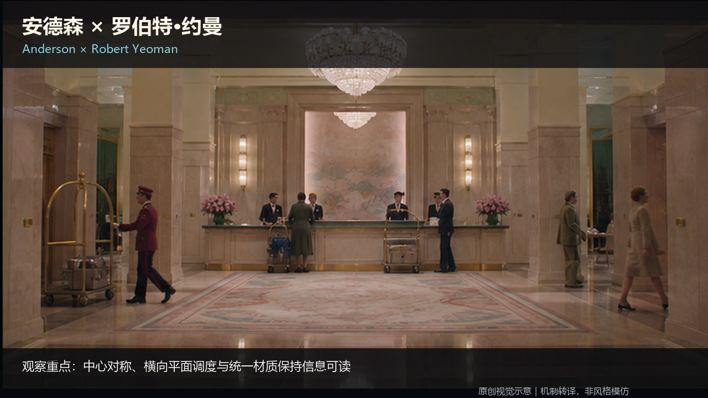

知识讲解：[A2-05 导演与摄影指导风格](../../knowledge/A-%E7%90%86%E8%AE%BA%E5%B1%82/A2-%E5%AF%BC%E6%BC%94%E7%BB%84/A2-05%20%E5%AF%BC%E6%BC%94%E4%B8%8E%E6%91%84%E5%BD%B1%E6%8C%87%E5%AF%BC%E9%A3%8E%E6%A0%BC.md) · [A2-07 电影视觉风格坐标系与术语总纲](../../knowledge/A-%E7%90%86%E8%AE%BA%E5%B1%82/A2-%E5%AF%BC%E6%BC%94%E7%BB%84/A2-07%20%E7%94%B5%E5%BD%B1%E8%A7%86%E8%A7%89%E9%A3%8E%E6%A0%BC%E5%9D%90%E6%A0%87%E7%B3%BB%E4%B8%8E%E6%9C%AF%E8%AF%AD%E6%80%BB%E7%BA%B2.md)

## 导演与摄影指导风格：二·8 斯坦利·库布里克 Stanley Kubrick（导演，多兼任视觉设计）（28-kubrick-deep，原创教学示意）

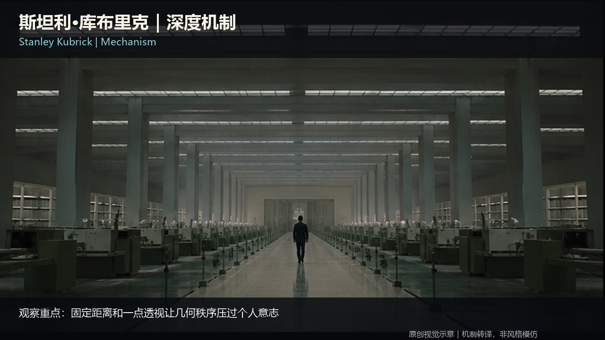

知识讲解：[A2-05 导演与摄影指导风格](../../knowledge/A-%E7%90%86%E8%AE%BA%E5%B1%82/A2-%E5%AF%BC%E6%BC%94%E7%BB%84/A2-05%20%E5%AF%BC%E6%BC%94%E4%B8%8E%E6%91%84%E5%BD%B1%E6%8C%87%E5%AF%BC%E9%A3%8E%E6%A0%BC.md)

## 导演与摄影指导风格：二·9 大卫·芬奇 David Fincher（导演）+ 杰夫·克罗嫩韦斯 Jeff Cronenweth（DP）（29-fincher-cronenweth，原创教学示意）

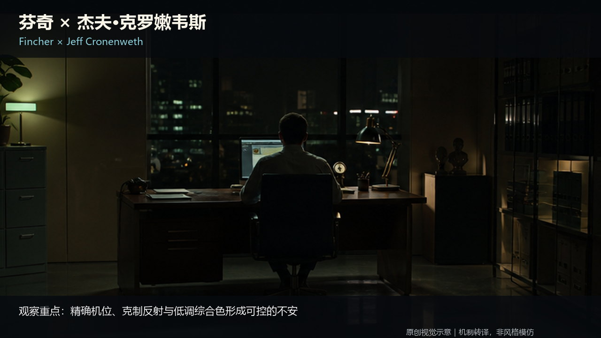

知识讲解：[A2-05 导演与摄影指导风格](../../knowledge/A-%E7%90%86%E8%AE%BA%E5%B1%82/A2-%E5%AF%BC%E6%BC%94%E7%BB%84/A2-05%20%E5%AF%BC%E6%BC%94%E4%B8%8E%E6%91%84%E5%BD%B1%E6%8C%87%E5%AF%BC%E9%A3%8E%E6%A0%BC.md)

## 导演与摄影指导风格：二·10 奉俊昊 Bong Joon-ho（导演）+ 洪京表 Hong Kyung-pyo（DP）（30-bong-hong，原创教学示意）

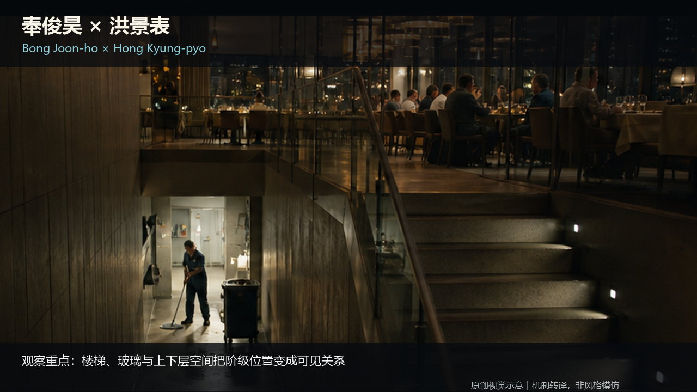

知识讲解：[A2-05 导演与摄影指导风格](../../knowledge/A-%E7%90%86%E8%AE%BA%E5%B1%82/A2-%E5%AF%BC%E6%BC%94%E7%BB%84/A2-05%20%E5%AF%BC%E6%BC%94%E4%B8%8E%E6%91%84%E5%BD%B1%E6%8C%87%E5%AF%BC%E9%A3%8E%E6%A0%BC.md)

## 导演与摄影指导风格：二·11 雷德利·斯科特 Ridley Scott（导演，美术/视觉主导）（31-ridley-deep，原创教学示意）

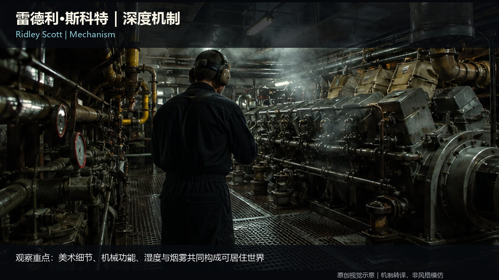

知识讲解：[A2-05 导演与摄影指导风格](../../knowledge/A-%E7%90%86%E8%AE%BA%E5%B1%82/A2-%E5%AF%BC%E6%BC%94%E7%BB%84/A2-05%20%E5%AF%BC%E6%BC%94%E4%B8%8E%E6%91%84%E5%BD%B1%E6%8C%87%E5%AF%BC%E9%A3%8E%E6%A0%BC.md)

## 导演与摄影指导风格：二·12 史蒂文·斯皮尔伯格 Steven Spielberg（导演）（32-spielberg-deep，原创教学示意）

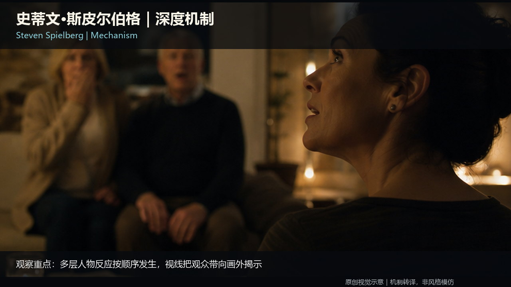

知识讲解：[A2-05 导演与摄影指导风格](../../knowledge/A-%E7%90%86%E8%AE%BA%E5%B1%82/A2-%E5%AF%BC%E6%BC%94%E7%BB%84/A2-05%20%E5%AF%BC%E6%BC%94%E4%B8%8E%E6%91%84%E5%BD%B1%E6%8C%87%E5%AF%BC%E9%A3%8E%E6%A0%BC.md)

## 导演与摄影指导风格：二·13 迈克尔·贝 Michael Bay（导演）（33-bay-deep，原创教学示意）

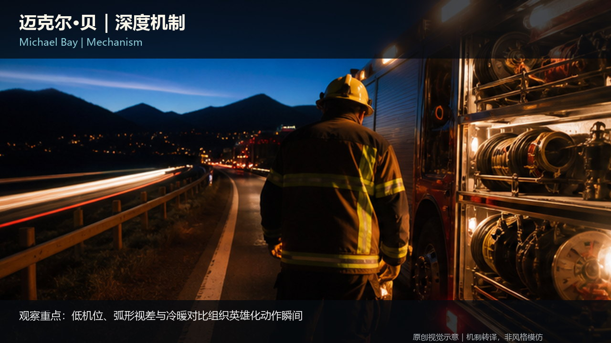

知识讲解：[A2-05 导演与摄影指导风格](../../knowledge/A-%E7%90%86%E8%AE%BA%E5%B1%82/A2-%E5%AF%BC%E6%BC%94%E7%BB%84/A2-05%20%E5%AF%BC%E6%BC%94%E4%B8%8E%E6%91%84%E5%BD%B1%E6%8C%87%E5%AF%BC%E9%A3%8E%E6%A0%BC.md)

## 导演与摄影指导风格：二·14 雅努什·卡明斯基 Janusz Kamiński（摄影师/DP）（34-kaminski，原创教学示意）

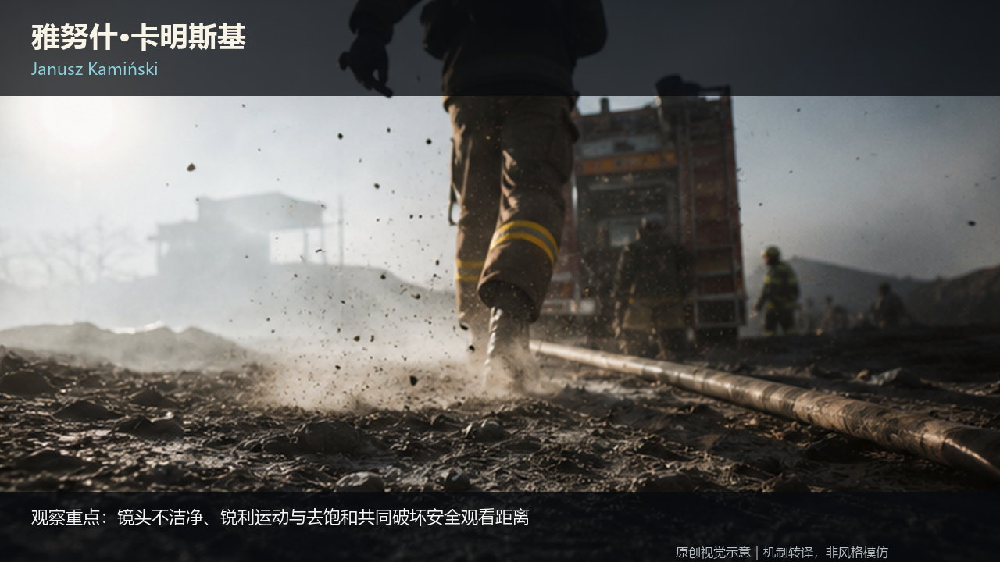

知识讲解：[A2-05 导演与摄影指导风格](../../knowledge/A-%E7%90%86%E8%AE%BA%E5%B1%82/A2-%E5%AF%BC%E6%BC%94%E7%BB%84/A2-05%20%E5%AF%BC%E6%BC%94%E4%B8%8E%E6%91%84%E5%BD%B1%E6%8C%87%E5%AF%BC%E9%A3%8E%E6%A0%BC.md)

## 导演与摄影指导风格：二·15 罗伯特·约曼 Robert Yeoman（摄影师/DP）（35-yeoman，原创教学示意）

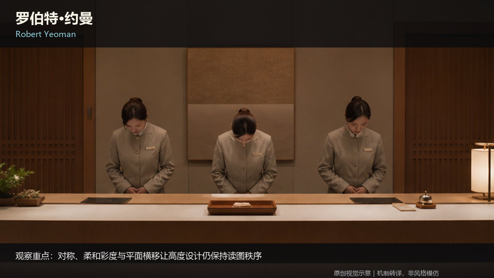

知识讲解：[A2-05 导演与摄影指导风格](../../knowledge/A-%E7%90%86%E8%AE%BA%E5%B1%82/A2-%E5%AF%BC%E6%BC%94%E7%BB%84/A2-05%20%E5%AF%BC%E6%BC%94%E4%B8%8E%E6%91%84%E5%BD%B1%E6%8C%87%E5%AF%BC%E9%A3%8E%E6%A0%BC.md)
