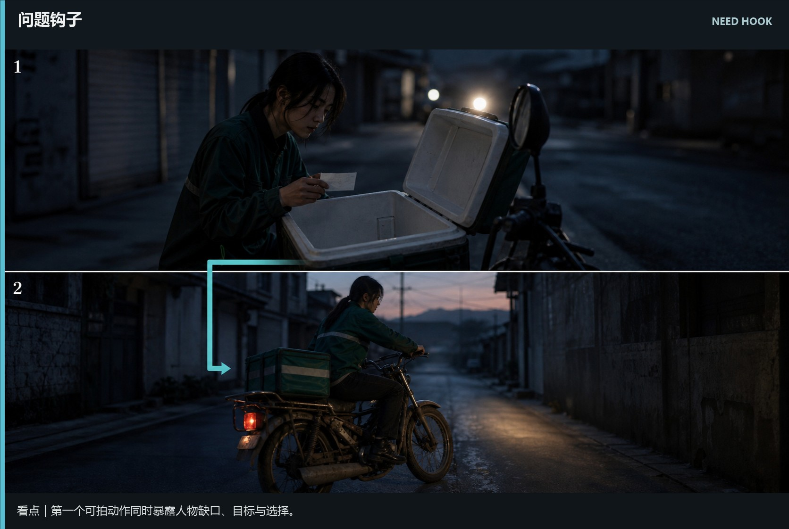
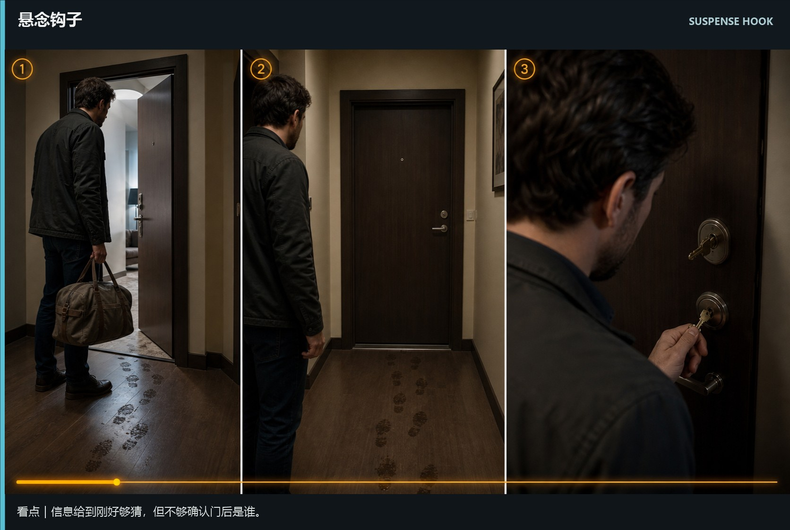
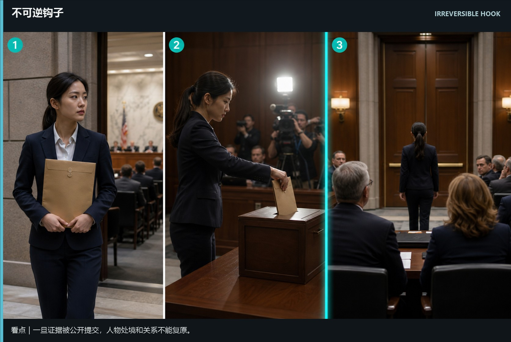
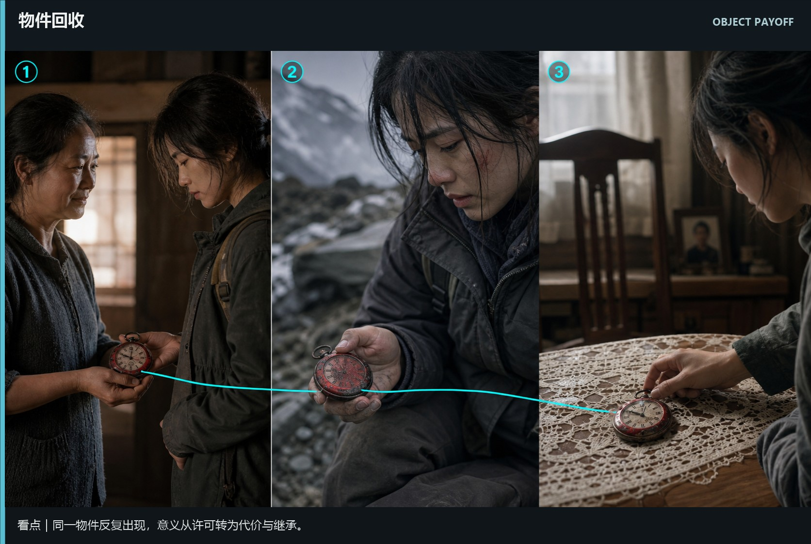
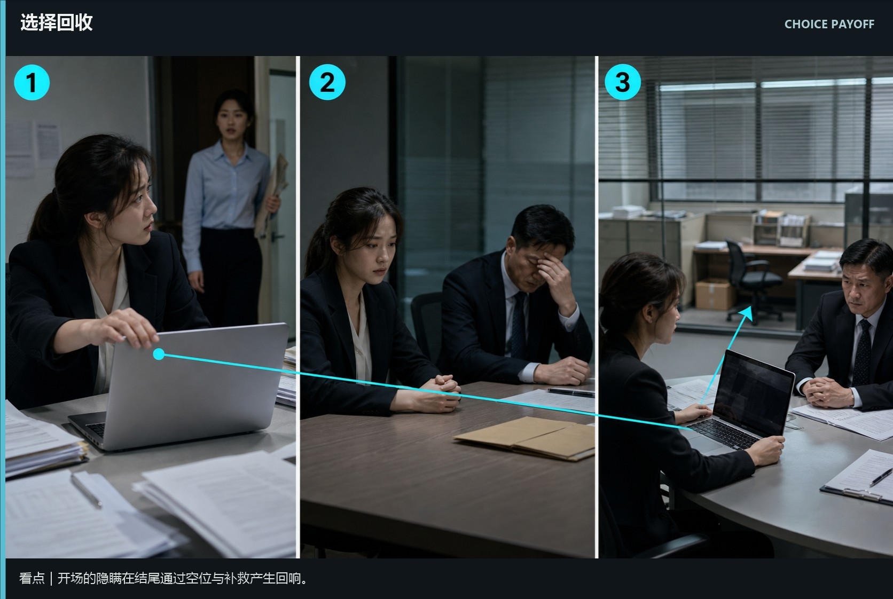
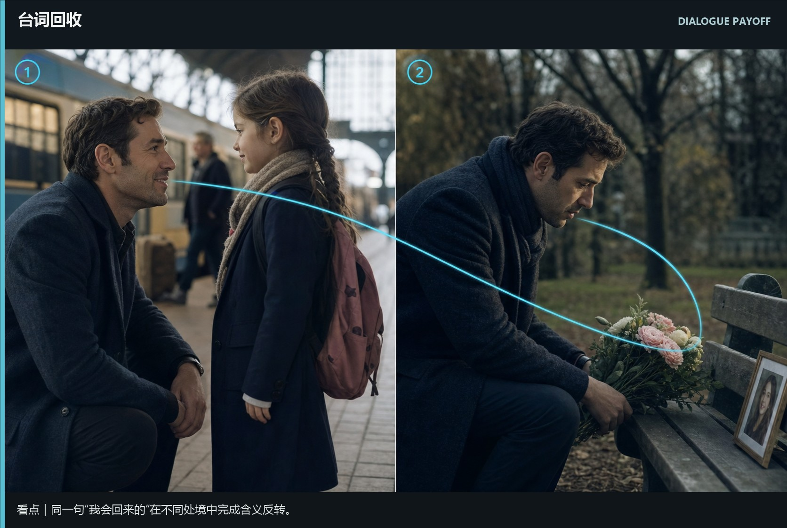
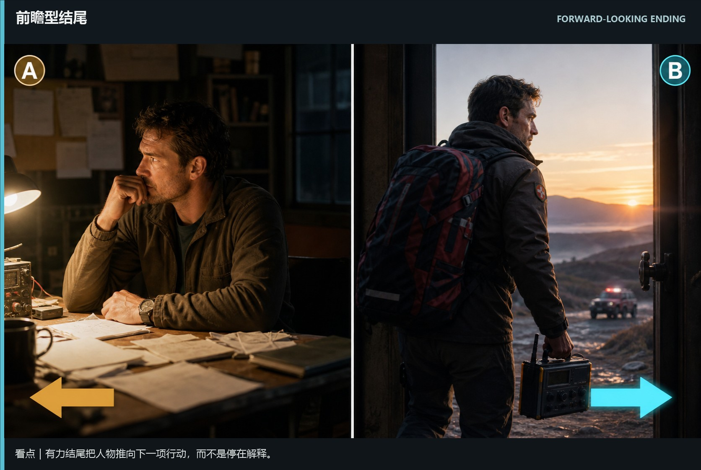

# writing-hooks-payoffs · 1—7

[全部主题](../IMAGE_GALLERY.md) · [首页](../../README.md)

## 开场钩子与结尾回收：问题钩子｜从缺口直接进入行动（01-need-hook，原创教学示意）

知识讲解：[A3-11 开场钩子与结尾回收](../../knowledge/A-%E7%90%86%E8%AE%BA%E5%B1%82/A3-%E7%BC%96%E5%89%A7%E7%BB%84/A3-11%20%E5%BC%80%E5%9C%BA%E9%92%A9%E5%AD%90%E4%B8%8E%E7%BB%93%E5%B0%BE%E5%9B%9E%E6%94%B6.md)

## 开场钩子与结尾回收：悬念钩子｜够猜但不能确认（02-suspense-hook，原创教学示意）

知识讲解：[A3-11 开场钩子与结尾回收](../../knowledge/A-%E7%90%86%E8%AE%BA%E5%B1%82/A3-%E7%BC%96%E5%89%A7%E7%BB%84/A3-11%20%E5%BC%80%E5%9C%BA%E9%92%A9%E5%AD%90%E4%B8%8E%E7%BB%93%E5%B0%BE%E5%9B%9E%E6%94%B6.md)

## 开场钩子与结尾回收：不可逆钩子｜事件发生后不能复原（03-irreversible-hook，原创教学示意）

知识讲解：[A3-11 开场钩子与结尾回收](../../knowledge/A-%E7%90%86%E8%AE%BA%E5%B1%82/A3-%E7%BC%96%E5%89%A7%E7%BB%84/A3-11%20%E5%BC%80%E5%9C%BA%E9%92%A9%E5%AD%90%E4%B8%8E%E7%BB%93%E5%B0%BE%E5%9B%9E%E6%94%B6.md)

## 开场钩子与结尾回收：物件回收｜同一物件，意义递进（04-object-payoff，原创教学示意）

知识讲解：[A3-11 开场钩子与结尾回收](../../knowledge/A-%E7%90%86%E8%AE%BA%E5%B1%82/A3-%E7%BC%96%E5%89%A7%E7%BB%84/A3-11%20%E5%BC%80%E5%9C%BA%E9%92%A9%E5%AD%90%E4%B8%8E%E7%BB%93%E5%B0%BE%E5%9B%9E%E6%94%B6.md)

## 开场钩子与结尾回收：选择回收｜早期选择产生后果（05-choice-payoff，原创教学示意）

知识讲解：[A3-11 开场钩子与结尾回收](../../knowledge/A-%E7%90%86%E8%AE%BA%E5%B1%82/A3-%E7%BC%96%E5%89%A7%E7%BB%84/A3-11%20%E5%BC%80%E5%9C%BA%E9%92%A9%E5%AD%90%E4%B8%8E%E7%BB%93%E5%B0%BE%E5%9B%9E%E6%94%B6.md)

## 开场钩子与结尾回收：台词回收｜相同话语，含义反转（06-dialogue-payoff，原创教学示意）

知识讲解：[A3-11 开场钩子与结尾回收](../../knowledge/A-%E7%90%86%E8%AE%BA%E5%B1%82/A3-%E7%BC%96%E5%89%A7%E7%BB%84/A3-11%20%E5%BC%80%E5%9C%BA%E9%92%A9%E5%AD%90%E4%B8%8E%E7%BB%93%E5%B0%BE%E5%9B%9E%E6%94%B6.md)

## 开场钩子与结尾回收：前瞻型结尾｜把人物推向下一项行动（07-forward-looking-ending，原创教学示意）

知识讲解：[A3-11 开场钩子与结尾回收](../../knowledge/A-%E7%90%86%E8%AE%BA%E5%B1%82/A3-%E7%BC%96%E5%89%A7%E7%BB%84/A3-11%20%E5%BC%80%E5%9C%BA%E9%92%A9%E5%AD%90%E4%B8%8E%E7%BB%93%E5%B0%BE%E5%9B%9E%E6%94%B6.md)
