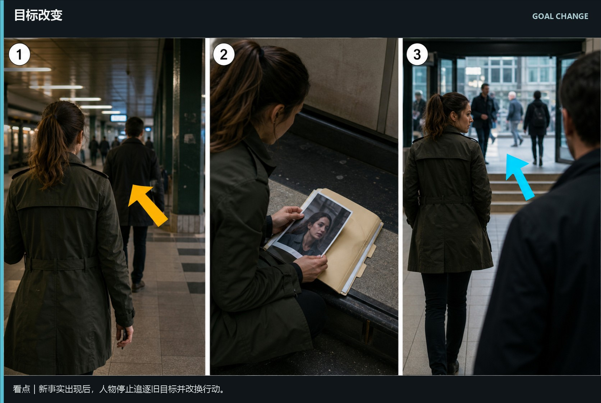
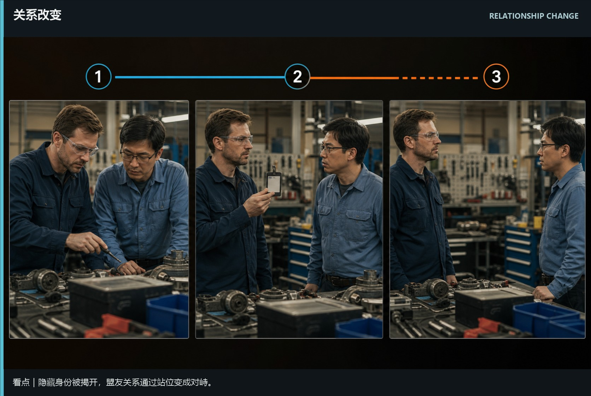
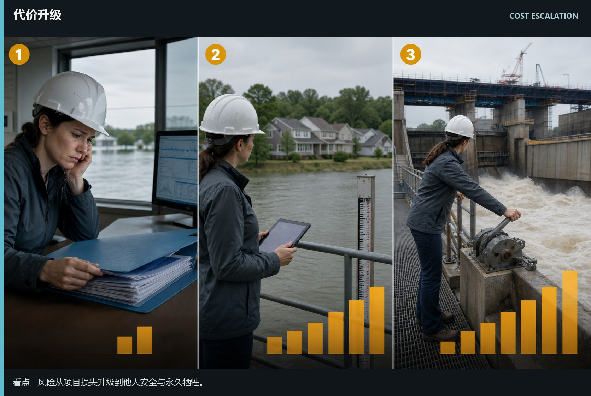
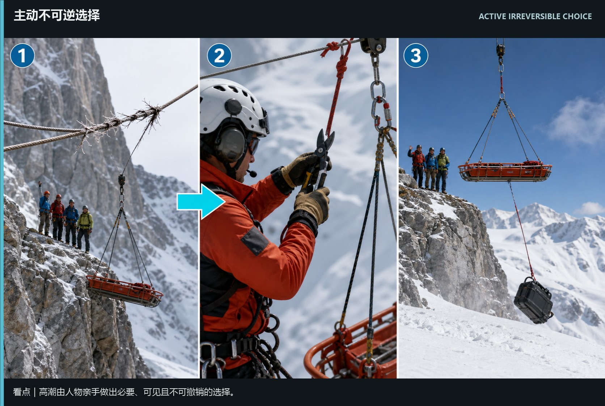
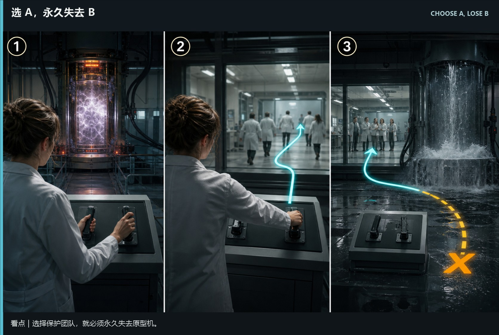
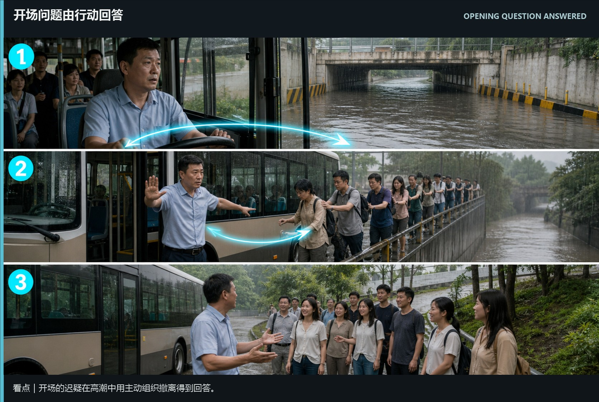
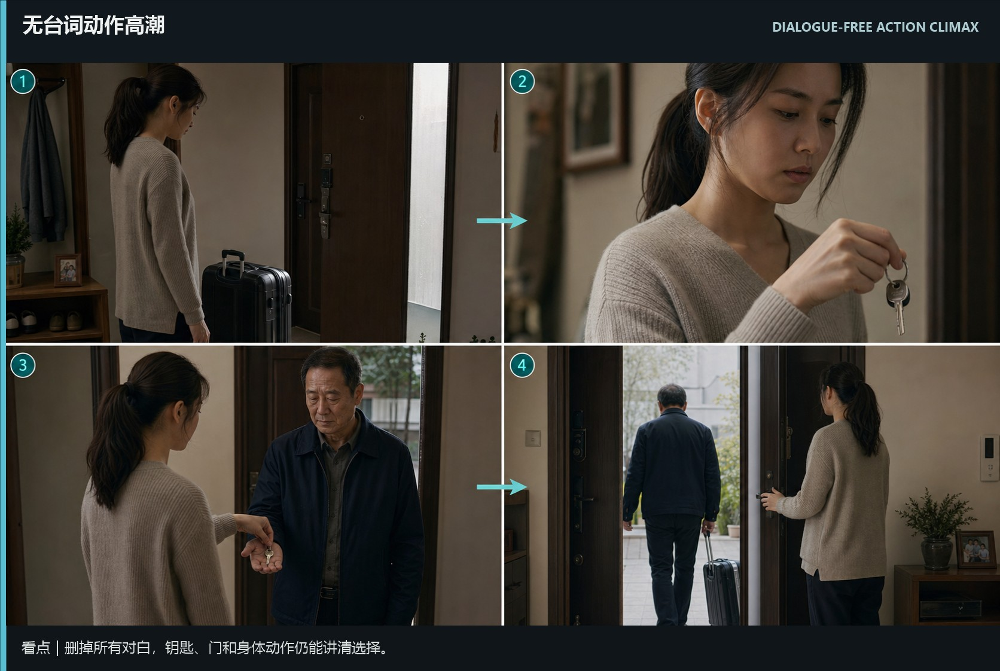

# writing-turns-climax · 1—7

[全部主题](../IMAGE_GALLERY.md) · [首页](../../README.md)

## 转折与高潮设计：目标改变｜停止旧追逐，改换行动（01-goal-change，原创教学示意）

知识讲解：[A3-12 转折与高潮设计](../../knowledge/A-%E7%90%86%E8%AE%BA%E5%B1%82/A3-%E7%BC%96%E5%89%A7%E7%BB%84/A3-12%20%E8%BD%AC%E6%8A%98%E4%B8%8E%E9%AB%98%E6%BD%AE%E8%AE%BE%E8%AE%A1.md)

## 转折与高潮设计：关系改变｜盟友站位变成对峙（02-relationship-change，原创教学示意）

知识讲解：[A3-12 转折与高潮设计](../../knowledge/A-%E7%90%86%E8%AE%BA%E5%B1%82/A3-%E7%BC%96%E5%89%A7%E7%BB%84/A3-12%20%E8%BD%AC%E6%8A%98%E4%B8%8E%E9%AB%98%E6%BD%AE%E8%AE%BE%E8%AE%A1.md)

## 转折与高潮设计：代价升级｜损失从项目推到人和永久牺牲（03-cost-escalation，原创教学示意）

知识讲解：[A3-12 转折与高潮设计](../../knowledge/A-%E7%90%86%E8%AE%BA%E5%B1%82/A3-%E7%BC%96%E5%89%A7%E7%BB%84/A3-12%20%E8%BD%AC%E6%8A%98%E4%B8%8E%E9%AB%98%E6%BD%AE%E8%AE%BE%E8%AE%A1.md)

## 转折与高潮设计：主动不可逆选择｜决定由人物亲手完成（04-active-irreversible-choice，原创教学示意）

知识讲解：[A3-12 转折与高潮设计](../../knowledge/A-%E7%90%86%E8%AE%BA%E5%B1%82/A3-%E7%BC%96%E5%89%A7%E7%BB%84/A3-12%20%E8%BD%AC%E6%8A%98%E4%B8%8E%E9%AB%98%E6%BD%AE%E8%AE%BE%E8%AE%A1.md)

## 转折与高潮设计：选 A，永久失去 B｜选择必须有代价（05-choose-a-lose-b，原创教学示意）

知识讲解：[A3-12 转折与高潮设计](../../knowledge/A-%E7%90%86%E8%AE%BA%E5%B1%82/A3-%E7%BC%96%E5%89%A7%E7%BB%84/A3-12%20%E8%BD%AC%E6%8A%98%E4%B8%8E%E9%AB%98%E6%BD%AE%E8%AE%BE%E8%AE%A1.md)

## 转折与高潮设计：开场问题由行动回答｜人物变化要能被看见（06-opening-question-answered，原创教学示意）

知识讲解：[A3-12 转折与高潮设计](../../knowledge/A-%E7%90%86%E8%AE%BA%E5%B1%82/A3-%E7%BC%96%E5%89%A7%E7%BB%84/A3-12%20%E8%BD%AC%E6%8A%98%E4%B8%8E%E9%AB%98%E6%BD%AE%E8%AE%BE%E8%AE%A1.md)

## 转折与高潮设计：无台词动作高潮｜只靠物件、身体和空间讲清选择（07-dialogue-free-action-climax，原创教学示意）

知识讲解：[A3-12 转折与高潮设计](../../knowledge/A-%E7%90%86%E8%AE%BA%E5%B1%82/A3-%E7%BC%96%E5%89%A7%E7%BB%84/A3-12%20%E8%BD%AC%E6%8A%98%E4%B8%8E%E9%AB%98%E6%BD%AE%E8%AE%BE%E8%AE%A1.md)
